# _天理教ポータル (Tenrikyo Comprehensive Master Portal)

> [!summary] 総合ポータル概要と研究指針
> 本ポータルは、天理教の原典聖典（『おふでさき』『おさしづ』『みかぐらうた』）、教祖中山みきと史実事件（教難・甘露台石没収・牢くぐり・天理研究会事件）、教理（陽気ぐらし・おさづけ）、分派・異端研究（ほんみち・ほんぶしん・太道教等）、親里神殿・都市計画、血脈家系図（中山家・主要幹部・高井家）、世界伝道網、および一次史料ConvMD群を極限まで深掘り・統合した**天理教研究の完全マスター研究ハブ**である。

---

## 1. 全研究領域の全体俯瞰（マスターアーキテクチャ）

```mermaid
graph TD
    M["<div style='color:#ffffff;'>_天理教ポータル (マスターハブ)</div>"] --> A1["<div style='color:#ffffff;'>【1. 原典・聖典研究】<br>おふでさき / おさしづ / みかぐらうた / 稿本教祖伝</div>"]
    M --> A2["<div style='color:#ffffff;'>【2. 歴史・受難・教難史】<br>甘露台石没収 / 牢くぐり / 教派神道独立 / 弾圧構造</div>"]
    M --> A3["<div style='color:#ffffff;'>【3. 教理・儀礼・医療福祉】<br>陽気ぐらし / おさづけ病気救済史 / 憩の家 / ひのきしん</div>"]
    M --> A4["【4. 建築・空間構造・宗教都市】<br>宗教都市天理 / 親里神殿 / おぢばがえり詰所群"]
    M --> A5["<div style='color:#ffffff;'>【5. 血脈・重臣家系図】<br>中山家系図 / 主要幹部家系図 / 高井家系図</div>"]
    M --> A6["<div style='color:#ffffff;'>【6. 海外拠点・世界伝道網】<br>5大州伝道庁 (LA/ハワイ/ブラジル/台湾/パリ) / おぢば遥拝</div>"]
    M --> A7["<div style='color:#ffffff;'>【7. 分派・異端研究 (全拠点)】<br>_分派・異端研究ポータル / ほんみち / ほんぶしん等</div>"]
    M --> A8["<div style='color:#ffffff;'>【8. 一次史料 ConvMD アーカイブ】<br>原文史料 / 警察秘密達 / 不敬罪裁判記録 / 研究ノート</div>"]
    
    style M fill:#1f2937,stroke:#4b5563,color:#fff
    style A1 fill:#1e40af,stroke:#2563eb,color:#fff
    style A2 fill:#991b1b,stroke:#dc2626,color:#fff
    style A3 fill:#059669,stroke:#10b981,color:#fff
    style A4 fill:#d97706,stroke:#f59e0b,color:#fff
    style A5 fill:#065f46,stroke:#059669,color:#fff
    style A6 fill:#374151,stroke:#6b7280,color:#fff
    style A7 fill:#7f1d1d,stroke:#991b1b,color:#fff
    style A8 fill:#4b5563,stroke:#9ca3af,color:#fff
```

---

## 2. カテゴリー別専門ノート全一覧

### 2-1. 【1. 原典・最極聖典研究】
- [[おふでさき]]：教祖中山みき自筆の1,711首の核心歌聖典。親神の意句、甘露台の理、世界たすけの原典ノート。
- [[おさしづ]]：本席・飯降伊蔵を通して下された神託刻限録。正統本部の統制と分派派生の根拠テキスト。
- [[みかぐらうた]]：教祖作詞・作曲のかぐらつとめ唱歌聖典。正統おつとめと分派独自歌詞の比較解剖。
- [[稿本天理教教祖伝]]：天理教教会本部編纂による公式伝記テキスト。

---

### 2-2. 【2. 歴史・教難・事件・受難史】
- [[明治15年甘露台石没収事件]]：1882年警察によるお屋敷襲撃・甘露台石強制押収事件。物理的木柱・「神の理」への転換点。
- [[明治の教難と教祖牢くぐり]]：教祖中山みき12回に及ぶ警察拘留・受難史と櫟本分署跡。
- [[明治の教難と教派神道独立]]：1888年神道天理教会設立の公認運動と国家適応史。
- [[天理研究会事件]]：昭和3年・13年の二度にわたるほんみち（不敬罪・治安維持法）弾圧事件裁判史実。
- [[革新天理教運動と昭和の教義論争]]：昭和初期の教義改変論争と復元運動。
- [[天理教弾圧の構造と歴史要因]]：大日本帝国による弾圧の5大根本要因（国体論・手かざし・家制度等）解剖。
- [[櫟本分署跡保存会]]：旧櫟本警察分署跡地（教祖拘留現場）の独立保全運動。

---

### 2-3. 【3. 教理・救済儀礼・医療・社会福祉】
- [[天理教のおたすけ・おさづけと近代病気救済史]]：「息の理・手かざし」によるおさづけの構造と近代医学行政との衝突、手かざし系新宗教への流出史。
- [[陽気ぐらしと天理教の社会福祉・医療]]：天理よろづ相談所病院「憩の家」（全人医療）、ひのきしん、災保隊、里親運動と陽気ぐらしの実践ノート。

---

### 2-4. 【4. 建築・空間構造・宗教都市】
- [[宗教都市天理の誕生と神殿建築]]：日本唯一の宗教名自治体「天理市」の誕生史と親里神殿の四方礼拝・千畳敷・八波営繕構造。
- [[おぢばがえりと親里詰所建築群]]：年間数百万人が帰還する巡礼儀礼「おぢばがえり」と親里を埋め尽くす大教会詰所網の建築社会学。

---

### 2-5. 【5. 血脈・家系図データベース】
- [[中山家系図]]：教祖中山みきから四代真柱・中山善司に至る直系血脈・真柱継承とほんみち等による「血脈批判」の解剖ノート。
- [[天理教主要幹部家系図]]：飯降家（本席）、辻家、梶本家、増井家、諸井家（麹町）、幡矢家（愛町）等、重臣家系の系譜データベース。
- [[高井家系図]]：明治の教難期に教祖を護衛し親里・初期本部を支えた最側近重臣「高井家（高井猶吉・高井駒造）」の系譜ノート。

---

### 2-6. 【6. 海外拠点・甘露台・世界伝道網】
- [[天理教の海外拠点と世界伝道網]]：5大州（アメリカLA、ハワイ、ブラジル・バウルー、台湾台北、フランス・パリ等）の主要海外伝道庁およびおぢば遥拝構造データベース。
- [[奈良以外の甘露台と異端甘露台一覧]]：奈良親里おぢば以外の全国・海外（ほんみち、ほんぶしん、太道教、愛町、海外遥拝所）の甘露台網羅データベース。
- [[関東の甘露台と奉斎拠点一覧]]：首都圏（東京足立・板橋宝場、太道教阿佐ヶ谷拝殿、ほんぶしん関東精舎、麹町大教会おぢば遥拝所、ほんみち関東出張所）の甘露台奉斎拠点データベース。
- [[ほんみち全国宝場と詳細交通アクセス案内]]：ほんみち大阪高石本部神殿、泉南支部＆ほんみち神拝殿、千葉野田関東出張所、十津川拠点、全国宝場網の解剖ノート。
- [[ほんみちの隠れ拠点と宝場構造]]：無看板・一般住宅擬態「宝場」の防衛構造。
- [[関東の甘露台]]：関東地方における甘露台奉斎・遥拝構造。

---

### 2-7. 【7. 分派・異端研究領域】
- [[_分派・異端研究ポータル]]：分派・異端研究全般の中央ポータルハブ。
- [[天理教の分裂の系譜]]：天理教100年の分裂メカニズム、3大要因（ダブル天啓、甘露台観、原典直解）の解剖。
- [[天理教分派・異端教団一覧]]：全10+分派教団の基本諸元、創始者、正統本部との差分、文化庁分類データベース。
- [[ほんみち]]：最大分派。「人間甘露台」解釈と無看板・隠れ宝場構造・不敬罪裁判史実。
- [[ほんぶしん]]：大西玉（みろく様）創始の二次分派。岡山吉備津神山屋外石造甘露台。
- [[太道教]]：中村しげ創始。東京都杉並区阿佐谷南（阿佐ヶ谷神修殿・阿佐ヶ谷猿田彦神社境内）。
- [[世界心道教]]：会田ヒデ創始。愛知県豊川市本部。
- [[天理三輪講]] / [[天理神之打開場所]] / [[おうかんみち]] / [[世界心霊教]] / [[八楽会教団]] / 神修教 / [[東京・関東周辺の天理教系分派]]
- [[大西愛治郎]] / [[大西玉]] / [[関根豊松]] / [[八島英雄]] / [[中山みき]] / [[中山正善]]

---

### 2-8. 【8. 一次史料アーカイブ (ConvMD)】
- src_ofudesaki_select：『おふでさき』核心歌抜粋史料MD
- src_osashizu_select：『おさしづ』核心刻限のおさしづ史料MD
- src_doroumi_hajime：ほんみち『泥海初め』『神誡』不敬罪裁判史料MD
- src_meiji19_himetsutatsu：明治19年奈良県警察『秘密達第12号』史料MD
- src_yashima_ichinomoto：八島英雄『中山みき研究ノート』史料MD
- src_kakushin_tenri：機関誌『革新天理』宣言文史料MD

---

## 3. 本部所在地および総合アクセス案内

- **本部施設名**: 天理教教会本部（親里神殿）
- **所在地**: 〒632-8686 奈良県天理市三島町271
- **電話番号**: 0743-63-1511（代表）
- **最寄り駅・電車**: JR桜井線（万葉まほろば線）・近鉄天理線「天理駅」徒歩15分
- **自動車アクセス**: 名阪国道「天理IC」より約10分（無料駐車場多数完備）

---

## 4. 研究規範・検証留保事項

> [!important] 研究の客観性と一次情報主義
> - 本ポータルおよび傘下の全専門ノートは、客観的一次史料、警察・司法省裁判記録、および宗教学・歴史社会学文献に基づいて作成されている。
> - 一次情報で確認できない曖昧な推測や俗説は排除し、「未確認」「教団非公表」として厳格に表記している。

---

*※本ノートは Vault `tenri` の最上位マスターポータルハブである。*
