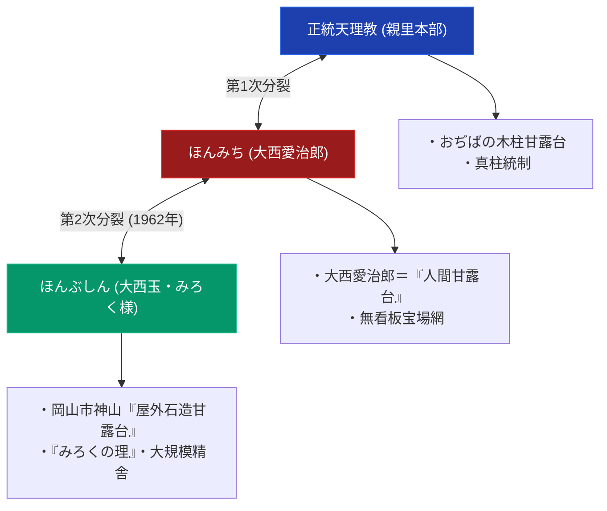

# ほんぶしん 極限深掘り専門構造分析ノート

> [!summary] 要旨
> 本稿は、ほんみち創始者[[大西愛治郎]]の次女・[[大西玉]]（みろく様、1916-1969）によって1962年にほんみちから派生・独立した二次分派「ほんぶしん」について、その核心教理（「みろくの理」）、岡山県岡山市東区神崎町1の「ほんぶしん本部・神山精舎」（公式サイト：`https://www.honbushin.jp/`）に建造された屋外石造「甘露台」の宗教建築解剖、およびほんみち・天理教本部との三者対比を多角解剖した専門分析ノートである。

---

## 1. 命題の構造（通説・正統本部 vs 本教団・自説）

教団側の自己位置づけ（Wikipedia「ほんぶしん」による）では、天理教は教えや精神を道理的に解釈した「雛形」、ほんみちは本家ができるまでの暫定的な組織である「仮屋」だとしている。これは教団の自説であり、史実としての優劣を示すものではない。

### 1-1. 教団基本諸元比較表

| 比較軸 | 正統天理教 | ほんみち | ほんぶしん |
| :--- | :--- | :--- | :--- |
| **創始者** | 中山みき（教祖） | 大西愛治郎 | 大西玉（みろく様） |
| **創始年** | 1838年（天保9年） | 1913年 / 1925年立教 | 1962年（昭和37年） |
| **甘露台の実体** | 奈良親里の木柱 | 人間甘露台（愛治郎自身） | **岡山市神山の屋外石造甘露台** |
| **本部所在地** | 奈良県天理市三島町 | 大阪府高石市羽衣3-1-72 | **岡山県岡山市東区神崎町1** |
| **公式サイトURL** | `tenrikyo.or.jp` | **非公表** | **https://www.honbushin.jp/** |
| **Google Maps座標** | 34.5985, 135.8350 | 34.5367, 135.4371 | **34.6309, 134.0593** |

（座標はいずれも未検証。12節参照）

---

## 2. 基本情報

| 項目 | 内容・分析データ |
| :--- | :--- |
| **教団正式名称** | 宗教法人ほんぶしん（旧称・通称：本ぶしん） |
| **創始者・指導者** | [[大西玉]]（尊称：みろく様） |
| **立教・創始年** | 1962年（昭和37年）ほんみちより独立 |
| **教団公式サイトURL** | [https://www.honbushin.jp/](https://www.honbushin.jp/) |
| **本部所在地** | 〒704-8138 岡山県岡山市東区神崎町1（ほんぶしん本部・神山精舎） |
| **Google Maps座標** | 北緯 34.6309, 東経 134.0593（未検証） |
| **アクセス** | JR赤穂線「西大寺駅」よりバス・タクシー約15分（未検証） |
| **核心象徴** | 神山の屋外石造「甘露台」（Wikipediaは「六角形の石塔」とする。形状の詳細は未検証） |
| **信者数** | 未確認（「90万人」とする資料の存在がWikipediaで言及されるが、教団公表値・公的統計での確認はできていない） |
| **法人番号** | 未確認 |

---

## 3. 創始者と天啓・社伝

### 3-1. 大西玉（みろく様）の受覚とほんぶしん立教
ほんみち創始者・大西愛治郎の次女である大西玉（1916-1969）は、1961年にほんみち内部で「天理みろく会」を発足させ、1962年1月にほんみちより独立して「ほんぶしん」を名乗った。1969年9月1日の死去後は遺言により**武田宗真**が後継者となった。ほんぶしんでは大西玉を中山みき（天理教教祖）の再生「天啓者・みろく」、武田宗真を「天啓者・甘露台」と呼んで信奉している。

---

## 4. 沿革・歴史変遷

- **1961年**: ほんみち内部で「天理みろく会」として発足。
- **1962年1月 (昭和37年)**: ほんみちより独立し「ほんぶしん」を名乗る。当初は大阪府高石市に事務所（ほんみちと同所）。
- **1966年**: 宗教法人となる。
- その後、長野県塩尻市に移転。
- **1969年**: 岡山県岡山市に本部を移転。同年9月1日、大西玉死去、武田宗真が後継者に。
- **1978年**: 本部近くの西片岡に「神山」を建設し、六角形の石塔である「甘露台」を建立。
- **1982年**: 神山に隣接する墓苑「清浄苑」を建設。
- **1984年**: ハワイで信者集会、平和のメッセージを発信。
- **1988年**: 北京で信者2000人の集会。
- **1994年**: 清浄苑中央に石造の巨大な球体を持つ「再生殿」を建築。

---

## 5. 教理・儀礼・神観の深層解剖

### 5-1. 「みろくの理」と石造甘露台
教祖中山みきが着工しながら明治15年（1882年）に礎石を警察に没収され未完成に終わった石造の甘露台の型を、大西玉は「みろくの世界（平和な世界）の完成型」として岡山神山の地に復元したとされる（教団側の位置づけ）。神山に建立された甘露台について、Wikipediaは「六角形の石塔」と記述する。旧稿が用いた「十三段の実物復元」という性格づけは、今回照合した資料では確認できなかった（12節参照）。

### 5-2. 実践・活動（Wikipediaによる）
人間の想念と言動を改善させる内観的反省法「聞行」、悩みを解決させる「善導」、日常生活に積極的精神を植えつける「勇魂の言霊」などの活動があり、「ひのきしん」と呼ばれる労働奉仕も設けられている。塩尻市には宗派を限定しないワールド健康センターを設立し、健康食品の販売なども行うとされる。

---

## 6. 宗教学的・歴史社会学的意義

### 聖地移転と自然融合型巨大建築
天理（奈良）から高石（大阪）を経由し、岡山（神山）の地へ至る新聖地の形成。広大な日本庭園と巨石文化が融合した精舎空間は、戦後新宗教の聖地創出の代表例である。

---

## 7. 拠点・現地情報

### 7-1. ほんぶしん本部・神山精舎
- **所在地**: 〒704-8138 岡山県岡山市東区神崎町1
- **Google Maps座標**: **北緯 34.6309, 東経 134.0593**（[Google Maps](https://www.google.com/maps/search/?api=1&query=ほんぶしん本部)）（未検証）
- **アクセス**: JR赤穂線「西大寺駅」よりバス約15分（未検証）。

### 7-2. 全国・海外拠点（Wikipedia「ほんぶしん」の所在地一覧による）
- **神山**: 岡山県岡山市東区西片岡990
- **甘露の里 長野**: 〒399-0722 長野県塩尻市柿沢721番地
- **宝師ヶ苑**: 〒742-0301 山口県岩国市周東町祖生4240
- **京都支部**: 〒602-0805 京都市上京区寺町今出川上4西桜木403−6
- **ほんぶしん世界伝道本部**: 95-030 Waihonu Street, Mililani, Hawaii 96789 U.S.A.

---

## 8. 関連教団・関連人物・関連概念

### 関連教団
- [[天理教]]
- [[ほんみち]]

### 関連人物
- [[中山みき]]
- [[大西愛治郎]]
- [[大西玉]]
- 武田宗真（大西玉没後の後継者、「天啓者・甘露台」と呼ばれる。未作成・ノート化候補）

---

## 9. 史料・一次資料 (convMD)

- [[src_ほんぶしん_公式]] — 教団公式サイト（本部住所 〒704-8138 岡山県岡山市東区神崎町1番地を確認）
- [[src_ほんぶしん_Wikipedia]] — Wikipedia「ほんぶしん」（沿革・所在地一覧・教団の自己位置づけ）

（旧稿が参照していた `src_doroumi_hajime`（『泥海初め』史料）・`src_ofudesaki_select`（『おふでさき』抜粋）は、`資料/` フォルダ内に実在を確認できなかったため、本節から外した。12節参照）

---

## 10. 参考文献・学術論文

- Wikipedia「ほんぶしん」 https://ja.wikipedia.org/wiki/ほんぶしん
- 教団公式サイト https://www.honbushin.jp/
- 弓山達也『天啓のゆくえ—宗教が分派するとき』（日本地域社会研究所、2005年）
- 文化庁『宗教年鑑』（本ノートの数値の裏付けには未使用）

---

## 11. 関連ノート (Vault内)

- [[_分派・異端研究ポータル]]
- [[天理教分派・異端教団一覧]]
- [[ほんみち]]

---

## 12. 留保（中立的併記・未確定要素）

> [!warning] 留保事項
> - **訂正（続柄）**: 旧稿の要旨は大西玉を「長女」としていたが、Wikipedia「ほんぶしん」「大西玉」およびVault内関連ノート（[[ほんみち]]・[[大西玉]]・[[大西愛治郎]]）はいずれも「次女」であり、「次女」に訂正した。
> - **訂正（没年）**: 旧稿は frontmatter・要旨・本文で大西玉の生没年を「1916-1979」としながら、死去を「1969年9月1日」と併記する内部矛盾があった。Wikipedia「ほんぶしん」「大西玉」はともに1969年9月1日死去（大西玉記事は本部で心筋梗塞により死去とする）ため、生没年を「1916-1969」に統一した。「1979」は誤記と判断する。
> - **未検証**: (1) Google Maps座標（34.6309, 134.0593。1-1表の天理教・ほんみちの座標も含め未再検証）。(2) アクセス所要時間（西大寺駅からバス約15分）。地図サイトには最寄りを大富駅とする情報もあり、公式の交通案内での確認を要する。(3) 神山の石造甘露台の形状について、旧稿の「屋外十三段巨大石造甘露台」「実物大の復元」という記述は照合資料で確認できず、Wikipediaの「六角形の石塔」を採用した。「十三段」等の詳細は未検証。(4) 信者数（「90万人」説は出所不明の資料への言及のみ）。(5) 法人番号。(6) frontmatter の「事件_不祥事: true」は旧稿の分類を引き継いだもので、本ノート本文に対応する事件の記述はない（要確認）。
> - **出典の格付け**: 旧稿は所在地・沿革を「Wikipedia一次資料で裏付け済み」としていたが、Wikipediaは一次資料ではない。本部住所は教団公式サイトでも確認した。evidence_type を `primary_source_based` から `secondary_source_based` へ、confidence を `4` から `3` へ変更した（沿革の裏付けがWikipedia単独に依存する項目が多く、未検証項目が残るため）。

> [!note] 改訂記録（2026-11-15・全件照合）
> - **照合資料**: Wikipedia「ほんぶしん」「大西玉」（後者はパイロット保存分 [[src_大西玉_Wikipedia]]）、教団公式サイト。Wikipedia・公式サイトは convMD で `資料/` に保存した（[[src_ほんぶしん_Wikipedia]]、[[src_ほんぶしん_公式]]）。
> - **構造**: 旧構成（1節＝命題、2節＝基本諸元、3節＝創始者、4節＝沿革、5節＝教理、6-2節＝意義、7節＝拠点、8節＝関連、9節＝史料、10節＝参考文献、11節＝関連ノート、12節＝留保）を宗教版12セクションへ再編し、年表の時系列順序を整えた（1994年の後に置かれていた1984年・1988年を時系列位置へ移動）。Wikipediaで確認できた実践活動（聞行・善導・勇魂の言霊）と教団の自己位置づけ（雛形・仮屋）を、出典を明示して5-2節・1節に追記した。
> - **訂正**: 大西玉の続柄（長女→次女）・生没年（1916-1979→1916-1969）。詳細は上記留保参照。

---

*※本稿は[[_分派・異端研究ポータル]]のほんぶしん極限深掘り専門ノートである。*
