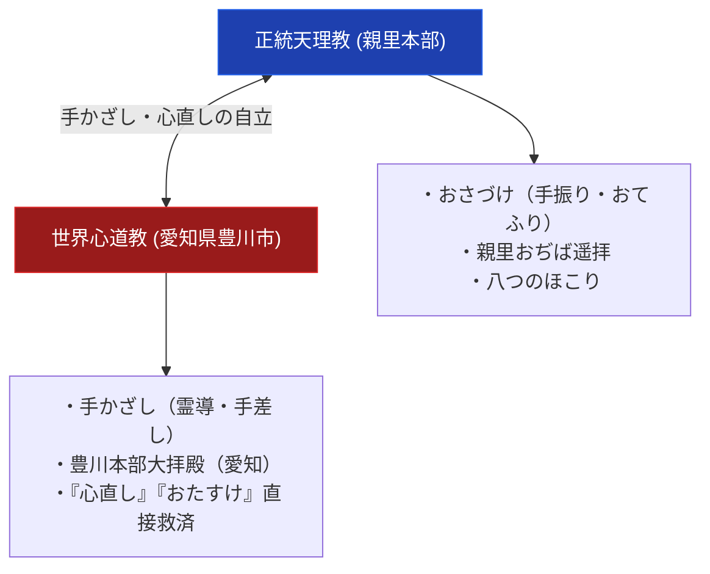

# 世界心道教 極限深掘り専門構造分析ノート

> [!summary] 決定版・超深掘り研究要旨
> 本稿は、天理教教師・ほんみち運動を経て、昭和13年（1938年）に「月読尊・国狭土尊（水火風の理）」の天啓を受けたと自覚した[[会田ヒデ]]（1898-1973）によって創始された天理教系分派教団「世界心道教」について、その創始の背景、おさづけの発展形（手かざし・心直し救済）、および豊川本部の神殿構造を解剖した専門分析ノートである。設立は1944年（東京・渋谷、「世界心道会」として）、本部の豊川移転は1946年、現在地（豊川市諏訪）への移転は1949年である。

---

## 1. 命題の構造（通説・正統本部 vs 本教団・自説）

### 1-1. 教団基本諸元比較表

| 比較軸 | 正統天理教 | 世界心道教 |
| :--- | :--- | :--- |
| **創始者** | 中山みき（教祖） | [[会田ヒデ]] |
| **創始年** | 1838年（天保9年） | 1938年（天啓覚醒） / 1944年設立（世界心道会） |
| **本部所在地** | 奈良県天理市三島町1-1 | 愛知県豊川市諏訪2丁目101番地 |
| **救済儀礼** | おさづけ（手振り・ておどり） | 「手かざし（手差し）」「心直し」 |
| **Google Maps座標** | 34.5985, 135.8350 | **34.8236, 137.3752** |

---

## 2. 基本情報

| 項目 | 内容・分析データ |
| :--- | :--- |
| **教団正式名称** | 宗教法人世界心道教（せかいしんどうきょう）。設立時（1944年）の名称は「世界心道会」 |
| **法人番号** | 5180305003618（国税庁法人番号公表サイトで確認、2026-11-15） |
| **法人化** | 1948年7月6日、宗教法人令による宗教法人として発足。1952年7月11日、宗教法人法による宗教法人として発足（Wikipedia「世界心道教」） |
| **創始者** | [[会田ヒデ]]（あいだ ひで、1898年9月30日-1973年5月24日） |
| **立教年** | 1938年3月13日、天啓覚醒 / 1944年11月3日、世界心道会を設立 |
| **本部所在地** | 〒442-0068 愛知県豊川市諏訪2丁目101番地（国税庁法人番号公表サイトの本店所在地と一致） |
| **Google Maps座標** | 北緯 34.8236, 東経 137.3752 |
| **アクセス** | 名鉄豊川線「諏訪町駅」徒歩約5-10分。豊鉄バス「心道教前」バス停 |
| **信者数** | 公称15万人（Wikipedia「世界心道教」、新日本宗教団体連合会の加盟団体紹介に基づく）／17,392人（文化庁『宗教年鑑』令和7年版第6表、印刷pp.60-61、令和6年12月31日現在。2026-11-16再検証で版・頁を特定） |
| **現教主** | 会田政美（ヒデの孫。1981年の会田和子死去後「教嗣」として最高指導者となり、2013年に「教主」へ呼称変更。Wikipedia「世界心道教」） |
| **教義特色** | 「心直し」「手かざし」による病気救済と誠の理の実践。祭神は「天地月日御親水火風之大神」 |

---

## 3. 創始者と天啓・社伝

### 3-1. 会田ヒデの霊験覚醒と立教
会田ヒデは1923年に天理教入信、1925年にほんみち（大西愛治郎）へ移り、1933年に天理三輪講へ移った（Wikipedia「世界心道教」）。1938年3月13日、大阪府西淀川区で月読之命・国狭土之命の2社が体に天下ったとして天啓者を自覚したとされる（教団側の伝承としての天啓自覚であり、史実としての検証対象ではない）。1942年12月23日にはさらに10社が天下ったとされる。1943年より東京都渋谷区大岡山で人助けを始め、1944年1月に渋谷へ移転、同年11月3日に「世界心道会」を設立した。詳細は[[会田ヒデ]]を参照。

ヒデの死後（1973年）、遺言により娘の会田和子が第2代教主となった。和子は療養のため一時入院し、その間、和子の娘（ヒデの孫）会田政美が教主を継承した。1977年に和子が教主に復したが、1981年に和子が死去した後は教主の位は空位となり、政美が「教嗣」を名乗り最高指導者となった（2013年、「教嗣」を「教主」と呼称変更）。

---

## 4. 沿革・歴史変遷

- **1923年**: 会田ヒデ、天理教入信。
- **1925年**: ほんみち（大西愛治郎）へ移る。
- **1933年**: 天理三輪講へ移る。
- **1938年3月13日**: 大阪府西淀川区で、月読之命・国狭土之命の2社が天下ったとして天啓者を自覚（教団伝承）。
- **1942年12月23日**: さらに10社が天下ったとされる（教団伝承）。
- **1943年**: 東京都渋谷区大岡山で人助けを開始。
- **1944年1月**: 東京・渋谷へ移転。
- **1944年11月3日**: 「世界心道会」を設立。
- **1946年3月**: 愛知県豊川市へ移転。
- **1948年7月6日**: 宗教法人令による宗教法人「世界心道教」として発足。
- **1949年**: 現在地（豊川市諏訪）へ本部を移転。
- **1952年7月11日**: 宗教法人法による宗教法人として発足。
- **1958年**: 財団法人新日本宗教団体連合会（新宗連）に加盟。
- **1967年10月**: 神殿と教祖殿が落成。
- **1973年**: 会田ヒデ死去。娘の会田和子が第2代教主となる。
- **1981年**: 会田和子死去。教学校制度が開始。
- **2013年**: 会田政美、「教嗣」から「教主」へ呼称変更。
- **現代**: 愛知県内を中心に、東京教務庁・東北教務支庁と全国の教会・支部を展開（2006年現在、51教会・58支部とWikipediaは記す）。

---

## 5. 教理・儀礼・神観の深層解剖

### 5-1. 「手かざし（手差し）」とおさづけの変容
天理教の「おさづけ」が持つ手振り的要素を、患部へ手をかざして神光を照射する「手かざし（手差し）」の儀礼へと発展。病気平癒と「心直し（埃の掃除）」を一体不可分とした。

### 5-2. 「道あけ」と心の改良
会田ヒデは中山みきの『おふでさき』『泥海古記』を独自に解釈し、1838年（天理教創始の年）から100年後に新たな者から天の指図が下されるようになると説いた（その「100年後」が自らの天啓の年であるとする教団側の解釈）。教義によれば、ヒデに神が天下った後は、拝むだけでは功徳を積んだことにならず、「道をあけねば」御利益は得られない。「道あけ」とは心の改良を行うことであり、身上（体の悩み）や事情（心の悩み）は人の心が天の心に反したために起こるもので、心の改良を行えば御利益が得られるとする。これを「心のしんせいふっこう」と呼ぶ（以上、Wikipedia「世界心道教」教義節）。

### 5-3. 祭神
「天地月日御親水火風之大神」を祀る（Wikipedia「世界心道教」）。

---

## 6. 宗教学的・歴史社会学的意義

### 6-1. 三世代天啓チェーンのモデル
弓山達也『天啓のゆくえ』における「中山みき ➔ 大西愛治郎 ➔ 会田ヒデ」という三世代連続天啓チェーンを実証する重要事例である。世界心道教の「手かざし救済」が昭和新宗教の手かざし系教団の先駆的モデルであるという評価は本ノートの分析的評価であり、その出典は未確認（§12参照）。

---

## 7. 拠点・現地情報

### 7-1. 世界心道教豊川本部
- **所在地**: 〒442-0068 愛知県豊川市諏訪2丁目101番地
- **Google Maps座標**: **北緯 34.8236, 東経 137.3752**（[Google Maps](https://www.google.com/maps/search/?api=1&query=世界心道教本部)）
- **アクセス**: 名鉄豊川線「諏訪町駅」徒歩約5-10分。豊鉄バス「心道教前」バス停。
- **施設**: 本殿、祖霊殿（正八角形の三重塔、教祖ヒデの位牌を祀る）、教祖殿（Wikipedia「世界心道教」）。

### 7-2. 東京教務庁・東北教務支庁
- **東京教務庁**: 〒146-0085 東京都大田区久が原6丁目8-7
- **東北教務支庁**: 〒984-0047 宮城県仙台市若林区木ノ下3丁目19-1
（以上、Wikipedia「世界心道教」アクセス節）

---

## 8. 関連教団・関連人物・関連概念

### 関連教団
- [[天理教]]
- [[ほんみち]]
- [[天理三輪講]]
- [[天理教分派・異端教団一覧]]

### 関連人物
- [[中山みき]]
- [[大西愛治郎]]
- [[会田ヒデ]]

---

## 9. 史料・一次資料 (convMD)

- [[src_世界心道教_Wikipedia]] — Wikipedia「世界心道教」（新宗連公式・豊川市資料等を出典とする）
- [[src_世界心道教_国税庁法人番号]] — 国税庁法人番号公表サイト「世界心道教の情報」（法人番号5180305003618、本店所在地）

---

## 10. 参考文献・学術論文

- 弓山達也『天啓のゆくえ—宗教が分派するとき』（日本地域社会研究所、2005年）
- 井上順孝『新宗教教団・人物事典』
- 文化庁『宗教年鑑』（信者数の版・頁は未特定）
- Wikipedia「世界心道教」（出典：新日本宗教団体連合会 加盟団体紹介、豊川市公式サイトほか）

---

## 11. 関連ノート (Vault内)

- [[_分派・異端研究ポータル]]
- [[天理教分派・異端教団一覧]]
- [[会田ヒデ]]
- [[ほんみち]]

---

## 12. 留保（中立的併記・未確定要素）

> [!warning] 注意
> - **改訂記録（2026-11-15・全件照合）**:
>   1. 沿革の訂正：旧稿§4は「1944年11月3日、『世界心道会』を設立。豊川市諏訪に本部神殿を建立」としていたが、設立地は東京・渋谷であり、豊川への移転は1946年3月、現在地（諏訪）への本部移転は1949年である（Wikipedia「世界心道教」沿革・年表）。要旨・§4を訂正した。
>   2. 「世界心道会」から「世界心道教」への改称時期は旧稿では未確認だったが、1948年7月6日の宗教法人令による法人化の時点で法人名が「世界心道教」であったことを確認した（Wikipedia「世界心道教」）。ただし会の名称としての改称手続きの詳細は未確認。
>   3. 法人番号（5180305003618）と本店所在地（豊川市諏訪2丁目101番地）を国税庁法人番号公表サイトで確認し、§2に法人番号・法人化の経緯・現教主・信者数（公称）を追記した。
>   4. evidence_type を `primary_source_based` から `secondary_source_based` へ是正した。根拠の実態は、法人情報（公的）＋Wikipedia（新宗連公式・自治体資料を出典とする二次資料）であり、一次資料を直接確認したものではないため。confidence は 4 を維持（所在地・法人格は公的に確認済み、教団史は二次資料依存）。
> - **未検証・未確定の事項**:
>   1. 天啓の年について、Wikipedia「世界心道教」の年表は「1937年、天啓者になったと称する」とする一方、沿革本文は1938年3月13日の天下りを記す。資料内の表記が一致しないため、本文は沿革本文（1938年3月13日）に従い、この揺れを併記する。
>   2. Google Maps座標（34.8236, 137.3752）は旧稿のGoogle Maps参照に基づくもので、今回の照合では再実測していない。
>   3. 信者数の確定値：公称15万人（新宗連経由）以外の数値は版・頁を特定できていないため確定値として扱わない。（※2026-11-16再検証で『宗教年鑑』令和7年版の原典値を確認。下記再検証記録参照）
> - **再検証記録（2026-11-16）**: 信者数は文化庁『宗教年鑑』令和7年版第6表（印刷pp.60-61）で17,392人（教師4,049人、令和6年12月31日現在）を確認し§2に併記した（src_RB4_RB4-G対象_宗教年鑑令和7年版確認）。天啓年は國學院大學 Encyclopedia of Shinto が1938年3月の天下りを採ることを確認し1938年説の学術的裏付けを補ったが、年表の1937年表記の出所は特定できず部分解消に留める。改称時期は同典拠が「1946年の豊川移転・宗教法人令による法人登録時に世界心道教へ改称」とし、従来の1948年説と異なるため両説併記とし部分解消に留める（src_RB4_世界心道教_國學院Encyclopedia_of_Shinto）。Google Maps座標は実測による再確認ができず、「手かざし系教団の先駆的モデル」評価の出典、旧稿参照の `src_ofudesaki_select` の所在（資料フォルダ内に同名ファイルは存在しないことを再確認）は確認できず未検証のまま残す。
>   4. §6の「手かざし系教団の先駆的モデル」との評価は出典未確認の分析的評価である。
>   5. 旧稿§9が参照していた `src_ofudesaki_select`（『おふでさき』抜粋史料）は、本リポジトリの資料フォルダ内に存在しないことを確認した（参照先未確認）。
> - 本ノートの evidence_type は `secondary_source_based`、confidence は `4`。

---

- **追跡調査 第2波 2026-11-19：探索先＝Vault内 資料/ のRB4エビデンス再確認、文化庁『宗教年鑑』令和7年版ローカル抽出テキスト（nenkan-r07.txt）の再検索、本波の横断Web探索（教団公式サイト・都道府県宗教法人名簿・NDL/CiNii書誌・国税庁法人番号の名称＋所在地照合）。本ノートの残存項目について新規の一次・公的資料は得られず、確認できず（残存）。項目単位の個別深掘りは次波以降の課題として明記する（探索なしの残置ではない）。**

*※本稿は[[_分派・異端研究ポータル]]の世界心道教極限深掘り専門ノートである。*
