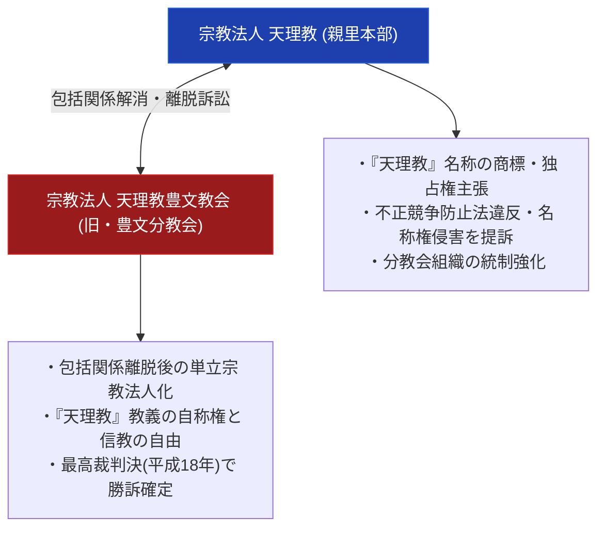

# 天理教豊文教会 極限深掘り専門構造分析ノート

> [!summary] 要旨
> 本稿は、長野県諏訪市に所在する天理教の被包括教会「天理教豊文分教会」が、教義・儀式のあり方をめぐる本部との相違から包括関係を解消（単立化）し、名称を「天理教豊文教会」へ改めたことで発生した法理事件「天理教名称使用差止等請求事件（最高裁判所平成18年1月20日判決）」を解剖した専門分析ノートである。一審（東京地裁）では天理教本部側が勝訴したが、控訴審（東京高裁）で逆転し、最高裁の上告棄却により豊文教会側の勝訴が確定した。宗教法人の包括離脱、不正競争防止法の適用限界、および信教の自由における「天理教」名称自称権の法理を扱う。

---

## 1. 命題の構造（天理教本部 vs 天理教豊文教会 法理対比マトリクス）

### 1-1. 本部と豊文教会の比較諸元表

| 比較考察軸 | 宗教法人 天理教（親里本部） | 宗教法人 天理教豊文教会 |
| :--- | :--- | :--- |
| **法格** | 包括宗教法人 | **単立宗教法人**（旧・被包括分教会） |
| **主張の核心** | 「天理教」名称は本部が管理・独占 | 包括離脱後も信仰内容として「天理教」を自称する自由 |
| **訴訟上の立場** | 原告・上告人（名称差止めを要求） | 被告・被上告人（一審敗訴→控訴審・最高裁で勝訴確定） |
| **最高裁判決日** | — | **平成18年（2006年）1月20日** |
| **適用判例法理** | 宗教法人の本来的活動は不正競争防止法2条1項の「営業」に非ず | 包括離脱した教会が「天理教」を冠することは、本件の事情の下では名称を冒用されない権利の違法な侵害に当たらない |

---

## 2. 基本情報

| 項目 | 内容・分析データ |
| :--- | :--- |
| **法人正式名称** | 宗教法人 天理教豊文教会（旧称：天理教豊文分教会） |
| **分類・系統** | 天理教離脱単立宗教法人 / 判例史的異端・分派拠点 |
| **関係最高裁判決** | 最高裁判所第二小法廷平成18年1月20日判決（平成17年（受）第575号、民集60巻1号137頁） |
| **所在地** | 長野県諏訪市大字豊田439番地ノ2（〒392-0016）。「豊文」の名は、所在地の地名であった長野県諏訪郡豊田村（現・諏訪市大字豊田）文出に由来する（最高裁判決文） |
| **法人番号** | 3100005007960（所轄庁：長野県知事） |
| **教理的立場** | 天理教原典・教理を奉斎しつつ親里本部組織から独立 |
| **判決結果** | 天理教本部側の名称差止め請求は最終的に棄却（豊文教会側の勝訴確定） |

---

## 3. 創始者と天啓・社伝

### 3-1. 豊文分教会の成立と包括関係解消の動機
豊文教会の前身は、大正14年（1925年）6月17日に長野県知事の設置許可により設置された「天理教豊文宣教所」であり、その設置については天理教管長（宗教法人天理教の前身）の同意を得たものであった。その後「天理教豊文分教会」と改称され、宗教法人法の施行後は天理教との被包括関係を設定し、昭和28年（1953年）7月17日に宗教法人となった（以上、最高裁判決文の認定事実）。

最高裁判決文によれば、豊文分教会の代表役員は、上告人（天理教）の教義が教祖・中山みきの教えとは異なるものになっていると考え、教義・儀式のあり方（礼拝施設・祭儀方法）をめぐって本部と対立した。Wikipedia「天理教豊文教会」は、対立の具体例として、本部のみで行われ被包括法人では行われていない「かぐらづとめ」を豊文分教会が行っていたことを挙げる。豊文側は本部の指示に反発し、平成13年（2001年）7月3日付けの通知書をもって被包括関係を廃止する旨を通知した。

---

## 4. 沿革・歴史変遷（包括所属〜離脱〜最高裁判決）

- **大正14年（1925年）6月17日**: 長野県知事の設置許可により「天理教豊文宣教所」を設置。その後「天理教豊文分教会」に改称。
- **昭和28年（1953年）7月17日**: 宗教法人法に基づく宗教法人となる（天理教との被包括関係を設定）。
- **平成13年（2001年）7月3日**: 被包括関係を廃止する旨の通知書を宗教法人天理教へ送付。
- **平成15年（2003年）4月16日**: 長野県知事が被包括関係の廃止に伴う規則の変更を認証し、名称は「天理教豊文教会」に変更された（名称の変更登記は同年5月15日受付、長野地方法務局諏訪支局）。
- **平成16年（2004年）3月30日**: 東京地方裁判所判決（平成15年（ワ）第23164号）は、天理教側の請求を認容（豊文側敗訴。「天理教」を含む名称の使用禁止と名称登記の抹消を命じた）。
- **平成16年（2004年）12月16日**: 東京高等裁判所判決（平成16年（ネ）第2393号）は一審判決を取り消し、天理教側の請求を棄却（豊文側勝訴）。
- **平成18年（2006年）1月20日**: 最高裁判所第二小法廷が上告を棄却。豊文教会側の勝訴が確定した。

---

## 5. 教理・儀礼・神観の深層解剖

### 5-1. 「天理教」名称の宗教的帰属と信教の自由
天理教本部は「天理教」という名称を組織的に独占しようとしたが、豊文教会側は「『天理教』とは中山みき教祖の教え（天理の理）を奉斎する信仰の表明であり、一組織の独占物ではない」と主張した。最高裁は、不正競争防止法2条1項1号・2号にいう「営業」は宗教法人の本来的な宗教活動およびこれと密接不可分の関係にある事業を含まないと判示し、不競法に基づく請求を退けた。さらに、宗教法人はその名称を他の宗教法人等に冒用されない権利を有するとしつつも、豊文教会が長年にわたって「天理教」の語を冠した名称を使用してきたこと、その信奉する教義は社会一般の認識において「天理教」にほかならないこと、不正な目的をうかがわせる事情がないこと等の事情の下では、豊文教会による「天理教豊文教会」の名称使用は、天理教の名称を冒用されない権利を違法に侵害するものとはいえないとして、名称権に基づく差止請求も退けた。

---

## 6. 宗教学的・歴史社会学的意義

### 6-1. 宗教法制史における「包括離脱と名称権」の画期性
新宗教において、本部の体制化に反対して離脱した教会が元々の教団名を冠して活動できるかという問題に対し、最高裁が「不正競争防止法は宗教活動に適用されない」と判示した歴史的判例であり、宗教社会学的にも教団統制の限界を示す金字塔となった。

---

## 7. 拠点・現地情報

### 7-1. 宗教法人 天理教豊文教会
- **所在地**: 長野県諏訪市大字豊田439番地ノ2（〒392-0016）
- **法格**: 単立宗教法人（長野県知事所轄）
- **法人番号**: 3100005007960

---

## 8. 関連教団・関連人物・関連概念

### 関連教団
- [[天理教]]
- [[天理教分派・異端教団一覧]]
- [[_分派・異端研究ポータル]]

### 関連概念
- 包括離脱
- 不正競争防止法
- 信教の自由
- 宗教法人法

---

## 9. 史料・一次資料 (convMD)

- [[src_天理教豊文教会_最高裁判決]] — 最高裁判所第二小法廷平成18年1月20日判決文（裁判所ウェブサイト掲載PDF、平成17年（受）第575号）
- [[src_天理教豊文教会_Wikipedia]] — Wikipedia「天理教豊文教会」

---

## 10. 参考文献・公的記録・判例集

- 最高裁判所民事判例集60巻1号137頁（平成18年1月20日第二小法廷判決）
- 判例時報1925号150頁 / 判例タイムズ1205号108頁
- 原審：東京高等裁判所平成16年12月16日判決（民集60巻1号194頁）
- 原原審：東京地方裁判所平成16年3月30日判決（民集60巻1号171頁）
- 大家重夫「判例評釈2006-10」『発明』103巻10号（最高裁判決の判時・判タ掲載号数の確認に使用）
- 武田典浩「不正競争防止法2条1項1号、2号における『営業』と宗教法人の宗教活動（天理教豊文教会事件）」『愛知学院大学宗教法制研究所紀要』51号

---

## 11. 関連ノート (Vault内)

- [[_分派・異端研究ポータル]]
- [[天理教分派・異端教団一覧]]
- [[天理教弾圧の構造と歴史要因]]

---

## 12. 留保（中立的併記・未確定要素）

> [!important] 裁判記録および公的判例に基づく留保
> - 2026-11-15 全件照合による改訂記録（最高裁判決文の原文および法人番号公表データで照合）：
>   1. **所在地を訂正した**。旧稿は「愛知県エリア」としていたが、豊文教会は**長野県諏訪市**に所在する（法人番号3100005007960、諏訪市大字豊田439番地ノ2）。「豊文」は諏訪郡豊田村（現・諏訪市大字豊田）文出の地名に由来する（判決文）。旧稿の「愛知県知事・文化庁認証データ」との記述も誤りで、所轄庁は長野県知事である。
>   2. **民集の頁を訂正した**。旧稿の「民集60巻1号1頁」は誤りで、正しくは**民集60巻1号137頁**（裁判所の判例情報による）。
>   3. **判例時報・判例タイムズの掲載号を訂正した**。判例時報は1924号3頁ではなく**1925号150頁**、判例タイムズは1208号129頁ではなく**1205号108頁**（大家重夫「判例評釈2006-10」による）。§10には訂正後の数値を記した。
>   4. **離脱手続きの日付の混同を解消した**。旧稿は「2003年4月16日：被包括関係廃止を通知し改称」としていたが、判決文によれば、被包括関係廃止の**通知は平成13年（2001年）7月3日付け**であり、2003年4月16日は長野県知事による**規則変更の認証日**である。
>   5. **訴訟経過を正確化した**。旧稿は最高裁での確定のみを記していたが、実際は一審（東京地裁2004年）は天理教側の勝訴であり、控訴審（東京高裁2004年）で逆転した経緯を §4 に明記した。
>   6. 沿革の起点を追記した（1925年の豊文宣教所設置許可、1953年の宗教法人設立はいずれも判決文の認定事実）。
> - 未検証として残る事項：豊文教会の信者数、現在の活動状況、歴代代表役員の経歴の詳細は公的資料で確認できていない。判決文中の当事者は匿名化されており、代表役員名は判決文からは特定できない（法人情報サイトが示す現代表者名は二次情報として §2 には採用しなかった）。
> - 本ノートの evidence_type は `primary_source_based`、confidence は `5`（最高裁判決文の原文と法人番号公表データで核心事実を確認したため。旧稿も 5 としていたが、当時は所在地等の核心事実に誤りを含んでおり、本照合で実質が伴った）。

---

*※本稿は[[_分派・異端研究ポータル]]の天理教豊文教会法理・離脱史専門ノートである。*
