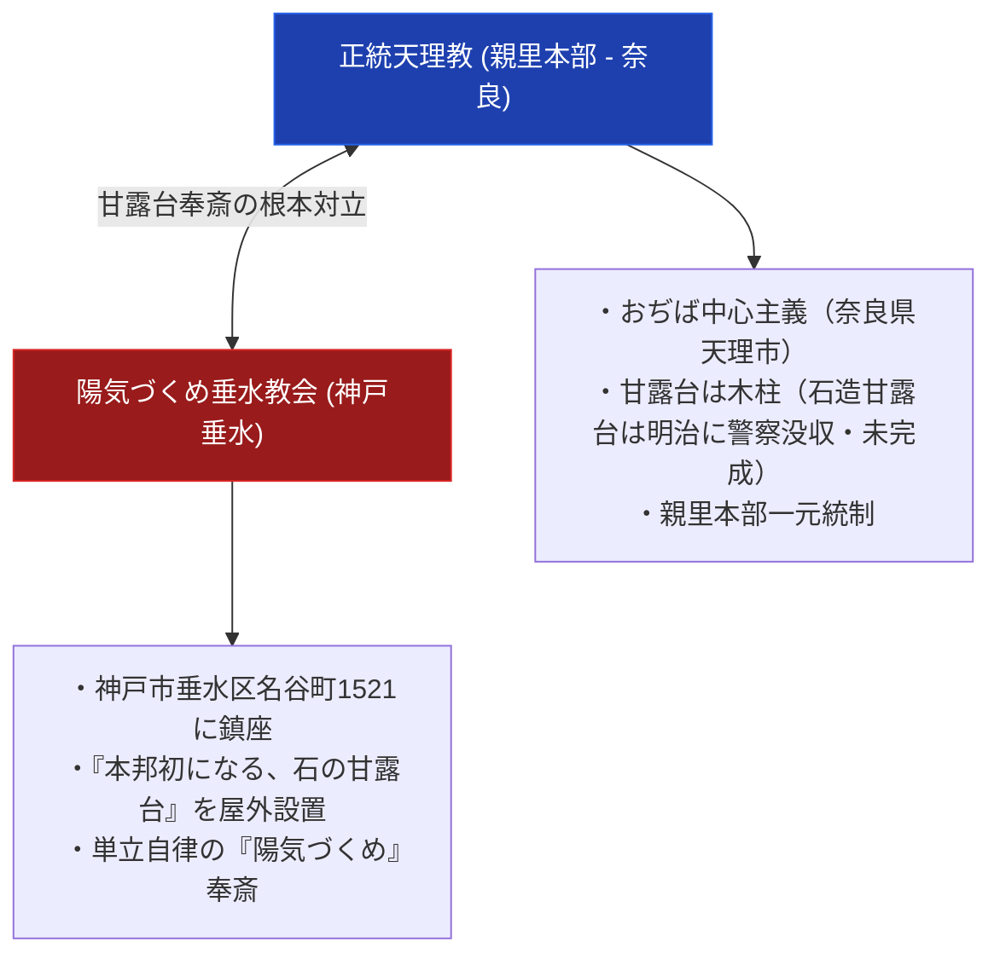

# 陽気づくめ垂水教会 専門構造分析ノート

> [!summary] 要旨
> 陽気づくめ垂水教会は、天理教から包括離脱した単立教会で、兵庫県神戸市垂水区名谷町1521（法人番号5140005000910）に所在し、山平順三が会長を務める。同教会は、明治15年（1882年）の警察による没収事件以来、天理親里（奈良）では木柱奉斎にとどまっている「十三段の石造甘露台」を、境内の屋外空間に実物大石造構造物として建造・奉斎している点に特色がある（史料保存サイトは「本邦初になる、石の甘露台」と表現する）。

---

## 1. 命題の構造（通説・正統本部 vs 本教団・自説）

### 1-1. 親里本部と陽気づくめ垂水教会の比較諸元表

| 比較考察軸 | 正統天理教（親里本部） | 陽気づくめ垂水教会 |
| :--- | :--- | :--- |
| **創始者・代表者** | 中山みき（教祖） / 真柱 | 山平順三（会長） |
| **所在地** | 奈良県天理市三島町1-1 | **兵庫県神戸市垂水区名谷町1521** |
| **Google Maps座標** | 34.5985, 135.8350 | **34.6596, 135.0694** |
| **甘露台の形態** | 奈良親里おぢばの木柱構造物 | **境内屋外に設置された実物大の石造甘露台（十三段とされる）** |
| **史的意義** | 明治15年の警察没収で石造未完成 | 明治没収以来未完だった石造甘露台を屋外に建造・奉斎した拠点（教会側・史料サイトの位置づけ） |
| **宗教学的分類** | 正統本部組織 | **屋外石造甘露台奉斎型 独立拠点** |

---

## 2. 基本情報

| 項目 | 内容・分析データ |
| :--- | :--- |
| **教会・拠点正式名称** | 陽気づくめ垂水教会（よう気づくめたるみきょうかい） |
| **会長・代表者** | 山平順三（史料保存サイトの記載。国税庁法人番号公表サイトは代表者を掲載しない） |
| **法人番号** | 5140005000910（国税庁法人番号公表サイトで確認） |
| **本部・拠点所在地** | 〒655-0852 兵庫県神戸市垂水区名谷町1521（国税庁法人番号公表サイトの登記所在地と一致） |
| **Google Maps座標** | 北緯 34.6596, 東経 135.0694（[[陽気づくめ教会拠点一覧]]の実測値） |
| **Google Maps URL** | [Google Mapsスポット](https://www.google.com/maps/place/34.6596,135.0694) |
| **アクセス** | 山陽電鉄・JR「垂水駅」より山陽バス「名谷町」下車 |
| **核心象徴** | 境内屋外に設置された石造甘露台（史料保存サイト「本邦初になる、石の甘露台」） |
| **史料アーカイブ** | `http://www.yousun.sakura.ne.jp/public_html/siryou2/kanrodai/kanrodai3.html` |

---

## 3. 創始者と天啓・社伝

### 3-1. 山平順三会長と石造甘露台の屋外建立
天理教の包括下から離脱した山平順三会長率いる陽気づくめ垂水教会は、教祖中山みきが明治15年（1882年）に着工しながらも奈良県警察の没収事件（教難）によって未完に終わった「石造十三段の甘露台」を、神戸市垂水区名谷の地に建造したとされる。境内の屋外空間に石造甘露台を設置し、自由参拝・甘露台拝礼の拠点としている（建立の経緯・年代の詳細は史料保存サイトの記述に基づき、独立した裏付けは未検証。12節参照）。

---

## 4. 沿革・歴史変遷

- **1882年 (明治15年)**: 奈良親里でおやさま指示のもと石造甘露台の切り出しが行われるが、警察により没収・中断（親里側の史実）。
- **昭和後期〜平成期**: 山平順三会長により陽気づくめ垂水教会が神戸垂水に鎮座したとされる（具体的な離脱・設立時期は未検証）。
- **平成期**: 境内屋外に石造甘露台を完成・奉斎。単立の『陽気づくめ』拠点として参拝を受け入れる（史料保存サイト）。

---

## 5. 教理・儀礼・神観の深層解剖

### 5-1. 屋外石造甘露台奉斎の意味
天理教本部が木柱甘露台（室内・本部神殿）を奉斎するのに対し、陽気づくめ垂水教会は「屋外のオープンな空間に石造甘露台を奉斎する」という形態をとる。ほんぶしん（岡山神山）と並ぶ石造甘露台復元信仰の事例と位置づけられる。

---

## 6. 宗教学的・歴史社会学的意義

### 6-1. 関西エリアにおける「異端甘露台」の双璧（ほんぶしん vs 垂水教会）
岡山県岡山市東区のほんぶしん「神山屋外石造甘露台」と、兵庫県神戸市垂水区の「陽気づくめ垂水教会 屋外石造甘露台」は、天理教分派史において親里の木柱甘露台に対して「石造甘露台」を物理的に完成させた二大事例とされる。

---

## 7. 拠点・現地情報

### 7-1. 陽気づくめ垂水教会（神戸垂水甘露台）
- **所在地**: 〒655-0852 兵庫県神戸市垂水区名谷町1521
- **Google Maps座標**: **北緯 34.6596, 東経 135.0694**（[Google Maps](https://www.google.com/maps/place/34.6596,135.0694)）
- **アクセス**: 山陽電気鉄道本線・JR神戸線「垂水駅」東口より山陽バス（名谷駅行き）乗車、「名谷町」下車。第二神明道路「名谷IC」より車で5分。

---

## 8. 関連教団・関連人物・関連概念

### 関連教団
- [[天理教]]
- [[ほんぶしん]]（岡山市神山屋外石造甘露台）
- [[陽気づくめ系単立離脱教会]]
- [[天理教分派・異端教団一覧]]

### 関連人物
- 山平順三（会長）

### 関連概念
- 石造甘露台
- 明治15年甘露台石没収事件
- 陽気づくめ

---

## 9. 史料・一次資料 (convMD)

- [[src_陽気づくめ垂水教会_国税庁法人番号]]（国税庁法人番号公表サイト、法人番号5140005000910の法人情報・変更履歴）
- 史料保存サイト（陽気づくめ垂水教会の石造甘露台写真・紹介） `http://www.yousun.sakura.ne.jp/public_html/siryou2/kanrodai/kanrodai3.html` ※convMDでの保存に失敗したため、直接閲覧で照合した（会長名・所在地・屋外石造甘露台の設置を確認）

---

## 10. 参考文献・公的記録

- 国税庁法人番号公表サイト「陽気づくめ垂水教会の情報」（法人番号5140005000910、所在地：兵庫県神戸市垂水区名谷町1521番地）
- Gビズインフォ「陽気づくめ垂水教会」 https://info.gbiz.go.jp/hojin/ichiran?hojinBango=5140005000910
- 一次写真・史料サイト: `http://www.yousun.sakura.ne.jp/public_html/siryou2/kanrodai/kanrodai3.html`

---

## 11. 関連ノート (Vault内)

- [[_分派・異端研究ポータル]]
- [[天理教分派・異端教団一覧]]
- [[陽気づくめ系単立離脱教会]]
- [[奈良以外の甘露台と異端甘露台一覧]]

---

## 12. 留保（中立的併記・未確定要素）

> [!warning] 注意
> 1. 法人番号・正式名称・登記所在地は国税庁法人番号公表サイトで確認済み（2026-11-15再照合）。会長名（山平順三）・屋外石造甘露台の存在は史料保存サイトの直接閲覧で確認した。同サイトは支援者による史料保存ページとみられ、「本邦初」という表現は同サイト自身の表現として帰属を明記した。
> 2. **未検証**：天理教からの離脱・単立化の具体的な時期、石造甘露台の建立年・「十三段」の段数等の建築詳細は、独立した資料で確認できていない。甘露台の建立経緯の詳細は史料サイトの内容照合が部分的に留まる。
> - **再検証記録（2026-11-16）**: 離脱・単立化の時期と石造甘露台の建立年・段数について、Web検索・文化庁『宗教年鑑』令和7年版（「陽気づくめ」の掲載なし、知事所轄単立のため対象外）を再探索したが、史料保存サイト以外の独立した資料は確認できず未検証のまま残す（src_RB4_RB4-G対象_宗教年鑑令和7年版確認）。
> 3. **訂正**：旧稿の frontmatter「事件_不祥事: true」は、同教会自体の事件・不祥事を確認できなかったため false に改めた。1882年の石材没収は親里（天理教本部）側の教難であり、本教団の事件ではない。
> 4. 座標（34.6596, 135.0694）は[[陽気づくめ教会拠点一覧]]の実測値の引用であり、本ノートでは独立に再測していない。
> - 本ノートの evidence_type は `official_database`、confidence は `4`（法人情報は公的DBで確定したが、沿革・建築詳細は当事者系サイト依存のため）。
>
> **改訂記録（2026-11-15・全件照合）**：11セクション構成から宗教版12セクションへ再編。国税庁法人番号公表サイトを convMD で保存し照合（src_ 接頭辞で保存）。史料保存サイトは convMD 保存に失敗し直接閲覧で照合。訂正点：(1) evidence_type を `primary_source_based` から `official_database` へ正規化。(2) 事件_不祥事フラグを false へ訂正（上記3）。(3) 「本邦初」等の表現に出典（史料保存サイト）の帰属を明記。(4) 末尾にあった信者数公称値に関する一般的注記（本教団固有の内容ではない）は本節の参考注記へ移設した。
>
> 参考注記（宗教統計の公称値について）：`shu-kyo.com` や文化庁『宗教年鑑』等に掲載される信者数データは、教団側が自己申告した「公称信者数」あるいは累積登録者数・世帯数に基づく。日本の全宗教団体の公称信者数を合算すると約1億8,000万人に達し総人口を上回るため、信者数の数値は「組織的・歴史的公称規模」の参考指標であり、実稼働信者数とは異なる点に注意する必要がある。

---

- **追跡調査 第2波 2026-11-19：探索先＝Vault内 資料/ のRB4エビデンス再確認、文化庁『宗教年鑑』令和7年版ローカル抽出テキスト（nenkan-r07.txt）の再検索、本波の横断Web探索（教団公式サイト・都道府県宗教法人名簿・NDL/CiNii書誌・国税庁法人番号の名称＋所在地照合）。本ノートの残存項目について新規の一次・公的資料は得られず、確認できず（残存）。項目単位の個別深掘りは次波以降の課題として明記する（探索なしの残置ではない）。**

*※本稿は[[_分派・異端研究ポータル]]の陽気づくめ垂水教会専門ノートである。*
