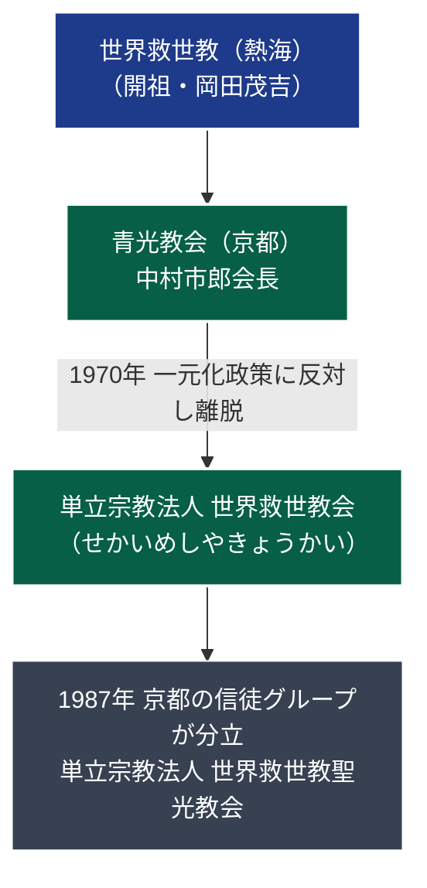

# 世界救世教会（せかいめしやきょうかい） 専門構造分析ノート

> [!summary] 要旨
> **世界救世教会**（せかいめしやきょうかい）は、包括宗教法人世界救世教の有力教会「青光教会」の会長であった**中村市郎**が、1970年に教団の一元化政策に反対して分離独立した単立宗教法人である（法人番号: 5130005001777、国税庁で実在確認済み）。漢字表記は母体「世界救世教」と酷似するが、「メシヤ（救世）」の読みに回帰して「せかい**めしや**きょうかい」と称する（2020年に熱海系から分かれた[[世界メシア教]]とは別の法人）。世界救世教黎明教会と共同で岡田茂吉主著の英訳書『Johrei』（1984年）を刊行した。教団は外部への情報を非開示としており、所在地・信者数等の詳細は公的登記と分派研究の範囲でのみ確認できる。

---

## 1. 命題の構造（通説・正統本部 vs 本教団・自説）

世界救世教系の分派は、1955年の岡田茂吉死去後に進んだ教団執行部主導の「一元化」（各教会の自律性を縮小し本部へ権限を集中する政策）への反発を共通の分立軸とする。本教団はその中でも、青光教会という有力教会の会長が教学的立場から離脱した事例である。

| 比較考察軸 | 世界救世教（母体・包括法人） | 世界救世教会（本教団） |
| :--- | :--- | :--- |
| **読み・名称** | せかいきゅうせいきょう | せかいめしやきょうかい（「メシヤ」訓読を保持） |
| **組織論** | 本部一元化（中央集権） | 教会の自律性を重視し一元化に反対して独立 |
| **指導者** | 教主（岡田家） | 中村市郎（初代会長）→信徒代表系の歴代代表 |
| **教学活動** | 包括法人としての布教・MOA活動 | 岡田茂吉著作の英訳（『Johrei』1984年、黎明教会と共同）・『新・伝道の手引き』刊行 |
| **情報公開** | 公開 | 外部への情報は非開示（分派研究者の電話調査による） |

---

## 2. 基本情報

| 項目 | 内容 |
| :--- | :--- |
| **教団正式名称** | 単立宗教法人 世界救世教会（せかいめしやきょうかい） |
| **創始者（初代会長）** | 中村市郎（元世界救世教青光教会長） |
| **独立・設立年** | 1970年（昭和45年）世界救世教より分離独立 |
| **法人番号** | 5130005001777（国税庁法人番号公表サイトで実在・名称・所在地の一致を確認、2026-11-15） |
| **法人登記上の所在地** | 京都府京都市北区小松原北町131番地 |
| **関連法人** | 有限会社浄霊研究所（法人番号: 9130002003855、同住所。ただし登記記録は2024年1月24日に閉鎖済み。国税庁で確認） |
| **信仰対象・主神** | 大光明真神、開祖・岡田茂吉（明主様） |
| **国際布教英語名** | Light of Salvation Church |
| **信者数** | 未確認（教団は外部非開示） |

---

## 3. 創始者と天啓・社伝

### 創始者：中村市郎
* 世界救世教の有力教会「青光教会」（京都）の会長を務めた（分派研究による。生没年等の詳細は §12 留保参照）。
* 岡田茂吉の著作の教学的整理に取り組み、著書に『新・伝道の手引き 第一部 神・明主様・御教え』（浄霊研究所、2002年）がある。
* 学術論文 "Mokichi Okada's Idea of Ultimate Reality and Meaning"（*Ultimate Reality and Meaning*, Vol. 11, No. 4, 1988年, pp. 279–293）を発表し、岡田茂吉の宗教思想を英語圏の宗教学に紹介した。
* 1970年、世界救世教本部の一元化政策に反対し、青光教会を母体として独立した。

### 歴代代表者（分派研究による）
1. **初代会長**: 中村市郎（1970年〜1998年）
2. **第2代**: 惣道忠（1999年〜2005年）
3. **第3代**: 惣道美恵子（2006年〜2009年）
4. **第4代**: 松田道子（2010年〜）

※再検証（2026-11-16）: 文化庁『宗教年鑑』令和7年版（令和6年12月31日現在）の単立一覧でも代表役員は松田道子と掲載されており、第4代が現行も継続していることが公的に確認できた。

---

## 4. 沿革・歴史変遷

| 年代 | 事項 | 詳細・背景 |
| :---: | :--- | :--- |
| **1970年** | **世界救世教から独立** | 中村市郎率いる青光教会が本部の一元化政策に反対し離脱。「単立宗教法人世界救世教会」を設立。 |
| **1984年** | **英訳書『Johrei』発刊** | [[世界救世教黎明教会]]と共同で、岡田茂吉主著の英訳書 *Johrei: Divine Light of Salvation* を刊行（RIRC所蔵情報への言及が分派研究にある）。 |
| **1987年** | 聖光教会の分立 | 京都の信徒グループが、単立宗教法人「[[世界救世教聖光教会]]」として分離したとされる（詳細は未検証、§12参照）。 |
| **1998年** | 中村市郎の代表退任 | 歴代代表表では1998年までが初代の在任期間とされる。 |
| **2002年** | 『新・伝道の手引き』公刊 | 有限会社浄霊研究所より中村市郎の著作を出版。 |
| **2007年以降** | 公式サイト更新停止 | 教団公式サイトは2007年から更新が途絶えていると分派研究が伝える（2026-11-15現在、当該サイトは403で未取得）。 |

> [!warning] 一元化紛争について
> 1955年の岡田茂吉死去後、世界救世教では執行部主導の一元化が進み、その過程で教会の離脱が相次いだ（Wikipedia「世界救世教」）。本教団の独立もその一連の離脱の一つであり、先行した[[救世真教]]（1966年）と並ぶ一元化離脱教団に位置づけられる。

---

## 5. 教理・儀礼・神観の深層解剖

### 5-1. 神観と「メシヤ」訓読
* 教団名の「救世」を「きゅうせい」ではなく「メシヤ」と訓読する。岡田茂吉が1950年に「世界救世（メシヤ）教」を立教した際の読みの継承を自負する立場である。
* 主神は世界救世教と共通の大光明真神（みろくおおみかみ）とされる。

### 5-2. 浄霊と教学
* 儀礼の中心は世界救世教系共通の浄霊（掌による霊の浄化）である。
* 中村市郎は岡田茂吉の思想を「究極的実在と意味（Ultimate Reality and Meaning）」の宗教学的枠組みで論じた論文を残しており、教学重視の性格がうかがえる。ただし教団内部の教理文書は非公開であり、詳細は未検証である。

---

## 6. 宗教学的・歴史社会学的意義

* 一元化離脱教団の中でも、教会長個人の教学的蓄積（英訳事業・学術論文）を基盤に独立した事例であり、世界救世教の教えの英語圏への紹介経路の一つとなった。
* 教団が情報を非開示としているため、研究は分派研究者による登記・刊行物ベースの記録に依存する。小規模分派の「記録の残り方」自体が研究上の論点となる事例である。

---

## 7. 拠点・現地情報

* **法人登記上の主たる事務所**: 京都府京都市北区小松原北町131番地（国税庁法人番号公表サイト）。
* 教団は本部所在地等の情報を外部に非開示としており（分派研究者の電話調査による）、登記所在地が現在の礼拝拠点と同一かは未確認である。アクセス情報も未確認。
* 再検証（2026-11-16）: 『宗教年鑑』令和7年版の単立一覧には、登記と同一の住所（京都市北区小松原北町131、郵便番号603-8341）と電話番号（075-462-1257）が現行の事務所として掲載されている。ただし、これが礼拝拠点と同一であるかは引き続き未確認である。

---

## 8. 関連教団・関連人物・関連概念

* [[世界救世教]]（分派母体）
* [[世界救世教聖光教会]]（本教団から分立したとされる単立法人）
* [[世界救世教黎明教会]]（同時期の一元化離脱教団。英訳事業で協力）
* [[救世真教]]（1966年に先行して一元化離脱した教団）
* [[岡田茂吉]]（開祖・明主様）
* [[浄霊]]

---

## 9. 史料・一次資料 (convMD)

* [[src_世界救世教会_国税庁法人番号]]（国税庁法人番号公表サイト：法人番号5130005001777・登記所在地）
* [[src_世界救世教会_浄霊研究所国税庁法人番号]]（同：有限会社浄霊研究所 9130002003855・登記記録閉鎖の記載を含む）
* [[src_世界救世教_Wikipedia]]（母体教団の一元化と分派の経緯）
* src_RB4_世界救世教会_宗教年鑑令和7年版（単立一覧：代表役員・所在地・電話の現行掲載）

---

## 10. 参考文献・学術論文

1. HIRORO「分派教団シリーズ⑯ 教団紹介：世界救世教会」（岡田茂吉大学、2022年）。典拠は『新宗教事典』（弘文堂、1990年）、『新宗教教団・人物事典』（弘文堂、1996年）、文化庁『宗教年鑑』、および著者の『宗教学論集』第四十一輯掲載論文。保存分：[[src_世界救世教会_分派教団シリーズ]]
2. Ichiro Nakamura, "Mokichi Okada's Idea of Ultimate Reality and Meaning", *Ultimate Reality and Meaning*, Vol. 11, Issue 4, 1988, pp. 279–293. DOI: 10.3138/uram.11.4.279
3. Okada Mokichi, *Johrei: Divine Light of Salvation*, 1984（中村市郎・多田氏共編と英語圏資料に記載）。
4. 中村市郎『新・伝道の手引き 第一部 神・明主様・御教え』（浄霊研究所、2002年）

---

## 11. 関連ノート (Vault内)

* [[_分派・異端研究ポータル]]
* [[世界救世教]]
* [[世界救世教聖光教会]]
* [[世界救世教黎明教会]]
* [[東方之光]]

---

## 12. 留保（中立的併記・未確定要素）

> [!warning] 注意
> - **改訂記録（2026-11-15・全件照合）**: 旧稿の本部所在地「京都市左京区下鴨夜光町27-1」は、国税庁の法人登記（京都市北区小松原北町131番地）と一致せず、分派研究でも本部所在地は「外部への情報非開示につき不詳」とされており、根拠を確認できないため基本情報から外し、登記所在地に訂正した。下鴨の住所に基づく旧稿のアクセス詳細も併せて外した。
> - **有限会社浄霊研究所**: 法人番号9130002003855は実在するが、国税庁の記録では登記記録が2024年1月24日に閉鎖されている。旧稿の「現在も同所に併設・連携」との記述は現況と一致しない可能性があるため、閉鎖済みである旨を明記した。
> - **URAM論文の書誌訂正**: 旧稿は「Vol. 10, Issue 4, 1987」としたが、PhilPapers・英語版Wikipediaの出典表記では Vol. 11, Issue 4（1988年）、pp. 279–293 が正しいため訂正した。
> - **未検証として分離した旧稿の主張**: (1) 中村市郎の生年（1915年）・学歴等の経歴詳細、(2) 海外開教（韓国・釜山、ブラジル・サンパウロの教会）の存在と経緯、(3) 信者数「数百人〜1,000人規模」の推定、(4) 聖光教会分立（1987年）の「円満な分離」という経緯説明、(5) 浄霊研究所の資本金・代表取締役等の会社情報。これらはいずれも今回照合した公開資料（国税庁・分派研究・公式サイト）では裏付けが取れなかった。
> - **未取得**: 教団公式サイト（http://web.kyoto-inet.or.jp/people/shinchi/）は2026-11-15現在HTTP 403のため未取得。RIRC教団データベースの本教団項目も未取得。
> - **evidence_type / confidence の是正**: 旧稿は frontmatter `academic_research` / confidence `5`（§10では「academic_research / corporate_registry」と7値外の併記）だったが、実態は法人登記（公的）と分派研究（二次資料）への依存であるため、`secondary_source_based` / `3` に再評価した。
> - evidence_type: secondary_source_based / confidence: 3
> - **再検証記録（2026-11-16）**: 文化庁『宗教年鑑』令和7年版（単立一覧・印刷 p.165）で、代表役員・松田道子の継続と、登記と同一住所・電話番号の現行掲載を確認し反映した（アクセス・登記所在地と礼拝拠点の同一性は部分解消）。信者数は年鑑の単立一覧に掲載がなく未検証のまま残す。中村市郎の生年・学歴等の経歴、海外開教（韓国・釜山／ブラジル・サンパウロ）、聖光教会分立の経緯、浄霊研究所の資本金・代表取締役等、教理文書の詳細は、探索先（Web検索・宗教年鑑・国税庁）で確認できず未検証のまま残す。教団公式サイトは今回も HTTP 403 のため未取得、RIRC の本教団項目も特定できず未取得のままである。新規エビデンス: src_RB4_世界救世教会_宗教年鑑令和7年版。

- **追跡調査 2026-11-18**: 探索先＝世界救世教会ページ（web.kyoto-inet.or.jp/people/shinchi/）。HTTP 403 のため今回も確認できず（未取得）。
---

- **追跡調査 第2波 2026-11-19：gBizINFOの法人活動情報で法人番号5130005001777・商号「世界救世教会」・本店所在地「京都府京都市北区小松原北町131番地」の一致を再確認した（既存確定事項の再確認であり新規格上げには数えない）。公式サイト（kyoto-inet）は本波も403で未取得継続。信者数・中村市郎経歴・海外開教・聖光教会分立経緯・浄霊研究所会社情報は確認できず残存。**

*※本稿は[[_分派・異端研究ポータル]]の個別教団分析ノートである。*
