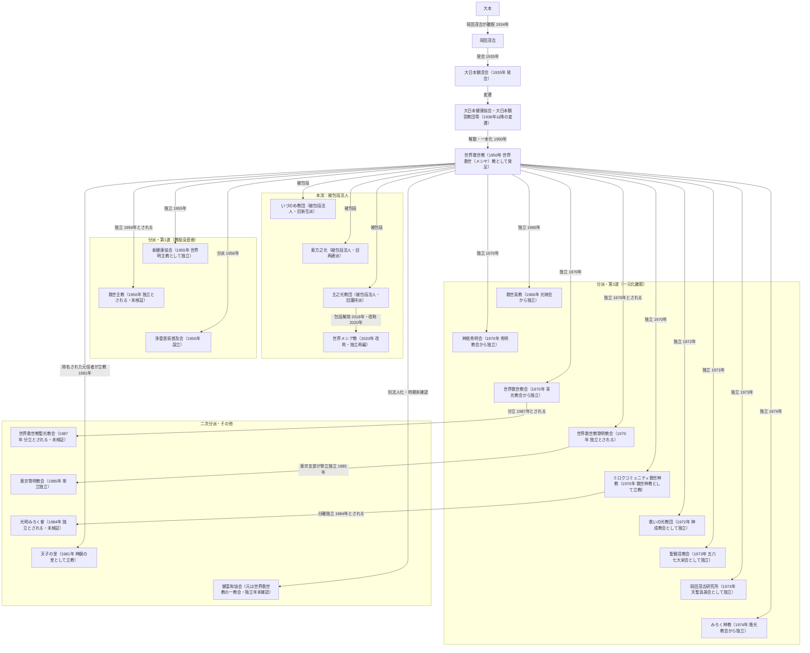
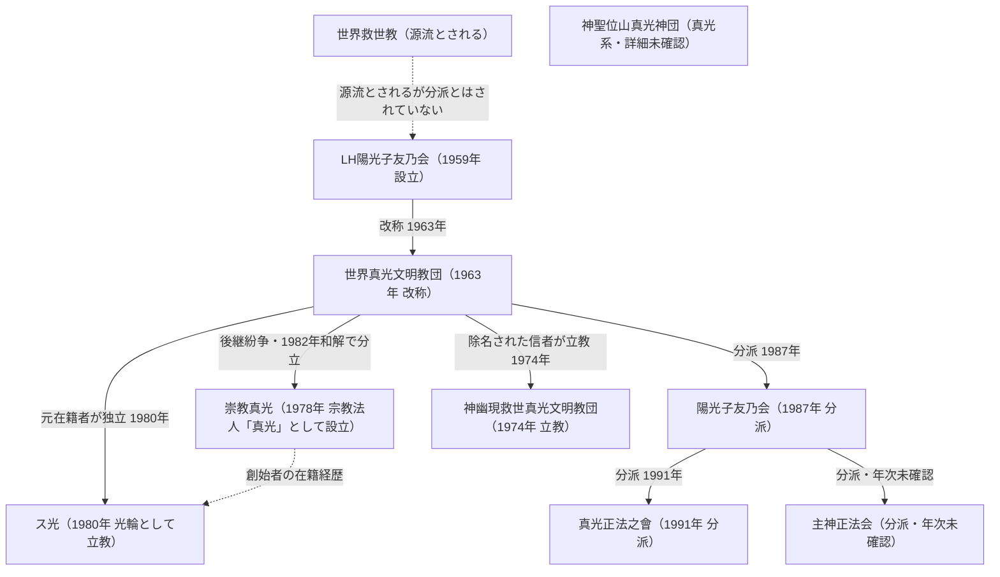

# 世界救世教系譜 解説ノート

> [!summary] 要旨
> 本ノートは、本フォルダ所収の各団体ノートに明記された系譜関係のみを整理したものである。世界救世教は大本の元幹部・岡田茂吉（1882-1955）が1935年に「大日本観音会」として設立し、1950年に「世界救世（メシヤ）教」として一本化された教団である。岡田茂吉の死去（1955年）直後と、1960年代末〜1970年代の「一元化政策」への反発を契機に多数の分派が生じた。本流は包括法人・世界救世教と被包括法人のいづのめ教団・東方之光に継承される。真光系（世界真光文明教団とその分派群）は、創始者・岡田光玉が世界救世教の有力信徒であったと真光系側で述べられるが、各ノートは「世界救世教からの分派とはされていない」と明記しており、本ノートでも分派としては扱わない。ノートに系譜関係の明記がない団体、記述が食い違う点は §5 に集約した。

---

## 1. 系譜の解説

### 1-1. 岡田茂吉と大本からの出発

世界救世教の創始者・岡田茂吉は大本の幹部として在籍していたが、1934年9月15日に大本を離脱した（世界救世教ノート§3）。同年12月23日に応神堂で大日本観音会の仮発会式を行い、1935年1月1日に正式発会した。すなわち本系譜の起点は「大本 ➔ 岡田茂吉の離脱・独立」にある。

### 1-2. 前身団体から世界救世教への変遷

発会後の変遷は世界救世教ノート§3・§4に次のとおり記される。1936年5月15日に大日本健康協会を創立し、同年7月1日に大日本観音会を解散した（官憲の圧迫による宗教活動と治療行為の分離。大日本健康協会も療術行為禁止令により自然消滅）。戦後は大日本浄霊療法普及協会を経て熱海に大日本観音教団を設立し、1950年2月4日、日本観音教団・日本五六七教を解散・一本化して「世界救世（メシヤ）教」として発足した（後の世界救世教）。岡田は自らを「明主」と称した。

教主の継承は、二代・岡田よし（1955-1962）→三代・岡田イツキ（1962-1998）→四代・岡田陽一（1998-2018、推戴取消）→五代・渡瀬信之（改称後：岡田信之、2018年6月26日就任）と続き、2025年12月17日に文化庁認証で教主制が廃止された（世界救世教ノート§4）。四代の推戴取消の日付は、2018年6月22日に世界救世教の理事会兼責任役員会が推戴取消を決議し（知財高裁判決の前提事実）、同月24日にその決定が通知され岡田陽一が正式に教主の地位を退いた（世界救世教『大経綸』21号）ことが、2026-11-24の調査で確定した（§5参照）。

### 1-3. 本流の形成――包括法人と被包括法人

岡田茂吉の1955年2月10日の死去後、「後継体制の統合が弱く、以後複数の分派が生じた」（世界救世教ノート§4）。一方で残存した本流は、包括法人・世界救世教の下に被包括法人を置く体制へ再編された。1980年代の教団内訴訟・管長地位確認訴訟等を経て、いづのめ教団（旧・新生派）、東方之光（旧・再建派）、主之光教団（旧・護持派）の3被包括法人に分裂・再編された経緯は、知財高裁判決（令和5年（行ケ）第10123号・第10126号、2024年5月21日言渡）の前提事実でも認定されている。同判決によれば、1984年頃から3派に分裂して代表者の地位確認を求める民事訴訟等の紛争が生じたが、**1997年12月に、3派はそれぞれ主体性を保持した宗教法人を成立させ、各法人が世界救世教を包括宗教法人とする被包括宗教法人となることを合意し、2000年3月頃までに3法人が被包括宗教法人となった**。また同判決は、主之光教団の法人の成立を1999年6月15日とする（src_kyusei_genealogy_a1_知財高裁判決）。CESNUR資料の「1997年12月15日が3派訴訟の裁判上の和解日、2000年3月21日が3被包括法人の新体制成立日」という日付は、月単位では判決文の認定と整合するが、日単位では依然として単一出典である（§5参照）。いづのめ教団・東方之光の法人設立登記日（日単位）は未取得である。

このうち主之光教団は、2018年1月30日に世界救世教責任役員会の決議で包括・被包括関係を廃止され（知財高裁判決の前提事実でも、1月12日の弁明機会設定の決議、1月26日の弁明手続を経た1月30日の廃止決議として認定）、同年6月に四代教主・岡田陽一の教主推戴が取り消された（決議は6月22日、通知・退任は6月24日）。2020年2月4日には、法人名（世界救世教主之光教団）はそのままで、宗教活動を「世界メシア教」の名で開始した（世界メシア教公式・教主様お言葉、src_kyusei_genealogy_a2_世界メシア教_教主お言葉2019-12-23・src_kyusei_genealogy_a2_世界メシア教_教主お言葉2020-02-04）。2024年12月24日に東京高裁で世界救世教と和解が成立した（世界メシア教公式プレスリリース、世界救世教『大経綸』21号）。現在、本流側に残る被包括法人はいづのめ教団（正式名称：世界救世教いづのめ教団）と東方之光（通称：MOA教団）である。両者とも分派ではなく包括下の法人であり、分離・独立の経緯の明記はない。

### 1-4. 分派の二つの波

世界救世教ノート§7は、分派発生の共通要因として「1955年の岡田茂吉帰幽直後、および1960年代末〜1970年代にかけて包括本部が進めた『一元化政策（各大教会の資産・人事・指揮権の中央集権統合）』に対する反発」を挙げる。分派は大きく二つの波に整理できる。

**第一波（教祖没直後、1955〜1956年）**：岡田茂吉の死去直後、教団運営方針や後継体制をめぐる初期幹部層の路線対立から、新健康協会（1955年、木原義彦・竹田栄三郎らが「世界明主教」として独立）、救世主教（1956年、初代管長・牧喜之助の独立とされる。ただし単一二次資料由来で未検証、§5参照）、浄霊医術普及会（1956年、救世神道光友会の役員であった野澤明一が設立）が生じた。

**第二波（一元化離脱、1966〜1974年）**：1960年代末から本部が進めた一元化に対し、有力教会（大教会）の長が教会ごと離脱する形の分派が相次いだ。先駆けは救世真教（1966年、光映会会長・小野田松造。一元化への抗議は1956年から）で、「最初の一元化離脱教団とされる」。1970年には神慈秀明会（秀明教会・小山美秀子。世界救世教ノート§7は「世界救世教最大の分派」と記す）、世界救世教会（青光教会・中村市郎）、世界救世教黎明教会（黎明教会・多田光行とされる）、ミロクコミュニティ救世神教（谷元後藤英男、「救世神教」として立教）が独立した。神慈秀明会・黎明教会・世界救世教会・隆光教会・大栄教会等は「一元化反対6教会」として連携して抵抗したと各ノートに記される。続いて救いの光教団（1972年、神成教会・大沼祐子）、聖観音教会（1973年、大栄教会・中島三千彦、「五六七大栄会」として独立）、岡田茂吉研究所（1973年、西光教会岩永支部・岩永佳誉子、「天聖真美会」として独立）、みろく神教（1974年、隆光教会・石坂隆明、信徒組織や不動産の帰属を巡る訴訟を経て分離）が離脱した。

**二次分派**：分派からさらに分かれた例として、世界救世教会からの世界救世教聖光教会（1987年とされる。ただし個別ノートは未検証とする、§5参照）、世界救世教黎明教会の東京支部の単立独立による東京黎明教会（1985年11月8日法人設立登記）、ミロクコミュニティ救世神教からの光明みろく會（1984年独立とされる。ただし系譜自体が単一二次資料由来で未検証、§5参照）がある。

**その他の独立形態**：天子の里は、1952年に世界救世教に入信した矢井清勝が1973年に除名処分を受けた後、1981年に岐阜市で「神鏡の里」を立教したもの（1986年に天子の里へ改称。ただしノートの全記述が単一ブログ記事依拠で未検証）。健富和協会は「元々、世界救世教の一教会として発足し、現在は別法人になっている」と公式サイトに記されるが、独立の経緯・時期はノートに明記がない。

### 1-5. 真光系との関係

真光系の中核・世界真光文明教団の創始者・岡田光玉（本名・岡田良一、1901-1974）について、世界真光文明教団ノートの frontmatter は系統を「世界救世教 ➔ L・H陽光子友乃会 ➔ 世界真光文明教団」と記し、§8でも世界救世教を「源流」とする。しかし同ノート§3は「岡田光玉は一時、世界救世教の有力信徒であったとされる（真光系諸教団側の記述。Wikipedia『岡田光玉』は『研究した』と記すのみで、資料により記述が異なる。ただし教会ごと脱退したわけではなく、**世界救世教からの分派とはされていない**）」と明記する。本ノートではこの留保に従い、真光系は世界救世教の分派としては扱わず、「源流として言及される別系統」として別図に分ける。

真光系自体の流れは次のとおりである。岡田光玉は1959年2月27日に神示を受けて立教し、同年8月28日に「LH陽光子友乃会」を設立、1963年に「世界真光文明教団」に改め同年11月19日に宗教法人登記した。1974年6月23日の光玉死去後、後継者紛争（真光裁判）が生じ、1982年7月5日の和解成立により、関口榮側（世界真光文明教団を継承）と岡田恵珠側が双方独立して布教することになった。恵珠側は係争中の1978年に宗教法人「真光」（後の崇教真光、現・崇教眞光）を設立している。信者の約4分の1が関口側、約4分の3が恵珠側についたとされる（世界真光文明教団ノート§4）。

世界真光文明教団からの分派としては、ほかに陽光子友乃会（1987年、元崇教局長・田中清英が「三代教え主」を主張して分派）、神幽現救世真光文明教団（1974年、岡田光玉在世時に除名された依田君美が立教）、ス光（1980年に「光輪」として立教。創始者・黒田みのるは世界真光文明教団で布教漫画を執筆し、その後崇教真光に在籍したとされるが、黒田本人は真光との関係を否定しているとされる）がある。陽光子友乃会からは真光正法之會（1991年）が分派し、主神正法会もその後分派したとされる（年次・経緯は未確認）。神聖位山真光神団は真光系諸教団の一つとされるが、分派元・分岐年の明記はなく詳細未確認である（2016年に清算結了）。

なお、現行の陽光子友乃会は、世界真光文明教団が1959〜1963年に名乗った「L・H陽光子友乃会」とは別法人・別時代の団体であり、混同を避ける必要がある（陽光子友乃会ノート§1）。

### 1-6. MOA・東方之光等の事業系団体の位置づけ

東方之光は通称「MOA教団」とも呼ばれ、世界救世教の被包括法人である（分派ではない）。本フォルダの各団体ノートの範囲では、東方之光から分派した団体、あるいは MOA・東方之光を分派元とする団体の明記はない。健康・事業系の性格を持つ団体（新健康協会、健富和協会、浄霊医術普及会、岡田茂吉研究所、聖観音教会、天子の里）についても、各ノートの分派元はいずれも世界救世教と明記されており、MOA・東方之光との関係の明記はない。したがって本ノートの系譜上、これらはすべて世界救世教から直接分かれた分派として位置づける。

---

## 2. 分岐チャート

### 2-1. 主図：世界救世教系

### 2-2. 副図：真光系

世界救世教との関係は破線で示す（各ノートは「源流」と言及する一方、「世界救世教からの分派とはされていない」と明記する）。

---

## 3. 分派一覧表

| 団体名 | 分岐年 | 分岐元 | 経緯の要点 | ノート |
| :--- | :--- | :--- | :--- | :--- |
| 世界救世教 | 1935年発会／1950年一本化 | 大本 | 岡田茂吉が1934年に大本を離脱し大日本観音会を発会。変遷を経て1950年に世界救世（メシヤ）教として発足 | [[世界救世教]] |
| いづのめ教団 | 被包括（1997年12月合意・2000年3月頃までに被包括化） | 世界救世教 | 分派ではなく被包括法人。前身は教団内の「新生派」とされる。被包括化の時期は知財高裁判決の前提事実による。法人設立登記日は未取得 | [[いづのめ教団]] |
| 東方之光 | 被包括（1997年12月合意・2000年3月頃までに被包括化） | 世界救世教 | 分派ではなく被包括法人。前身は「再建派」とされる。通称MOA教団。被包括化の時期は知財高裁判決の前提事実による。法人設立登記日は未取得 | [[東方之光]] |
| 世界メシア教 | 2018年包括解除／2020年活動名開始 | 世界救世教（主之光教団） | 旧「護持派」の被包括法人・主之光教団（法人成立は1999年6月15日、知財高裁判決）が包括関係を廃止され、2020年2月4日に宗教活動名として「世界メシア教」を開始。法人名の変更（登記・認証）は2025年 | [[世界メシア教]] |
| 新健康協会 | 1955年 | 世界救世教 | 岡田茂吉没直後、木原義彦らが「世界明主教」として独立。没後の分派の嚆矢とされる | [[新健康協会]] |
| 救世主教 | 1956年とされる（未検証） | 世界救世教 | 初代管長・牧喜之助の独立とされるが、単一二次資料由来で未検証 | [[救世主教]] |
| 浄霊医術普及会 | 1956年 | 世界救世教（救世神道光友会を経由） | 光友会の役員であった野澤明一が設立 | [[浄霊医術普及会]] |
| 救世真教 | 1966年 | 世界救世教（光映会） | 小野田松造が罷免・離脱して立教。最初の一元化離脱教団とされる | [[救世真教]] |
| 神慈秀明会 | 1970年 | 世界救世教（秀明教会） | 小山美秀子が離脱・独立。世界救世教最大の分派と記される | [[神慈秀明会]] |
| 世界救世教会 | 1970年 | 世界救世教（青光教会） | 中村市郎が一元化政策に反対して離脱 | [[世界救世教会]] |
| 世界救世教黎明教会 | 1970年とされる | 世界救世教（黎明教会） | 多田光行が一元化に反対して独立したとされるが、教団史の裏付けは未再確認 | [[世界救世教黎明教会]] |
| ミロクコミュニティ救世神教 | 1970年 | 世界救世教 | 谷元後藤英男が「救世神教」として立教（教団側説明）。2019年に現名称へ変更登記 | [[ミロクコミュニティ救世神教]] |
| 救いの光教団 | 1972年 | 世界救世教（神成教会） | 「宗教法人 神成教会」として独立し、1974年に現名称へ改称 | [[救いの光教団]] |
| 聖観音教会 | 1973年 | 世界救世教（大栄教会） | 中島三千彦が「五六七大栄会」として独立。後に現名称へ改称 | [[聖観音教会]] |
| 岡田茂吉研究所 | 1973年 | 世界救世教（西光教会岩永支部） | 岩永佳誉子が一元化認証の翌年に「天聖真美会」として分離独立 | [[岡田茂吉研究所]] |
| みろく神教 | 1974年 | 世界救世教（隆光教会） | 石坂隆明が資産帰属を巡る訴訟を経て分離独立 | [[みろく神教]] |
| 世界救世教聖光教会 | 1987年とされる（未検証） | 世界救世教会 | 京都の信徒グループが分離したとされるが、裏付ける公開資料は確認できていない | [[世界救世教聖光教会]] |
| 東京黎明教会 | 1985年 | 世界救世教黎明教会（東京支部） | 東京支部が単立の宗教法人として認証を受け独立 | [[東京黎明教会]] |
| 光明みろく會 | 1984年とされる（未検証） | ミロクコミュニティ救世神教 | 中田美代子が分離独立したとされるが、系譜自体が単一二次資料由来で未検証 | [[光明みろく會]] |
| 天子の里 | 1981年 | 世界救世教（除名された元信者） | 1973年に除名された矢井清勝が「神鏡の里」を立教（ノートは単一ブログ依拠で未検証） | [[天子の里]] |
| 健富和協会 | 未確認 | 世界救世教（一教会） | 元は世界救世教の一教会として発足し別法人化。独立の経緯・時期は明記なし | [[健富和協会]] |
| 世界真光文明教団 | 1959年立教 | 世界救世教は「源流」とされる | 岡田光玉が LH陽光子友乃会を設立し1963年に改称。ただし各ノートは「世界救世教からの分派とはされていない」と明記 | [[世界真光文明教団]] |
| 崇教真光 | 1978年 | 世界真光文明教団 | 岡田光玉死去後の後継紛争で岡田恵珠側が宗教法人「真光」を設立。1982年和解で分立固定化 | [[崇教真光]] |
| 陽光子友乃会 | 1987年 | 世界真光文明教団 | 元崇教局長・田中清英が「三代教え主」を主張して分派 | [[陽光子友乃会]] |
| 神幽現救世真光文明教団 | 1974年 | 世界真光文明教団 | 在籍中に除名された依田君美が立教 | [[神幽現救世真光文明教団]] |
| ス光 | 1980年 | 世界真光文明教団・崇教真光（創始者の在籍経歴） | 黒田みのるが「光輪」として立教。ただし黒田本人は真光との関係を否定しているとされる | [[ス光]] |
| ス光光波世界神団 | （ス光の旧称） | ― | 1984〜2013年の旧称を扱う統合・参照用ノート。本体は [[ス光]] を参照 | [[ス光光波世界神団]] |
| 真光正法之會 | 1991年 | 陽光子友乃会 | 田中清英の運営を批判しての脱会・分派とされる | [[真光正法之會]] |
| 主神正法会 | 未確認 | 陽光子友乃会 | 「その後、主神正法会が分派した」とのみ明記。年次・経緯・創始者は未確認 | [[主神正法会]] |
| 神聖位山真光神団 | 未確認 | 真光系諸教団（詳細未確認） | 真光系の一つとして高山市に所在したことのみ確認。2016年清算結了 | [[神聖位山真光神団]] |

---

## 4. 関連ノート (Vault内)

[[世界救世教系譜と聖典継承]]（各団体が誰の言葉を聖典・御教えとして掲げるかの調査ノート） / [[世界救世教]] / [[いづのめ教団]] / [[東方之光]] / [[世界メシア教]] / [[神慈秀明会]] / [[世界救世教会]] / [[世界救世教聖光教会]] / [[世界救世教黎明教会]] / [[東京黎明教会]] / [[救世主教]] / [[救世真教]] / [[救いの光教団]] / [[みろく神教]] / [[ミロクコミュニティ救世神教]] / [[光明みろく會]] / [[聖観音教会]] / [[岡田茂吉研究所]] / [[新健康協会]] / [[浄霊医術普及会]] / [[健富和協会]] / [[天子の里]] / [[世界真光文明教団]] / [[崇教真光]] / [[陽光子友乃会]] / [[真光正法之會]] / [[神幽現救世真光文明教団]] / [[神聖位山真光神団]] / [[主神正法会]] / [[ス光]] / [[ス光光波世界神団]]

---

## 5. 留保（系譜上の位置づけ未確定・ノート間の食い違い）

> [!warning] 留保事項
> - **系譜上の位置づけが未確定の団体**:
>   - 神聖位山真光神団： 真光系に属することのみ確認でき、分派元・分岐年・創始者は各ノートに明記がなく未確認。
>   - 主神正法会： 分派元が陽光子友乃会であることのみ明記され、分岐年・経緯・創始者は未確認。
>   - 健富和協会： 世界救世教の一教会として発足したことのみ明記され、独立の経緯・時期・創始者は未確認。
>   - 世界救世教聖光教会： 1987年の分立経緯は個別ノートが「旧稿の記述・未検証、裏付ける公開資料なし」としている。
>   - 光明みろく會： ミロクコミュニティ救世神教からの二次分派という系譜自体が、未取得の単一二次資料に依存し未検証。
>   - 救世主教： 1956年独立・初代管長就任等の中核的記述が単一の未取得記事由来で未検証。
>   - 世界救世教黎明教会： 1970年独立は「とされる」扱いで、教団史詳細の裏付けは再確認できていない。
>   - 天子の里： ノートの全記述が単一ブログ記事に依拠し、除名経緯・立教年等いずれも未検証。
>   - いづのめ教団・東方之光・主之光教団の被包括化の時期： 2026-11-24の調査で、知財高裁判決の前提事実により「1997年12月に合意、2000年3月頃までに3法人が被包括化」と確定した（主之光教団の法人成立は1999年6月15日）。残る未確認は、CESNUR資料の日単位の日付（1997年12月15日の裁判上の和解・2000年3月21日の新体制成立。月単位では判決文と整合するが日単位では単一出典のまま）と、いづのめ教団・東方之光の法人設立登記日（登記情報は有料・登録制のため未取得）。旧稿の「1997年発足」説は、1997年12月の合意を指すものとみられるが、被包括化の完了は2000年3月頃である。
>   - 岡田光玉と世界救世教の関係： 「有力信徒であった」（真光系側）と「研究した」と記すのみ（Wikipedia『岡田光玉』）で記述が異なり、所属先を「小田原支部」とする説は未検証。
> - **ノート間の記述の食い違い（両論併記）**:
>   - 救世主教の創始地： 世界救世教ノート§7は「名古屋で独立創立」とするが、救世主教ノートは「大分県別府市に創始」とし、いずれも一次資料による確定はできていないと明記する。
>   - 真光裁判の帰結： 「関口榮側が勝訴」（Wikipedia『世界真光文明教団』）と「1982年7月5日の和解成立」（同『真光系諸教団』）の記述があり、本ノート群は和解成立説に拠る。
>   - ス光の立教年： 1980年に「光輪」として立教とする説（Wikipedia『ス光』、学術論文で傍証）と、1983年立教説（同『真光系諸教団』）があり未解消。
>   - 二次分派2件の確度表記： 世界救世教聖光教会（1987年分立）・光明みろく會（1984年分離独立）について、世界救世教ノート§7は断定調で記すが、各個別ノートは未検証として分離している。
>   - 世界救世教黎明教会の1970年独立： 世界救世教ノート§7は断定調、黎明教会ノート自体は「1970年独立とされる」とする。
>   - ミロクコミュニティ救世神教の母体内所属： 世界救世教ノート§7は「五光教会の谷元後藤英男」と記すが、同教団ノートに「五光教会」への言及はない。
>   - 世界メシア教の改称・分離の年次（2026-11-24調査で各層とも公式・公的資料で確認済み）: 2020年2月4日は、法人名（世界救世教主之光教団）を変えずに宗教活動名として「世界メシア教」を開始した日（教団公式・教主様お言葉）。単立化・名称変更の認証日は2025年5月30日（『宗教年鑑』令和7年版付録）、法人登記の商号変更は2025年6月5日（国税庁）。3層はそれぞれ別の手続であり、矛盾ではない。
>   - 四代教主・岡田陽一の推戴取消日（2026-11-24調査で解消）: 2018年6月22日に理事会兼責任役員会が推戴取消を決議し（知財高裁判決の前提事実。中外日報も「推戴を取り消す決議」と報道）、同月24日に決定が通知され岡田陽一が正式に教主の地位を退いた（世界救世教『大経綸』21号）。Wikipediaの「6月22日 解任」（本文）と「6月24日 推戴取り消し」（歴代教主一覧）の揺れは、決議日と通知・退任日の差に対応する。
>   - 崇教真光の設立表記： 「宗教法人『真光』（後の崇教真光）設立」と「崇教真光を設立」の揺れがある。
>   - 陽光子友乃会の代表者（2026-11-24調査で一部解消）: 『宗教年鑑』の代表役員欄は、令和元年版・令和2年版（各9月30日現在）では「（代務者）沼田希世」、令和3年版（2021年9月30日現在）以降は「沼田邦子」であり、沼田邦子の代表役員就任は2020年10月〜2021年9月の間に絞られた（src_kyusei_genealogy_a3_宗教年鑑各版_代表役員推移）。Wikipediaの「会長・沼田明里」は令和元年〜7年版の代表役員欄には現れない。沼田明里・沼田希世・沼田邦子の3名の関係（同一人物・改名・親族等）は未確認のまま。
>   - 新健康協会の現行代表（2026-11-24調査で一部解消）: 『宗教年鑑』の代表役員欄は令和3年版（2021年9月30日現在）まで森和治、令和4年版（2022年9月30日現在）から木山峰秀であり、交代は2021年10月〜2022年9月の間に絞られた。木山峰秀が何代目にあたるかは未確認のまま（src_kyusei_genealogy_a3_宗教年鑑各版_代表役員推移）。
>   - 主神正法会の旧稿記述（「岐阜県高山市を拠点とする世界救世教系」等）は典拠がないとして全面撤回され、現行ノートは真光系・陽光子友乃会分派とする。本表・本図は現行ノートに従った。

---

*※本稿は religion-vault の系譜整理ノートである。2026-11-23に本フォルダ所収30ノートの記載のみに基づき作成した。系譜関係は各ノートの明記範囲に限定し、明記がない関係は推測で結んでいない。2026-11-24にA群調査（被包括法人の成立年次・世界メシア教の年次・代表者の食い違い・教主推戴取消日）を実施し、裁判所判決文・教団公式発表・『宗教年鑑』各版に基づき §1・§3・§5 を更新した（調査レポート: kyusei-genealogy-research-a-2026-11-24）。*
