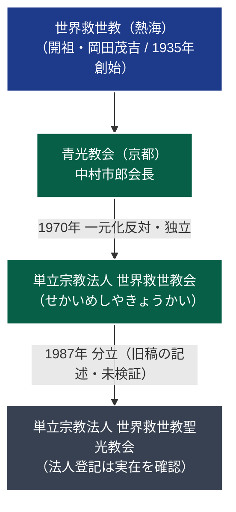

# 世界救世教聖光教会 専門構造分析ノート

> [!summary] 要旨
> **世界救世教聖光教会**（せかいきゅうせいきょうせいこうきょうかい）は、京都府に登記された単立宗教法人である（法人番号: 3130005001779、国税庁で実在確認済み。法人登記上の所在地は京都市伏見区桃山町泰長老24番地9）。教団名に「世界救世教」を冠するが、包括宗教法人世界救世教（熱海）および[[世界救世教会]]（せかいめしやきょうかい）とは別法人である。旧稿は1987年に世界救世教会の京都ブランチから分離独立した教団としていたが、その経緯を裏付ける公開資料は今回の照合では確認できなかったため、本ノートでは法人登記の事実と未検証の経緯を分離して記載する。

---

## 1. 命題の構造（通説・正統本部 vs 本教団・自説）

| 比較考察軸 | 世界救世教会（旧稿の分派元） | 世界救世教聖光教会（本教団） |
| :--- | :--- | :--- |
| **法人番号** | 5130005001777 | 3130005001779（別法人として実在を確認） |
| **法人登記上の所在地** | 京都市北区小松原北町131番地 | 京都市伏見区桃山町泰長老24番地9 |
| **情報公開** | 外部非開示 | 公開資料は法人登記以外ほぼなし |

---

## 2. 基本情報

| 項目 | 内容 |
| :--- | :--- |
| **教団正式名称** | 単立宗教法人 世界救世教聖光教会（せかいきゅうせいきょう せいこうきょうかい） |
| **設立・認可年** | 1987年（昭和62年）とされる（未検証。§12参照） |
| **法人番号** | 3130005001779（国税庁法人番号公表サイトで実在・名称・所在地の一致を確認、2026-11-15） |
| **法人登記上の所在地** | 京都府京都市伏見区桃山町泰長老24番地9 |
| **法人格・管轄** | 単立宗教法人（京都府知事所轄） |
| **信仰対象・主神** | 大光明真神、開祖・岡田茂吉（明主様）とされる（世界救世教系共通。教団自身の公表資料は未確認） |
| **信者数** | 未確認 |

---

## 3. 創始者と天啓・社伝

* 旧稿は「[[世界救世教会]]（中村市郎）の京都ブランチ（Seiko Kyokai in Kyoto）が母体であり、1987年に自立した法人格を取得した」とするが、設立主体・経緯を示す公開資料は確認できていない（未検証）。
* 旧稿が根拠とした「中村市郎の1987年論文に母教会からの自立が記録される」との主張についても、中村の論文（*Ultimate Reality and Meaning*, Vol. 11, No. 4, 1988年）の書誌は確認できたが、本教団の設立への言及は未確認である。

---

## 4. 沿革・歴史変遷

| 年代 | 事項 | 詳細・背景 |
| :---: | :--- | :--- |
| **1970年** | （系譜上の前提）世界救世教会独立 | 中村市郎率いる青光教会が世界救世教から離脱。 |
| **1987年** | 単立宗教法人として設立（旧稿の記述） | 設立登記年とされるが、今回の照合では裏付け未確認。法人番号の指定は他の宗教法人と同様2015年（法人番号制度開始時）である。 |
| **現在** | 法人として存続 | 国税庁法人番号公表サイトに現行の法人として掲載（最終更新は平成27年11月13日付の公表情報）。 |

---

## 5. 教理・儀礼・神観の深層解剖

* 世界救世教系の教団名を冠することから、岡田茂吉の教えと浄霊の実践を継承する教団と推定されるが、教団自身の教理公表資料は確認できておらず、旧稿の教理記述（大光明真神信仰・浄霊・自然食生活の重視等）は母体系の一般像からの敷衍であり、個別の裏付けはない（未検証として分離）。

---

## 6. 宗教学的・歴史社会学的意義

* 法人登記上は明確に存在しながら、活動実態の公開情報がほぼ皆無という点で、世界救世教系小規模分派の「記録の空白」を示す事例である。系譜関係の主張（世界救世教会からの分立）を検証可能な形で記録すること自体が今後の課題となる。

---

## 7. 拠点・現地情報

* **法人登記上の主たる事務所**: 京都府京都市伏見区桃山町泰長老24番地9（国税庁法人番号公表サイト）。
* 旧稿は所在地を「京都府京都市（番地非公開）」としていたが、法人登記上の所在地は公表情報であるため上記のとおり明記した。ただし登記所在地が現在の礼拝拠点と同一かは未確認である。アクセスについては、再検証（2026-11-16）でマピオン電話帳に「世界メシヤ教聖光教会」の名義で同一住所（〒612-8034 桃山町泰長老24-9）・電話075-601-1472・最寄り駅「桃山駅」と掲載されていることを確認した（第三者電話帳情報としての傍証にとどまる）。

---

## 8. 関連教団・関連人物・関連概念

* [[世界救世教会]]（旧稿の分派元）
* [[世界救世教]]（歴史的根源）
* [[世界救世教黎明教会]]（同系の単立教団）
* [[岡田茂吉]]（開祖・明主様）
* [[浄霊]]

---

## 9. 史料・一次資料 (convMD)

* [[src_世界救世教聖光教会_国税庁法人番号]]（国税庁法人番号公表サイト：法人番号3130005001779・登記所在地）
* src_RB4_世界救世教聖光教会_マピオン電話帳・年鑑確認（マピオン電話帳の掲載内容・『宗教年鑑』令和7年版に掲載なしの確認）
* [[src_世界救世教_Wikipedia]]（母体教団の一元化と分派の経緯）

---

## 10. 参考文献・学術論文

1. 国税庁法人番号公表サイト「世界救世教聖光教会の情報」（2026-11-15確認）
2. Ichiro Nakamura, "Mokichi Okada's Idea of Ultimate Reality and Meaning", *Ultimate Reality and Meaning*, Vol. 11, Issue 4, 1988, pp. 279–293（旧稿が本教団の典拠として挙げた論文。書誌は実在するが本教団への言及は未確認）
3. HIRORO「分派教団シリーズ 教団紹介：世界救世教聖光教会」（岡田茂吉大学）と旧稿が挙げる記事は、2026-11-15の照合ではURLを特定できず未取得。

---

## 11. 関連ノート (Vault内)

* [[_分派・異端研究ポータル]]
* [[世界救世教]]
* [[世界救世教会]]
* [[世界救世教黎明教会]]

---

## 12. 留保（中立的併記・未確定要素）

> [!warning] 注意
> - **改訂記録（2026-11-15・全件照合）**: 法人番号3130005001779の実在と登記所在地（京都市伏見区桃山町泰長老24番地9）を国税庁で確認し、基本情報に反映した。一方、旧稿の中核的主張（1987年の設立登記、世界救世教会の京都ブランチからの分立、中村市郎論文による裏付け）は、今回照合した公開資料ではいずれも確認できなかったため、本文では「旧稿の記述・未検証」と明示して分離した。
> - **未検証として分離した旧稿の主張**: (1) 設立年1987年と設立経緯の詳細、(2) 「代表役員は信徒代表から選任される」等の組織運営の記述、(3) 信者数「数十人〜百人規模」の推定、(4) 教理・実践の個別記述、(5) 日本聖公会京都教区「聖光教会」・聖光幼稚園（京都市左京区松ヶ崎）との峻別注記の具体的内容（同名の別団体が存在すること自体は一般に知られるが、本照合では個別に確認していない）。
> - **未取得**: HIRORO「分派教団シリーズ」の本教団紹介記事（旧稿は回数を (21) とするが、URL未特定のため未取得）。RIRC教団データベースの本教団項目も未取得。
> - **evidence_type / confidence の是正**: 旧稿は `academic_research` / confidence `5`（§10では「academic_research / official_database」）と過大だった。確認できたのは法人登記（公的記録）のみで、教団史の主張は未検証のため、`mixed_secondary_unverified` / `2` に再評価した。
> - evidence_type: mixed_secondary_unverified / confidence: 2
> - **再検証記録（2026-11-16）**: アクセス・所在地同一性はマピオン電話帳（「世界メシヤ教聖光教会」名義・同一住所・電話075-601-1472・最寄り桃山駅）で傍証を得たため部分解消とする（教団公式情報ではなく、登記所在地＝礼拝拠点の同一性は未確定のまま）。『宗教年鑑』令和7年版は全文検索で掲載なしを確認した（京都府知事所轄の単立単位法人は個別掲載対象外で、信者数・代表役員は得られなかった）。設立年1987年と分立経緯・組織運営・信者数・教理／経典は、Web検索・NDL系検索を探索したが確認できず未検証のまま残す。HIRORO記事・RIRC項目は今回も未取得。

- **追跡調査 2026-11-18**: 探索先＝Web検索・HIRORO／RIRC。対象記事の所在は今回も特定できず、確認できず（未取得）。
---

- **追跡調査 第2波 2026-11-19：探索先＝Vault内 資料/ のRB4エビデンス再確認、文化庁『宗教年鑑』令和7年版ローカル抽出テキスト（nenkan-r07.txt）の再検索、本波の横断Web探索（教団公式サイト・都道府県宗教法人名簿・NDL/CiNii書誌・国税庁法人番号の名称＋所在地照合）。本ノートの残存項目について新規の一次・公的資料は得られず、確認できず（残存）。項目単位の個別深掘りは次波以降の課題として明記する（探索なしの残置ではない）。**

*※本稿は[[_分派・異端研究ポータル]]の個別教団分析ノートである。*
