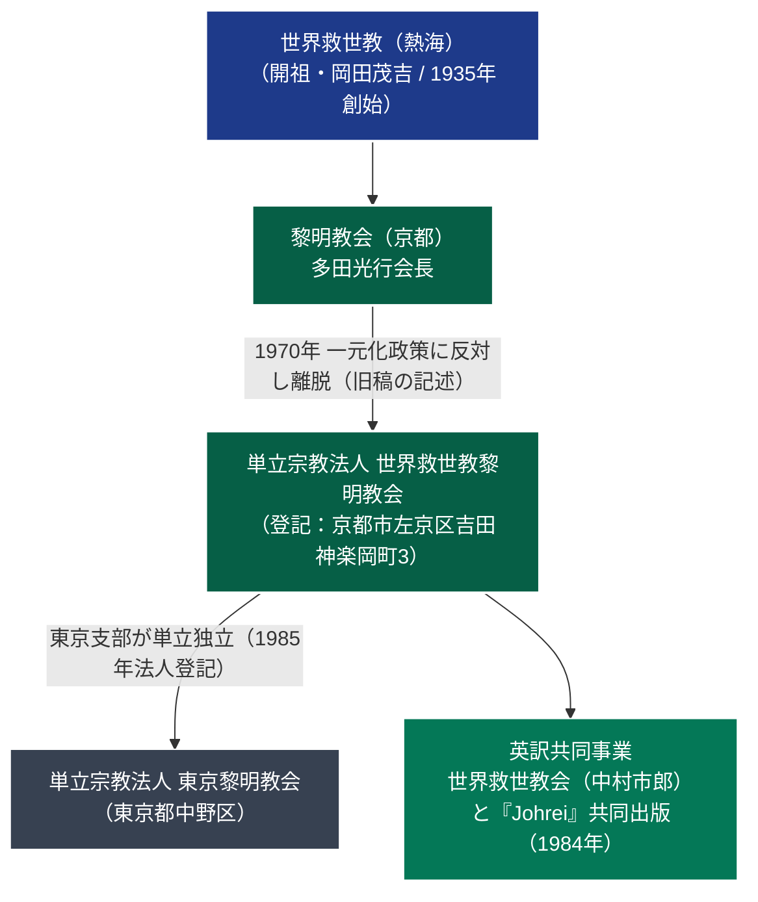

# 世界救世教黎明教会 専門構造分析ノート

> [!summary] 要旨
> **世界救世教黎明教会**（せかいきゅうせいきょう れいめいきょうかい）は、京都市に登記された単立宗教法人である（法人番号: 2130005001771、国税庁で実在確認済み。法人登記上の主たる事務所は京都市左京区吉田神楽岡町3番地）。旧稿は、旧世界救世教の有力教会「黎明教会」を率いた**多田光行**が1970年の教団一元化に反対して分離独立した教団とし、出版部門「洛東社」や「黎明教会資料研修館」（京都市山科区）を持つとするが、これらの教団史の詳細は教団公式サイトの旧ページ（現在404）等に依拠しており、今回の照合では裏付けを再確認できなかった。本ノートでは法人登記の確定事実と教団史の記述を分離して記載する。[[世界救世教会]]と共同で岡田茂吉主著の英訳書『Johrei』（1984年）を刊行したことは英語圏資料でも確認できる。また本教団の東京支部が分離独立したものが[[東京黎明教会]]である。

---

## 1. 命題の構造（通説・正統本部 vs 本教団・自説）

| 比較考察軸 | 世界救世教（母体・包括法人） | 世界救世教黎明教会（本教団） |
| :--- | :--- | :--- |
| **組織論** | 本部一元化（中央集権） | 一元化に反対し独立したとされる |
| **教学の性格** | 包括法人としての布教・MOA活動 | 岡田茂吉の原典保存・出版（洛東社）を掲げるとされる |
| **法人登記** | 包括宗教法人（熱海） | 単立宗教法人（法人番号: 2130005001771） |

---

## 2. 基本情報

| 項目 | 内容 |
| :--- | :--- |
| **教団正式名称** | 単立宗教法人 世界救世教黎明教会（せかいきゅうせいきょう れいめいきょうかい） |
| **通称・別名** | 黎明教会 |
| **創始者（初代会長）** | 多田光行（元世界救世教黎明教会長）とされる |
| **独立・設立年** | 1970年（昭和45年）世界救世教より分離独立とされる |
| **法人番号** | 2130005001771（国税庁法人番号公表サイトで実在・名称・所在地の一致を確認、2026-11-15） |
| **法人登記上の所在地** | 京都府京都市左京区吉田神楽岡町3番地 |
| **公式サイト** | http://www.reimei.or.jp/（現存を確認。詳細ページは未取得） |
| **信仰対象・主神** | 大光明真神（みろくおおみかみ）、開祖・岡田茂吉（明主様） |
| **派生教団** | [[東京黎明教会]]（旧東京支部、1985年に単立法人化） |

---

## 3. 創始者と天啓・社伝

### 創始者：多田光行（旧稿の記述）
* 岡田茂吉の直弟子として黎明教会を率い、岡田茂吉の御神書・講話録の原典保存を重視したとされる。
* 1970年の世界救世教本部による一元化において、中村市郎（世界救世教会）らとともに独立を決断したとされる。
* 後継は多田歌恵とされる。

これらの人物・経緯の詳細は、教団公式サイトの旧ページ（http://www.reimei.or.jp/asp/kyokai51.asp、現在404）等に基づく旧稿の記述であり、今回の照合では一次・公的資料による裏付けを再確認できなかった（§12参照）。多田の名は、英訳書『Johrei』（1984年）の共編者として英語圏資料（英語版Wikipedia「Johrei」記事の出典等）に "Tada" の名で現れる。

---

## 4. 沿革・歴史変遷

| 年代 | 事項 | 詳細・背景 |
| :---: | :--- | :--- |
| **1970年** | **世界救世教から独立（旧稿の記述）** | 本部の一元化方針を拒否し、「単立宗教法人 世界救世教黎明教会」を設立したとされる。 |
| **1971年** | 東京支部の発足（旧稿の記述） | 東京支部が開設され、のちの[[東京黎明教会]]の母体となったとされる。 |
| **1984年** | 英訳書『Johrei』協力 | 京都の[[世界救世教会]]（中村市郎）と共同で、岡田茂吉主著の英訳書 *Johrei: Divine Light of Salvation* を刊行（分派研究・英語圏資料で確認。再検証2026-11-16でCiNii書誌を確認：Society of Johrei, c1984、ISBN 4915605000、NCID BA57316198）。 |
| **1985年** | 多田光行の死去（旧稿の記述） | 初代会長が逝去し、多田歌恵が後継代表に就任したとされる。 |
| **1989〜92年** | 『多田光行集』全4巻刊行（旧稿の記述） | 版元・洛東社より刊行されたとされる（書誌の再確認は未実施）。 |

> [!warning] 一元化紛争について
> 1955年の岡田茂吉死去後、世界救世教では執行部主導の一元化が進み、その過程で教会の離脱が相次いだ（Wikipedia「世界救世教」）。本教団および[[世界救世教会]]の独立は、その一連の離脱に位置づけられる。

---

## 5. 教理・儀礼・神観の深層解剖

### 5-1. 原典主義とされる教学姿勢（旧稿の記述）
* 岡田茂吉生存当時の講話・御神書の原典をそのまま学ぶ「原典主義」を堅持するとされる。
* 儀礼の中心は世界救世教系共通の浄霊であり、自然農法と美の探求も岡田茂吉の三本柱として継承するとされる。

教団公式サイト（現行トップページ）は「明主様（岡田茂吉師）の御教えに基づき、心身ともに健康で幸福な社会を実現することを目的に活動」と掲げており、岡田茂吉の教えに基づく活動という大枠は公式に確認できる。個別の教理記述の裏付けは未検証である。

---

## 6. 宗教学的・歴史社会学的意義

* 一元化離脱教団の中でも、英訳事業（『Johrei』）を通じて世界救世教の教えの国際的紹介に関与した点に特徴がある。
* 岡田茂吉関係資料の保存・出版を掲げる教団とされ、初期救世教史料の所在という観点でも注目されるが、資料研修館の実態は公開情報が乏しく未検証である。

---

## 7. 拠点・現地情報

* **法人登記上の主たる事務所**: 京都府京都市左京区吉田神楽岡町3番地（国税庁法人番号公表サイト）。マピオン電話帳には「黎明教会」として同住所・電話075-771-2022・最寄り駅は元田中駅と掲載される（第三者電話帳情報としての傍証、再検証2026-11-16）。
* 旧稿は本部所在地を「京都市山科区北花山大林町3-1（黎明教会資料研修館）」としていた。これは教団公式サイト旧ページに基づく資料研修館の所在地とみられるが、法人登記上の主たる事務所は左京区吉田神楽岡町3番地であり、両者を区別して記載する。資料研修館の現況・アクセスは未確認。

---

## 8. 関連教団・関連人物・関連概念

* [[世界救世教]]（分派母体）
* [[世界救世教会]]（同時期の一元化離脱教団。英訳事業で協力）
* [[東京黎明教会]]（東京支部からの独立）
* [[救世主教]]（昭和30年代の初期独立分派）
* [[岡田茂吉]]（開祖・明主様）
* [[浄霊]]

---

## 9. 史料・一次資料 (convMD)

* [[src_世界救世教黎明教会_国税庁法人番号]]（国税庁法人番号公表サイト：法人番号2130005001771・登記所在地）
* src_RB4_世界救世教黎明教会_Johrei書誌・アクセス（CiNii『Johrei』書誌・マピオン電話帳・年鑑掲載確認）
* [[src_世界救世教_Wikipedia]]（母体教団の一元化と分派の経緯）
* src_kyusei_unconfirmed_reimei_series14（岡田茂吉大学「分派教団シリーズ⑭ 教団紹介：世界救世教黎明教会」：代表歴代は（初代）多田光行（1970-1985）・（2代）多田歌恵（1986年〜）、『多田光行集』全4巻・『多田光行会長先生 追想』の書名を挙げる）
* src_kyusei_unconfirmed_representatives_series04（同「シリーズ④ 教団代表者歴代」）
* 教団公式サイト http://www.reimei.or.jp/ は現存を確認したが、JS中心の構成のため convMD 保存は未実施（直接閲覧で照合）。旧ページ /asp/kyokai51.asp は404で未取得。

---

## 10. 参考文献・学術論文

1. 国税庁法人番号公表サイト「世界救世教黎明教会の情報」（2026-11-15確認）
2. HIRORO「分派教団シリーズ⑯ 教団紹介：世界救世教会」（岡田茂吉大学、2022年）— 本教団と世界救世教会の英訳共同事業への言及。保存分：[[src_世界救世教会_分派教団シリーズ]]
3. Okada Mokichi, *Johrei: Divine Light of Salvation*, 1984（中村市郎・多田氏共編）。
4. 旧稿が挙げた教団刊行物（『多田光行集』全4巻・洛東社、1989〜92年／『多田光行会長先生 追想』洛東社、1986年／『教会20周年記念集』1990年）は書誌の再確認が未実施のため未検証。
5. HIRORO「分派教団シリーズ 教団紹介：世界救世教黎明教会」（岡田茂吉大学）と旧稿が挙げる記事（回数表記⑭）は、2026-11-15の照合ではURLを特定できず未取得。

---

## 11. 関連ノート (Vault内)

* [[_分派・異端研究ポータル]]
* [[世界救世教]]
* [[世界救世教会]]
* [[東京黎明教会]]
* [[救世主教]]

---

## 12. 留保（中立的併記・未確定要素）

> [!warning] 注意
> - **改訂記録（2026-11-15・全件照合）**: (1) 法人番号2130005001771の実在を確認し、法人登記上の主たる事務所（京都市左京区吉田神楽岡町3番地）を基本情報に明記した。旧稿は山科区北花山大林町3-1（資料研修館）を本部所在地としており、登記所在地と混同していたため区別した。(2) [[東京黎明教会]]ノート旧稿§10にあった本教団の法人番号「4130005001753」は誤りであり、正しくは2130005001771である（東京黎明教会ノート側も同日訂正）。
> - **未検証として分離した旧稿の主張**: (1) 多田光行の生没年（1910-1985）・経歴・多田歌恵の継承、(2) 経典『御神書』・機関紙「黎明新聞」の存在、(3) 『多田光行集』等の刊行物の書誌、(4) 資料研修館の施設内容、(5) 信者数「推定数千人」。これらはいずれも今回照合した公開資料では裏付けが取れなかった（多くは教団公式サイト旧ページ由来とみられる）。
> - **未取得**: 教団公式サイト旧ページ（/asp/kyokai51.asp、404）。HIRORO「分派教団シリーズ」の本教団紹介記事。RIRC教団データベースの本教団項目。
> - **evidence_type / confidence の是正**: 旧稿は `academic_research` / confidence `5`（§10では「academic_research / official_database」）と過大だった。確定できたのは法人登記と英訳事業の事実までであり、教団史の詳細は未検証のため、`secondary_source_based` / `3` に再評価した。
> - **再検証記録（2026-11-16）**: 英訳書『Johrei』の書誌をCiNiiで確認した（Society of Johrei, c1984、ISBN 4915605000、NCID BA57316198）。英語圏資料が共編者を Teruyuki Tada とすることから多田光行の関与は傍証が強まったが、漢字表記との対応・生没年・多田歌恵の継承は確認できず部分解消にとどめる。アクセスはマピオン電話帳（黎明教会・吉田神楽岡町3・電話075-771-2022・元田中駅）で傍証を得たが、資料研修館の現況は未確認のため部分解消とする。1970年独立の経緯・経典『御神書』・機関紙「黎明新聞」・『多田光行集』等の書誌・信者数は、公式サイト（JS構成で詳細未取得）・NDL系・Web検索・『宗教年鑑』令和7年版（知事所轄単立のため掲載なし）を探索したが確認できず未検証のまま残す。公式サイト旧ページとHIRORO記事は今回も未取得。
> - evidence_type: secondary_source_based / confidence: 3

- **追跡調査 2026-11-18**: 探索先＝Web検索・HIRORO／RIRC。対象記事・旧ページの所在は今回も特定できず、確認できず（未取得）。
- **追加調査 2026-11-24（現代表者名の個別深掘り）**: 探索先＝教団公式サイト（トップ・問い合わせページの掲載内容を再確認）、岡田茂吉大学「分派教団シリーズ」⑭・④、コトバンク、京都府宗教法人名簿の公開形態（NDLリサーチ・ナビ）、gBizINFO、民間集約サイト。**現代表者名は未確認のまま**：(1) 公式サイトには代表者・教会長の氏名表示がないことを再確認した。(2) 岡田茂吉大学⑭（2022年公開・2023年更新）の代表歴代は「（初代）多田光行（1970–1985）、（2代）多田歌恵（1986年～）」であり、これが現在得られる最も新しい体系的二次資料だが、その後の交代の有無は裏付けがない。(3) 民間集約サイトCompalyzeは「代表者：多田光史」と表示するが、同サイト自身がAI抽出で事実と異なる場合がある旨を注記する集約情報であり、一次裏付けが取れないため採用しない（手がかりとしてのみ記録）。(4) 『京都府宗教法人名簿』は紙媒体のみでWeb公開がなく、オンラインでは確認できない。**部分的に進展した点**：従来「書誌を確認できなかった」『多田光行集』について、同⑭が「第1–4巻（洛東社、1989–1992年）」の刊行情報を挙げ、『多田光行会長先生 追想』（洛東社、1986年）の書名も示した（NDLでの直接確認は未了）。またコトバンク（日本の美術館・博物館INDEX）は黎明教会資料研修館について「前身は初代会長多田光行が昭和57年（1982年）に開設した『黎明教会美術資料室』」とし、多田光行が初代会長である点の傍証が得られた。新規エビデンス: src_kyusei_unconfirmed_reimei_series14、src_kyusei_unconfirmed_representatives_series04。
---

- **追跡調査 第2波 2026-11-19：探索先＝Vault内 資料/ のRB4エビデンス再確認、文化庁『宗教年鑑』令和7年版ローカル抽出テキスト（nenkan-r07.txt）の再検索、本波の横断Web探索（教団公式サイト・都道府県宗教法人名簿・NDL/CiNii書誌・国税庁法人番号の名称＋所在地照合）。本ノートの残存項目について新規の一次・公的資料は得られず、確認できず（残存）。項目単位の個別深掘りは次波以降の課題として明記する（探索なしの残置ではない）。**

*※本稿は[[_分派・異端研究ポータル]]の個別教団分析ノートである。*
