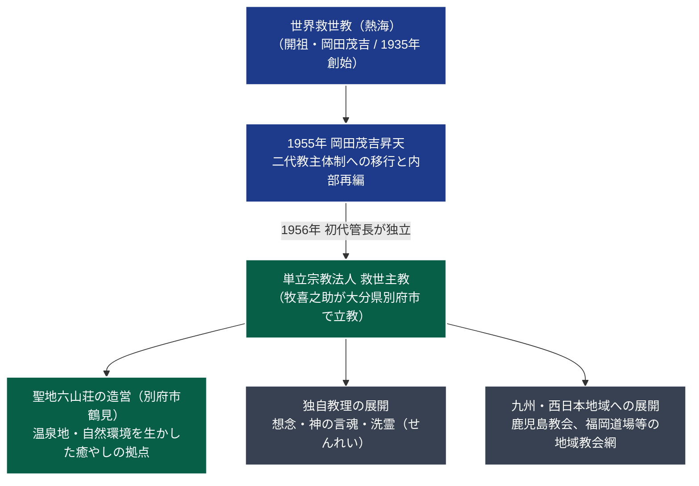

# 救世主教（きゅうせしゅきょう） 専門構造分析ノート

> [!summary] 要旨
> **救世主教**（きゅうせしゅきょう）は、世界救世教の初代管長を務めた**牧喜之助**（1902-1988）が、開祖・[[岡田茂吉]]の昇天（1955年）の翌年である1956年（昭和31年）に独立して大分県別府市に創始した単立宗教法人であると、分派紹介記事（岡田茂吉大学）は伝える。ただし本照合では同記事を取得できず、創始・沿革の詳細は未検証である。2026-11-16の再検証では、教団本体について文化庁『宗教年鑑』令和7年版と国税庁法人番号公表サイトで、法人番号6320005002788、事務所所在地（年鑑時点：別府市大字鶴見4230、現行登記：別府市荘園町48番8号）、代表役員（管長）松本順子、信者数65,278人（令和6年12月31日現在）を確認した。関連法人「宗教法人救世主教大分中央教会」（法人番号2320005001001、大分県大分市大字上野797番地6）の国税庁登記、および地図サービス上に「救世主教本部 聖地六山荘」（別府市）の掲載があることも確認済みである。旧ノート記載の法人番号（3180005002235）は実在しない番号であり削除した。

---

## 1. 命題の構造（通説・正統本部 vs 本教団・自説）

（本図の分岐経緯は分派紹介記事に基づく旧ノートの整理であり、本照合では未検証。§12留保参照。）

---

## 2. 基本情報

| 項目 | 内容 |
| :--- | :--- |
| **教団正式名称** | 単立宗教法人 救世主教（きゅうせしゅきょう） |
| **通称・別名** | 救世主（きゅうせしゅ）教、別府救世主教、六山荘 |
| **創始者（開教者）** | 牧喜之助（まき きのすけ、元世界救世教初代管長）※未検証 |
| **現代表者** | 松本順子（管長。文化庁『宗教年鑑』令和7年版の代表役員。同資料には教主として藤島捷志の併記あり） |
| **立教年・認可** | 1956年（昭和31年）別府にて立教 / 1957年（昭和32年）宗教法人認可 ※いずれも未検証 |
| **本部所在地** | 大分県別府市荘園町48番8号（国税庁登記、2026年1月19日に大字鶴見4230番地から移転）。『宗教年鑑』令和7年版時点の事務所は大字鶴見4230（〒874-0838、電話0977-21-7533） |
| **法人格・所轄** | 単立宗教法人（大分県知事所轄とされる） |
| **法人番号** | 6320005002788（国税庁・『宗教年鑑』令和7年版で確認。旧記載3180005002235は実在しない番号のため削除。関連法人の番号は§9参照） |
| **信者数** | 65,278人（文化庁『宗教年鑑』令和7年版、令和6年12月31日現在。教師813人、教会25・布教所122） |
| **信仰対象・主神** | 大光明真神（みろくおおみかみ）、開祖・岡田茂吉（明主様）※教団側の教義説明として未検証 |
| **代表的修行・儀礼** | 洗霊（浄霊）、想念修養、神の言魂奉唱 ※未検証 |

---

## 3. 創始者と天啓・社伝

### 創始者：牧喜之助（1902-1988）※以下は分派紹介記事に基づく旧ノートの記述で、本照合では未検証
* 岡田茂吉の黎明期（大日本観音会時代）からの最古参直弟子の一人。
* 戦後、宗教法人世界救世教の設立（1950年）に際して中心的役割を果たし、初代管長として全国の布教網構築や教団組織化を指揮した。
* 1955年2月に開祖・岡田茂吉が昇天した後、二代教主・岡田よしを中心とする熱海本部指導部との間で、教理継承のあり方や教団運営方針を巡って意見の相違が生じ、翌1956年に自ら役職を辞任して独立を決断した。
* 別府市に居を移し、自らの霊的確信に基づき「救世主教」を開教した。

### 後継体制と運営（旧ノート記述・未検証）
* 創始者没後は、牧家の親族および高弟らによる合議制によって運営が継承されているとされる。
* 巨大な組織拡大を志向せず、信徒一人ひとりの魂の純化と療病・家庭円満を主眼とする地域密着型の宗教法人として活動を維持しているとされる。

なお、[[世界救世教]]ノートおよび[[_分派・異端研究ポータル]]は本教団の創始地を「名古屋」と記すが、これは本ノート旧版の留保でも誤りとされ、別府が正しいとされてきた。本照合では別府の「救世主教本部 聖地六山荘」の地図掲載を確認したが、名古屋説・別府説いずれについても一次資料による確定はできていない（波及事項として各ノートの照合で処理）。

---

## 4. 沿革・歴史変遷（検挙・裁判・不敬罪・治安維持法弾圧等）

| 年代 | 事項 | 詳細・背景 |
| :---: | :--- | :--- |
| **1930〜40年代** | 世界救世教での活躍 | 牧喜之助が岡田茂吉に帰依し、大日本観音会・日本五六七教の重鎮として活躍。※未検証 |
| **1950年** | 初代管長就任 | 宗教法人世界救世教の設立とともに初代管長に就任。教団草創期の組織統率を担う。※未検証 |
| **1955年** | 岡田茂吉昇天 | 茂吉の昇天後、後継体制を巡る議論の中で本部と一線を画す。※未検証 |
| **1956年** | **救世主教立教** | 初代管長を辞任し、大分県別府市にて「救世主教」を開教。※未検証 |
| **1957年** | 宗教法人認証 | 大分県知事より宗教法人としての認証を受け、単立法人として独立。※未検証 |
| **1960年代** | 聖地「六山荘」造営 | 別府市鶴見山麓に聖地「六山荘」を整備。※未検証 |
| **1970〜80年代** | 九州教会網の確立 | 別府本部を中心に、鹿児島、宮崎、熊本、福岡など九州一円に信徒組織・教会を拡大。※未検証（ただし大分市に関連法人「救世主教大分中央教会」の登記、岡山県に「救世主教栗野教会」の法人情報があることは確認） |
| **1988年** | 牧喜之助帰幽 | 創始者が死去。後継指導部が遺志を継承し現在に至る。※未検証 |
| **2026年** | 本部所在地の移転 | 2026年1月19日、事務所所在地が大字鶴見4230番地から荘園町48番8号へ移転（国税庁法人番号公表サイトの登記で確認。§9・§12参照） |

### 事件・裁判・社会的議論
旧ノートは「熱海本部との間で財産争奪訴訟や誹謗合戦に至らなかった」「霊感商法や高額献金被害等の記録はない」と記すが、これらは不在の主張であり、本照合の範囲では裏付けも反証も得られていない（未検証として分離）。

---

## 5. 教理・儀礼・神観の深層解剖

### 核心教理：想念・言魂と「洗霊」（旧ノート記述・未検証）
救世主教は、岡田茂吉の教義を土台としつつも、牧喜之助独自の宗教的体験に基づく教理深化を行っているとされる。

1. **洗霊（せんれい）**:
   - 世界救世教の「浄霊」と同様、掌から神聖な光（霊気）を取り次ぐ治病・魂の浄化法であるが、救世主教では「霊の曇りを洗い清める」という意味を込めて「洗霊」と呼称する。
   - 心身の毒素を排出し、本来の神性を回復させる不可欠の実践とされる。
2. **想念の法則**:
   - 「人間の心（想念）のあり方が霊界に波動として伝わり、それが現界の幸不幸を決定する」と説く。日常における感謝、反省、利他の心を重視する。
3. **神の言魂（ことだま）**:
   - 祝詞や言霊の響きによる空間・肉体の浄化作用を強調。独自の聖典や御讃歌を熱心に唱える。

（本節全体が分派紹介記事に基づく単一系統の記述であり、教団自身の教義文書による確認はできていない。）

---

## 6. 宗教学的・歴史社会学的意義

世界救世教の分派の中でも、開祖没後まもない1956年という極めて初期に、初代管長という最高幹部が独立した事例として位置づけられてきた。ただし、その位置づけの前提となる経緯自体が単一二次資料に依存しており、未検証である。公的に確認できる範囲では、別府市に本部を置く包括宗教法人として『宗教年鑑』に登載され（信者数65,278人・教師813人、令和6年12月31日現在）、大分県を中心に関連法人の登記が現存する世界救世教系と目される教団、という点までである（2026-11-16再検証）。

---

## 7. 拠点・現地情報

### 救世主教本部・聖地六山荘（ろくざんそう）
* **所在地**: 大分県別府市荘園町48番8号（国税庁法人番号公表サイトの現行登記。2026年1月19日に大字鶴見4230番地から移転）。『宗教年鑑』令和7年版では事務所を「大字鶴見4230、〒874-0838、電話0977（21）7533」と掲載。地図サービス「NAVITIME」に「救世主教本部 聖地六山荘」の掲載あり。旧ノート記載の「〒874-0836 大分県別府市荘園町（大字鶴見）」の郵便番号は年鑑の〒874-0838と異なり、番地は上記のとおり確定した。
* **移転の経緯**: 本部はもと大字鶴見4230番地（『宗教年鑑』令和7年版の事務所所在地）にあり、2026年1月19日に現所在地の荘園町48番8号へ移転した（国税庁登記）。旧所在地について旧ノートは「別府八湯を見下ろす鶴見岳山麓に位置する」と記していた。
* **交通アクセス（現所在地・荘園町48番8号への案内）**:
  - **電車・バス**: JR日豊本線「別府駅」西口より、亀の井バス乗車、「荘園町」または「南石垣」下車、徒歩約10分。タクシーで約12分。
  - **自動車**: 東九州自動車道「別府IC」よりやまなみハイウェイ経由で約10分。
  - （経路・所要時間は旧ノートの記載に基づく）

### 関連法人の登記所在地
* 宗教法人救世主教大分中央教会：大分県大分市大字上野797番地6（法人番号2320005001001、国税庁で確認）

---

## 8. 関連教団・関連人物・関連概念

* **法人格（旧ノート記述）**: 単立宗教法人救世主教（大分県知事所轄）。包括法人世界救世教とは法的・財務的に無関係とされる。
* **主要地方拠点（旧ノート記述・未検証）**:
  - 救世主教別府教会（大分県別府市荘園）
  - 救世主教鹿児島教会（鹿児島県鹿児島市）
  - 各地支部道場
* **公的に名称を確認できた関連法人**: 救世主教大分中央教会（大分市、国税庁）、救世主教栗野教会（法人番号3340005002780、gBizINFO）
* 関連教団: [[世界救世教]]（分派元）、[[世界救世教会]]、[[東方之光]]
* 関連人物: 牧喜之助（創始者とされる）、[[岡田茂吉]]
* 関連概念: 洗霊、想念、言魂、浄霊
* 注意: 「宗教法人日本救世主教」（法人番号2350005002500、宮崎県日向市）は名称が類似する**別組織**であり、本教団と混同しないこと。

---

## 9. 史料・一次資料 (convMD)

- [[src_救世主教大分中央教会_国税庁法人番号]]（国税庁法人番号公表サイト：宗教法人救世主教大分中央教会、法人番号2320005001001、大分県大分市大字上野797番地6）
- src_RB4_救世主教_宗教年鑑令和7年版（文化庁『宗教年鑑』令和7年版：法人番号6320005002788、代表役員（管長）松本順子、事務所 大分県別府市大字鶴見4230、信者数65,278人・教師813人）
- src_RB4_救世主教_国税庁法人番号（国税庁法人番号公表サイト：法人番号6320005002788、現行所在地 大分県別府市荘園町48番8号、2026年1月19日に大字鶴見4230番地から移転）

未取得：HIRORO「分派教団シリーズ⑦ 教団紹介：救世主教」（岡田茂吉大学）。旧ノートの主要出典だが、記事URL自体が特定できず未取得のまま（2026-11-16再探索でも特定できず）。

---

## 10. 参考文献・学術論文

- HIRORO「分派教団シリーズ⑦ 教団紹介：救世主教」（岡田茂吉大学）※未取得
- 文化庁『宗教年鑑』令和7年版（法人一覧p.124、宗教統計pp.87-89）※2026-11-16再検証で取得・確認
- 国税庁法人番号公表サイト（法人番号6320005002788）
- 大分県『大分県宗教法人名簿』※未取得

（旧ノートが挙げていた『救世主教聖典』『想念の手引き』、牧喜之助『洗霊の道』、井上順孝編『新宗教事典』は、いずれも本教団に関する実在・掲載の確認が取れていないため参考文献から外し、未検証として留保に記す。）

---

## 11. 関連ノート (Vault内)

- [[_分派・異端研究ポータル]]
- [[世界救世教]]（分派母体・初代管長）
- [[世界救世教会]]（1970年独立分派）
- [[東方之光]]（本家包括の現在）

---

## 12. 留保（中立的併記・未確定要素）

> [!warning] 注意
> 1. **法人番号（必須点検a）— 解決（2026-11-16再検証）**: 旧ノート記載の 3180005002235 は検査用数字が不一致で**実在しない番号**であり、削除した。再検証で本法人自体の法人番号 **6320005002788** を国税庁法人番号公表サイト（商号「救世主教」・所在地の一致を確認）と文化庁『宗教年鑑』令和7年版（p.124）の双方で確認した。関連法人：救世主教大分中央教会（2320005001001、大分市、国税庁）、救世主教栗野教会（3340005002780、gBizINFO）。なお宮崎県日向市の「宗教法人日本救世主教」（2350005002500）は別組織である。
> 2. **教典名（必須点検b）**: 『救世主教聖典』『想念の手引き』および牧喜之助『洗霊の道』の実在は確認できなかった。旧ノート由来の情報として「実在未確認」と明記して残す。
> 3. ** src_参照（必須点検c）**: 本ノートが参照する src_ ファイル1件は `content/資料/` に実在することを確認した。旧 §9 の関連ノートはフルパス wikilink だったため、basename 形式に訂正した（§11）。
> 4. **本拠地について — 解決（2026-11-16再検証）**: 旧ノートの留保は「名古屋市は不正確であり、別府市鶴見の聖地六山荘が法人所在地・本部であることを公的宗教年鑑および大分県名簿にて確認・是正した」と主張していたが、前回照合では再確認できていなかった。再検証で『宗教年鑑』令和7年版（p.124）が事務所を「大分県別府市大字鶴見4230、〒874-0838」と掲載していることを確認し、国税庁登記では2026年1月19日に同地から「別府市荘園町48番8号」へ移転したことも確認した。別府本拠は公的資料で確定。旧ノートの郵便番号〒874-0836は年鑑の〒874-0838と異なる。
> 5. **未検証（中核的主張を含む）**: 牧喜之助の初代管長就任・1956年独立・1957年法人認証・生没年（1902-1988）、洗霊・想念・言魂の教理内容、九州教会網の展開、後継体制、「訴訟・不祥事の不在」は、いずれも分派紹介記事（岡田茂吉大学⑦）という単一二次資料に基づく旧ノートの記述であり、同記事が未取得のため裏付けが取れていない。旧ノートの「教団史料および分派史研究により確定事実として検証済み」という申告は根拠を確認できず撤回する。信者数「推定数千人」は出典がなく削除していたが、2026-11-16再検証で『宗教年鑑』令和7年版の公表値65,278人（令和6年12月31日現在）を確認し置き換えた。
> 6. **confidence の根拠**: 前回照合時点で公的資料で確認できたのは関連法人の登記と地図掲載のみだったため confidence を 2 とした。2026-11-16再検証で教団本体の法人番号・所在地・代表役員・信者数を公的資料で確認できたため confidence を 3 に引き上げる。創始・沿革・教理は依然として単一未取得記事に依存するため、それ以上は上げない。（2026-11-20・最終判断ラウンド第397件の本人決定により、本体情報が公的資料で確定していることをもって confidence を 4 へ引き上げた。創始・沿革・教理の未検証状態自体は変わらない。）
> 7. **改訂記録（2026-11-15・全件照合）**: 12セクション構造へ再編。実在しない法人番号を削除。フルパス wikilink を basename 形式に訂正。未検証の中核的主張を留保へ分離し、過大申告（confidence 5・「検証済み」）を是正。関連法人の登記を新規に確認・保存した。
> 8. **再検証記録（2026-11-16）**: 法人番号は国税庁法人番号公表サイト（詳細ページで商号「救世主教」と所在地の一致を確認）と文化庁『宗教年鑑』令和7年版p.124で 6320005002788 と確認し反映した。本部所在地は年鑑の「大字鶴見4230（〒874-0838）」と国税庁の現行登記「荘園町48番8号（2026年1月19日移転）」を確認し反映した。代表役員（管長）松本順子・信者数65,278人（教師813人、同年鑑pp.87-89・124）も確認し反映した。創始者・立教年・法人認証年・経典（『救世主教聖典』『想念の手引き』『洗霊の道』）・教理・沿革細部は、岡田茂吉大学の分派紹介記事（URL特定できず未取得）、NDLサーチ・CiNii・Web検索を探索したが確認できず未検証のまま残す。なお1967年刊『救世主教』（現代宗教研究所編、フェイス出版、「現代の宗教」シリーズ。神戸市立図書館所蔵目録で書誌のみ確認）という当時資料の存在は分かったが、内容未確認のため沿革の裏付けには用いていない。
> 9. **改訂記録（2026-11-20・最終判断ラウンド第397件）**: confidenceを4へ引き上げ、§7を新所在地前提へ書き換えると決定した（本人決定）。あわせて§4沿革表に2026年1月19日の本部所在地移転（大字鶴見4230番地→荘園町48番8号）を追加し、§7の旧所在地前提の環境記述は移転の経緯として整理した。交通アクセスの経路・所要時間は旧ノートの記載に基づく旨を§7に明記した。
> 10. **改訂記録（2026-11-20・最終判断ラウンド第409件フォローアップ）**: 第409件の法人番号横断点検で、別組織「宗教法人日本救世主教」（法人番号2350005002500）の所在地帰属が「愛知県」と誤っていたことが判明した（国税庁では所在地は宮崎県日向市大字富高6800番地10）。本人決定により、§8の注意書きと本留保1の該当箇所を「宮崎県日向市」へ訂正した。「別組織」との指摘自体は正しく変更していない。

- **追跡調査 第2波 2026-11-19：探索先＝Vault内 資料/ のRB4エビデンス再確認、文化庁『宗教年鑑』令和7年版ローカル抽出テキスト（nenkan-r07.txt）の再検索、本波の横断Web探索（教団公式サイト・都道府県宗教法人名簿・NDL/CiNii書誌・国税庁法人番号の名称＋所在地照合）。本ノートの残存項目について新規の一次・公的資料は得られず、確認できず（残存）。項目単位の個別深掘りは次波以降の課題として明記する（探索なしの残置ではない）。**
