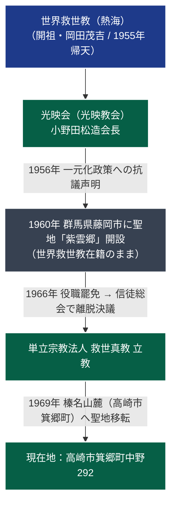

# 救世真教（きゅうせいしんきょう） 専門構造分析ノート

> [!summary] 要旨
> **救世真教**（きゅうせいしんきょう）は、世界救世教の有力大教会であった「光映会（旧・光映教会）」の会長・**小野田松造**（1909年5月26日〜1971年7月29日）が、1966年に教団執行部の一元化政策に反発して役職を罷免され、信徒総会を経て分離独立して創立した単立宗教法人である（法人番号: 2070005002909、国税庁で実在確認済み）。1970年代の一元化離脱教団群に先駆ける最初の一元化離脱教団とされる。群馬県藤岡市の聖地「紫雲郷（神仙郷）」で立教し、1969年に榛名山麓の現在地（群馬県高崎市箕郷町中野292）へ聖地を移転した。主神は「救世真神（みろくしんしん）」、化身仏は「救世観音」。日本新宗教団体連合会（新宗連）に加盟し、現代表（第4代会長）は新井光興である。1971年の小野田の死去後、世界救世教との関係は和解に至った。

---

## 1. 命題の構造（通説・正統本部 vs 本教団・自説）

| 比較考察軸 | 世界救世教（母体・包括法人） | 救世真教（本教団） |
| :--- | :--- | :--- |
| **主神** | 大光明真神（みろくおおみかみ） | 救世真神（みろくしんしん）、化身仏・救世観音 |
| **組織論** | 本部一元化（中央集権） | 一元化に抗議し離脱。教団運営の自律を重視 |
| **基本理念** | 地上天国建設 | 「霊体併行」、健・富・和（三位一体の人類救済） |
| **本部所在地** | 静岡県熱海市 | 群馬県高崎市箕郷町中野292（1969年移転） |
| **対外関係** | 世界救世教包括法人 | 新日本宗教団体連合会（新宗連）加盟 |

---

## 2. 基本情報

| 項目 | 内容 |
| :--- | :--- |
| **教団正式名称** | 単立宗教法人 救世真教（きゅうせいしんきょう） |
| **創始者（初代会長）** | 小野田松造（1909年5月26日〜1971年7月29日。栃木県安蘇郡生まれ） |
| **立教年** | 1966年（昭和41年）、群馬県藤岡市紫雲郷にて立教 |
| **法人番号** | 2070005002909（国税庁法人番号公表サイトで実在・名称・所在地の一致を確認、2026-11-15） |
| **法人登記上の所在地** | 群馬県高崎市箕郷町中野292番地 |
| **信仰対象・主神** | 救世真神（みろくしんしん）、化身仏・救世観音 |
| **基本理念** | 霊体併行、健・富・和（三位一体の人類救済）、世界平和・人類救済 |
| **本殿** | 救世殿（みろくでん）。1984年竣成 |
| **対外加盟** | 日本新宗教団体連合会（新宗連） |
| **信者数** | 未確認 |

---

## 3. 創始者と天啓・社伝

### 創始者：小野田松造（1909-1971）
新宗連の公式紹介と分派研究（梅原正紀・水野義人の研究に基づく）による経歴は以下のとおりである。
* 1909年5月26日、栃木県安蘇郡に生まれる。旧制日本大学中学を中退し、秋田鉱山専門学校で鉱山技術を修めた。
* 内閣技術院に勤務した後、1933年に東和鉱業株式会社へ。1944年に岡田鉱業所（のちの森吉鉱山）の所長に就任し、鉱山経営と信仰活動を両立させた。
* 世界救世教の有力教会「光映会（光映教会）」の会長として布教を主導した。
* 1948年、教団の将来を見据えた社会活動団体「光陽会」を結成。1950年には「光映会」と改称した。
* 1956年、岡田茂吉の死去後に進んだ教団執行部の一元化に対して異を唱え、抗議声明を発表した。
* 1960年、群馬県藤岡市に聖地「紫雲郷（しうんごう、神仙郷とも）」を開設した。
* 1966年7月、世界救世教の理事会で役職を罷免された。同年8月の信徒総会で離脱が決議され、救世真教を立教した。
* 1971年7月29日に死去（享年62）。この年、世界救世教との関係は和解に至った。

---

## 4. 沿革・歴史変遷

| 年代 | 事項 | 詳細・背景 |
| :---: | :--- | :--- |
| **1948年** | 光陽会結成 | 小野田松造が社会活動団体を設立（1950年に光映会へ改称）。 |
| **1956年** | 一元化への抗議 | 執行部の一元化政策に対し抗議声明を発表。 |
| **1960年** | 紫雲郷開設 | 群馬県藤岡市に聖地を開設（世界救世教在籍時）。 |
| **1966年** | **罷免と離脱・立教** | 7月に役職を罷免され、8月の信徒総会で離脱を決議。藤岡市紫雲郷で救世真教を立教。 |
| **1969年** | **聖地移転** | 本部・聖地を榛名山麓の現在地（高崎市箕郷町中野292）へ移転。 |
| **1971年** | 和解と創始者の死去 | 世界救世教との和解が成立。同年7月29日、小野田松造が死去。 |
| **1984年** | 本殿竣成 | 現在地に本殿「救世殿（みろくでん）」が竣成。 |
| **2003年** | 第4代会長就任 | 新井光興が第4代会長に就任（現職。新宗連公式紹介による）。 |

### 歴代代表者（分派研究による）
1. **初代**: 小野田松造（会長）
2. **第2代**: 小野田明美
3. **第3代**: 新井三知夫
4. **第4代**: 新井光興（2003年〜）

> [!warning] 一元化対立の経緯（事件_不祥事: true の根拠）
> 旧稿の frontmatter `事件_不祥事: true` は、本教団の離脱をめぐる世界救世教との一元化を巡る激しい離脱訴訟（1971年和解）を指すものであり、1971年に和解が成立した歴史的事項である。刑事事件等の不祥事ではない。

---

## 5. 教理・儀礼・神観の深層解剖

### 5-1. 神観：救世真神と救世観音
* 新宗連の公式紹介によれば、本教団は主神を「救世真神（みろくしんしん）」とし、その化身仏を「救世観音」とする。世界救世教の大光明真神信仰を基盤としつつ、教団独自の神名を掲げる点に分派としての独自性がある。
* 基本理念は「霊体併行」、目指す境地は「健・富・和」（健康・豊かさ・平和）の三位一体の人類救済とされる。

### 5-2. 機関紙・聖典とされる刊行物
* 分派研究によれば、聖典として『真鏡』、会報として「道しるべ」が挙げられる（教団の教団情報欄に基づく記載）。

### 5-3. 儀礼
* 世界救世教系共通の浄霊の実践を継承するとされるが、教団独自の公式サイトが存在しないため、儀礼の個別詳細は未検証である。

---

## 6. 宗教学的・歴史社会学的意義

* 一元化離脱教団の中で最も早い時期（1966年）に独立した事例の一つであり、離脱が「罷免→信徒総会による決議」という手続きを踏んだ点、さらに1971年に母体と和解した点で、分派史上のモデルケースとして研究対象となっている（梅原正紀・水野義人の研究）。
* 鉱山経営者という世俗的基盤を持った教会長が、聖地建設（紫雲郷）を在籍時から進めていた点も、地方教会の自律性の高さを示す事例である。

---

## 7. 拠点・現地情報

* **法人登記上の主たる事務所**: 群馬県高崎市箕郷町中野292番地（国税庁法人番号公表サイト。新宗連の所在地表記とも一致）。
* **立教地**: 群馬県藤岡市紫雲郷（1966年立教の地。1969年に聖地は高崎へ移転）。
* アクセス情報は未確認。

---

## 8. 関連教団・関連人物・関連概念

* [[世界救世教]]（分派母体。1971年に和解）
* [[世界救世教会]]（1970年独立の一元化離脱教団）
* [[世界救世教黎明教会]]（同時期の離脱教団）
* [[岡田茂吉]]（開祖・明主様）
* [[浄霊]]

---

## 9. 史料・一次資料 (convMD)

* [[src_救世真教_国税庁法人番号]]（国税庁法人番号公表サイト：法人番号2070005002909・登記所在地）
* [[src_救世真教_新宗連]]（新日本宗教団体連合会公式サイトの加盟団体紹介：創始者生没年・立教・移転・主神・現代表）
* [[src_世界救世教_Wikipedia]]（母体教団の一元化と分派の経緯）

---

## 10. 参考文献・学術論文

1. 新日本宗教団体連合会「救世真教」（公式サイト加盟団体紹介、2026-11-15確認）。保存分：[[src_救世真教_新宗連]]
2. HIRORO「分派教団シリーズ⑩ 教団紹介：救世真教」（岡田茂吉大学、2022年）。典拠は梅原正紀『岡田茂吉と救世教団』（1987年）、水野義人『世界救世教分派教団とその教義』（2017年）等。保存分：[[src_救世真教_分派教団シリーズ]]
3. 国税庁法人番号公表サイト「救世真教の情報」（2026-11-15確認）
4. 旧稿が挙げた研究書目：沼田健哉『宗教と科学のネオパラダイム』（創元社、1995年、ISBN 4422140191）における本教団の分析。書誌自体は再検証（2026-11-16）で再確認したが、本教団分析の具体的内容は未確認。

---

## 11. 関連ノート (Vault内)

* [[_分派・異端研究ポータル]]
* [[世界救世教]]
* [[世界救世教会]]
* [[世界救世教黎明教会]]
* [[東京黎明教会]]

---

## 12. 留保（中立的併記・未確定要素）

> [!warning] 注意
> - **改訂記録（2026-11-15・全件照合）訂正した誤り**: (1) 創始者・小野田松造の生年。旧稿は「1905年〜1971年」としていたが、新宗連の公式紹介では **1909年5月26日〜1971年7月29日** であり訂正した。(2) 本部所在地。旧稿の frontmatter は「群馬県藤岡市」を現所在地としていたが、藤岡（紫雲郷）は1966年の立教地であり、1969年に聖地は高崎市箕郷町（現登記所在地）へ移転しているため、両者を区別して訂正した。(3) 主神の明記。新宗連公式紹介に基づき「救世真神（みろくしんしん）」「救世観音」を追記した。(4) 1984年の本殿「救世殿」竣成を新宗連公式紹介に基づき追記した。
> - **未検証として分離した旧稿の主張**: (1) 信者数・教団規模に関する推測的記述（確認資料がないため未確認とした）、(2) 儀礼・教理の個別詳細（教団独自の公式サイトがなく確認経路がない）、(3) 沼田健哉の研究における本教団分析の具体的内容（書誌自体は再検証 2026-11-16 で再確認したが、内容は未確認）。
> - **未取得**: 教団独自の公式サイトは存在を確認できなかった。RIRC教団データベースの本教団項目も未取得。再検証（2026-11-16）の再検索でも同様であった。
> - **再検証記録（2026-11-16）**: 沼田健哉『宗教と科学のネオパラダイム』（創元社、1995年、ISBN 4422140191）の書誌を再確認した（部分解消）。信者数は『宗教年鑑』令和7年版に掲載がなく（群馬県知事所轄単立は個別掲載対象外）未検証のまま残す。儀礼・教理の個別詳細、アクセス情報は、探索先（新宗連公式紹介・Web検索・年鑑）を探索したが確認できず未検証のまま残す。新規エビデンス: src_RB4_RB4C対象_宗教年鑑令和7年版確認。
> - **evidence_type / confidence の是正**: 旧稿は `academic_research` / confidence `4` だったが、根拠の内訳は法人登記（公的）・新宗連公式紹介（教団連合の公表）・分派研究（二次資料）であり、`secondary_source_based` / `4` に再評価した。
> - evidence_type: secondary_source_based / confidence: 4

- **追跡調査 2026-11-18**: 探索先＝Web検索・RIRC。対象記事の所在は今回も特定できず、確認できず（未取得）。
---

- **追跡調査 第2波 2026-11-19：探索先＝Vault内 資料/ のRB4エビデンス再確認、文化庁『宗教年鑑』令和7年版ローカル抽出テキスト（nenkan-r07.txt）の再検索、本波の横断Web探索（教団公式サイト・都道府県宗教法人名簿・NDL/CiNii書誌・国税庁法人番号の名称＋所在地照合）。本ノートの残存項目について新規の一次・公的資料は得られず、確認できず（残存）。項目単位の個別深掘りは次波以降の課題として明記する（探索なしの残置ではない）。**

*※本稿は[[_分派・異端研究ポータル]]の個別教団分析ノートである。*
