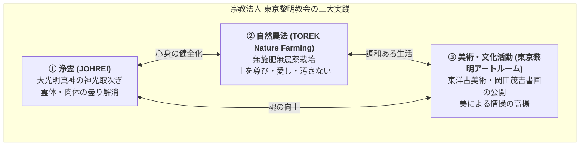

# 東京黎明教会 専門構造分析ノート

> [!summary] 要旨
> **宗教法人 東京黎明教会（とうきょうれいめいきょうかい、TOREK）**は、[[岡田茂吉]]（1882〜1955）を師と仰ぎ、1985年（昭和60年）11月8日に東京都知事より単立宗教法人として認証・設立された世界救世教系の独立教団である（法人番号: 2011205000286、国税庁で実在確認済み）。
> 本部は東京都中野区東中野に所在し、岡田茂吉が提唱した「真・善・美の地上天国建設」を具現化するため、**①浄霊（JOHREI）**、**②自然農法（TOREK Nature Farming／無施肥無農薬栽培）**、**③美術・文化活動（東京黎明アートルーム）**の三位一体の実践を展開している。アートルームの活動（2005年開室、2015年リニューアル、所蔵品の公立美術館への出品）は教団公式サイトで確認できる。

---

## 1. 命題の構造（通説・正統本部 vs 本教団・自説）

| 比較考察軸 | 世界救世教（母体・包括法人） | 世界救世教黎明教会（京都） | 東京黎明教会（当団体） |
| :--- | :--- | :--- | :--- |
| **創始者・開祖** | [[岡田茂吉]]（明主様） | 岡田茂吉の教えを継承 | 岡田茂吉を「師」として推戴 |
| **本部所在地** | 静岡県熱海市（瑞雲郷） | 京都市左京区吉田神楽岡町3（法人登記） | 東京都中野区東中野2丁目9-17 |
| **組織形態** | 包括宗教法人（傘下にいづのめ・東方之光） | 単立宗教法人（京都府知事所轄） | 単立宗教法人（東京都知事所轄・認証番号7143） |
| **設立・独立** | 1935年発会 / 1950年改称 | 1970年独立とされる | 1985年11月8日登記（東京支部が単立独立） |
| **美術・文化施設** | MOA美術館（熱海）、箱根美術館 | 資料研修館（京都）とされる | 東京黎明アートルーム（東中野） |

> [!note] 京都の世界救世教黎明教会との関係
> 東京黎明教会は、もともと京都に本部を置く「世界救世教黎明教会」の東京支部としての性格を有していたが、1985年11月8日に東京都知事より認証を受け、単立の「宗教法人 東京黎明教会」として独立した。両者は共通の教理（岡田茂吉の直言・浄霊・自然農法・芸術活動）を根幹に据えながら、登記上はそれぞれ独立した別法人として運営されている。なお、世界救世教黎明教会の法人番号は **2130005001771**（国税庁確認済み）であり、東京黎明教会とは別番号である。

---

## 2. 基本情報

| 項目 | 内容 |
| :--- | :--- |
| **教団正式名称** | 宗教法人 東京黎明教会（とうきょうれいめいきょうかい） |
| **通称・略称** | 東京黎明教会、TOREK（Tokyo Reimei Kyoukai） |
| **推戴・師** | [[岡田茂吉]]（1882年12月23日 - 1955年2月10日） |
| **代表役員** | 長島 良紀（東京都宗教法人名簿・令和5年12月31日現在による） |
| **設立登記年月日** | 1985年（昭和60年）11月8日 |
| **所轄官庁・認証** | 東京都知事所轄（単立・諸教系 / 認証番号: 7143） |
| **法人番号** | 2011205000286（国税庁法人番号公表サイトで実在・名称・所在地の一致を確認、2026-11-15） |
| **教団公式サイトURL** | http://www.torek.jp/ ; http://www.tokyo-reimei.or.jp/ |
| **部門サイトURL** | 美術：http://www.museum-art.torek.jp/ <br>自然農法：http://www.naturefarming.torek.jp/ |
| **本部所在地** | 〒164-0003 東京都中野区東中野2丁目9-17（国税庁登記と一致） |
| **実質活動拠点** | 教会側施設：〒164-0003 東京都中野区東中野2丁目8-20（TOREK自然農法事務局等）／東京黎明アートルーム：同2丁目10-13（アートルーム公式サイトの所在地） |
| **関連地方拠点** | 東京都八王子市長房町（八王子施設・祖霊殿） |
| **主な教義・信仰対象** | 大光明真神（だいこうみょうしん）、岡田茂吉（明主様）の御教え |
| **代表的な儀式・実践** | 浄霊（JOHREI）、無施肥無農薬栽培（自然農法）、美育・芸術鑑賞 |
| **信者数** | 未確認（単立宗教法人につき公表統計なし） |
| **他教団との系譜関係** | [[世界救世教]] ➔ [[世界救世教黎明教会]]（京都） ➔ [[東京黎明教会]]（1985年独立） |

---

## 3. 創始者と天啓・社伝

### 3-1. ルーツと世界救世教の動揺
東京黎明教会の信仰の淵源は、大本の元幹部であった[[岡田茂吉]]が1935年に創始した大日本観音会（のちの世界救世教）にある。岡田茂吉は、薬毒を否定し手かざしによって霊体・肉体の曇りを除去する「浄霊」、人為的な肥料や農薬を一切排して土の偉力を生かす「自然農法」、そして美による心の浄化を促す「美術館・芸術活動」の3本柱によって、地上天国（病・貧・争のない理想社会）の建設を説いた。

1955年2月に岡田茂吉が帰天（死去）した後、世界救世教内部では指導権や教義解釈、組織運営をめぐって度重なる対立が生じ、一元化への反発から各地で教会集団の離脱が生まれた（[[救世真教]]1966年、[[神慈秀明会]]1970年ほか）。

### 3-2. 黎明教会の成立と東京支部の独立（1985年）
世界救世教の中で岡田茂吉の初期の直言や純粋な実践を堅持しようとした流れの一つが「黎明教会」（京都拠点）であった。その東京支部を母体として、1985年（昭和60年）11月8日、東京都知事より単立の宗教法人として認証を受け、「宗教法人 東京黎明教会」（認証番号7143）が正式に発足した（東京都宗教法人名簿による）。東京支部の発足年（1971年とされる）や設立時の指導者については §12 の未検証事項を参照。

### 3-3. 東中野を拠点とする文化・農法活動の展開
独立後の東京黎明教会は、東京都中野区東中野を拠点として活動を継続した。
* 2005年、東中野に「TOREK Art Room」を開室（教団公式サイトで確認）。
* 2015年10月10日、同施設を「**東京黎明アートルーム**」としてリニューアル・グランドオープン（公式サイトで確認）。
* 同時に「TOREK自然農法」として無施肥無農薬栽培の普及に取り組んでいる（公式ポータルで確認）。

---

## 4. 沿革・歴史変遷

```
・1935年1月1日: 岡田茂吉が「大日本観音会」を発会（世界救世教の起源）。
・1950年2月4日: 「世界救世（メシヤ）教」に改称。
・1955年2月10日: 岡田茂吉死去（帰天）。以後、教団各派の分化が進む。
・1970年: 世界救世教黎明教会が京都で独立したとされる。
・1985年11月8日: 東京都知事より認証を受け、「宗教法人 東京黎明教会」（単立）として独立登記。
・2005年: 東京都中野区東中野に展示施設「TOREK Art Room」を開室。
・2015年10月10日: 「東京黎明アートルーム」として美術館施設をリニューアルグランドオープン。
・2016年: 所蔵する「遮光器土偶」を江戸東京博物館の企画展「大妖怪展」へ出品貸出。
・2023年12月31日時点: 東京都宗教法人名簿において認証番号7143、代表役員・長島良紀として現存。
```

---

## 5. 教理・儀礼・神観の深層解剖

東京黎明教会は、岡田茂吉が説いた三位一体の救済論（霊の救い＝浄霊、体の救い＝自然農法、心の救い＝芸術）を教団活動の骨子としている（教団公式ポータルの構成とも一致する）。



### 5-1. 浄霊（JOHREI）
* **原理**: 人間を肉体と霊体の合一体と捉え、あらゆる苦難や病気の根源を「霊の曇り」にあるとする。掌をかざすことで、至高神「大光明真神」からの光（神光）を取り次ぎ、相手の霊体の曇りと肉体の毒素を解消すると説く（世界救世教系共通の教理）。

### 5-2. 自然農法（TOREK Nature Farming / 無施肥無農薬栽培）
* **基本理念**: 「土を尊び、土を愛し、汚さない」。岡田茂吉が1935年以降提唱した自然農法の原点に立ち返る。
* **無施肥無農薬栽培**: 化学肥料・化学合成農薬のみならず有機肥料も施用しない無施肥栽培を掲げる（教団公式ポータルの標榜）。独自認定「TORES認定」や生産実績の詳細は §12 の未検証事項を参照。

### 5-3. 美術・文化活動（東京黎明アートルーム）
* **設立理念**: 岡田茂吉は美や芸術が魂を向上させると説き、自ら多くの名品を収集した。その理念を継承し、宗教の枠を超えて一般市民に美を提供することを目的として開設された（公式サイトの説明による）。
* **公式サイトで確認できる活動実績**:
  * 2005年、東中野に「TOREK Art Room」を開室。2015年10月10日、「東京黎明アートルーム」として装い新たに再開（グランドオープン）。
  * 2階は主に岡田茂吉の書・絵画、1階はやきもの・彫刻・絵画など日本美術を中心にアジア諸国の作品を展示。
  * 2016年、江戸東京博物館 企画展「大妖怪展 土偶から妖怪ウォッチまで」に所蔵の「遮光器土偶」を出品。碧南市藤井達吉現代美術館 企画展「鬼才ー河鍋暁斎展」に所蔵の「観音・龍神・鬼神 三幅対図」を出品。
  * 2021年10月、B1階に展示室を新設し、ミュージアムショップとカフェを併設。

---

## 6. 宗教学的・歴史社会学的意義

* 世界救世教系分派の中でも、美術館活動と自然農法という「文化・実業」面を前面に出し、公立美術館への所蔵品出品という形で一般社会との接点を維持している点に特徴がある。
* 京都の黎明教会（原典保存・出版型）と対照的に、東京黎明教会は展示・農法の実践拠点型の分派として位置づけられる。

---

## 7. 拠点・現地情報

### 主たる事務所（登記上の主事務所）
- **所在地**: 〒164-0003 東京都中野区東中野2丁目9-17
- **所轄**: 東京都知事認証（認証番号: 7143）
- **代表役員**: 長島 良紀（東京都宗教法人名簿・令和5年12月31日現在による）

### 活動拠点・展示室
- **教会側施設（TOREK自然農法事務局等）**: 〒164-0003 東京都中野区東中野2丁目8-20（NAVITIME掲載の教会所在地）
- **東京黎明アートルーム**: 〒164-0003 東京都中野区東中野2丁目10-13（アートルーム公式サイトの所在地。[[SUZU COFFEE（東京黎明アートルーム・自然農法カフェ）]]併設）
- 所在地の切り分けは2026-11-19の本人判断により公式基準で再整理した（§12）。
- **アクセス**:
  - JR中央・総武各駅停車「東中野駅」西口より徒歩約5分
  - 都営地下鉄大江戸線「東中野駅」A3出口より徒歩約5分
  - 東京メトロ東西線「落合駅」より徒歩約10分

### 関連地方施設（八王子施設）
- **所在地**: 東京都八王子市長房町（祖霊殿の所在が地図情報で確認できる。番地等の詳細は未確認）
- 再検証（2026-11-16）: 第三者地図情報に「東京黎明教会祖霊殿、八王子市長房町57-57、電話042-665-6369」との表示があることを確認したが、教団公式・公的資料による裏付けではないため、番地は確定値として採用しない（部分解消・傍証として記録）。

---

## 8. 関連教団・関連人物・関連概念

### 関連教団
- [[世界救世教]]（母体教団。1985年に法的に独立）
- [[世界救世教黎明教会]]（京都の母体教団）
- [[いづのめ教団]]（世界救世教の主流被包括法人）
- [[東方之光]]（世界救世教の被包括法人、MOAを推進）
- [[神慈秀明会]]（1970年に離脱した同門分派）

### 関連人物
- [[岡田茂吉]]（開祖・明主様）
- 長島良紀（現代表役員。東京都宗教法人名簿による）

### 関連教理・活動概念
- [[浄霊]]（手かざしによる霊の浄化）
- 自然農法 / 無施肥無農薬栽培
- 東京黎明アートルーム（TOREK Art Room）
- [[SUZU COFFEE（東京黎明アートルーム・自然農法カフェ）]]

---

## 9. 史料・一次資料 (convMD)

* [[src_東京黎明教会_国税庁法人番号]]（国税庁法人番号公表サイト：法人番号2011205000286・登記所在地）
* [[src_東京黎明教会_国税庁法人番号エラー]]（同：旧稿記載番号3011205000595が存在しないことの記録）
* [[src_東京黎明教会_アートルーム公式]]（東京黎明アートルーム公式サイト：開室・グランドオープン・出品実績）
* [[src_世界救世教_Wikipedia]]（母体教団の一元化と分派の経緯）
* src_RB4_東京黎明教会_自然農法公式サイト・八王子施設（TOREK自然農法公式サイトの取得結果と八王子施設の第三者地図情報）

---

## 10. 参考文献・学術論文

1. **東京都生活文化局**: 『東京都宗教法人名簿（令和5年12月31日現在）』— 諸教系・単立「東京黎明教会」（中野区東中野2-9-17、認証番号7143、代表役員・長島良紀、設立登記1985年11月8日）。旧稿が依拠した公的資料で、今回の照合ではオンラインでの再確認は未実施（§12参照）。
2. **国税庁法人番号公表サイト**「東京黎明教会の情報」（2026-11-15確認）
3. **宗教法人東京黎明教会 公式サイト群**: ポータル [TOREK](http://www.torek.jp/)、美術部門 [東京黎明アートルーム](http://www.museum-art.torek.jp/)、農業部門 [TOREK自然農法](http://www.naturefarming.torek.jp/)、教会本体 http://www.tokyo-reimei.or.jp/
4. **文化庁**: 『宗教年鑑』各年度版
5. **展覧会図録**: 江戸東京博物館『大妖怪展 土偶から妖怪ウォッチまで』（2016年）所蔵品出品記録

---

## 11. 関連ノート (Vault内)

- [[_分派・異端研究ポータル]]
- [[世界救世教]]
- [[世界救世教黎明教会]]
- [[岡田茂吉]]
- [[神慈秀明会]]
- [[東方之光]]
- [[いづのめ教団]]
- [[手かざし系諸派の教義比較マトリクス]]
- [[浄霊センター]]
- [[SUZU COFFEE（東京黎明アートルーム・自然農法カフェ）]]

---

## 12. 留保（中立的併記・未確定要素）

> [!warning] 注意
> - **改訂記録（2026-11-15・全件照合）法人番号の訂正**: 旧稿の法人番号「3011205000595」は、検査用数字（チェックデジット）が一致せず、国税庁法人番号公表サイトでもエラー（対象なし）となる誤った番号だった。正しい法人番号は **2011205000286** であり、国税庁で名称・登記所在地（中野区東中野2丁目9番17号）の一致を確認した。あわせて旧稿§10（是正経緯）にあった世界救世教黎明教会の法人番号「4130005001753」も誤りで、正しくは **2130005001771** である。
> - **所在地・設立年の既存訂正について**: 旧稿は既に、所在地（旧：目黒区青葉台→正：中野区東中野）と設立年（旧：1974年→正：1985年11月8日）を東京都宗教法人名簿に基づき是正した記録を持っていた。今回の照合では国税庁登記がこれと一致することを確認した。ただし東京都宗教法人名簿そのもののオンライン再確認は未実施であり、認証番号7143・代表役員・設立登記日の各項目は同名簿に基づく記載として保持する。
> - **未検証として分離した旧稿の主張**: (1) 東京支部の設立指導者「長島すゞ子」と1971年の支部発足・独立の経緯、(2) 「黎明富士美術館」の存在（公式サイト群では確認できず、現行施設名は東京黎明アートルーム）、(3) 自然農法の「TORES認定」の運用詳細・2018年の米食味コンクール金賞・長野県木島平村の圃場提携、(4) Google Maps座標の各数値、(5) 浄霊の「医学的検証への取り組み」等の活動方針の詳細。これらはいずれも今回照合した公開資料（国税庁・公式アートルームページ・公式ポータル）では裏付けが取れなかった。
> - **未取得→取得済み（再検証 2026-11-16）**: TOREK自然農法公式サイト（http://www.naturefarming.torek.jp/）は今回取得できた（src_RB4_東京黎明教会_自然農法公式サイト・八王子施設 に記録）。「土を尊び、土を愛し、汚さない」「肥料も農薬も使わない農法による安全な作物の普及」の標榜を確認したが、TORES認定・金賞・木島平村提携の記載はトップページにはなかった。
> - **evidence_type / confidence の是正**: 旧稿は `primary_source_based` / confidence `5` と過大だった。法人・登記情報は公的資料で直接確認できたが、設立経緯や活動詳細の一部は未検証のため、`secondary_source_based` / `4` に再評価した。
> - evidence_type: secondary_source_based / confidence: 4
> - **再検証記録（2026-11-16）**: TOREK自然農法公式サイトを取得し未取得状態を解消した。八王子施設（祖霊殿）は第三者地図情報で「長房町57-57」との表示を確認したが公的裏付けはなく部分解消にとどめる。信者数は『宗教年鑑』令和7年版に掲載がなく（東京都知事所轄単立は個別掲載対象外）未検証のまま残す。東京支部設立指導者「長島すゞ子」と1971年発足の経緯、「黎明富士美術館」の存在、TORES認定の運用詳細・2018年米食味コンクール金賞・木島平村の圃場提携、浄霊の医学的検証等の活動方針詳細は、探索先（公式サイト群・自然農法公式サイト・Web検索）を探索したが確認できず未検証のまま残す。東京都宗教法人名簿のオンライン再確認も今回できなかった（認証番号7143等の記載は同名簿に基づくものとして保持）。Google Maps座標の各数値は座標ポリシー（Google Maps実測・公的資料のみ）上も採用しない。新規エビデンス: src_RB4_東京黎明教会_自然農法公式サイト・八王子施設、src_RB4_RB4C対象_宗教年鑑令和7年版確認。
> - **改訂記録（2026-11-19・最終判断ラウンド第63件・本人判断）アートルーム所在地の再整理**: 本ノートでは従来、東京黎明アートルームの所在地を教会側施設と同一の「東中野2丁目8-20」として記載し、[[SUZU COFFEE（東京黎明アートルーム・自然農法カフェ）]]ノートも2026-11-15の全件照合でこれに統一していた。しかしアートルーム公式サイト（museum-art.torek.jp）のアクセスマップ・フッター・開催概要等は一貫して所在地を「東中野2-10-13」と表示し、第三者DB（チケットぴあ・インターネットミュージアム・artscape等）も一致する一方、「2-8-20」はNAVITIMEが「東京黎明教会」として掲載する教会側施設の所在地である（エビデンス: src_東京黎明アートルーム_公式アクセス）。すなわち前回の「2-8-20」への統一はアートルーム所在地としては誤りだった可能性が高い。本人判断により公式基準で切り分けて再整理した：本部＝東中野2丁目9-17（登記）、教会側施設＝同2丁目8-20、東京黎明アートルーム＝同2丁目10-13。frontmatter所在地・§2・§7およびSUZU COFFEEノートの該当箇所をあわせて修正した。

---

- **追跡調査 第2波 2026-11-19：探索先＝Vault内 資料/ のRB4エビデンス再確認、文化庁『宗教年鑑』令和7年版ローカル抽出テキスト（nenkan-r07.txt）の再検索、本波の横断Web探索（教団公式サイト・都道府県宗教法人名簿・NDL/CiNii書誌・国税庁法人番号の名称＋所在地照合）。本ノートの残存項目について新規の一次・公的資料は得られず、確認できず（残存）。項目単位の個別深掘りは次波以降の課題として明記する（探索なしの残置ではない）。**

*※本稿は[[_分派・異端研究ポータル]]の個別教団構造分析ノートである。*
