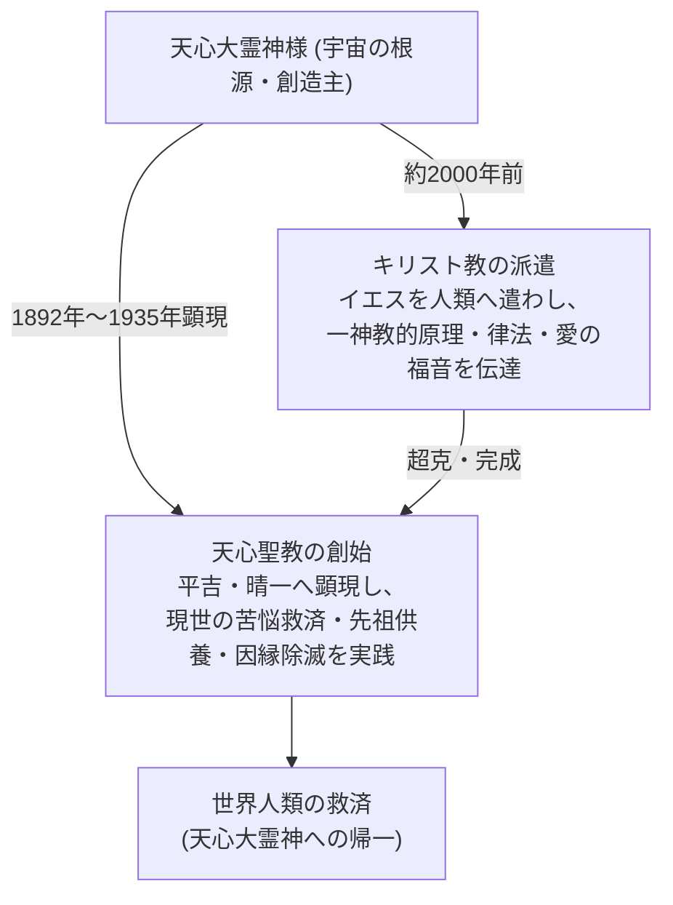
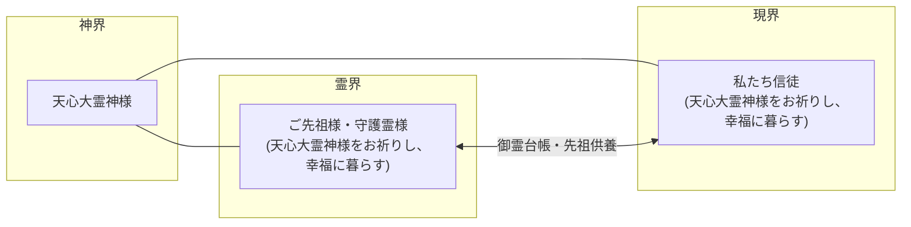

# 天心聖教 専門構造分析ノート

> [!summary] 要旨
> **天心聖教**（てんしんせいきょう / 旧称: 天心教、天心大霊教）は、開祖・島田晴一（せいいち、1896〜1985、國學院大學『神道事典』は「島田精一」と表記）が主祭神「天心大霊神（てんしんおおみかみ）」の神託・神命を受けて創始した文部科学大臣所轄の単立宗教法人（法人番号: 4010005000437、本部: 東京都文京区本駒込6丁目）。
> 全国主要都市の拠点を神社ではなく「教会」「礼拝堂」「本部聖堂」と呼称し、モダンな近代教会堂建築を採用しているため外形上はキリスト教系と混同されやすいが、その教義の本質は**「神道・民間霊術的実践を母体としながら、キリスト教の神観（イエスを遣わした宇宙神）を包括的・発展的に取り込んだ独自の習合宗教」**である。
> 主祭神「天心大霊神」は**「かつてイエスを人類に遣わされた神様御自身」**であると公式教理（入門冊子『安心して暮らせる幸せを』等）で明記されており、戦時中には開祖に対して**「キリスト教を父とし、汝の宗教を母として世界を救え」**という神託（神勅）が下された。西洋の一神教的超越性（父）と、日本の神道・母性的抱擁・現世救済（母）を統合する救済史観を掲げつつ、信徒の実践面では「お祝詞」「おふだ」「御霊台帳による先祖供養」「悪因縁除滅」「発散の行」といった伝統的日本宗教の霊動的・現世利益的儀礼を中核に据えている。

---

## 1. 命題の構造（通説・正統本部 vs 本教団・自説）

天心聖教は、施設名称に「教会」「礼拝堂」「聖堂」を用い、竹中工務店発注の本部聖堂をはじめとする近代的な会堂建築を持つことから、初見の外部者からは「プロテスタント系またはキリスト教系新宗教の一派」と認識されることが多い。しかし、内部教理および儀礼の深層を解剖すると、キリスト教を否定するのではなく、むしろ自教の主神の配下にキリスト教の神格と歴史的使命を包摂・位置づける「スーパーセッショニズム（超克・完成的習合）」の構造を持つ。

### 比較考察軸マトリクス表

| 比較考察軸 | 伝統的正統キリスト教（カトリック / プロテスタント） | 伝統的教派神道・神社神道 | 天心聖教 (Tenshin-Seikyo) |
| :--- | :--- | :--- | :--- |
| **最高神・信仰対象** | 三位一体の神（父・子・聖霊） | 天照大御神・造化三神・八百万の神 | **天心大霊神**（宇宙の創造主、天地一切をつかさどる唯一の救い神。「かつてイエスを世に遣わした神」御自身） |
| **イエス・キリストの位置づけ** | 神の独り子、人類の贖罪主、救世主 | 基本的に教理外（他宗教の預言者） | **天心大霊神が約2000年前に人類へ遣わした使者**（天心大霊神はその根源神であり、モーセやイエスの時代を超越した存在） |
| **キリスト教の役割（神託）** | 唯一絶対の救済の道 | 他宗教（外来宗教） | **「キリスト教を父とし、汝の宗教（自教）を母として世界を救え」**（父性的一神教と母性的現世救済の婚姻的統合） |
| **拠点・建築形態** | 教会堂・大聖堂（十字架を掲揚） | 神社社殿（鳥居・千木・鰹木・神鏡） | **本部聖堂・教会・礼拝堂**（近代建築・チャペル風様式、十字架や鳥居は排し「御聖殿（御神殿・御霊殿）」を安置） |
| **中心儀礼・実践** | 礼拝、ミサ、聖餐式、洗礼、聖書朗読 | 祭祀、大祓詞奏上、玉串奉奠、神札 | **お祝詞奏上**、**おふだ拝受**、**御霊台帳による先祖供養**、**悪因縁除滅**、**発散の行**、個人指導（悩み相談） |
| **世界観・領域統治** | 天国と地獄、終末論（最後の審判） | 幽顕一如、高天原・中津国・黄泉国 | **三界統治**（現界・霊界・神界を一貫して統べる。現界の信徒と霊界のご先祖が共に天心大霊神を祈ることで真の幸福を実現） |
| **他宗教観** | 排他的または対話的包摂 | 寛容・神仏習合 | **包括的帰一論**（「信じる対象は違っても、その信じる心がやがて天心大霊神様に結ばれ、今までの信仰も生きる」） |

---

## 2. 基本情報

### 2-1. 法人格および組織諸元
- **法人名称**: 宗教法人 天心聖教（てんしんせいきょう）
- **法人番号**: 4010005000437（国税庁法人番号公表サイトで名称・所在地の一致を確認済み）
- **所轄庁**: 文部科学大臣所轄（単立単位宗教法人、包括関係なし）
- **文化庁『宗教年鑑』分類**: 諸教（単立）とされる（令和7年版の団体名索引で掲載頁 p.163〈文部科学大臣所轄単位宗教法人一覧〉を特定。2026-11-16再検証。§12参照）
- **國學院大學『神道事典』分類**: 第8部 流派・教団と人物 / 近代の教団（神道系新宗教）
- **代表役員**: 島田幸一郎と旧稿にあるが、今回照合した資料（事典・Wikipedia・公式冊子）では確認できなかったため未検証（§12参照）。継承は初代開祖: 島田晴一、二代教主: 島田晴行（1976年就任、事典・Wikipediaで確認）
- **公称信者数**: 約21万人（國學院大學『神道事典』記載の公称値）
- **本部所在地**: 〒113-0021 東京都文京区本駒込6丁目10-21（天心聖教本部聖堂）
  - 本部施設構成: 御聖殿（向かって右: 御神殿、左: 御霊殿）

### 2-2. 全国の主要礼拝施設（聖堂・教会・礼拝堂一覧）
教団は全国各地に拠点を展開しており、その名称は「聖堂」「教会」「礼拝堂」に統一されている（公式入門冊子『安心して暮らせる幸せを』末尾一覧より。2026-11-15に保存した公式冊子とWikipediaの施設一覧で相互に一致を確認）。

| 施設種別 | 施設名 | 所在地 | 特色・備考 |
| :--- | :--- | :--- | :--- |
| **本部** | **本部聖堂** | 東京都文京区本駒込6-10-21 | 教団中枢。竹中工務店発注の聖堂（2代目1960年竣工、3代目2006年竣工。Wikipedia）。御神殿・御霊殿を併設。 |
| **聖堂** | **長崎聖堂** | 長崎県長崎市女の都3-5-16 | 九州中核拠点（旧・長崎仮教会から昇格）。 |
| **教会** | **大阪教会** | 大阪府大阪市阿倍野区長池町10-6 | 関西中核拠点。 |
| **教会** | **沼津教会** | 静岡県沼津市下香貫林ノ下2068 | 東海地区中核拠点。 |
| **教会** | **諫早教会** | 長崎県諫早市福田町46-32 | 諫早天心診療所を併設。近代建築の会堂。 |
| **発祥聖地** | **聖地大越礼拝堂** | 埼玉県加須市大越2439 | 平吉少年が神様と出会った「納屋」が保存される教団発祥聖地。 |
| **礼拝堂** | **札幌礼拝堂** | 北海道北広島市虹ヶ丘8-2-1 | 北海道中核拠点。モダンな礼拝堂建築。 |
| **礼拝堂** | **函館礼拝堂** | 北海道函館市東山1-15-1 | 道南拠点。2017年に竹中工務店発注で竣工、2018年度日事連建築賞・日事連会長賞受賞（Wikipedia）。 |
| **礼拝堂** | **仙台礼拝堂** | 宮城県仙台市青葉区栗生6-2-1 | 東北中核拠点。 |
| **礼拝堂** | **山形礼拝堂** | 山形県天童市東久野本3-3-38 | 山形拠点。 |
| **礼拝堂** | **伊勢礼拝堂** | 三重県いなべ市大安町石榑東1860-5 | 近畿・東海境界拠点。 |
| **礼拝堂** | **四国礼拝堂** | 香川県東かがわ市水主2067-31 | 四国北部拠点。 |
| **礼拝堂** | **今治礼拝堂** | 愛媛県今治市桜井2-6-4 | 四国西部拠点。 |
| **礼拝堂** | **大分礼拝堂** | 大分県大分市中鶴崎2-6-19 | 東九州拠点。 |
| **医療機関** | **天心診療所（東京）** | 東京都文京区本駒込6-11-9 | 本部聖堂至近に設置された医療施設。 |
| **医療機関** | **諫早天心診療所** | 長崎県諫早市福田町46-32 | 諫早教会に併設された医療施設。 |

---

## 3. 創始者と天啓・社伝

### 3-1. 1892年（平吉少年への神顕現）と開祖誕生予言
天心聖教の起源は、教団公式教本『由来』および入門冊子において以下のように語られる（國學院大學『神道事典』・Wikipediaの沿革とも大筋で一致する）。
- **神の顕現**: 1892年（明治25年）、埼玉県加須市大越の農家において、当時10歳であった長男・**島田平吉（へいきち）**の前に突如として神様（天心大霊神）が姿を現した。神様は大男の姿で山小屋や納屋に現れ、平吉に文字を教え、空中飛行によって深山へ連れ出すなど数々の神秘的奇蹟を現したとされる。
- **救済史的意味**: 教団は、この1892年の平吉への顕現を**「イエス誕生から約2千年後」**という超歴史的タイムスケールの中で位置づけている。
- **開祖誕生予言**: 1895年（明治28年）正月、平吉は「来年弟が生まれる」と予言。13ヶ月後の1896年（明治29年）2月11日、予言通り男の子が誕生した。神様はその子に自ら**「晴一（せいいち）」**と名付け、平吉に対して「汝と別れねばならないが、年月が経つうちに我が使命を降す者を現す故、時節を待っておられよ」と言い残して神界へ戻ったとされる。

### 3-2. 40年後の神降臨と先物相場神示
- 成長した晴一は外米や建具（障子戸）のブローカーとなり、23歳で東京・深川に店舗を開店した。しかしその後事業は暗転し、深刻な経営不振に陥る（Wikipediaによれば1920年の物価大暴落や1923年の関東大震災も苦境の要因とされる）。
- 誕生から約40年後の1935年（昭和10年）、どん底にあった晴一のもとに天心大霊神が再降臨した。「汝らに財宝を授けつかわすが故、晴一の生まれた二月十一日には必ず祭り事をせよ」と命じ、商品先物市場の相場変動を予言（神示）したことで、晴一とその商売仲間は莫大な富を得て窮地を脱したとされる。なおWikipediaは、1935年の神示は同業者・佐藤安孝の神懸りを通じて下され、大豆相場の高騰予言が当たったとする経緯を記す。
- これを契機に晴一は自宅で例祭を始め、神懸かり（憑依）によって神託を伝える宗教的集会が形成されていった。

---

## 4. 沿革・歴史変遷

- **1892年（明治25年）**: 平吉少年への神顕現（§3-1）。
- **1896年（明治29年）2月11日**: 開祖・島田晴一、埼玉県北埼玉郡大越村（現・加須市大越）に生まれる。
- **1935年（昭和10年）**: 天心大霊神の再降臨・相場神示。宗教活動を開始（§3-2）。
- **戦時中**: 神託「キリスト教を父とし、汝の宗教を母として世界を救え」が下される（國學院大學『神道事典』）。
- **1948年（昭和23年）**: 晴一、東京・駕籠町（現・文京区本駒込）に転居。翌1949年に客間に神殿を造り集会が再開される（Wikipedia）。
- **1951年（昭和26年）1月**: **開教の神命**。天心大霊神より**「晴一、汝身命を賭して宗教を改革し、宗教と人生に新生命を与えて世界人類を救済せよ。我が守護してつかわす」**との神命を受ける。Wikipediaはこの1951年を立教とする。
- **1952年（昭和27年）**: 晴一は経営していた3つの会社を部下に譲渡し、**「天心教」**を創立（國學院大學『神道事典』）。
- **1953年（昭和28年）**: **「天心大霊教」**へ改称。1955年に青年部発足、1960年に新殿堂（2代目聖堂、竹中工務店発注）が竣工。
- **医療と病気治し**: 診療所・調剤所を開設するとともに、1961年頃には神から示された「御神水」注射による病気平癒祈願を行い、多くの信徒を獲得した（事典）。
- **1976年（昭和51年）**: 晴一の高齢に伴い、長男の**島田晴行（しまだ はるゆき）**が二代教主に就任。
- **1985年（昭和60年）**: 開祖・晴一が帰幽。
- **1988年（昭和63年）**: 教団名を**「天心聖教」**へ改称。
- **2006年（平成18年）**: 竹中工務店発注の3代目本部聖堂が竣工（Wikipedia）。
- **2017年（平成29年）**: 函館礼拝堂が竣工（竹中工務店発注。2018年度日事連建築賞・日事連会長賞。Wikipedia）。

> [!warning] 弾圧・事件の記録について
> 戦前期の不敬罪・治安維持法による弾圧や、教団をめぐる事件・裁判の記録は、今回照合した資料（事典・Wikipedia・公式冊子）の範囲では確認できなかった。

---

## 5. 教理・儀礼・神観の深層解剖

### 5-1. 唯一救済神「天心大霊神」とイエス救済史観
公式入門冊子（『安心して暮らせる幸せを』）および公式サイト「神の聖旨」によれば、天心大霊神は以下のように規定される。
- **唯一の救い神**: 天心大霊神様は、神界・霊界・現界を一貫してつかさどる唯一の救い神であり、すべての生命の親神である。
- **イエスとの歴史的関係**: 天心大霊神は、**「イエスを世に遣わされた神様御自身」**である。約2000年前に人類にイエスを送り出した根源神そのものが、約2000年を経て日本において平吉・晴一に顕現したとする救済史観をとる。
- **超越性**: モーセやイエスの時代（旧・新約聖書の時代）をも超え、時代や国境・宗教の枠組みを超越する存在とされる。

### 5-2. 「父」としてのキリスト教と「母」としての天心聖教の二重構造
教団の核心的神託である**「キリスト教を父とし、汝の宗教を母として世界を救え」**（國學院大學『神道事典』所収の神託文）は、以下の二重構造を示す。

- **キリスト教（父性原理）**: 世界に神の存在と絶対的愛、精神的道徳律を宣言した歴史的役割を果たしたと評価される。
- **天心聖教（母性原理）**: その宣言を、現世における具体的な苦しみ（病気・貧困・人間関係の悪因縁）からの解放と、霊界の先祖との共生（供養）によって完成させる実践的・抱擁的な宗教と位置づけられる。

### 5-3. 三界統治の世界観と包括的帰一論
天心聖教の世界観は、**神界・霊界・現界**の三つの領域が分離せず一貫して天心大霊神によって治められているとする「三界統治」である。

他宗教への態度は極めて包摂的である。入門冊子によれば「どんな宗教、宗派でも信じる対象は違っても、その信じる心がやがては天心大霊神様に結ばれ、今までの信仰も生かされます」と説かれ、信徒が従来持っていた仏壇や神棚、他宗教の信仰を直ちに否定せず、その信仰心自体を天心大霊神への帰一の過程として肯定する包括的包摂主義（インクルーシビズム）をとる。

### 5-4. 霊的実践システム（現世救済の技法群）
天心聖教の教団的求心力の源泉は、抽象的な教理体系以上に、以下の具体的・身体的な霊的実践システムにある。

1. **個人指導（悩み相談）**: 礼拝堂・教会・聖堂の指導者による一対一の人生相談。信徒の家庭問題・健康問題・対人関係の悩みを受け止め、信仰的解決の指針を与える。
2. **おふだ（神札）・お守り**: 天心大霊神の分霊を込めた「おふだ」を自宅に祀ることで家庭を守護すると説く。
3. **お祝詞（のりと）奏上**: 神道式の祝詞を奏上し、天心大霊神の加護と浄化を祈る中心儀礼。
4. **御霊台帳と先祖供養**: 死者の霊を「御霊台帳」に登録して礼拝施設で永続的に供養するシステム。日本の伝統的な祖霊信仰・位牌供養を教団儀礼として制度化したもの。
5. **悪因縁の除滅（おはらい）**: 現在の不幸や病気の原因を、過去世や先祖から受け継いだ「悪因縁」と解釈し、祈祷によってその因縁を断ち切る。
6. **発散の行**: 身体の中の悪い「気」や霊的穢れを体外へ放出させる身体的実践（ヒーリング的技法）。民間霊術の伝統を継承する要素である。
7. **御神水**: 1961年頃から行われた、神示による「御神水」の注射による病気平癒祈願（§4参照）。

### 5-5. 祭事（Wikipediaによる）
- 元旦祭、節分祭、大祭（2月11日）、開教記念祭（5月11日）、合同御霊祭（春秋）、毎月の感謝祭（1日）・例祭（11日）・御霊祭（21日）。

### 5-6. 他の習合系新宗教との構造的相違点
同様にキリスト教や異宗教要素を取り込む日本の新宗教と比較すると、天心聖教の特殊性が浮かび上がる。

| 教団 | 習合の論理構造 | 天心聖教との相違点 |
|:--- |:--- |:--- |
| **[[日本聖道教団]]** | 伝統神道をキリスト教的に再編し、キリストの精神を神道に接合する | 聖道教団が神道的枠組みを維持するのに対し、天心聖教は「天心大霊神＝イエスの派遣者」という**神格の同一視**まで踏み込む |
| **生長の家** | 「万教帰一」を掲げ、各宗教の真理は同一であると説く | 生長の家が哲学的・観念的な同一性を説くのに対し、天心聖教は**歴史的神託（父と母の神勅）**によって救済史上の役割分担を規定する |
| **世界救世教** | 岡田茂吉の浄霊と自然農法を中心とし、キリスト教要素は副次的 | 救世教が浄霊という治癒技法を前面に出すのに対し、天心聖教は**神託による教理的統合**を前面に出す |

---

## 6. 宗教学的・歴史社会学的意義

天心聖教の教理が宗教学的に注目されるのは、以下の2点の神学的新機軸である（旧稿の分析。出典は教団公式資料の記述に基づく）。

1. **逆転した救済史観**: 通常、キリスト教系新宗教は「日本的神がキリスト教に包摂される」か「キリスト教を日本の神が超克する」という対立構造をとりがちである。これに対し天心聖教は、主神自身が「かつてイエスを送った神」であることで、キリスト教の歴史全体を自教の救済史の内部に取り込むと同時に、その完成者として自教を位置づける。これはスーパーセッショニズム（代替・完成主義）の日本的変奏と評価できる。
2. **ジェンダー的補完神学**: 「キリスト教＝父／自教＝母」という対比は、父性的・律法的一神教と母性的・抱擁的現世救済という、日本の宗教文化における根強い二項対立（超越 vs 内在、天 vs 地）を神学的に統合しようとする試みである。この構造は、[[日本近代新宗教におけるキリスト教習合の系譜]] における独自の位置を占める。

國學院大學『神道事典』（磯岡哲也執筆）が独立項目として収録している点から、学術的にも神道系新宗教の一事例として認知されている。

---

## 7. 拠点・現地情報

- **本部聖堂**: 〒113-0021 東京都文京区本駒込6丁目10-21（法人登記所在地と一致）
- **Google Maps座標**: 未確認
- **アクセス**: 都営三田線「千石駅」徒歩約5分、JR山手線・東京メトロ南北線「駒込駅」南口徒歩約10分、JR山手線・都営三田線「巣鴨駅」徒歩約10分（旧稿記載。今回の照合では公式サイトのアクセス情報で再確認できていない）
- **全国の礼拝施設**: §2-2の一覧参照（公式入門冊子・Wikipediaで一致を確認）

---

## 8. 関連教団・関連人物・関連概念

### 関連教団
- [[日本聖道教団]]（神道・キリスト教習合系の比較対象）
- [[日本近代新宗教におけるキリスト教習合の系譜]]（習合系譜の横断ノート）
- 生長の家（万教帰一との比較）
- 世界救世教（治癒技法中心型との比較）

### 関連人物
- 島田晴一（初代教祖・開祖。國學院事典は「島田精一」と表記）
- 島田平吉（晴一の兄。1892年に神の顕現を受けた）
- 島田晴行（二代教主。晴一の長男）
- 佐藤安孝（1935年の神示に関わった同業者。Wikipediaによる）

### 関連教理・概念
- 天心大霊神（てんしんおおみかみ）
- 御霊台帳（先祖供養の制度）
- 悪因縁除滅
- 発散の行
- 御神水

---

## 9. 史料・一次資料 (convMD)

- [[src_天心聖教_国税庁法人番号]]（国税庁法人番号公表サイト「天心聖教の情報」。法人番号4010005000437・所在地〈文京区本駒込6丁目10番21号〉を確認）
- src_天心聖教_宗教年鑑R7単位一覧2026-11-18（『宗教年鑑』令和7年版の単位一覧で代表役員 島田幸一郎・所在地・電話を確認。2026-11-18追跡調査）
- [[src_天心聖教_Wikipedia]]（Wikipedia「天心聖教」。沿革・施設・祭事の出典）
- [[src_天心聖教_國學院神道事典]]（國學院大學デジタルミュージアム『神道事典』「天心聖教」項目、磯岡哲也執筆。教祖伝・神託文・公称信者数約21万人の出典）
- [[src_天心聖教_公式入門冊子]]（公式入門冊子『安心して暮らせる幸せを』PDF。教義・施設一覧の出典）

※公式サイト（www.tenshin-seikyo.or.jp）のトップページはconvMD変換に失敗したため本文は未取得（サイト自体の存在と構成〈神の聖旨／天心聖教の由来／年表／全国の礼拝施設〉はブラウザで確認）。入門冊子PDFは取得・保存済み。

---

## 10. 参考文献・学術論文

- 國學院大學デジタルミュージアム『神道事典』「天心聖教」（磯岡哲也）
- 文化庁『宗教年鑑』令和7年版（団体名索引で天心聖教の掲載頁 p.163 を特定。分類「諸教」の原典頁として確認。2026-11-16再検証）
- 天心聖教公式入門冊子『安心して暮らせる幸せを』
- 天心聖教教本『由来』（一巻、310頁。公式冊子で書誌を確認）
- Wikipedia「天心聖教」

---

## 11. 関連ノート (Vault内)

- [[_分派・異端研究ポータル]]
- [[日本聖道教団]]
- [[日本近代新宗教におけるキリスト教習合の系譜]]

---

## 12. 留保（中立的併記・未確定要素）

> [!warning] 注意
> - **主祭神の読みの訂正**: 旧稿は「天心大霊神（てんしんだいれいじん）」としていたが、Wikipedia・國學院事典の英訳（Tenshin ōmikami）に照らし、読みは「てんしんおおみかみ」が正しいと判断し訂正した。
> - **創始者の表記ゆれ**: 國學院大學『神道事典』は創始者を「島田精一」と表記する。Wikipedia・教団側資料は「島田晴一（せいいち）」。両表記を併記した。
> - **代表役員「島田幸一郎」は確認済み（2026-11-18 追跡調査で解消）**: 『宗教年鑑』令和7年版の単位宗教法人一覧の原典照合により、法人番号4010005000437・代表役員 島田幸一郎・東京都文京区本駒込6-10-21・〒113-0021・電話03（3946）1721 を確認した。→ src_天心聖教_宗教年鑑R7単位一覧2026-11-18
> - **教書『御諭し』は未確認**: 旧稿が挙げた教書のうち『御神示』『神の聖旨（みこころ）』は公式冊子・公式サイトで呼称を確認し、『由来』（一巻・310頁）は公式冊子で書誌を確認した。『御諭し』は今回照合した資料の範囲では確認できなかったため未確認とする。
> - **信者数**: 約21万人は國學院事典が記す公称値であり、実数の検証ではない。
> - **アクセス情報**は旧稿記載のままで、今回の照合では再確認していない。ただし住所・電話は『宗教年鑑』令和7年版の記載（文京区本駒込6-10-21・03（3946）1721）と一致することを2026-11-18の追跡調査で確認した。
> - **公式サイト本文は未取得**（convMD変換失敗）。教義の検証は公式入門冊子PDF・事典・Wikipediaに基づく。
> - **再検証 2026-11-16（RB2）**：探索先＝文化庁『宗教年鑑』令和7年版公式PDF（索引）、既存エビデンス（公式入門冊子・國學院事典・Wikipedia・国税庁）。格上げ＝年鑑掲載頁の特定（令和7年版 p.163、単位宗教法人一覧）。未取得＝代表役員「島田幸一郎」の検証（単位一覧 p.163 の代表者欄はブラウザ取得のレート制限〈429〉により抽出できず）と公式サイト本文（従来通り未取得）。残存＝教書『御諭し』（既存資料の範囲で確認できず）、アクセス情報の公式再確認、Google Maps座標（座標ポリシー上、Google Maps実測または公的資料が必要で今回は実施できず）。
> - **追跡調査 2026-11-18**：探索先＝『宗教年鑑』令和7年版全文テキスト（RB4保存分の原典照合）。解消＝代表役員「島田幸一郎」を年鑑単位一覧で確認（法人番号・所在地・電話も一致）。残存＝教書『御諭し』、公式サイト本文（未取得のまま）、Google Maps座標。
> - evidence_type は `primary_source_based`、confidence は `4`（教義・沿革は教団公式冊子・教本という一次資料を直接保存・照合し、公的諸元は国税庁、第三者裏付けは國學院事典で確認したため。ただし代表役員・一部教書名は未確認のため5とはしない）。
> - **改訂記録（2026-11-15・全件照合）**: 法人番号4010005000437の実在を国税庁で直接確認。主祭神の読みを「てんしんおおみかみ」に訂正。立教年表記を1951年立教・1952年創立の併記に整理。Wikipedia・事典により沿革（駕籠町転居・聖堂竣工年・函館礼拝堂等）と祭事を補強。代表役員名と『御諭し』を未検証として分離。旧稿の「品質ゲート」チェックリスト形式を廃し、宗教版12セクションへ再編（実質的内容は保持）。

---

> - **追跡調査 第2波 2026-11-19（RB2）**: 探索先＝『宗教年鑑』令和7年版ローカル抽出テキスト（nenkan-r07.txt）再検索・Vault内『資料/』再確認・Web検索（国税庁法人番号・NDL／CiNii・教団公式・自治体公式）。代表役員「島田幸一郎」は第1波（2026-11-18）で年鑑R7単位一覧により解消済みのため本波では重複処理しない。教書『御諭し』・公式サイト本文・アクセス公式再確認は引き続き確認できず。確認できない項目は未検証のまま残置する。

*※本稿は[[_分派・異端研究ポータル]]の個別教団分析ノートである。*

