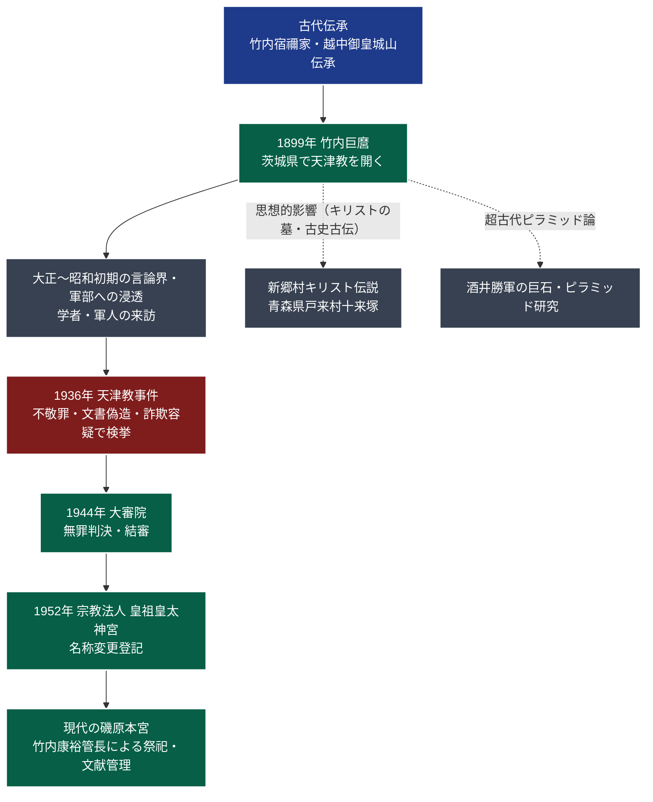

# 皇祖皇太神宮天津教 専門構造分析ノート

> [!summary] 要旨
> 皇祖皇太神宮天津教（こうそこうたいじんぐうあまつきょう）は、超古代史文書「竹内文書（竹内文献）」の継承・公開を契機として竹内巨麿（1874-1965）が1899年（明治32年）に立教した神道系宗教団体である。茨城県北茨城市磯原町に皇祖皇太神宮を構え、天神七代・上古二十五代・鵜葺草葺不合朝七十三代に及ぶ編年、モーセ・キリスト・釈迦らの来日修業伝説を伝承する。戦前には不敬罪等で検挙された（天津教事件）が、1944年12月12日に大審院で無罪判決が結審した。竹内文書は歴史学界では近代成立の偽書と断定されている。

---

## 1. 命題の構造（通説・正統本部 vs 本教団・自説）

- **教団の自説**: 『竹内文書』は竹内宿禰家に伝わる真正の古代記録であり、皇祖皇太神宮は天皇の祖先神を祀る根源の宮である。
- **学界の通説**: 竹内文書は近代（明治〜大正期）に成立した偽書である（5節・6節参照）。本ノートでは両者を分離して併記する。

---

## 2. 基本情報

| 項目 | 内容 |
| :--- | :--- |
| **教団正式名称** | 皇祖皇太神宮天津教（略称：天津教）。1952年に「宗教法人 皇祖皇太神宮」へ名称変更登記（Wikipedia） |
| **通称・別名** | 皇祖皇太神宮、天津教、磯原神宮 |
| **創始者（初代管長）** | 竹内巨麿（たけうち きよまろ、1874-1965、幼名・稲造） |
| **現代表者（第3代管長）** | 竹内康裕 |
| **立教年** | 1899年（明治32年）に茨城県において天津教を開く。1900年に皇祖皇太神宮の磯原遷座とされる（教団伝承） |
| **本部所在地** | 茨城県北茨城市磯原町磯原835番地（国税庁法人番号公表サイトの登記所在地） |
| **法人番号** | 7050005007310（国税庁確認済み、2026-11-16） |
| **法人格** | 宗教法人（単立とされる。所轄庁の確認は未実施） |
| **法人番号** | 未確認（12節参照） |
| **信者数** | 未確認（1929年時点で1万数千人を擁したとWikipediaは伝える） |
| **信仰対象・主祭神** | 天地身一大神をはじめ、天神七代、上古二十五代、不合朝七十三代、神武朝以降の歴代天皇・皇后を合祀する（公式サイト）。旧ノートの「元無極神」は公式サイトのトップページでは確認できなかった |
| **最重要聖典・神宝** | 『竹内文書（竹内文献）』、神代文字碑、神宝 |

---

## 3. 創始者と天啓・社伝

### 創始者：竹内巨麿（たけうち きよまろ、1874-1965）
* 富山県婦負郡呉羽村（現・富山市）出身。幼名は稲造。
* 祖父より、世界の歴史や太古の天皇家を記した古文献（いわゆる竹内文書）や、真正な神器とされる神宝を譲り受けた。
* 竹内文書や神宝の認知、そして日本国の再興を求め、1899年（明治32年）に茨城県において天津教を開いた（Wikipedia）。
* 教団伝承では、1900年（明治33年）に先祖代々越中（富山）の御皇城山に鎮座していた皇祖皇太神宮を、神託に基づいて茨城県多賀郡磯原町（現・北茨城市）へ遷座したとされる。
* 「武内宿禰の正統後裔」を自称したこと、鞍馬山・御岳山・伊勢神宮等での修行歴は、旧ノートの記述だが今回照合した出典（Wikipedia・公式サイト）では確認できなかった（未検証として分離）。

### 後継体制と世襲構造
* **初代管長**: 竹内巨麿（1874-1965）
* **第2代管長**: 竹内義宮（1999年没） — Wikipediaは「子息の竹内義宮」とする。旧ノートの「養嗣子」「1921年生」「読み：よしのり」は今回の出典では確認できなかった（未検証として分離）。
* **第3代管長（現職）**: 竹内康裕 — Wikipediaは「孫の竹内康裕が管長の座を引き継ぎ、現在に至っている」とする。

---

## 4. 沿革・歴史変遷（検挙・裁判・不敬罪弾圧等）

| 年代 | 事項 | 詳細・背景 |
| :---: | :--- | :--- |
| **1874年** | 竹内巨麿誕生 | 富山県呉羽村に生まれる。 |
| **1899年** | 天津教を開く | 竹内文書・神宝の認知と日本国の再興を求め、茨城県において立教（Wikipedia）。 |
| **1900年** | 皇祖皇太神宮磯原遷座 | 教団伝承による。富山から茨城県磯原へ神宮を遷座したとされる。 |
| **1911年** | 本殿・拝殿新築 | 明治44年に本殿や拝殿を新築し、活動範囲を広げる（Wikipedia）。 |
| **1936年** | 狩野亨吉による批判 | 元第一高等学校校長・文学博士の狩野亨吉が雑誌『思想』1936年6月号に「天津教古文書の批判」を発表し、偽書批判を展開した（Wikipedia「狩野亨吉」「竹内文書」。旧ノートの「1928年・『天津教古文書の偽作』」は年次・題名ともに誤りで、2026-11-16に訂正）。なお1928年5月は信者が狩野宅を訪ね竹内文書の写真を贈った年であり、論文の年ではない。 |
| **1929年** | 信者1万数千人 | 茨城県・福島県・東京・千葉県などで信者1万数千人を擁するまでになる（Wikipedia）。同年、詐欺事件で検挙された明道会・岸一太の著作中に竹内文書の一部が掲載されていた。 |
| **1930年** | 警視庁の取調べ・不起訴 | 岸一太の関連で、警視庁が詐欺容疑で竹内巨麿らを取り調べたが不起訴となった（Wikipedia。旧ノートに欠落していた経緯を追記）。 |
| **1935年** | キリスト墓騒動 | 竹内巨麿らが青森県戸来村（現・新郷村）を訪れ、「キリストの墓（十来塚）」を発見したと発表したとされる。 |
| **1936年** | **天津教事件（検挙）** | 2月13日朝、茨城県多賀郡磯原町にて竹内巨麿らが不敬罪、文書偽造行使、詐欺容疑で逮捕された（Wikipedia）。 |
| **1942年** | 一審有罪判決 | 3月16日、一審で不敬罪の有罪判決。上告（Wikipedia）。旧ノートの「水戸地裁・懲役刑」のうち、裁判所名と刑量は今回の出典では確認できなかった。 |
| **1944年** | **大審院で無罪判決** | 12月12日、大審院無罪判決、結審（Wikipedia）。 |
| **1952年** | 名称変更登記 | 新宗教法人法の施行を経て、「宗教法人 皇祖皇太神宮」へ名称変更登記された（Wikipedia）。 |
| **1965年** | 竹内巨麿逝去 | 子息の竹内義宮、孫の竹内康裕が管長を引き継ぐ。 |

> [!warning] 天津教事件について
> 1936年の検挙理由としてWikipediaは、世界天皇史観ともいうべき神話と異質な神代史・皇統譜を説き、その神宝をもって真正の三種の神器と称するなど、神宮や皇統の尊厳をそこなう思想が含まれていたこと、またその思想が国家主義者・国粋主義者らの関心を引いたことを挙げる。教団としては大規模ではなかったが、神宝や文献を見学・調査に訪れた学者や軍人はかなりの数にのぼり、当時その思想的影響力は無視できないものであったとされる。

---

## 5. 教理・儀礼・神観の深層解剖

### 5-1. 核心教理：竹内文書（竹内文献）の世界観
教団の信仰の基盤は、神代文字で書かれたとされる古代記録群『竹内文書』にある。記紀（古事記・日本書紀）以前の歴史を記すとされる。

1. **歴代朝の編年**:
   - **天神七代（てんじんしちだい）**: 宇宙開闢から地球形成、人類創成に至る神話的時代。
   - **上古二十五代（じょうこにじゅうごだい）**: 天皇（スメラミコト）が地球全体を統治していた黄金時代。
   - **鵜葺草葺不合朝（うがやふきあえずちょう）七十三代**: 記紀神話の神武天皇以前に73代続いた王朝。
   - 公式サイトも「天神七代、上古二十五代、不合朝七十三代、そして神武朝の現在までの代代の天皇・皇后を合祀したお宮」と述べ、この編年が教団の公式な自己提示であることが確認できる。
2. **スメラミコトの世界巡幸と五色人（ごしきじん）**:
   - 上古の天皇は「天の浮舟（あめのうきふね）」と呼ばれる飛行船に乗って世界各地を巡幸し、万国の民を統治したとされる。
   - 世界の人類は五色人に大別され、日本がその親国・根源の地であると説く。
3. **世界聖人の来日・修行伝説**:
   - モーセ、イエス・キリスト、釈迦、孔子、老子、マホメットら世界の宗教創始者が来日し、皇祖皇太神宮で神道を修業したと主張。
   - キリストはゴルゴダの丘で十字架にかけられたのは弟イスキリであり、本人は日本（青森県戸来村）に逃れて天寿を全うしたとする伝承を掲げる。

（以上は教団の信仰内容の記録であり、史実としての裏付けはない。6節の史料批判を参照）

### 5-2. 儀礼・実践
* 古代神道祭祀（祝詞奏上、神代文字を刻んだ石碑・神宝への礼拝）が行われるとされる。具体的な儀礼の詳細は公式サイトの行事案内等で部分的に確認できるが、本ノートでは未検証の細部には立ち入らない。
* 公式サイトでは「竹内文献勉強会」の開催が告知されている（2026年1月24日開催分を確認）。

---

## 6. 宗教学的・歴史社会学的意義

### 歴史学・考古学における「偽書」論争
* 歴史学界における一致した見解として、竹内文書は**近代（明治〜大正期）に成立した偽書（偽作）**と断定されている。
* 狩野亨吉は1936年の論文「天津教古文書の批判」で、用紙が近代のものであること、神代文字の音韻体系が明治期の日本語をトレースしていること、古代に存在し得ない近代概念が混入していること等を指摘したとされる（旧ノートの要約。原典の直接照合は未実施）。狩野は1935年に日本医事新報から鑑定を依頼され偽造と回答し、1942年には検察側証人として出廷した（Wikipedia「狩野亨吉」）。
* 一方で、民俗学・宗教社会学においては、近代日本人が生み出した「日本中心主義的ナショナリズムの文化的所産」として、オカルティズム史・近代精神史の貴重な一次史料として分析されている。

### 大審院無罪判決の意義
* 1944年12月12日の大審院無罪判決について、Wikipediaは判決が「この問題は裁判所の権限を超えた宗教問題である」、あるいは「単なる証拠不十分である」として無罪を宣告したと伝える。戦時下における不敬罪事件の無罪結審として、近代法制史・宗教弾圧史の文脈で言及される。
* 旧ノートが記した「大審院判事・小林俊三ら」の判事名、および判決理由の詳細な引用文は、今回照合した出典では確認できなかった（未検証として分離）。判決録原文の直接照合も行っていない。

---

## 7. 拠点・現地情報

### 本宮（皇祖皇太神宮）
* **所在地**: 茨城県北茨城市磯原町磯原835番地（国税庁法人番号公表サイトの登記所在地、2026-11-16確認）。旧ノート記載の「磯原1602」は登記所在地と一致しない。
* **アクセス**: JR常磐線 磯原駅より徒歩約2分／常磐道 北茨城IC下車 約5分（公式サイト「交通案内」による、2026-11-16確認）。旧ノートの「磯原駅よりタクシー約10分」は公式案内と異なるため採用しない。

---

## 8. 関連教団・関連人物・関連概念

- 関連人物: 竹内巨麿、竹内義宮、竹内康裕、狩野亨吉、酒井勝軍、岸一太
- 関連概念: 竹内文書、神代文字、古史古伝、キリストの墓伝説（新郷村）
- 関連教団: [[神道天行居]]（古神道研究との交錯）、[[大本]]（昭和10年代の国家弾圧・不敬罪事件の比較対象）、[[国際ラエリアン・ムーブメント]]（古代宇宙人・超古代文明論の近現代的変奏）

---

## 9. 史料・一次資料 (convMD)

- src_皇祖皇太神宮天津教_Wikipedia.md：Wikipedia「皇祖皇太神宮天津教」（convMD取込、2026-11-15）
- src_皇祖皇太神宮天津教_公式.md：皇祖皇太神宮公式サイト「皇祖皇太神宮とは」（convMD取込、2026-11-15）
- src_皇祖皇太神宮_国税庁法人番号：国税庁法人番号公表サイト（法人番号7050005007310、所在地 磯原町磯原835番地。2026-11-16確認）
- src_皇祖皇太神宮_公式交通案内：公式サイト「交通案内」（磯原駅徒歩約2分・北茨城IC約5分。2026-11-16確認）

※旧ノートの出典URLに挙げられていた「大審院判決録（昭和19年）」は、今回直接取得・照合していない（未取得）。判決の存在と結審日はWikipedia経由で確認した。

---

## 10. 参考文献・学術論文

- 狩野亨吉「天津教古文書の批判」『思想』1936年6月号（旧ノートの「天津教古文書の偽作」1928年は誤り。原典の直接照合は未実施）
- 原田実『偽書が揺るがした日本史』山川出版社、2020年（旧ノート記載）
- 長尾光之『竹内文書の謎』大陸書房、1986年（旧ノート記載）
- 藤原明『幻影の超古代史—竹内文書と近代日本』柏書房、2019年（旧ノート記載）
- （以上の書誌は旧ノートから引き継いだもので、今回の照合では各書の実在確認まで行っていない）

---

## 11. 関連ノート (Vault内)

- [[_分派・異端研究ポータル]]
- [[神道天行居]]
- [[大本]]
- [[国際ラエリアン・ムーブメント]]

※旧ノート §9 のフルパスwikilink（フォルダパス付きの形式）は basename 形式に訂正した。

---

## 12. 留保（中立的併記・未確定要素）

> [!warning] 留保事項
> - **法人番号（必須点検a）**: 旧ノート記載の 4050005003310 は、国税庁法人番号の検査用数字を計算すると一致せず（正しい検査用数字は6。なお余りは3であり、追補で示された「余り0→9」のケースには該当しない）、誤番号と確定した。旧ノートは出典に「国税庁法人番号公表サイト」を挙げていたが、番号自体は実在しないものであった。**2026-11-16の再検証で正番号 7050005007310 を特定し、国税庁法人番号公表サイトの個別照会で名称「皇祖皇太神宮」・所在地「茨城県北茨城市磯原町磯原835番地」の一致を確認した**（src_皇祖皇太神宮_国税庁法人番号）。
> - **経典・資料名（必須点検b）**: 『竹内文書（竹内文献）』はWikipedia・公式サイトで言及され実在を確認した。一方、旧ノート記載の『神代文字神宝奉斎録』は今回の出典では実在を確認できず、未検証として分離した。
> - **典拠の実在（必須点検c）**: §9の src_ ファイルはすべて content/資料/ に実在する。
> - **未検証として分離した旧記述**: 信者数「国内約5,000人（公称）」、第2代義宮の「養嗣子・1921年生・読み（よしのり）」、「大審院判事・小林俊三」の名、1942年一審の裁判所名（水戸地裁）と刑量（懲役刑）、主祭神「元無極神（もとふつのおおかみ）」、1952年の「文部科学大臣所轄の単立宗教法人認証」という表現（Wikipediaが確認するのは「宗教法人 皇祖皇太神宮」への名称変更登記まで）。
> - **再検証で解決した旧記述（2026-11-16・RB2）**: 所在地「磯原1602」は国税庁登記（磯原835番地）と不一致と確定。1945年の押収資料の戦災焼失は、Wikipedia「竹内文書」に「信奉者は、原本は裁判に提出されたのちに東京大空襲によりほぼ焼失したと主張」と明記されており、信奉者側の主張として帰属明示のうえで確認できる。酒井勝軍の来訪年次は旧ノートの「1925年」が誤りで、正しくは1929年（昭和4年）3月10日（Wikipedia「酒井勝軍」「竹内巨麿」）。アクセスは公式サイト「交通案内」で確認（src_皇祖皇太神宮_公式交通案内）。
> - **再検証でも確認できなかった項目（2026-11-16・RB2）**: 『神代文字神宝奉斎録』の実在（NDL系・Web検索で確認できず）。「小林俊三」の名（別資料の二次引用では裁判長は三宅正太郎とされ、判決日も12月1日説と12月12日説が競合するため断定できない）。1942年一審の裁判所名・刑量。義宮の養嗣子説（Wikipediaは「巨麿の子」とする）・生年・読み。「元無極神」（検索で用例を確認できず）。文化庁『宗教年鑑』令和7年版には本法人の掲載がなく、単立としての所轄確認は年鑑では得られなかった。
> - **史料批判の明確化**: 教団が伝承する『竹内文書』の記述は、学術的（歴史学・考古学・国語学）には偽書と断定されている。本ノートの記述は、信仰内容そのものの客観的記録と、教団史・法廷闘争史を厳密に区別して整理したものである。
> - 本ノートの evidence_type は `secondary_source_based`、confidence は `3`（旧値の「official_database / academic_history」は正規化7値に存在しない値であり、判決録等の一次資料を直接照合していない実態に合わせて再評価した）。
> - **改訂記録（2026-11-15・全件照合）**: 法人番号の誤り確定と未確認化、立教年の訂正（1900年→1899年立教／1900年は遷座の教団伝承として区別）、所在地の訂正（1602→835、Wikipedia）、1930年不起訴の経緯と1929年の信者数を追記、1952年の登記表現を訂正、後継者記述の未検証部分を分離、フルパスwikilinkをbasename化、12セクションへの構造正規化、evidence_type・confidence の再評価を行った。

---

> - **追跡調査 第2波 2026-11-19（RB2）**: 探索先＝『宗教年鑑』令和7年版ローカル抽出テキスト（nenkan-r07.txt）再検索・Vault内『資料/』再確認・Web検索（国税庁法人番号・NDL／CiNii・教団公式・自治体公式）。信者数公称の出典・『神代文字神宝奉斎録』・判決録原文・狩野論文原典はいずれも確認できず。確認できない項目は未検証のまま残置する。

*※本稿は[[_分派・異端研究ポータル]]の個別教団分析ノートである。*

