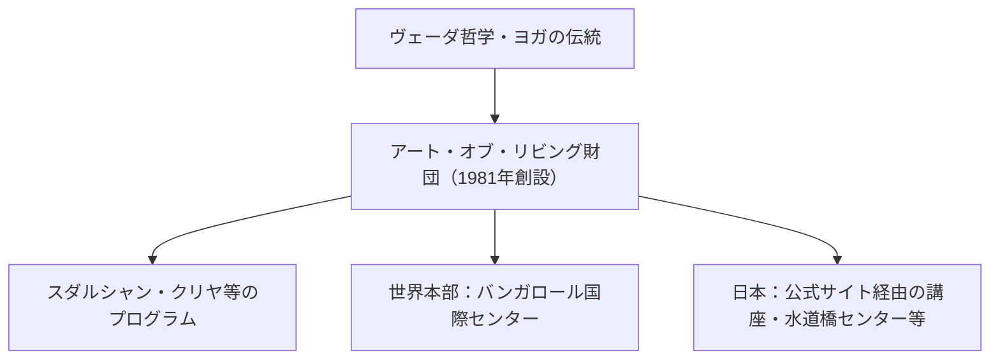

# アートオブリビング 専門構造分析ノート

> [!summary] 要旨
> アートオブリビング（The Art of Living Foundation）は、インドの霊性指導者スリ・スリ・ラビ・シャンカール（1956-）が1981年に創設した非営利の教育・人道支援組織である。リズミカルな呼吸法「スダルシャン・クリヤ」を中核とするストレス解消プログラム、瞑想、ヨガを世界各国で展開する。世界本部はインド・バンガロール（アート・オブ・リビング国際センター）。日本では公式サイト（artofliving.org/jp-ja）を通じて講座が案内され、東京・水道橋にセンターが置かれている。日本の法人は一般社団法人ＡＲＴ ＯＦ ＬＩＶＩＮＧ（法人番号3011605001552、本店・東京都台東区小島）である（2026-11-16の再検証で確認。12節）。

---

## 1. 命題の構造（通説・正統本部 vs 本教団・自説）

本組織は特定宗教の教団ではなく、ヴェーダ哲学・ヨガの伝統を背景とする国際的な霊性・教育NGOである。「宗教団体」としてではなく「呼吸法・瞑想プログラムを提供する国際NGO」として位置づけるのが実態に近い。

| 比較軸 | アート・オブ・リビング財団 | 備考 |
| :--- | :--- | :--- |
| 創設 | 1981年、スリ・スリ・ラビ・シャンカール | 英語版Wikipedia |
| 中核技法 | スダルシャン・クリヤ（呼吸法）、瞑想、ヨガ | 同上 |
| 組織形態 | 非営利の教育・人道支援NGO（財団） | 同上 |
| 展開規模 | 150カ国以上（資料により154〜180カ国と幅がある） | 公式各国サイト・Wikipedia |
| 日本法人 | 一般社団法人ＡＲＴ ＯＦ ＬＩＶＩＮＧ（法人番号3011605001552） | 国税庁法人番号公表サイト（2026-11-16） |

---

## 2. 基本情報

| 項目 | 内容 |
| :--- | :--- |
| **組織名称** | The Art of Living Foundation（アート・オブ・リビング財団） |
| **創始者** | スリ・スリ・ラビ・シャンカール（Gurudev Sri Sri Ravi Shankar、1956-） |
| **創設** | 1981年（インド） |
| **世界本部** | The Art of Living International Center（インド・カルナータカ州バンガロール） |
| **主な技法** | スダルシャン・クリヤ呼吸法、ヨガ、瞑想 |
| **日本公式サイト** | https://www.artofliving.org/jp-ja |
| **日本の法人格・法人番号** | 一般社団法人ＡＲＴ ＯＦ ＬＩＶＩＮＧ（法人番号3011605001552、本店：東京都台東区小島1丁目9番2号。2022年3月29日に練馬区東大泉3-33-21から移転。国税庁法人番号公表サイト、2026-11-16確認） |

---

## 3. 創始者と天啓・社伝

創始者スリ・スリ・ラビ・シャンカールは1956年生まれのインドの霊性指導者・人道活動家である。1981年にアート・オブ・リビング財団を創設した。中核技法のスダルシャン・クリヤは、呼吸のリズムを用いる技法として財団のプログラムの中心に置かれている（英語版Wikipedia）。

---

## 4. 沿革・歴史変遷

- 1981年：ラビ・シャンカールがアート・オブ・リビング財団を創設。
- 以後、呼吸法・瞑想プログラムを国際的に展開し、刑務所更生プログラムや紛争地域での活動など人道支援分野にも広がった（英語版Wikipedia）。
- 1994年：日本支部の活動が始まった（公式サイト）。
- 2009年：創始者の来日（10月）を機に、日本支部が一般社団法人として法的登録を行った（公式サイトの日本支部紹介）。

---

## 5. 教理・儀礼・神観の深層解剖

### 5-1 中核プログラム
スダルシャン・クリヤは、固有のリズムを持つ呼吸法であり、ストレス軽減を目的とする財団の代表的プログラムである。あわせてヨガ、瞑想、自己啓発系の講座が提供される。

### 5-2 宗教性について
財団は特定の宗教への帰属を求める組織ではなく、ヴェーダ哲学・ヨガを背景とする霊性教育・人道支援NGOと自ら位置づけている。宗教学上はインド系の現代霊性運動の一事例として扱われる。

---

## 6. 宗教学的・歴史社会学的意義

インド発のグル中心型霊性運動が、呼吸法という身体技法を商品化・国際展開した代表例であり、「宗教」ではなく「ウェルネス／教育NGO」の形態で各国に進出する現代型の展開モデルとして注目される。

---

## 7. 拠点・現地情報

- 世界本部：The Art of Living International Center（バンガロール）。
- 日本：公式サイトのセンター一覧に「アートオブリビングハピネスセンター 水道橋」（東京都千代田区猿楽町2-7-11 ハマダビルヂング5F）が掲載されている。
- 旧稿が所在地とした「渋谷区代々木」は本照合では確認できなかった（12節）。

---

## 8. 関連教団・関連人物・関連概念

- [[超越瞑想（TM運動）]]（インド系瞑想運動）
- [[ブラフマ・クマリス]]（インド系国際霊性運動）
- [[サティヤ・サイ・オーガニゼーション]]（インド系国際運動）

---

## 9. 史料・一次資料 (convMD)

- [[src_アートオブリビング_Wikipedia]]（英語版Wikipedia「Art of Living Foundation」）
- [[src_アートオブリビング_公式日本]]（公式サイト日本ページ）
- src_アートオブリビング_国税庁法人番号（法人番号3011605001552：名称・所在地・変更履歴、2026-11-16）
- src_アートオブリビング_公式沿革・国連ECOSOC（公式サイトの日本支部沿革、国連ECOSOC公式一覧 E/2019/INF/5、2026-11-16）

---

## 10. 参考文献・学術論文

- 英語版Wikipedia「Art of Living Foundation」「Ravi Shankar (spiritual leader)」（2026-11-15確認）

---

## 11. 関連ノート (Vault内)

- [[_分派・異端研究ポータル]]

---

## 12. 留保（中立的併記・未確定要素）

> [!warning] 注意
> 1. **法人格・法人番号（再検証 2026-11-16 で確認）**：国税庁法人番号公表サイトで、一般社団法人ＡＲＴ ＯＦ ＬＩＶＩＮＧ（法人番号3011605001552、本店・東京都台東区小島1丁目9番2号）を確認した。2022年3月29日に練馬区東大泉3-33-21から移転している。旧稿の法人名「一般社団法人 日本アートオブリビング協会」は登記の正式名称ではなく不正確だった（PR TIMES等の広報表記は「一般社団法人アートオブリビング」）。前回照合で確認できなかったのは探索不足による。
> 2. **所在地**：旧稿の「〒151-0053 東京都渋谷区代々木ほか」は確認できなかった。現行の公式センター一覧で確認できるのは水道橋センター（千代田区猿楽町）である。再検証 2026-11-16：国税庁の変更履歴等を再探索したが、渋谷区代々木の所在地は確認できず。
> 3. **信者数・実践者数**：旧稿の「世界数千万人、国内数万人規模の実践者」は出典未確認のため分離する。展開国数も資料により154〜180カ国と幅があり、「150カ国以上」とのみ記す。再検証 2026-11-16：公式の公称（累計受講者3億人・2011年、3.7億人・2015年）はあるが、いずれも団体公称であり検証可能な統計ではないため未確認のまま。
> 4. **経典名（再検証 2026-11-16 で一部確認）**：原著『Celebrating Love』（Sri Sri Publications）の実在は確認した。ただし邦訳書『セレブレーション・オブ・ラブ』としての刊行は未確認のままである。
> 5. **国連NGOの位置づけ（再検証 2026-11-16 で確認）**：国連ECOSOC公式一覧（E/2019/INF/5）に Art of Living Foundation が Special consultative status（特別諮問資格、1996年登録）として掲載されていることを確認した。
> 6. **日本での活動開始・法人設立（再検証 2026-11-16 で確認）**：公式サイトは「日本支部の活動は1994年に始まりました」と記し、日本支部紹介では2009年10月の創始者来日を機に一般社団法人として法的登録を行ったと記す。
> 7. **幽霊典拠の付け替え**：旧稿が典拠とした `src_indian_hindu_movements` は `content/資料/` に実在しないため、実在する保存分（§9）へ付け替えた。
> 8. **改訂記録（2026-11-15・全件照合）**：旧稿の3セクション構成を宗教版12セクションへ再編。法人格・所在地・信者数・経典名の未検証記載を分離し、evidence_type を official_database/5 から secondary_source_based/3 へ是正した。
> 9. **改訂記録（2026-11-16・再検証 RB6）**：未検証7項目を再探索した。格上げ5件：法人格・法人番号（国税庁）、日本活動開始1994年・法人登録2009年（公式サイト）、国連ECOSOC登録区分（国連公式一覧）、原著『Celebrating Love』の実在。残存2件：信者数、旧所在地（代々木）。検証日を2026-11-16に更新した。
> - evidence_type: secondary_source_based / confidence: 3

- **追跡調査 第2波 2026-11-19（RB6）**: 探索先＝Vault内資料/・『宗教年鑑』令和7年版・国税庁法人番号・NDL・教団公式サイト・Web検索。Vault内資料/再確認・『宗教年鑑』令和7年版ローカル抽出テキスト再検索・横断Web探索で新規の一次・公的資料は得られず、確認できず。

---

*※本稿は[[_分派・異端研究ポータル]]の個別教団分析ノートである。*
