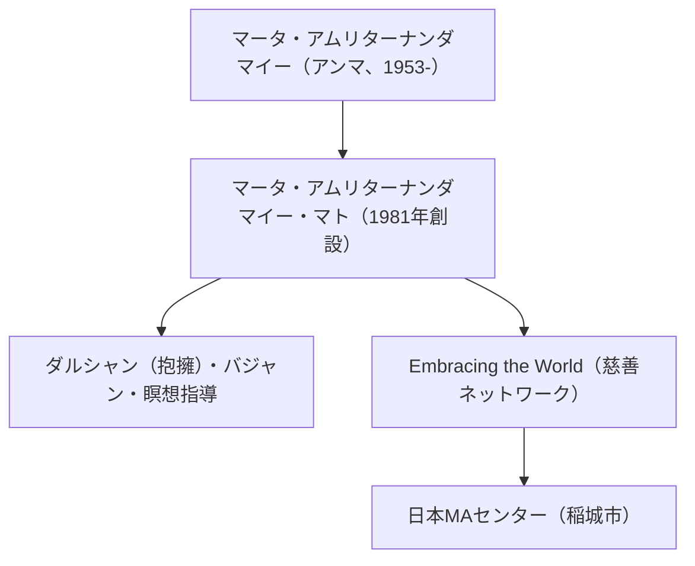

# マータ・アムリターナンダマイー（アンマ） 専門構造分析ノート

> [!summary] 要旨
> マータ・アムリターナンダマイー（Mata Amritanandamayi Devi、通称「アンマ（母）」、1953-）はインド・ケーララ州出身の女性聖者で、信奉者を抱擁するダルシャン（ハグ）で世界的に知られる。1981年にマータ・アムリターナンダマイー・マト（MAM）を創設し、慈善ネットワーク「Embracing the World」が病院・学校・住宅建設・災害支援などの活動を展開する。日本の拠点は日本MAセンター（MA Center Japan）である。旧稿の日本法人番号（6012405002246）は国税庁に存在しない番号であり、「国税庁確認済み」の申告は虚偽だった（12節）。

---

## 1. 命題の構造（通説・正統本部 vs 本教団・自説）

特定教団の教祖というより、ヒンドゥー教のバクティ（信愛）伝統に立つ女性グル（聖者）として世界的に崇敬される人物であり、その活動は宗教実践と大規模慈善事業が一体となっている点に特徴がある。

| 比較軸 | アンマ／MAM | 備考 |
| :--- | :--- | :--- |
| 出身 | インド・ケーララ州パラヤカダヴ村（漁村） | 英語版Wikipedia |
| 中核実践 | 抱擁によるダルシャン、バジャン（聖歌） | 同上 |
| 組織 | MAM（1981年創設）＋慈善網 Embracing the World | 同上 |
| 日本拠点 | 日本MAセンター（macenter.jp） | 公式サイト |
| 日本法人 | 法人格・法人番号は未確認 | 本照合（12節） |

---

## 2. 基本情報

| 項目 | 内容 |
| :--- | :--- |
| **人物名** | マータ・アムリターナンダマイー（出生名：スダマニ・イダマネル、1953年9月27日生） |
| **通称** | アンマ（「母」の意） |
| **創設組織** | マータ・アムリターナンダマイー・マト（MAM、1981年創設） |
| **本部** | アムリタプリ（インド・ケーララ州コッラム県） |
| **慈善部門** | Embracing the World（ETW） |
| **日本の拠点** | 日本MAセンター（MA Center Japan、公式サイト macenter.jp）。所在地は Embracing the World 公式連絡先一覧で東京都稲城市百村1620-1（〒206-0804） |
| **日本の法人格・法人番号** | 未確認（12節） |
| **日本語機関紙** | 季刊誌『マートルヴァーニ（母の声）』（MAセンター発行） |

---

## 3. 創始者と天啓・社伝

アンマは1953年、ケーララ州の漁村パラヤカダヴの漁師の家庭に生まれた。幼少期からクリシュナへの強い信愛を持ち、1970年代後半から村で人々を抱擁するダルシャンを始めたとされる。正式な修行制度や師承によらず、信奉者からは女神の化身（アヴァターラ）として崇敬される（英語版Wikipedia）。

---

## 4. 沿革・歴史変遷

- 1953年：ケーララ州パラヤカダヴに生まれる。
- 1970年代後半：ダルシャン（抱擁）を開始。
- 1981年：マータ・アムリターナンダマイー・マト（MAM）を創設。アーシュラムはアムリタプリに発展した。
- 以後、慈善ネットワーク Embracing the World のもとで大学・病院・学校・無料住宅・災害復興などの事業を展開。インド国外にもセンター網を持つ。
- 初来日は1990年（Times of India がMAMの発表に基づき「1990年以来毎年来日」と報道。2026-11-16再検証で確認）。日本の法人認証年は未確認のまま（12節）。

---

## 5. 教理・儀礼・神観の深層解剖

### 5-1 ダルシャン（抱擁）
アンマのダルシャンは来場者を一人ずつ抱擁する形式で行われ、英語版Wikipediaは30年以上で3,300万人以上を抱擁したと記す（教団側はそれ以上の数値を公称する。12節）。儀礼の中心は教義の講説よりも、グルとの直接の接触とバジャン（聖歌）、瞑想指導（IAM瞑想など）に置かれる。

### 5-2 思想的背景
アドヴァイタ（不二一元論）とバクティ（信愛）の双方を背景とし、「愛と奉仕」を実践の中核とする。特定の排他的教義体系を持つ教団というより、聖者崇敬と慈善実践を軸とする運動である。

---

## 6. 宗教学的・歴史社会学的意義

女性グルが世界的規模の慈善ネットワークを率いる現代インド系霊性運動の代表例であり、「抱擁」という身体的儀礼のメディア化・国際展開の事例として研究される。宗教と人道支援の融合形態としても注目される。

---

## 7. 拠点・現地情報

- 世界本部：アムリタプリ（ケーララ州）。
- 日本：日本MAセンター。公式サイトは macenter.jp（旧稿の amritapuri.jp ではない）。所在地は Embracing the World 公式連絡先一覧では東京都稲城市百村1620-1。
- 旧稿の所在地「稲城市坂浜282」は本照合で確認できなかった（12節）。

---

## 8. 関連教団・関連人物・関連概念

- [[サティヤ・サイ・オーガニゼーション]]（インド系国際運動）
- [[ブラフマ・クマリス]]（インド系国際霊性運動）
- [[アートオブリビング]]（インド系国際霊性運動）

---

## 9. 史料・一次資料 (convMD)

- [[src_アンマ_Wikipedia]]（英語版Wikipedia「Mata Amritanandamayi」）
- [[src_アンマ_日本MAセンター公式]]（日本MAセンター公式サイト）
- [[src_アンマ_国税庁法人番号エラー]]（国税庁：旧稿記載番号6012405002246が「存在しません」と表示される証跡）
- src_アンマ_再検証（初来日年の報道、アムリタハートとの関係・登記閉鎖、2026-11-16）

---

## 10. 参考文献・学術論文

- 英語版Wikipedia「Mata Amritanandamayi」「Embracing the World」（2026-11-15確認）
- Embracing the World 公式連絡先一覧（Centers & Contact Persons、PDF）

---

## 11. 関連ノート (Vault内)

- [[_分派・異端研究ポータル]]

---

## 12. 留保（中立的併記・未確定要素）

> [!warning] 注意
> 1. **法人番号の捏造を訂正**：旧稿記載の法人番号6012405002246は、検査用数字（チェックデジット）が整合せず、国税庁法人番号公表サイトでも「対象の法人番号は存在しません」と表示される（証跡：§9）。「国税庁確認済み」の申告は虚偽だった。日本の法人格・法人番号は未確認として分離する。再検証 2026-11-16：現行の日本MAセンター運営法人の法人番号は確認できず（下記2のアムリタハートは2021年に登記閉鎖）
> 2. **アムリタハートとの関係（再検証 2026-11-16 で確認）**：旧稿の法人名「特定非営利活動法人 国際マハーマナ・マタ・アムリターナンダマイー・ミッション」は、国税庁・Web検索のいずれでも確認できなかった。一方、稲城市百村の「特定非営利活動法人国際チャリティ協会アムリタハート」（法人番号1013405000604）については、2016年の来日公演のプレスリリース（共同通信PRワイヤー、発信元は同法人）が「Embracing the Worldの日本での活動は同法人が実施」と明記し、主催者住所がMAセンターと同一（稲城市百村1620-1）であることを確認した。ただし同法人は2021年7月5日に登記閉鎖（清算結了）しており、現行のMAセンター運営法人は未確認である
> 3. **所在地の訂正**：旧稿の「稲城市坂浜282 〒206-0822」は確認できなかった。Embracing the World 公式連絡先一覧の日本センター住所は稲城市百村1620-1（〒206-0804）である。再検証 2026-11-16：公式サイト・ETW連絡先一覧・国税庁を再探索したが「稲城市坂浜282」は確認できず
> 4. **公式サイトの訂正**：旧稿の公式サイト amritapuri.jp は現行の日本の公式サイトではない。現在の日本MAセンターのサイトは macenter.jp である。
> 5. **来日・認証年（再検証 2026-11-16 で一部確認）**：初来日1990年は Times of India（MAMの発表に基づく報道）で確認した。一方、旧稿の「2004年NPO法人認証」は再検証（国税庁・NPOポータル等）でも確認できず未検証のまま
> 6. **機関誌名の訂正**：旧稿の『アムリタ・マルガ』は確認できなかった。日本MAセンターが実際に発行する季刊誌は『マートルヴァーニ（母の声）』である。旧稿の経典名『永遠の愛』も書名としての実在を確認できなかった。再検証 2026-11-16：NDLサーチ等で両書名を再探索したが実在は確認できず。実在する関連邦訳書は『聖母アマチとの対話』（知玄舎、2003年）、『目覚めよ、子供たち!』（日本マーター・アムリターナンダマイー・センター刊）等である
> 7. **ダルシャン人数**：英語版Wikipediaは「3,300万人以上を抱擁」とし、教団側資料は4,000万人以上を公称する。いずれも公称の範疇であり、検証可能な信者数統計は存在しない。旧稿の「世界数千万人、国内数万人」も未検証として分離する。再検証 2026-11-16：検証可能な信者数統計は確認できず
> 8. **幽霊典拠の付け替え**：旧稿が典拠とした `src_indian_hindu_movements` は `content/資料/` に実在しないため、実在する保存分（§9）へ付け替えた。
> 9. **改訂記録（2026-11-15・全件照合）**：旧稿の3セクション構成を宗教版12セクションへ再編。存在しない法人番号と虚偽の確認申告を記録のうえ訂正し、evidence_type を academic_database/5 から secondary_source_based/3 へ是正した。
> 10. **改訂記録（2026-11-16・再検証 RB6）**：未検証7項目を再探索した。格上げ2件：初来日1990年（Times of India）、アムリタハートとMAセンターの関係（2016年プレスリリース。ただし同法人は2021年登記閉鎖）。残存5件：現行の日本法人格・法人番号、旧所在地（稲城市坂浜282）、2004年NPO認証、書名2点、ダルシャン人数・信者数統計。検証日を2026-11-16に更新した。
> - evidence_type: secondary_source_based / confidence: 3

- **追跡調査 第2波 2026-11-19（RB6）**: 探索先＝Vault内資料/・『宗教年鑑』令和7年版・国税庁法人番号・NDL・教団公式サイト・Web検索。Vault内資料/再確認・『宗教年鑑』令和7年版ローカル抽出テキスト再検索・横断Web探索で新規の一次・公的資料は得られず、確認できず。

---

*※本稿は[[_分派・異端研究ポータル]]の個別教団分析ノートである。*
