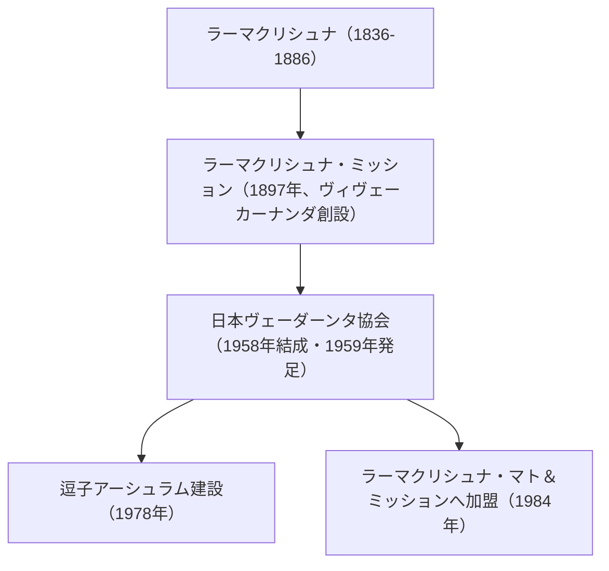

# 日本ヴェーダーンタ協会 専門構造分析ノート

> [!summary] 要旨
> 日本ヴェーダーンタ協会は、ラーマクリシュナ（1836-1886）とその弟子スワミ・ヴィヴェーカーナンダ（1863-1902）の系譜に連なる、インドのラーマクリシュナ・マト＆ミッション準拠の日本のセンターである。公式沿革によれば1958年11月に結成され、1959年5月2日に正式発足した。逗子市久木4-18-1に本部アーシュラムを置き、隔月刊の機関誌『不滅の言葉』を発行する。1984年にラーマクリシュナ・マト＆ミッションへ正式加盟した（旧稿の「1984年宗教法人認証」はこの加盟との混同である）。旧稿の法人番号は別法人の番号だった（12節）。

---

## 1. 命題の構造（通説・正統本部 vs 本教団・自説）

本協会は新宗教の分派ではなく、19世紀インドの聖者ラーマクリシュナの運動の公式系譜に連なる日本センターである。インド本部（ベールール・マト）との関係は公式沿革で明確に示されている。

| 比較軸 | 日本ヴェーダーンタ協会 | 備考 |
| :--- | :--- | :--- |
| 系譜 | ラーマクリシュナ／ヴィヴェーカーナンダ | 公式沿革 |
| 日本での発足 | 1958年結成、1959年5月2日正式発足 | 同上 |
| 本部 | 逗子市久木4-18-1 | 同上 |
| 本部との関係 | 1984年にラーマクリシュナ・マト＆ミッションへ加盟 | 同上 |
| 機関誌 | 『不滅の言葉』（隔月刊） | 同上 |

---

## 2. 基本情報

| 項目 | 内容 |
| :--- | :--- |
| **組織名称** | 日本ヴェーダーンタ協会（Vedanta Society of Japan） |
| **精神的源流** | ラーマクリシュナ（1836-1886）、スワミ・ヴィヴェーカーナンダ（1863-1902） |
| **結成・発足** | 1958年11月結成、1959年5月2日正式発足（公式沿革） |
| **所在地** | 〒249-0001 神奈川県逗子市久木4-18-1 |
| **代表** | 会長：スワミ・メーダサーナンダ（1993年12月着任、公式沿革） |
| **機関誌** | 『不滅の言葉』（Fumetsu no Kotoba / The Universal Gospel、隔月刊、1959年創刊） |
| **法人番号** | 9021005007994（宗教法人日本ヴェーダーンタ協会。国税庁法人番号公表サイト、2026-11-16再検証で確認） |

---

## 3. 創始者と天啓・社伝

ラーマクリシュナは19世紀インドの聖者で、カーリー女神へのバクティ（信愛）と諸宗教の一致を説いた。その筆頭弟子ヴィヴェーカーナンダは1893年のシカゴ万国宗教会議でヴェーダーンタを西洋に紹介し、1897年にラーマクリシュナ・ミッションを創設した。日本ヴェーダーンタ協会はこの系譜の日本支部である。

---

## 4. 沿革・歴史変遷

公式サイトの沿革（"How The Vedanta Society of Japan Came Into Being"）による。

- 1957年：大阪でヴェーダーンタ・アカデミー（ヴェーダーンタ哲学会）が内垣昴平を中心に設立される（協会とは別系統の展開として沿革に記される）。
- 1958年11月：日本ヴェーダーンタ協会が結成される。
- 1959年5月2日：正式に発足し、登録された。機関誌『不滅の言葉』創刊。
- 1960-70年代：東京にセンターを開設（後に逗子へ集約）。スワミの来日講演（1963年スワミ・ランガナターナンダ、1969年スワミ・タポシャーナンダ等）。
- 1970年：逗子に土地を購入し、聖母の家（Holy Mother's House）を置く。
- 1978年5月7日：逗子アーシュラム本館が落成・奉献される。
- 1984年：ラーマクリシュナ・マト＆ミッションに正式加盟し、初の常駐スワミ、スワミ・シッダールターナンダが着任。
- 1993年12月：スワミ・メーダサーナンダが着任（現職会長）。

---

## 5. 教理・儀礼・神観の深層解剖

### 5-1 ヴェーダーンタとラーマクリシュナの教え
アドヴァイタ・ヴェーダーンタ（不二一元論）を基調としつつ、ラーマクリシュナの「諸宗教は同じ真理への異なる道である」という宗教多元主義を掲げる。礼拝・瞑想・学習・奉仕が実践の柱である。

### 5-2 『不滅の言葉』の位置づけ
『不滅の言葉』は協会の隔月刊機関誌であり、聖典ではない。旧稿が経典として記した『不滅の言葉（コタムリト）』は、機関誌名と『ラーマクリシュナの福音』の原題カタームリタ（『シュリー・ラーマクリシュナ・カタームリタ』）の混同である（12節）。

---

## 6. 宗教学的・歴史社会学的意義

ヴィヴェーカーナンダ以来の「西洋・日本へのヴェーダーンタ伝播」の日本側の受け皿として、インド宗教の日本受容史における初期の制度化事例である。インド本部との正式な加盟関係を持つ、系譜の明確な日本センターとして位置づけられる。

---

## 7. 拠点・現地情報

- 本部：日本ヴェーダーンタ協会（逗子市久木4-18-1、〒249-0001）。礼拝堂・図書室等を備えるアーシュラム。
- 旧稿の所在地「逗子市桜山4丁目11-10（〒249-0005）」は現行の公式所在地と一致しない（12節）。

---

## 8. 関連教団・関連人物・関連概念

- 日本ヴエーダーンタ・ソサイテイ（高槻市の別法人。Vault内に専門ノートなし。大阪の内垣系の流れとみられるが、本稿では同一視しない）
- [[ブラフマ・クマリス]]（インド系国際霊性運動）
- [[サティヤ・サイ・オーガニゼーション]]（インド系国際運動）

---

## 9. 史料・一次資料 (convMD)

- [[src_日本ヴェーダーンタ協会_公式About]]（公式サイト「About Us」：沿革・所在地・機関誌）
- [[src_日本ヴェーダーンタ協会_国税庁法人番号（誤帰属の証拠）]]（国税庁：番号7021005001693＝社会福祉法人湘南望青会である証跡）
- [[src_日本ヴエーダーンタ・ソサイテイ_国税庁法人番号]]（別法人4120905002182の登記情報。混同防止のため保存）
- src_日本ヴェーダーンタ協会_国税庁法人番号・県名簿（正しい法人番号9021005007994と県名簿の「諸教単立」、2026-11-16）

---

## 10. 参考文献・学術論文

- 日本ヴェーダーンタ協会公式サイト（vedanta.jp）「About Us」（2026-11-15確認）
- 国税庁法人番号公表サイト（2026-11-15確認）

---

## 11. 関連ノート (Vault内)

- [[_分派・異端研究ポータル]]

---

## 12. 留保（中立的併記・未確定要素）

> [!warning] 注意
> 1. **法人番号・社格（再検証 2026-11-16 で確認）**：旧稿記載の法人番号7021005001693は、国税庁では「社会福祉法人湘南望青会」（神奈川県茅ヶ崎市汐見台）の番号であり、日本ヴェーダーンタ協会の番号ではない（誤帰属）。再検証で国税庁にて宗教法人日本ヴェーダーンタ協会（法人番号9021005007994、本店・神奈川県逗子市久木4丁目18番1号）を確認した。また神奈川県知事所轄宗教法人名簿では「日本ヴェーダーンタ協会／諸教／諸教単立」とされており、旧稿の社格「単立宗教法人」も確認した
> 2. **所在地の訂正**：旧稿の「〒249-0005 逗子市桜山4丁目11-10」は現行の公式所在地（久木4-18-1、〒249-0001）と異なる。旧所在地か誤記のいずれかは未確認である。再検証 2026-11-16：公式サイト・国税庁・県名簿を再探索したが「桜山4丁目11-10」の記載は確認できず、未確認のまま
> 3. **「1984年宗教法人認証」の訂正**：公式沿革で1984年はラーマクリシュナ・マト＆ミッションへの加盟年であり、宗教法人認証年とは記されていない。宗教法人としての認証年は未確認である。公式沿革は1959年の発足時に「正式に登録された（duly registered）」と記すが、登録の種別は明示されていない。再検証 2026-11-16：法人格と単立の別は上記1で確認したが、認証年自体は公的資料で確認できず
> 4. **経典名の訂正**：『不滅の言葉』は聖典ではなく協会の隔月刊機関誌である。「コタムリト（カタームリタ）」は『ラーマクリシュナの福音』の原題であり、両者の混同を訂正した。
> 5. **信者数**：旧稿の「国内数千人」は出典未確認のため分離する。公式沿革は会員数は現在も比較的少ないと記す。再検証 2026-11-16：公式サイト・宗教年鑑等を再探索したが、信者数の公表は確認できず
> 6. **別法人との混同防止**：「宗教法人日本ヴエーダーンタ・ソサイテイ」（法人番号4120905002182、大阪府高槻市塚原）は本協会とは別法人である。公式沿革は大阪の内垣系アカデミーが後に独自の道を歩んだと記しており、同ソサイテイとの対応関係は推測の域を出ないため断定しない。再検証 2026-11-16：両団体の公式資料を再探索したが、対応関係を明示する資料は確認できず
> 7. **幽霊典拠の付け替え**：旧稿が典拠とした `src_indian_hindu_movements` は `content/資料/` に実在しないため、実在する保存分（§9）へ付け替えた。
> 8. **改訂記録（2026-11-15・全件照合）**：旧稿の3セクション構成を宗教版12セクションへ再編。法人番号の誤帰属・所在地・認証年の混同・経典名の混同を訂正し、evidence_type を official_database/5 から secondary_source_based/4 へ是正した。
> 9. **改訂記録（2026-11-16・再検証 RB6）**：未検証6項目を再探索した。格上げ2件：法人番号（9021005007994、国税庁）、社格「単立宗教法人」（神奈川県名簿）。残存4件：旧所在地（桜山）の性質、宗教法人認証年、信者数、高槻の別法人との対応関係。検証日を2026-11-16に更新した。
> - evidence_type: secondary_source_based / confidence: 4

- **追跡調査 第2波 2026-11-19（RB6）**: 探索先＝Vault内資料/・『宗教年鑑』令和7年版・国税庁法人番号・NDL・教団公式サイト・Web検索。Vault内資料/再確認・『宗教年鑑』令和7年版ローカル抽出テキスト再検索・横断Web探索で新規の一次・公的資料は得られず、確認できず。

---

*※本稿は[[_分派・異端研究ポータル]]の個別教団分析ノートである。*
