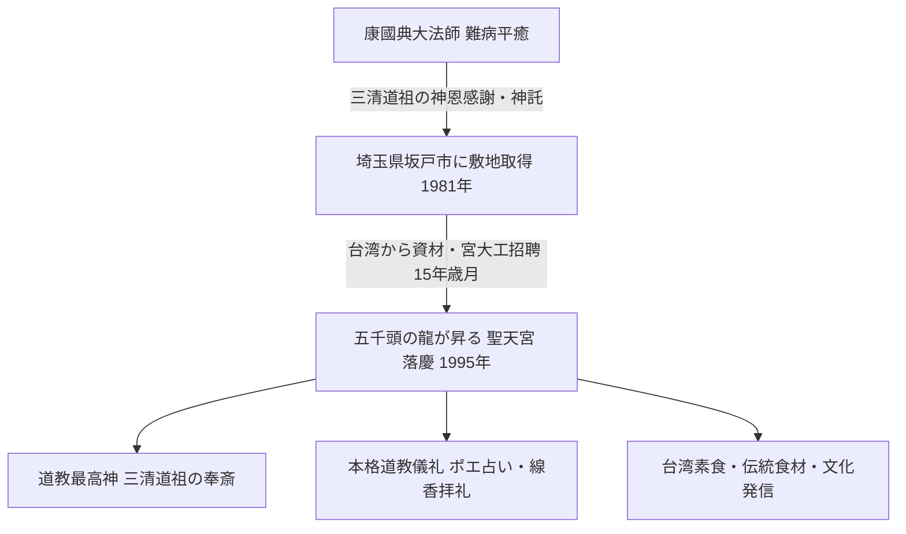

# 五千頭の龍が昇る聖天宮 専門構造分析ノート

> [!summary] 要旨
> **五千頭の龍が昇る聖天宮**は、道教の最高三神「三清道祖（元始天尊・霊宝天尊・道徳天尊）」を主神として祀る、日本最大級の本格的宮殿式道教寺院である。台湾出身の道教法師・康國典が大病平癒の神恩に感謝し、神託に従って私財を投じて建立した。台湾伝統の瑠璃瓦、透かし彫りの九龍網（一枚岩から彫り出された龍のレリーフ）、五千頭以上の精巧な龍の彫刻、陰陽太極の八卦天井など、道教の宇宙観が建築意匠の全体に凝縮されている。在日台湾人・華僑の篤い信仰拠点であると同時に、本格的な道教参拝作法（九本の線香・ポエ占い・寿金焼納）を体験できる文化人類学的・宗教学的名所として広く一般公開されている。

---

## 1. 命題の構造（一般観光客 vs 道教教理）



### 比較考察マトリクス表

| 比較軸 | 一般観光客・サブカルチャー視点（etic） | 道教信徒・宗教学的視点（emic） |
| :--- | :--- | :--- |
| **空間認識** | 埼玉の田園地帯に出現した異国情緒あふれる豪華絢爛な宮殿、コスプレ・ロケ地 | 道教の天界・至高神「三清境」を地上に具現化した聖域（道観） |
| **主神の捉え方** | 中国の仙人・神様 | 宇宙の始源・万物の根源道（タオ）を体現する至高神**「三清道祖」** |
| **参拝・祈願方法** | おみくじ感覚の占い（ポエ投げ） | **擲筊（ポエ）**による神仏との真剣な直接対話（神託確認） |
| **龍の彫刻（5000頭）** | 圧巻のインスタ映え装飾・美術工芸 | 陽気（至高の気）の充満、魔除け、天地の結節を象徴する聖獣 |
| **食と売店** | 珍しい台湾スナックやタピオカドリンク | 五葷抜き素食文化、仙果（ドライフルーツ）、不老長寿の養生茶 |

---

## 2. 基本情報

| 項目 | 内容 |
| :--- | :--- |
| **宮名** | 五千頭の龍が昇る 聖天宮（せいてんきゅう） |
| **法人格** | 宗教法人 聖天宮（単立）。認証日は昭和50年（1975年）5月12日（埼玉県公式宗教法人名簿）。Wikipediaは昭和55年（1980年）設立とするが、本人判断（2026-11-19）により公式名簿を正とした |
| **創始建立者** | 康國典（台湾出身の大法師） |
| **主神（祭神）** | **三清道祖**（元始天尊・霊宝天尊・道徳天尊） |
| **配祀神** | 南斗星君（延命の神）、北斗星君（厄除の神）、四聖大元帥（守護四武将） |
| **敷地面積** | 約7,000坪（境内・前庭含む。約2万3千平方メートル） |
| **建築様式** | 台湾伝統閩南式・中国北方宮殿式の折衷宮殿建築（瑠璃瓦、組物、透かし彫り） |
| **開廟日** | 1995年（平成7年）9月 |
| **所在地** | 埼玉県坂戸市塚越51-1 |
| **拝観時間** | 10:00〜16:00（年中無休。公式サイトで確認） |
| **駐車場** | 120台・無料（公式サイトで確認） |
| **公式URL** | `https://www.seitenkyu.com/` |

---

## 3. 創始者と天啓・社伝

### (1) 康國典の難病平癒と神託
台湾の貿易商・道教法師であった康國典は、40代半ばに重い病（不治の病と宣告された）を患った。公式サイトの「建立由縁」によれば、道教の最高神「三清道祖」に祈願したところ一命をとりとめて完治し、その後、「神恩に報いるため、これまで縁のなかった日本の地に宮を建てよ」という三清道祖の神託を受けたという。これは建立の由来として団体側が伝える社伝であり、史実としての検証対象とは区別する。

### (2) 埼玉県坂戸の地の選定と15年におよぶ大工事
康國典は日本各地の風水・霊地を探し歩き、清流（高麗川・越辺川水系）に恵まれ、富士山と秩父連山を望む埼玉県坂戸市塚越の地を選定。1981年（昭和56年）に着工した。
建材の木材・石材・黄瑠璃瓦はすべて台湾から大型船で輸送され、台湾屈指の宮大工・石工彫刻師が10年以上にわたり日本に滞在して手作業で組み上げた。1995年に本殿が落慶し開廟した。

康國典の没後は、子息の康嘉文法師が聖天宮を管理している（Wikipediaによる）。また近年、施設の名称は「五千頭の龍が昇る聖天宮」へと改められた（同）。

---

## 4. 沿革・歴史変遷

```
・1975年（昭和50年）5月12日: 宗教法人として認証（埼玉県公式宗教法人名簿）。Wikipediaは1980年（昭和55年）設立とするが、本人判断（2026-11-19）により公式名簿を正とした。
・1981年（昭和56年）: 社殿着工。
・1995年（平成7年）9月: 15年の歳月をかけて開廟（落慶）。
・康國典の没後: 子息・康嘉文法師が管理を継承（没年は未確認）。
・近年: 施設名称を「五千頭の龍が昇る聖天宮」に改称。
```

---

## 5. 教理・儀礼・神観の深層解剖

### 5-1. 天門・前殿・本殿の三進構造
中国正統の宮殿・道観様式である「三進式（前庭 ➔ 天門 ➔ 前殿 ➔ 本殿）」を踏襲。
- **天門（てんもん）**: 屋根に躍動する龍と鳳凰の極彩色陶器彫刻（剪花・剪粘工芸）が配置される。
- **前殿**: 巨大な一本の楠から彫り出された「九龍網（きゅうりゅうもう）」の石扉や、八卦太極を象った格天井が広がる。
- **本殿（三清殿）**: 中央に元始天尊（過去・宇宙の始まり）、左に道徳天尊（太上老君・現在・老子）、右に霊宝天尊（未来）の金身像が鎮座する。

### 5-2. 陰陽五行と八卦天井
本殿および前殿の天井には、釘を一本も使わずに木木を組み上げたドーム状の「太極八卦藻井（そうせい）」が施されている。八卦の配置により邪気を祓い、天からの清らかな霊気を地上に降ろす構造となっている。

### 5-3. 台湾道教の伝統参拝作法
聖天宮では、本場台湾と全く同一の正式作法が案内されている。
1. **九本の線香拝礼**: 寿金（神仏への捧げ物）とともに、玉皇上帝（天公炉）へ3本、三清道祖へ3本、前殿へ3本を順に捧げる。
2. **擲筊（ポエ占い）**: 三日月型の木片（筊杯）を2枚床に落とし、表と裏（陰と陽）が出るまで神仏に問いかける。
3. **金炉での寿金焼納**: 参拝後、神仏への感謝の紙幣（金紙）を特製の八角炉で燃やす。

### 5-4. 飲食・食文化との関わり
- **境内売店と台湾食材**:
  境内の売店では、道教の不老長寿思想・養生観に基づく台湾伝統茶（凍頂烏龍茶、東方美人茶等）や、台湾直輸入のドライフルーツ（愛玉子、仙草、龍眼等）が提供されている。
- **素食（オリエンタルベジ）への接続**:
  台湾の道教祭祀において「三牲（肉魚）」を捧げる伝統もある一方、身を清める「清醮（精進潔斎）」の期間には完全素食が義務づけられる。聖天宮の売店でも台湾製の精進インスタントラーメンや乾物が販売され、近隣の[[一貫道と台湾素食レストラン]]や埼玉・東京の台湾コミュニティと密接にリンクしている。

---

## 6. 宗教学的・歴史社会学的意義

聖天宮は、移民個人の還願（病気平癒への感謝）という私的な動機から、日本国内に本格的な台湾道教の宮殿式道観が移植された稀有な事例である。特定の一貫道や新宗教ではなく、台湾の伝統的正統道教（三清信仰）に基づく寺院である点が、道教系ノート群の中での位置づけを分ける。特撮ヒーロー番組や映画・アニメのロケ地としても著名であるが、宗教法人としての礼拝・祭祀が日々執行されている生きた信仰空間であり、観光・ロケ地利用と信仰実践が併存する点に、現代日本の宗教施設の多面性が表れている。

---

## 7. 拠点・現地情報

- **所在地**: 埼玉県坂戸市塚越51-1（〒350-0209）
- **拝観時間**: 10:00〜16:00（年中無休）
- **アクセス（電車）**: 東武東上線「若葉駅」東口より東武バス（ツーデーマーチ・戸口経由）「戸口」下車徒歩約15分、または若葉駅より徒歩約30分・タクシー約8分
- **アクセス（自動車）**: 関越自動車道「鶴ヶ島IC」または「坂戸IC」より約10分、圏央道「坂戸IC」より約8分
- **駐車場**: 120台・無料

---

## 8. 関連教団・関連人物・関連概念

- **康國典**: 聖天宮開廟者・大法師
- **康嘉文**: 康國典の子息。現在の管理者（Wikipediaによる）
- **三清道祖**: 道教の至高三神（元始天尊・霊宝天尊・道徳天尊）
- **[[天道（一貫道）]]**: 台湾の救済新宗教（道教神を習合）
- **[[東京媽祖廟]]**: 東京都新宿区のビル型道教寺院
- **[[横浜関帝廟・横濱媽祖廟]]**: 神奈川県横浜中華街の道教廟
- **[[神戸関帝廟]]**: 兵庫県神戸市の道教廟
- **[[一貫道と台湾素食レストラン]]**: 台湾の精進食文化

---

## 9. 史料・一次資料 (convMD)

- [[src_聖天宮_公式サイト]] — 宗教法人聖天宮 公式サイト（拝観時間・年中無休・駐車場等を確認）
- 公式サイト「建立由縁について」（創設者・康國典の由来。公式PDFを直接閲覧で照合）

---

## 10. 参考文献・学術論文

- [[src_聖天宮_Wikipedia]] — Wikipedia（日本語版）「五千頭の龍が昇る聖天宮」（宗教法人の設立年・康嘉文への継承・改称を確認）
- 埼玉県総務部学事課『埼玉県宗教法人名簿』（未取得。書誌のみ）
- 文化庁『宗教年鑑』（未取得。書誌のみ）
- 野口鐵郎 ほか編『道教事典』（平河出版社）
- 窪徳忠『道教の神々』（講談社学術文庫）

---

## 11. 関連ノート (Vault内)

- [[天道（一貫道）]]
- [[道徳会館]]
- [[東京媽祖廟]]
- [[横浜関帝廟・横濱媽祖廟]]
- [[神戸関帝廟]]
- [[一貫道と台湾素食レストラン]]
- [[系統別分類カタログ]]

---

## 12. 留保（中立的併記・未確定要素）

> [!warning] 留保事項
> 1. **康國典の生没年**: 旧稿にあった「1919–2014」という生没年は、公式サイト・Wikipedia等の今回照合した資料では裏付けが取れなかったため未検証として分離する（死去自体と子息・康嘉文への継承はWikipediaに記載がある）。
> 2. **法人番号**: 未確認（旧稿の「確認済み（宗教法人 聖天宮）」という記載は番号を伴わないため改めた）。宗教法人としての認証は埼玉県公式宗教法人名簿により昭和50年（1975年）5月12日と確認した（Wikipediaの1980年設立説は、本人判断（2026-11-19）により不採用）。
> 3. **配祀神の構成**: 南斗星君・北斗星君・四聖大元帥等の配祀は公式パンフレット由来の記載であり、今回のWeb照合では個別に確認していない。
> 4. **建立の由来（神託・難病平癒）**: 公式サイトの「建立由縁」に基づく団体側の社伝として記載した。史実として検証されたものではない。
> 5. **規模の表現**: 旧稿要旨の「日本唯一の本格的宮殿式道教寺院」を、資料の表現に合わせて「日本最大級」に改めた（Wikipedia・公式系資料はいずれも「最大級／最大」とする）。
> 6. **改訂記録（2026-11-15・全件照合）**: 工期の表記「14年をかけて」を公式サイト・Wikipediaの「15年」に訂正した（2箇所）。宗教法人の設立年（1980年）、開廟月（1995年9月）、現在の管理者（康嘉文）、施設名の改称を追記した。evidence_type は `primary_source_based` を維持したが、confidence は5から4に引き下げた（生没年・法人番号・配祀構成に未確認要素が残るため）。12セクション構造へ再編した。

### 再検証記録（2026-11-16・RB6）
- **格上げ（法人番号）**: 国税庁法人番号公表サイトで「聖天宮」法人番号 **1030005010783**（本店所在地：埼玉県坂戸市大字塚越字御イセ原51-1、本ノートの所在地と一致）を確認した。frontmatterの法人番号を更新した。→ src_聖天宮_再検証_法人番号と配祀
- **格上げ（配祀神の構成）**: Wikipedia日本語版「五千頭の龍が昇る聖天宮」§祭神に「三清道祖、南斗星君、北斗星君、四聖大元帥を祀っている」と明記され、中国語版も同構成を記すことを確認した。
- **残存**: 康國典の生没年「1919–2014」は公式サイト・Wikipedia・Web検索を再探索しても裏付けなし。埼玉県宗教法人名簿・文化庁『宗教年鑑』は今回も未取得（書誌のみ）。

### 追跡調査記録（2026-11-18）
- **解消（埼玉県宗教法人名簿）**: 埼玉県公式サイト掲載『埼玉県知事所轄宗教法人一覧（令和7年12月31日現在）』で、聖天宮（諸教・単立 No.10108、坂戸市塚越51-1、代表者 康嘉文）を確認した。→ src_聖天宮_埼玉県宗教法人一覧2026-11-18
- **数値の矛盾（判断事項として保留）**: 同名簿の認証日は昭和50年（1975年）5月12日であり、Wikipedia の「宗教法人としては昭和55年（1980年）設立」と矛盾する。→ 本人判断（2026-11-19）により埼玉県公式名簿の昭和50年（1975年）5月12日認証を正とし、本文（frontmatter立教年・§4・年表・§12）を改訂した。
- **残存**: 『宗教年鑑』における聖天宮の記載は年鑑全文テキストでも確認できず（未確認のまま）。康國典の生没年「1919–2014」は今回も裏付けなし。

- **追跡調査 第2波 2026-11-19（RB6）**: 探索先＝Vault内資料/・『宗教年鑑』令和7年版・国税庁法人番号・NDL・教団公式サイト・Web検索。認証年は対象外確定済み（埼玉県公式名簿1975年）のため再処理していない。残存の康國典の生没年（1919–2014）は本波も裏付けが得られず確認できず。

---

*※本稿は[[_分派・異端研究ポータル]]の道教・中華系宗教に関する専門構造分析ノートである。*
