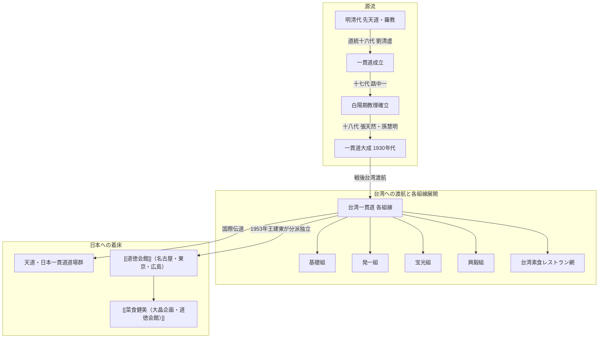

# 天道（一貫道） 専門構造分析ノート

> [!summary] 要旨
> **天道（一貫道）**は、明清代の白蓮教・羅教・先天道の系譜を引く中国・台湾発祥の巨大救済新宗教である。1930年に第18代祖・張天然が教団を大成させた。戦後の中華人民共和国（共産党政権）による弾圧を経て台湾へ渡り、戒厳令下の非合法地下活動期を「素食食堂」などを拠点に乗り越えて信徒数を拡大、1987年に台湾で合法化された。宇宙の三期末劫（青陽期・紅陽期・白陽期）の歴史観に基づき、現代は白陽期の救済仏である「弥勒古仏」が掌天盤を司るとする。その厳格な「不殺生・清口（五葷抜き完全菜食）」の教義は、台湾および世界のオリエンタルベジタリアン食文化・代替肉産業の基盤を築いた。

---

## 1. 命題の構造（一貫道本流 vs 伝統道教 vs 道徳会館）

### 比較考察マトリクス表

| 比較軸 | 伝統道教（正一派・全真派） | 天道（一貫道本流） | 日本の分派（道徳会館） |
| :--- | :--- | :--- | :--- |
| **最高主神** | **三清道祖**（元始・霊宝・道徳天尊） | **無生老母（明明上帝）**、弥勒仏、関聖帝君 | **弥勒仏**（日本社会向けに弥勒信仰を前面化） |
| **教理体系** | 道教の不老不死・符籙・科儀・内丹術 | **五教合一（儒・道・仏・基・回）**・三期末劫救済 | 一貫道教理を継承・日本現地化（三教合一・修養） |
| **核心儀礼** | 醮祭、護符、道観での祭祀 | **求道式における「三宝（玄関・口訣・合同）」伝授** | **三宝伝授**（秘教的口伝を継承） |
| **食の戒律** | 全真派は菜食、正一派は通常食（祭祀時禁忌） | **「清口」の誓約（肉魚卵五葷酒の終身完全排除）** | **完全素食（五葷抜き精進）の実践** |
| **拠点形態** | 宮殿式道廟（[[五千頭の龍が昇る聖天宮]]、関帝廟等） | ビル内・住居内の**「佛堂（佛堂・天壇）」** | 会館・道場（[[道徳会館]]各拠点） |
| **飲食事業** | 廟前売店での精進食材販売等 | **台湾素食レストラン・自助餐**（[[中一素食店（台湾素食レストラン）\|中一素食店]], [[健福（台湾素食レストラン）\|健福]]等） | **[[菜食健美（大晶企画・道徳会館）]]**（大晶企画） |

---

## 2. 基本情報

| 項目 | 内容 |
| :--- | :--- |
| **教団名** | 天道（一貫道 / Yiguandao / 台湾天道） |
| **主神・信仰対象** | **明明上帝（無生老母）**、諸天神聖、万仙菩薩、弥勒古仏、観音菩薩、関聖帝君、呂洞賓等 |
| **道統祖師** | 東方前十八代（伏羲〜孟子） ➔ 西方二十八代（釈迦〜達磨） ➔ 東方後十八代（達磨〜張天然・孫慧明） |
| **聖典・重要経書** | 『皇母訓子十誡』, 『一貫道疑問解答』, 『弥勒救苦真経』, 『大学』, 『中庸』, 『論語』, 『道徳経』, 『金剛経』 |
| **組織形態** | 国際一貫道総会（中華民国一貫道総会）、世界各国の組線（基礎、発一、宝光、興毅、安東、文化等） |
| **信者数** | 台湾約81万人（2005年時点、人口の約3.5%。英語版Wikipediaの学術的推計による）。韓国約130万人（2015年）。日本は約5万人規模とされる（研究文献の紹介による）。全世界総数の確定的統計はない |
| **国内拠点** | 東京都八王子市（天道道場）、各地の公共佛堂・家庭佛堂（東京、神奈川、大阪、埼玉、愛知等） |
| **食の実践** | **「清口（チンコウ）」**による五葷抜き完全菜食（素食・オリエンタルベジタリアン） |

---

## 3. 創始者と天啓・社伝

### 起源と道統思想
一貫道は、明代の羅祖（羅清）による「羅教（無為教）」および「先天道」の流れを汲み、儒・仏・道の三教合一に西洋宗教を取り入れた。先天道第15代祖・王覚一が今日の一貫道の教理の基盤を創り、その死後に位を継いだ第16代祖・劉清虚が、『論語』里仁編の「吾が道、一を以て之を貫く」に基づいて「一貫道」と称した（命名の年は1886年とするのが中国側資料の通説）。1930年、第18代祖・張天然（弓長祖）が孫慧明（子系祖、師母）とともに道務を統括し、中国全土に大規模な信徒網を築いた。張天然は済公（済顛）の化身、孫慧明は月慧菩薩の化身と位置づけられる（教団の道統叙述による）。

---

## 4. 沿革・歴史変遷

### (1) 中国共産党の弾圧と台湾への渡航
1949年の中華人民共和国成立後、一貫道は「反動的会道門」として徹底的な摘発と弾圧を受け、指導部は台湾・香港へと逃れた。1940年代の中国本土では推定1,200万人規模に達した時期もあったとされる（英語版Wikipediaの紹介する推計）。台湾においても国民党政権下で長年非合法化（1952年に公式に禁止）されたが、信徒たちは「素食食堂」や家庭佛堂を隠れ蓑として地下で結束を強め、台湾社会の隅々にまで浸透した。台湾の信徒数は1963年約5万人、1984年32万4千人、1989年44万3千人と拡大し、1987年1月13日に合法化され、台湾有数の宗教勢力として公認されるに至った。2005年時点の推計では約81万人（人口の約3.5%）である。

### (2) 日本への伝道と定着
1950年代初頭から在日華僑や台湾人留学生を通じて日本へ伝来した。
- **本流天道系**: 基礎組や発一組など台湾各組線が日本国内に公共佛堂・家庭佛堂を開設。八王子市などに大型道場を構える。研究文献の紹介では、日本の支部構成として孔孟聖道院・先天大道日本総天壇・天道・天道総天壇等が挙げられ、合計約5万人規模とされる。
- **分派独立（道徳会館）**: 1953年、在日華僑の王建東が名古屋で分派独立し、「宗教法人 道徳会館」を設立。

---

## 5. 教理・儀礼・神観の深層解剖

### 5-1. 三期末劫観（さんきまつごうかん）
宇宙の歴史を3つの救済期に分類する。
1. **青陽期（しょうようき）**: 燃灯仏が司る時代（救済対象：君主・聖人）。
2. **紅陽期（こうようき）**: 釈迦牟尼仏が司る時代（救済対象：僧侶・修行者）。
3. **白陽期（はくようき）**: **弥勒仏**が司る現代（末法・末劫の時代。天道が広く大衆に開かれ、平民・在家信徒が一括して救済される「普渡」の時代）。

### 5-2. 三宝伝授（さんぽうでんじゅ）の秘儀
「求道式（得道式）」において、選ばれた点伝師（てんでんし）から秘密裏に授けられる3つの霊的宝物。
1. **玄関竅（げんかんきょう）**: 両目の間、眉間の奥にあるとされる魂の出入り口（急所）。点伝師が指で点じる（点玄）ことで霊眼が開かれ、死後に魂が地獄や輪廻に堕ちず天界（理天）へ直行するとされる。
2. **口訣（こうけつ / 無字真経）**: 五文字のマントラ（「無太佛弥勒」）。緊急時・劫難時に心の中で唱えることで神仏の加護を得る。
3. **合同（ごうどう / 手印）**: 両手の親指と他指を特定の形（子・亥の結び）で合わせる所作。宇宙の根源神（無生老母）との契約の証。

### 5-3. 「清口（チンコウ）」とオリエンタルベジタリアン
一貫道において、中堅以上の信徒や壇主（佛堂の責任者）になるための絶対的条件が「清口」である。
- **五葷（ネギ・ニンニク・ニラ・ラッキョウ・アサツキ）の禁忌**: 血液を濁らせ、情欲と怒りを刺激する野菜として完全排除。
- **殺生カルマの断絶**: 肉食による動物の霊的怨念を取り込まない。
- **言霊の浄化**: 悪口、陰口、嘘を排し、常に徳ある言葉を発する。

---

## 6. 宗教学的・歴史社会学的意義

### 飲食・産業文化との結合（台湾素食産業の推進母体）

一貫道信徒の「清口」実践は、台湾を世界有数の「素食先進国」へ押し上げる直接の原動力となった。
- **素食自助餐（量り売りビュッフェ）の普及**: 街中に数千軒ある台湾素食店の多くが一貫道信徒によって運営されている。
- **精巧な大豆・湯葉加工技術**: 初心者が肉の味への執着を断てるよう「素鶏」「素鴨」「素魚」などの代替肉（フェイクミート）技術が極限まで洗練された。
- **日本国内への波及**: [[中一素食店（台湾素食レストラン）]]、[[健福（台湾素食レストラン）]]、[[菜食健美（大晶企画・道徳会館）]]など、日本国内のオリエンタルベジレストランの多くが一貫道・道徳会館の食文化ネットワークに直接・間接のルーツを持つ。

一貫道は、弾圧下の地下活動期に素食食堂を拠点とした歴史を持つため、宗教実践と飲食産業が不可分に結びついた事例としても宗教学・食文化研究の対象となる。道教の神仏（関帝、呂洞賓等）を祀るため道教の一派と見なされやすいが、教義の本質は「無生老母」を至高神とし「弥勒救済」を説く五教合一の救済新宗教である。

---

## 7. 拠点・現地情報

- **総会**: 中華民国一貫道総会（台湾）。公式サイト https://www.yiguandao.org.tw/
- **日本国内**: 東京都八王子市の天道道場のほか、各地に公共佛堂・家庭佛堂（東京、神奈川、大阪、埼玉、愛知等）。個別の所在地・アクセスは各佛堂により異なり、本ノートでは未確認

---

## 8. 関連教団・関連人物・関連概念

- **明明上帝（無生老母）**: 宇宙万物を生み出した根源の母神
- **弥勒仏**: 白陽期の救済を司る主仏
- **張天然**: 一貫道第18代祖（弓長祖）
- **孫慧明**: 張天然の妻、子系祖（師母）
- **[[道徳会館]]**: 一貫道師母組より分派・独立した日本の宗教法人
- **[[一貫道と台湾素食レストラン]]**: 食文化実践とレストラン網の総合分析
- **[[中一素食店（台湾素食レストラン）]]**: 日本における台湾素食の草分け老舗
- **[[健福（台湾素食レストラン）]]**: 台湾素食専門店
- **[[五千頭の龍が昇る聖天宮]]**: 台湾伝統道教の日本最大級寺院（比較対象）

---

## 9. 史料・一次資料 (convMD)

- 中華民国一貫道総会 公式サイト (https://www.yiguandao.org.tw/)（未取得。convMD・直接閲覧とも接続できなかったため、今回は保存・照合できていない）

---

## 10. 参考文献・学術論文

- 松本浩一『中国人の宗教・一貫道』（東方書店）
- 林本炫『台湾の一貫道と社会変遷』（台湾・新自然主義出版）
- 井上順孝 編『新宗教教団・人物事典』（弘文堂）
- [[src_一貫道_Wikipedia日本語]] — Wikipedia（日本語版）「一貫道」（王覚一・劉清虚による教理形成と命名の経緯を確認）
- [[src_Yiguandao_Wikipedia英語]] — Wikipedia（英語版）「Yiguandao」（信徒数の学術的推計・台湾合法化の経緯・日本の支部構成を確認）
- 文化庁『宗教年鑑』（未取得。書誌のみ）

---

## 11. 関連ノート (Vault内)

- [[道徳会館]]
- [[一貫道と台湾素食レストラン]]
- [[菜食健美（大晶企画・道徳会館）]]
- [[中一素食店（台湾素食レストラン）]]
- [[健福（台湾素食レストラン）]]
- [[五千頭の龍が昇る聖天宮]]
- [[東京媽祖廟]]
- [[横浜関帝廟・横濱媽祖廟]]
- [[神戸関帝廟]]
- [[系統別分類カタログ]]

---

## 12. 留保（中立的併記・未確定要素）

> [!warning] 留保事項
> 1. **信者数の公称と学術推計の乖離**: 旧稿の「全世界数千万人（台湾数百万・日本国内数万人）」という記載は、学術的推計（台湾約81万人＝2005年、韓国約130万人＝2015年）と大きく乖離し、出典も特定できなかったため、確定値としては採用せず未検証として分離する。教団側がより大きな公称値を用いる場合がある点は併記するにとどめる。
> 2. **秘教性と宗教学的実態**: 三宝の口訣・手印・点玄関は信徒間では外部秘とされるが、宗教学文献および台湾の公刊資料において学術的に記録されている。本ノートの口訣の表記（「無太佛弥勒」）は公刊資料に基づく。
> 3. **命名年の出典**: 「一貫道」の命名を1886年とするのは中国側資料の通説であり、日本語版Wikipediaの本文は年を特定していない。
> 4. **総会公式サイトは未取得**: 中華民国一貫道総会の公式サイトは今回取得できなかったため、教団側の最新の自己叙述との照合は今後の課題とする。
> 5. **改訂記録（2026-11-15・全件照合）**: 信者数を学術的推計に基づく地域別数値に改め、全世界総数は未検証に分離した。台湾の信徒数の推移（1963年・1984年・1989年・2005年）と合法化の日付（1987年1月13日）、日本の支部構成に関する研究文献の紹介を追記した。confidence は5から4に引き下げた（信者数等の基礎数値に未検証要素が残るため）。evidence_type は `academic_research` を維持した。12セクション構造へ再編した。

### 再検証記録（2026-11-16・RB6）
- **残存（全項目）**: 探索先＝中華民国一貫道総会公式サイト（今回も取得できず＝未取得）、文化庁『宗教年鑑』、学術資料・Web検索。全世界総数の確定的な数値は学術推計の範囲でも得られず未検証のまま。日本国内の個別佛堂の所在地も公的資料では確認できず。『宗教年鑑』は今回も未取得（書誌のみ）。

- **追跡調査 2026-11-18**: 探索先＝一貫道公式サイト（yiguandao.org.tw）。取得できず、確認できず（未取得）。なお『宗教年鑑』令和7年版では一貫天道弘法発展協会（法人番号6120105008029・代表 林由凰・大阪府松原市田井城3-231-1）の掲載を全文テキストで確認した。
- **追跡調査 第2波 2026-11-19（RB6）**: 探索先＝Vault内資料/・『宗教年鑑』令和7年版・国税庁法人番号・NDL・教団公式サイト・Web検索。総会公式サイト・『宗教年鑑』は未取得継続。全世界総数・国内個別佛堂の所在地も確認できず。
- 2026-11-20・最終判断ラウンド第408件：公式サイトは未取得のまま残すと決定した（本人決定。ライブブラウザ／convMD直接実行での再試行は行わない）。

---

*※本稿は[[_分派・異端研究ポータル]]の道教・中華系宗教に関する専門構造分析ノートである。*
