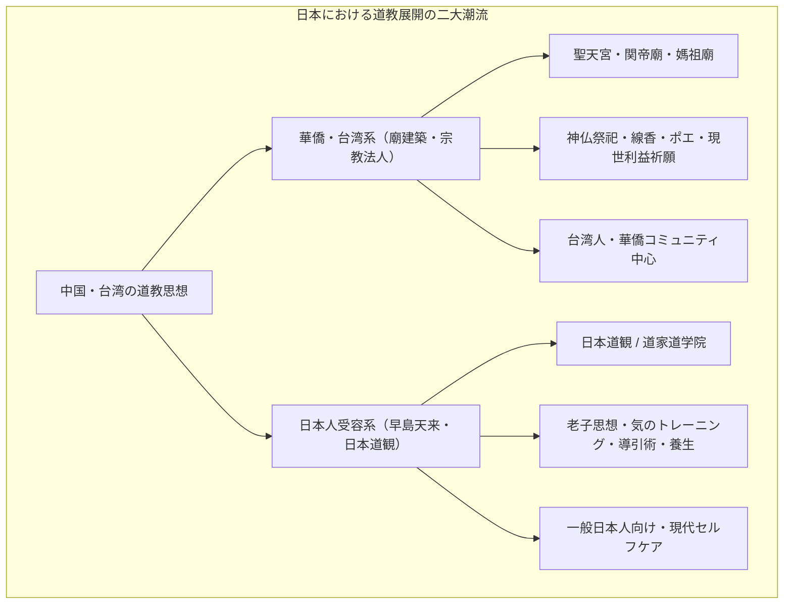

# 日本道観（道家道学院） 専門構造分析ノート

> [!summary] 要旨
> **日本道観・道家道学院**は、早島正男（号：天來、通称「早島天来」、1911年3月3日–1999年6月）が設立した道教系の修養団体とその教育機関である。早島は1969年に台湾で道家龍門派伝的第十三代の允可を受け、**1979年に福島県いわき市で日本道観を設立**、**1992年に道家道学院（道家＜道＞学院）を設立**した（Wikipedia「早島正雄」）。華僑・台湾人による民族信仰としての道廟とは異なり、日本人向けに老荘思想と導引術・動功・静功などの身体技法を健康法・自己開発プログラムとして体系化した点に特徴がある。総本部はいわき市泉町下川に置かれ、現在は早島妙聴が二代道長・学長を務める。旧版の「1969年設立」「創始者の生年1928年」「総本部は平沼ノ内」等の記述は照合の結果いずれも誤りであり、本版で訂正した（詳細は12節）。

---

## 1. 命題の構造（華僑系道廟 vs 日本人受容系タオイズム）

### 比較考察マトリクス表

| 比較軸 | 華僑・台湾系道廟（[[五千頭の龍が昇る聖天宮\|聖天宮]]、[[横浜関帝廟・横濱媽祖廟\|関帝廟]]等） | 日本道観・道家道学院（早島天来系） |
| :--- | :--- | :--- |
| **中心対象** | **三清道祖、関聖帝君、天上聖母**（神格化された神仏） | **老子、道（TAO）、気（天地のエネルギー）** |
| **実践形態** | 廟前での線香供養、神像礼拝、祭礼パレード、金紙焼納 | **導引術（気の体操）、動功（気功）、静功（瞑想的実践）** |
| **目的・救済** | 家内安全、商売繁盛、海難除け、死後救済 | **無病息災、自然治癒力向上、不老長寿、天地自然との合一** |
| **指導者** | 台湾・華僑の道教法師（道士・壇主） | **早島天来（初代道長） ➔ 早島妙聴（二代道長）** |
| **組織形態** | 宗教法人、一般社団法人（伝統寺院型） | 学院・道場型の教育機関（宗教法人格は未確認） |

- 命題上の注意：団体側は自らを「道教の正統な法嗣」として提示するが、第三者資料で確認できるのは、早島が1969年に台湾で龍門派伝的第十三代の允可を受けたという経歴（Wikipedia）までであり、台湾・中国の道教団体との組織的関係の詳細は未検証である（12節）。

---

## 2. 基本情報

| 項目 | 内容 |
| :--- | :--- |
| **組織名称** | 日本道観（総本部） ／ 道家道学院（正式表記「道家＜道＞学院」、TAO ACADEMY） |
| **創始者** | 早島正男（号：天來、通称「早島天来」、1911年3月3日–1999年6月）・初代道長 |
| **現代表者** | 早島妙聴（二代道長・道家道学院学長） |
| **創設年** | 1979年（日本道観） ／ 1992年（道家道学院） |
| **総本部所在地** | 福島県いわき市泉町下川字萱手79-2（〒971-8183、道家道学院総本部） |
| **東京本校** | 道家道学院 本校・東京〈道〉学院：東京都渋谷区代々木4-1-5（施設情報による） |
| **三大プログラム** | **導引術（どういんじゅつ）**、**動功（どうこう）**、**静功（じょうこう）** |
| **公式URL** | `https://www.dougakuin.jp/` |

---

## 3. 創始者と天啓・社伝

### (1) 早島天来の経歴と道教伝授（Wikipedia「早島正雄」による）
- 早島天来の本名は**早島正男**、号は**天來**である（Wikipediaの見出しは「早島正雄」だが本文は本名を正男とする）。1911年3月3日生まれ、1999年6月没。
- 1960年、神奈川県鎌倉市材木座に武術道場「松武館」を開設。
- 1969年、台湾に渡り**道家龍門派伝的第十三代**を允可され、嗣漢張天府顧問に就任した。
- 1979年、福島県いわき市に日本道観を設立。1992年、道家道学院を設立した。

### (2) 「導引術」の現代的復興
古代中国の馬王堆漢墓から出土した「導引図」に示されるような、呼吸と身体動作によって体内の気血を巡らせる「導引術」を、現代人が日常生活で実践できる形に再構成した。1973年の『人間は病気では死なない 導引術入門』をはじめ、1970〜80年代に導引術・タオイズム関連の著作を多数刊行したことがWikipediaの著作リストから確認できる。なお旧版の「日本全国に大ブームを巻き起こした」という評価表現は、出典のない言説として断定を避ける。

### (3) 国際タオイズム交流について
旧版は「2013年に一般社団法人日本タオイズム協会を設立して国際シンポジウムを共催」等と記していたが、協会公式サイトを取得できず確認できなかったため、未検証として12節に分離した。

---

## 4. 沿革・歴史変遷

| 年代 | 出来事 | 出典・備考 |
|---|---|---|
| 1911年 | 早島正男（天來）誕生（3月3日） | Wikipedia |
| 1960年 | 鎌倉市材木座に松武館を開設 | Wikipedia |
| 1969年 | 台湾で道家龍門派伝的第十三代を允可。嗣漢張天府顧問に就任 | Wikipedia |
| 1973年 | 『人間は病気では死なない 導引術入門』刊行。以後関連著作を多数刊行 | Wikipedia著作リスト |
| 1979年 | **日本道観を設立**（いわき市） | Wikipedia |
| 1992年 | **道家道学院を設立** | Wikipedia |
| 1999年 | 早島天來没（6月）。早島妙聴が二代道長・学長に就任（就任時期の詳細は未確認） | Wikipediaほか |

---

## 5. 教理・儀礼・神観の深層解剖

### 5-1. タオイズムの世界観
- 道家道学院の教育内容は老荘思想（タオイズム）を中核とし、「道（タオ）」との合一、無為自然、陰陽の調和を説くとされる。
- 「神観」は人格神への信仰というより宇宙の根源原理としての「道」を中心とする点で、神々への祭祀を中心とする宗教的道教とは異なる、思想的道教の色彩が強い。

### 5-2. 三大修行・実践体系
- **導引術（どういんじゅつ）**: 体内のツボ（経絡）を刺激しながら、呼吸法と独自のポーズを組み合わせ、滞った「邪気」を排出し「天地の精気」を取り込むとされる気の健康法。
- **動功（どうこう）**: 立ち姿勢で行う気功法。体の中心軸（丹田）を整え、滑らかな動きで気の循環を活性化させるとされる。
- **静功（じょうこう）／洗心術**: 老子の「無為自然」「上善如水」の思想に基づき、執着やストレスから心を解放し天地自然と一体になる瞑想・生活哲学。旧版は第三の柱を「洗心術」としていた。講座体系の詳細は公式サイトの全容取得ができておらず、名称の対応関係を含め未検証部分を含む。

### 5-3. 食文化・養生思想（タオイズムの食養生）
- **道教食養法（仙食・薬膳）**: 老子思想に基づく「腹八分」「身土不二」「陰陽調和」の食生活が推奨されるとされる（団体側の提示であり、実践の実態は未検証）。
- **オリエンタルベジとの接点**: 道教の不老長寿・気功修行においては、気を濁らせる刺激物（五葷）や重い肉食を避ける「避穀（ひこく）・精進」が伝統的に重視されており、台湾素食文化の哲学的源流の一つとなっている。

---

## 6. 宗教学的・歴史社会学的意義

- 日本道観・道家道学院は、中国道教の法統（龍門派）を名乗りつつ、実態としては思想・健康法の教育機関として展開した点に特徴がある。神々への祭祀を中心とする在日華僑の道教（関帝廟・媽祖廟など）とは異なる、日本人向けの「学びとしてのタオイズム」の受け皿である。
- 1970年代以降の東洋思想・代替医療への関心の高まりの中で、書籍メディアを通じてタオイズムを一般読者に届けた事例として位置づけられる。

---

## 7. 拠点・現地情報

| 拠点 | 所在地 | 備考 |
|---|---|---|
| 道家道学院総本部（日本道観総本部） | 福島県いわき市泉町下川字萱手79-2（〒971-8183） | マピオン・NAVITIME掲載情報。最寄りはJR常磐線「泉駅」 |
| 道家道学院 本校・東京〈道〉学院 | 東京都渋谷区代々木4-1-5 | 施設情報による。最寄りは小田急線「参宮橋駅」 |

- 旧版の総本部住所（いわき市平沼ノ内諏訪原1-1-1）および東京本部住所（千代田区三番町）は現在の公開情報と一致せず出典も確認できなかったため、上記のとおり訂正した。旧住所が過去の所在地であった可能性は否定できない（12節）。

---

## 8. 関連教団・関連人物・関連概念

- **早島天来**: 創始者・初代道長
- **早島妙聴**: 二代道長・道家道学院学長
- **老子**: タオイズム（道教）の始祖
- **無為自然**: 宇宙の法則に従う根本理念
- **[[五千頭の龍が昇る聖天宮]]**: 伝統宮殿式道廟（比較対象）
- **[[天道（一貫道）]]**: 三教合一新宗教（比較対象）

---

## 9. 史料・一次資料 (convMD)

- [[src_日本道観_道家道学院公式]]（道家道学院公式サイト dougakuin.jp トップページ。取得できたのはメニュー等の部分情報）
- [[src_日本道観_Wikipedia早島正雄]]（Wikipedia「早島正雄」。生没年・経歴・著作リストの根拠）

---

## 10. 参考文献・学術論文

- Wikipedia「早島正雄」（日本道観・道家道学院の設立年、早島の経歴の主要な根拠）
- 道家道学院公式サイト `https://www.dougakuin.jp/`
- マピオン・NAVITIME掲載の施設情報（総本部・東京本校の所在地の根拠。タウンページ系データ）
- 早島天来の著作（Wikipedia著作リストで確認できるもの）：『人間は病気では死なない 導引術入門』（1973年）ほか
- ※日本道観を対象とする学術論文・研究書は本照合では確認できなかった。旧版が挙げていた福井文雅『道教の総合的研究』は一般的な道教学の文献であり、本団体の出典ではないため本節から外した。

---

## 11. 関連ノート (Vault内)

- [[五千頭の龍が昇る聖天宮]]
- [[東京媽祖廟]]
- [[横浜関帝廟・横濱媽祖廟]]
- [[神戸関帝廟]]
- [[天道（一貫道）]]
- [[系統別分類カタログ]]

---

## 12. 留保（中立的併記・未確定要素）

> [!warning] 留保事項
> - **位置づけ**: 日本道観・道家道学院は、宗教学・思想史において「日本における現代タオイズム（道教）の代表的受容・展開組織」として分類しうるが、宗教法人格の有無は未確認であり、教育・修養機関としての性格が強い。
> - 本ノートの evidence_type は `secondary_source_based`、confidence は `3`（2026-11-15の全件照合で変更。理由は下記改訂記録参照）。

> [!note] 改訂記録（2026-11-15・全件照合）
> - **照合に用いた資料**: Wikipedia「早島正雄」、道家道学院公式サイト（部分取得）、マピオン・NAVITIMEの施設情報（タウンページ系データ）。公式サイトは convMD で `資料/` に保存した。
> - **訂正1（創始者の生没年・本名）**: 旧版「早島正雄、1928–1999」→ 本名は**早島正男**、号は天來、**1911年3月3日–1999年6月**（Wikipedia）。
> - **訂正2（設立年）**: 旧版「1969年日本道観設立／1980年道家道学院設立」→ **日本道観1979年、道家道学院1992年**。1969年は台湾で龍門派伝的第十三代の允可を受けた年であり、設立年ではない。
> - **訂正3（総本部所在地・アクセス）**: 旧版「いわき市平沼ノ内諏訪原1-1-1／いわき駅よりバス」→ **いわき市泉町下川字萱手79-2／JR常磐線「泉駅」**（施設情報2件が一致）。
> - **訂正4（東京本校所在地）**: 旧版「千代田区三番町／半蔵門駅・九段下駅」→ 現在の公開情報では**渋谷区代々木4-1-5／参宮橋駅**（道家道学院 本校・東京〈道〉学院）。
> - **訂正5（公式サイトURL）**: 旧版の taoism.or.jp・dokan.co.jp はいずれも取得できず、道家道学院の現行公式サイトは **dougakuin.jp** であるため差し替えた。
> - **未検証として分離した主張**: (1) 早島の「道号：司馬天法」——照合した資料に記載なし。(2) 系統の「正一派」——確認できたのは龍門派の伝的のみ。(3) 「信者数・受講者数：累計数十万人」——出典未確認の規模主張。(4) 一般社団法人日本タオイズム協会の設立（2013年）・国際タオイズムシンポジウムの共催・早島妙聴の同協会理事長就任——協会公式サイト（taoism.or.jp）はDNS解決失敗のため**未取得**。なお国税庁法人番号公表サイトで確認できる「日本タオイズム協会」は福岡県朝倉郡東峰村の**一般財団法人**であり、同一団体かどうか確認できない。(5) 旧住所（平沼ノ内・三番町）が過去の所在地であった可能性——肯定も否定もできる資料なし。(6) 旧版の著作リストのうち『タオ・プログラム』『老子道徳経の読み方』——Wikipedia著作リストの範囲では未確認（『導引術入門』は1973年刊『人間は病気では死なない 導引術入門』として確認）。(7) 台湾道教総会・中国道教協会との「正式な交流」の詳細。(8) 日本道観の宗教法人格の有無・法人番号。
> - **取得失敗の資料**: 日本タオイズム協会公式サイト（taoism.or.jp、DNS解決失敗）、dokan.co.jp（convMDで変換失敗）。いずれも承認待ちサイトではなく技術的失敗のため「未取得」と記録する。
> - **evidence_type の変更**: `primary_and_secondary_sources` → `secondary_source_based`（7値への正規化。公式サイトは部分取得にとどまり、事実関係の主たる根拠がWikipedia等の二次資料のため）。
> - **confidence の変更**: `5` → `3`（旧版は設立年・創始者生年・所在地など根幹情報に複数の誤りを含んでいた。訂正後の本文は二次資料に基づくが、団体自体の一次資料の全容取得ができておらず、関連団体の情報も未検証のため）。
> - **構造再編**: references/religion.md の宗教版12セクション構造へ再編した。旧1節（比較対比）→新1節、旧2節→新2節、旧3節→新3節・新4節、旧4節（実践体系）・旧5節（食養生）→新5節、旧6節→新8節、旧7節→新9節・新10節、旧8節→新11節、旧9節→新12節。旧版の意義づけは新6節・新7節に再構成した。記述内容の削除は行っていない（未検証の主張は12節へ分離）。

### 再検証記録（2026-11-16・RB6）
- **格上げ（日本タオイズム協会）**: 道家道学院学長特設サイト（tao-academy.jp）の新着情報で、一般財団法人日本タオイズム協会の設立一周年記念祭典（2014年7月5日、英彦山）・第2回国際タオイズム文化交流会シンポジウム（2015年7月24日～26日）の開催を確認した。国税庁では同協会の法人番号 **5290005014615**（福岡県朝倉郡東峰村大字小石原1362番地1）を確認。旧稿の「一般社団法人」は誤りで正しくは**一般財団法人**であり、福岡の法人は英彦山の所在地と整合する同一団体と判断できる。設立年は2013年頃と整合するが、早島妙聴の同協会理事長就任は今回も未確認。→ src_日本道観_再検証_タオイズム協会と著作
- **格上げ（著作・部分）**: 『「老子道徳経」の読み方』（早島正雄、経済界、1989年、ISBN 4-7667-8066-3）の実在を図書館OPAC書誌とWikipedia著作リストで確認した。『タオ・プログラム』は今回も確認できず。
- **格上げ（中国道教協会との交流・部分）**: 同特設サイトに中国道教協会からの支援物資受領、同協会副会長を団長とする訪問団の来訪、任法融会長の設立祭典出席等の交流実績が記録されていることを確認した。「正式な交流」の格付け自体は団体側の表現として扱う。
- **残存**: 道号「司馬天法」、系統の「正一派」、「累計数十万人」、旧住所（平沼ノ内・三番町）、日本道観自体の宗教法人格の有無・法人番号は、公式系サイト・国税庁・Web検索を再探索しても確認できず。

- **追跡調査 第2波 2026-11-19（RB6）**: 探索先＝Vault内資料/・『宗教年鑑』令和7年版・国税庁法人番号・NDL・教団公式サイト・Web検索。Vault内資料/再確認・『宗教年鑑』令和7年版ローカル抽出テキスト再検索・横断Web探索で新規の一次・公的資料は得られず、確認できず。

---

*※本稿は[[_分派・異端研究ポータル]]の道教・タオイズム修養組織に関する専門構造分析ノートである。*
