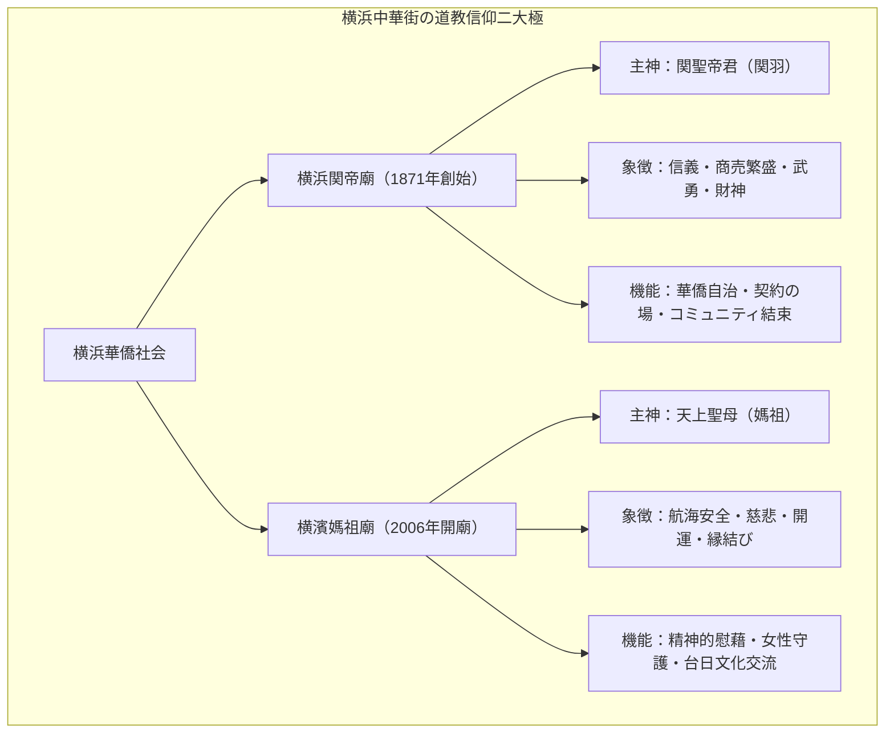

# 横浜関帝廟・横濱媽祖廟 専門構造分析ノート

> [!summary] 要旨
> **横浜関帝廟**と**横濱媽祖廟**は、日本最大のチャイナタウンである横浜中華街（神奈川県横浜市中区山下町）に鎮座する二大道教寺院（廟）である。**横浜関帝廟**は1862年の小祠を起源とし、**1871年に本格的な廟が建立**された。三国志の英雄・関羽（関聖帝君）を祀り、明治初期以来の横浜華僑社会の結束の中心となってきた。現行の建物は**4代目で、1990年8月14日に開廟式**が行われた（公式サイト・Wikipedia）。**横濱媽祖廟**は航海安全の女神・媽祖（天上聖母）を祀り、横浜開港150周年記念事業として**2006年3月17日に開廟**した。旧版の「2000年第4代本殿落慶」は誤りであり、本版で訂正した（詳細は12節）。

---

## 1. 命題の構造（二大廟の機能・象徴対比）

### 比較考察マトリクス表

| 比較軸 | 横浜関帝廟（1871年創始） | 横濱媽祖廟（2006年開廟） |
| :--- | :--- | :--- |
| **主神（祭神）** | **関聖帝君**（三国志武将・関羽雲長） | **天上聖母**（北宋の実在女性・林黙娘 / 媽祖） |
| **神格と利益** | 商業の神（財神）、信義の神、悪霊退散、学問（文衡帝君） | 海上安全、子宝（註生娘娘）、縁結び（月下老人）、学問（文昌帝君） |
| **歴史と設立** | 1862年小祠、1871年に本格的廟建立。震災・空襲・火災を経て1990年に4代目が開廟 | 2006年3月17日、横浜開港150周年を記念して開廟 |
| **法人形態** | 未確認（旧版の「一般社団法人」は本照合で確認できず。12節参照） | **宗教法人 横濱媽祖廟** |
| **主要祭礼** | **関帝誕（旧暦6月24日）**：獅子舞・龍舞・華僑パレード | **媽祖誕（旧暦3月23日）**：台湾伝統音楽・神輿巡行 |
| **周辺素食環境** | 横浜中華街内の台湾素食専門店（[[健福（台湾素食レストラン）\|健福]]等）と隣接 | 同上 |

---

## 2. 基本情報

| 項目 | 内容 |
| :--- | :--- |
| **施設名称** | 横浜関帝廟（Kanteibyo） ／ 横濱媽祖廟（Masobyo） |
| **所在地** | 関帝廟：神奈川県横浜市中区山下町140 ／ 媽祖廟：山下町136 |
| **主神** | 関聖帝君（関帝廟） ／ 天上聖母・媽祖（媽祖廟） |
| **配祀神** | 関平、周倉、福徳正神、玉皇上帝、月下老人、註生娘娘、臨水夫人、文昌帝君 |
| **開門時間** | 関帝廟 8:00〜18:00（公式ページ記載を紹介する二次情報による）／ 媽祖廟 9:00〜19:00（年中無休） |
| **参拝作法** | 5本の線香供養（各香炉に1本ずつ）、ポエ占い、金紙焼納 |
| **公式URL** | `http://www.yokohama-kanteibyo.com/` ／ `http://www.yokohama-masobyo.jp/` |

---

## 3. 創始者と天啓・社伝（建立の経緯）

### (1) 横浜開港と関帝廟の誕生
1859年の横浜開港に伴い、欧米商館の買弁（通訳・仲介人）として多くの中国人（華僑）が横浜に定住した。公式史では、1862年に一人の華僑が関羽の木像を祀る小祠を建てたことが始まりとされ、1871年（明治4年）に華僑有志の寄付により本格的な廟が造られた。関帝廟は祈りの場にとどまらず、商人同士が契約を交わし紛争を調停する「信義の法廷」としても機能したとされる。

### (2) 横濱媽祖廟の建立地
媽祖廟の所在地（山下町136）は、かつて清国領事館があり、その一角に媽祖が祀られていた場所であると横浜市公式観光情報が伝える。海を渡って異国の地で生き抜いてきた華僑の心の支えとして、2006年に現在地へ本格的な廟が建立された。

---

## 4. 沿革・歴史変遷

| 年代 | 出来事 | 出典・備考 |
|---|---|---|
| 1862年 | 関羽の木像を祀る小祠が建てられる | 公式史（複数の紹介資料で一致） |
| 1871年 | 華僑有志の寄付により本格的な関帝廟が建立 | 公式・Wikipedia |
| 1886年 | 関帝廟の拡張 | Wikipedia |
| 1891年 | 関帝廟の改築 | Wikipedia |
| 1923年 | 関東大震災で関帝廟が倒壊。2代目が再建される | Wikipedia |
| 1945年 | 6月の空襲で2代目が焼失。1946年に3代目が建立される | Wikipedia |
| 1986年 | 3代目が原因不明の火災で焼失 | Wikipedia |
| **1990年8月14日** | **現行4代目の開廟式** | 公式サイト（英語ページ）・Wikipedia |
| 2006年3月17日 | **横濱媽祖廟が開廟**（横浜開港150周年記念事業。総工費18億円と報じられた） | Wikipedia（中・英）・横浜経済新聞 |
| 2019年 | 隣接する横浜中華学院の工事で初代関帝廟と見られる遺構が発見され、一部が常設展示 | Wikipedia |

- 関帝廟の建築資材はほとんどが中国から取り寄せられ、中華民国・中華人民共和国出身の大工が建築を行った（Wikipedia）。

---

## 5. 教理・儀礼・神観の深層解剖

### 5-1. 五本の線香と五大神炉
参拝者は、売店で5本の線香と金紙を購入し、1番から5番までの香炉に順に1本ずつ線香を捧げる。
1. **玉皇上帝炉**: 天の最高神
2. **天上聖母炉（または関聖帝君炉）**: 本廟の主神
3. **註生娘娘炉**: 子宝・安産の女神
4. **文昌帝君炉**: 学問・試験合格の神
5. **月下老人炉**: 縁結びの神

### 5-2. 擲筊（ポエ）による神意確認
悩み事や願い事がある信徒は、三日月型の木片（ポエ）を神前に投げ、表（陽）と裏（陰）の組み合わせ（聖筊）が出るまで対話を行う。

### 5-3. 金紙（冥銭・神への供物）の焼納
金箔が貼られた紙（寿金・太極金）に自らの氏名・生年月日を記入して供え、参拝後に特製の金炉で燃やすことで、祈願が天界へ届くと信じられている。

---

## 6. 宗教学的・歴史社会学的意義

- 両廟は、横浜華僑社会の自治と結束を象徴する公共的聖域であり、日本における道教・中華民間信仰の代表的拠点である。関帝廟が「信義と商業の守護神」として中華街の経済秩序を象徴するのに対し、媽祖廟は「慈悲と海難救済の母神」として生命守護を司る。
- 2019年に初代関帝廟と見られる遺構が発見されたことは、開港期華僑史の物証として両廟の歴史的価値を補強している。

---

## 7. 拠点・現地情報

| 項目 | 横浜関帝廟 | 横濱媽祖廟 |
|---|---|---|
| 所在地 | 神奈川県横浜市中区山下町140 | 神奈川県横浜市中区山下町136 |
| 開門時間 | 8:00〜18:00（公式ページ記載を紹介する二次情報による。要現地確認） | 9:00〜19:00（年中無休） |
| アクセス | みなとみらい線「元町・中華街駅」徒歩約3〜5分、JR根岸線「石川町駅」中華街口徒歩約6分 | 同左 |
| 周辺 | 横浜中華街の中心部。近隣に台湾素食専門店[[健福（台湾素食レストラン）\|健福]]など | 同左 |

---

## 8. 関連教団・関連人物・関連概念

- **関聖帝君**: 武神・財神・商業道徳の最高神
- **天上聖母（媽祖）**: 航海安全・諸願成就の海の母神
- **[[五千頭の龍が昇る聖天宮]]**: 埼玉県坂戸市の台湾宮殿式道廟
- **[[東京媽祖廟]]**: 東京都新宿区のビル型媽祖廟
- **[[神戸関帝廟]]**: 兵庫県神戸市の華僑道教廟
- **[[天道（一貫道）]]**: 関帝を白陽期の重要な神仏として崇敬
- **[[健福（台湾素食レストラン）]]**: 横浜中華街のオリエンタルベジ専門店

---

## 9. 史料・一次資料 (convMD)

- [[src_横浜関帝廟_公式]]（横浜関帝廟公式サイト yokohama-kanteibyo.com トップページ。取得できたのは部分情報）
- [[src_横濱媽祖廟_公式]]（横濱媽祖廟公式サイト yokohama-masobyo.jp トップページ。取得できたのは部分情報）
- [[src_横浜関帝廟_Wikipedia]]（Wikipedia「横浜関帝廟」。4代目開廟年・沿革の根拠）

---

## 10. 参考文献・学術論文

- 横浜関帝廟公式サイト `http://www.yokohama-kanteibyo.com/`（歴史ページ・英語ページ）
- 横濱媽祖廟公式サイト `http://www.yokohama-masobyo.jp/`
- Wikipedia「横浜関帝廟」「横濱媽祖廟」（日本語版ほか）
- 横浜市公式観光情報（媽祖廟の所在地が旧清国領事館跡であることの根拠）
- ※旧版が挙げていた『横浜関帝廟史』『横濱媽祖廟公式ガイドブック』、可児弘明『横浜中華街』、田中一成『中国の宗族と演劇』は、本照合で実在・該当記述を確認できなかったため12節に分離した。

---

## 11. 関連ノート (Vault内)

- [[東京媽祖廟]]
- [[五千頭の龍が昇る聖天宮]]
- [[神戸関帝廟]]
- [[天道（一貫道）]]
- [[道徳会館]]
- [[健福（台湾素食レストラン）]]
- [[一貫道と台湾素食レストラン]]
- [[系統別分類カタログ]]

---

## 12. 留保（中立的併記・未確定要素）

> [!warning] 留保事項
> - **法人格の区分**: 横濱媽祖廟は宗教法人とされる。横浜関帝廟の法人形態（旧版は「一般社団法人」と記載）は、本照合で確認できる出典が得られなかったため未確認とする。双方ともに実態として道教・中華民間信仰の宗教施設として機能している。
> - **法人番号**: 旧版frontmatterは「確認済み」としていたが、番号そのものの記載がなく国税庁法人番号公表サイトでの照合も行われていなかったため、「未確認」に改めた（追加点検項目に基づく是正）。
> - 本ノートの evidence_type は `primary_source_based`、confidence は `4`（2026-11-15の全件照合で変更。理由は下記改訂記録参照）。

> [!note] 改訂記録（2026-11-15・全件照合）
> - **照合に用いた資料**: 両廟の公式サイト、Wikipedia「横浜関帝廟」（日本語版）、横浜市公式観光情報、横浜経済新聞。公式サイト2件とWikipediaは convMD で `資料/` に保存した。
> - **訂正1（4代目本殿の落慶年）**: 旧版「2000年第4代本殿落慶」→ **1990年8月14日開廟式**（公式サイト英語ページ・Wikipediaで一致）。あわせて1886年拡張・1891年改築・1946年3代目建立・2019年遺構発見を沿革に追記した。
> - **訂正2（開門時間）**: 旧版は両廟一律「9:00〜19:00」としていたが、媽祖廟は9:00〜19:00（年中無休）で一致する一方、関帝廟は公式ページ記載を紹介する二次情報（2026-11-05確認と明記）で **8:00〜18:00** とされるため、出典を明記して書き分けた。
> - **訂正3（法人番号）**: 「確認済み」→「未確認」（番号の記載自体がなく、照合の実績もないため。追加点検項目に基づく）。
> - **未検証として分離した主張**: (1) 関帝廟の法人形態「一般社団法人」。(2) 信者数「年間数百万人規模」——中華街全体の来街者数との混同の疑いがあり、両廟固有の参拝者数としては出典なし。(3) 媽祖廟の分霊元「台南の祀典大天后宮・福建省湄洲媽祖祖廟」——建立の経緯として広く語られるが、本照合では公式資料で確認できなかった。(4) 参考文献の『横浜関帝廟史』『公式ガイドブック』、可児弘明『横浜中華街—被災と復興の華僑史』（中公新書）、田中一成『中国の宗族と演劇』（東京大学出版会）——書名・版元の実在確認まで至らなかったため本文の参考文献から外した（実在しないと断定するものではない）。
> - **取得状況**: 両廟公式サイトのトップページは convMD で保存できたが本文は部分的である。関帝廟公式サイトの本文テキストはブラウザ取得でも空となり、歴史の詳細はWikipediaと二次情報に依存している。
> - **evidence_type**: `primary_source_based` を維持（公式サイトを直接取得し、横浜市公式観光情報等の公的資料でも照合したため。7値の範囲内）。
> - **confidence の変更**: `5` → `4`（中核の年代・所在地は確認できたが、関帝廟の法人形態・開門時間の一次確認・信者数など未検証項目が残るため）。
> - **構造再編**: references/religion.md の宗教版12セクション構造へ再編した。旧1節（対比）→新1節、旧2節→新2節、旧3節→新3節・新4節、旧4節（儀礼）→新5節、旧5節→新8節、旧6節→新9節・新10節、旧7節→新11節、旧8節→新12節。現地情報は新7節に分離し、意義づけは新6節に再構成した。記述内容の削除は行っていない（未検証の主張は12節へ分離）。
> - **src_ 参照点検**: 9節で参照する src_ ファイル3件はすべて `content/資料/` に実在することを確認した。

### 再検証記録（2026-11-16・RB6）
- **格上げ（媽祖廟の分霊元）**: 中国語版Wikipedia「橫濱媽祖廟」に、2006年1月に湄洲島で湄洲媽祖祖廟の法師による開光分霊が行われ、台南祀典大天后宮が開廟儀式に協力した旨の記載を確認した。日本語の横浜観光紹介には「台南市大天后宮より分霊」とする記述もあるため、分霊元は「湄洲媽祖祖廟（開光分霊）＋台南祀典大天后宮の関与」として典拠併記で扱う。→ src_横濱媽祖廟_再検証_分霊
- **残存**: 関帝廟の法人形態（一般社団法人説）、両廟の法人番号、信者数「年間数百万人規模」は、神奈川県宗教法人名簿・国税庁・公式サイト・Web検索を再探索しても確認できず。旧版参考文献（『横浜関帝廟史』『横濱媽祖廟公式ガイドブック』、可児弘明『横浜中華街』、田中一成『中国の宗族と演劇』）の実在も今回確認できなかった（なお『関帝廟と横浜華僑』関聖帝君鎮座150周年記念、自在、2014年、ISBN 978-4-9908054-0-1 は実在する別書）。

- **追跡調査 第2波 2026-11-19（RB6）**: 探索先＝Vault内資料/・『宗教年鑑』令和7年版・国税庁法人番号・NDL・教団公式サイト・Web検索。Vault内資料/再確認・『宗教年鑑』令和7年版ローカル抽出テキスト再検索・横断Web探索で新規の一次・公的資料は得られず、確認できず。
- **改訂記録（2026-11-20・最終判断ラウンド第297件）**: 横濱媽祖廟の分霊元について、湄洲媽祖祖廟での開光分霊（中国語版Wikipedia）と「台南大天后宮より分霊」（日本語紹介）で典拠が割れる件は、本人決定により典拠併記を維持し、本文への単独確定表記は行わないこととした。本文は変更していない。

---

*※本稿は[[_分派・異端研究ポータル]]の道教・華僑宗教施設に関する専門構造分析ノートである。*
