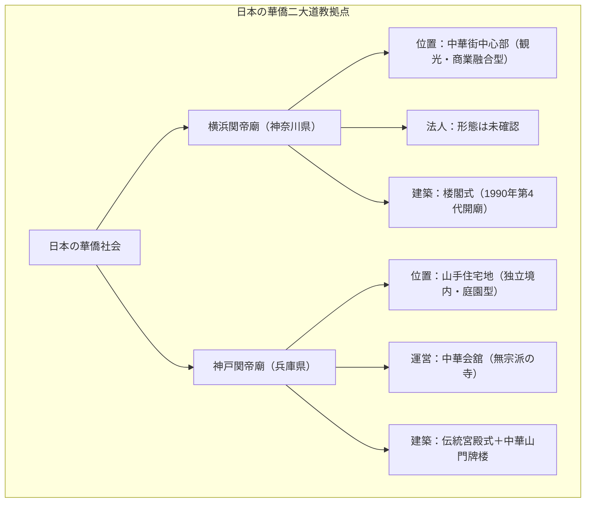

# 神戸関帝廟 専門構造分析ノート

> [!summary] 要旨
> **神戸関帝廟**は、兵庫県神戸市中央区中山手通に所在する、関西華僑社会の歴史的信仰拠点であり、Wikipediaでは「無宗派の寺」とされる。現在の地には1892年（明治25年）に黄檗山萬福寺末寺・長楽寺が呉錦堂らによって移され、1939年に関帝と天后の像が祀られた。1945年の空襲で長楽寺もろとも焼失した後、**1947年（昭和22年）に中国人有志によって長楽寺跡に関帝廟が建立**され、以後拡張されてきた。旧版の「1892年に現在地へ関帝廟を建立」は前身寺院の移転と関帝廟の建立を混同した誤りであり、本版で訂正した（詳細は12節）。南京町（神戸中華街）から離れた山手エリアに鎮座し、中華会舘が運営する。

---

## 1. 命題の構造（東西二大関帝廟の構造対比：横浜 vs 神戸）

### 比較考察マトリクス表

| 比較軸 | 横浜関帝廟（横浜市中区） | 神戸関帝廟（神戸市中央区） |
| :--- | :--- | :--- |
| **創始時期** | 1871年（明治4年） | 前身・長楽寺の移転1892年（明治25年）／関帝廟の建立1947年 |
| **立地環境** | 横浜中華街の目抜き通り中央（過密商業地） | 中山手通の閑静な住宅街（専用境内・中華牌楼） |
| **主祭神** | 関聖帝君ほか | 関聖帝君、天后（1939年に両像を祀る） |
| **法人格・運営** | 形態は未確認 | 中華会舘が運営（Wikipediaは「無宗派の寺」とする） |
| **主要祭事** | 関帝誕（旧暦6月24日パレード） | 関帝誕、**中元節の盂蘭盆会（旧暦7月13日〜15日）** |
| **空間体験** | 圧倒的な極彩色・観光客で賑わう動的空間 | 線香の煙が静かに漂う厳かな祈りと自治の静的空間 |

---

## 2. 基本情報

| 項目 | 内容 |
| :--- | :--- |
| **廟名** | 関帝廟（神戸関帝廟） |
| **所在地** | 兵庫県神戸市中央区中山手通7-3-2 |
| **主神** | **関聖帝君（関羽雲長）**、天后（媽祖） |
| **配祀神** | 関平、周倉（詳細な配置は未確認。12節参照） |
| **建立年** | 1947年（昭和22年）。前身の長楽寺は1892年に当地へ移転 |
| **拝観時間** | 9:00〜17:00（年中無休。複数の施設情報による） |
| **運営** | 中華会舘 |
| **公式URL** | `https://www.zhonghua-huiguan.com/`（中華会舘） |

---

## 3. 創始者と天啓・社伝（建立の経緯）

### (1) 前身・長楽寺の移転（1892年）
神戸開港（1868年）後、貿易に従事する華僑が南京町を形成した。現在地にはもともと、大阪府中河内郡布施村にあった黄檗山萬福寺末寺・**長楽寺**が、**1892年（明治25年）に呉錦堂らによって移された**（Wikipedia「関帝廟 (神戸市)」）。本堂前の大香炉には「光緒十八年」（1892年）の銘があり、この移転の年を示すとされる。

### (2) 関帝・天后の合祀（1939年）
1939年、長楽寺に関帝と天后（媽祖）の像が祀られた。これが現在の関帝廟の直接の前身である。

### (3) 関帝廟の建立（1947年）
1945年の空襲で長楽寺もろとも焼失した後、**1947年（昭和22年）に中国人有志によって長楽寺跡に関帝廟が造営**され、以後拡張されて現在に至る。

---

## 4. 沿革・歴史変遷

| 年代 | 出来事 | 出典・備考 |
|---|---|---|
| 1892年 | 黄檗山萬福寺末寺・長楽寺が呉錦堂らにより現在地へ移転。大香炉に「光緒十八年」の銘 | Wikipedia |
| 1939年 | 関帝と天后の像が祀られる | Wikipedia |
| 1945年 | 空襲で長楽寺もろとも焼失 | Wikipedia |
| **1947年** | **長楽寺跡に関帝廟が建立**（中国人有志による）。以後拡張 | Wikipedia |
| 毎年旧暦7月13日〜15日 | 盂蘭盆会（中元節の施餓鬼供養） | Wikipedia |

- 1977年の火災、1995年の阪神・淡路大震災での被災、1999年2月14日の修復完了については、単一の英語圏情報源（chinatownology）の記載があるが、公的資料で確認できなかったため12節に参考情報として分離した。

---

## 5. 教理・儀礼・神観の深層解剖（境内構造と信仰作法）

- **中華山門（牌楼）**: 中山手通に面する極彩色の門。「関帝廟」の扁額が掲げられる。
- **本殿**: 関聖帝君を祀る。関帝廟の一般形では本殿中央に関羽、脇に関平・周倉が配されるが、神戸の現行配置の詳細は本照合で確認できなかった（12節）。
- **大香炉**: 本堂前に置かれ「光緒十八年」（1892年）の銘を持つ。
- **中元節（盂蘭盆会）**: 旧暦7月13日〜15日に行われる施餓鬼供養は本廟の代表的年中行事である（Wikipedia）。無縁仏や祖先の霊を慰めるため供物や金紙が捧げられる。
- **参拝作法**: 中国式の線香供養、ポエ（擲筊）による神意確認などが行われる。

---

## 6. 宗教学的・歴史社会学的意義

- 神戸関帝廟は、前身が黄檗宗寺院であったという経緯を持ち、仏教寺院の跡地に華僑の道教廟が建立された点で、日本の華僑宗教の重層性を示す事例である。
- 中華街の商業地区から離れた山手の住宅地に独立境内を保ち、中華会舘を中心とする神戸華僑社会の自治と世代間継承を支えてきた。

---

## 7. 拠点・現地情報

| 項目 | 内容 |
|---|---|
| 所在地 | 兵庫県神戸市中央区中山手通7-3-2 |
| アクセス | 神戸市営地下鉄西神・山手線「県庁前駅」西出口より徒歩約7分、JR神戸線・阪神本線「元町駅」より徒歩約12分、阪急神戸線「花隈駅」より徒歩約8分 |
| 拝観時間 | 9:00〜17:00（年中無休） |
| 運営 | 中華会舘（公式サイト zhonghua-huiguan.com） |

---

## 8. 関連教団・関連人物・関連概念

- **関聖帝君**: 商業道徳・義理人情の守護神
- **[[横浜関帝廟・横濱媽祖廟]]**: 東日本の華僑道教二大廟
- **[[東京媽祖廟]]**: 東京都新宿区の都市型廟
- **[[五千頭の龍が昇る聖天宮]]**: 埼玉県坂戸市の台湾道観
- **[[天道（一貫道）]]**: 関帝を重要な神仏として尊崇

---

## 9. 史料・一次資料 (convMD)

- [[src_神戸関帝廟_Wikipedia]]（Wikipedia「関帝廟 (神戸市)」。沿革・所在地の根拠。本文の一部は変換で欠落したため検索結果等と併せて照合）

---

## 10. 参考文献・学術論文

- Wikipedia「関帝廟 (神戸市)」（前身・長楽寺の移転年、1947年の建立、盂蘭盆会の日程の根拠）
- 中華会舘公式サイト `https://www.zhonghua-huiguan.com/`（運営主体の根拠）
- NDLレファレンスで存在を確認できた資料：中華会館『関帝廟』（小冊子、第2版、2008年）
- 中華会館編『落地生根―神戸華僑と神阪中華会館の百年』（研文出版、2000年）（旧版の陳来幸『神戸華僑と近代中国』は実在を確認できなかったため、2026-11-19の本人決定により本書へ差し替えた。§12参照）
- ※旧版が挙げていた『神戸関帝廟百年史』、兵庫県宗教法人名簿は、本照合で実在・該当記述を確認できなかったため12節に分離した。

---

## 11. 関連ノート (Vault内)

- [[横浜関帝廟・横濱媽祖廟]]
- [[東京媽祖廟]]
- [[五千頭の龍が昇る聖天宮]]
- [[天道（一貫道）]]
- [[道徳会館]]
- [[系統別分類カタログ]]

---

## 12. 留保（中立的併記・未確定要素）

> [!warning] 留保事項
> - **法人格**: 旧版は「宗教法人 関帝廟（単立）」「法人番号確認済み」としていたが、Wikipediaは本廟を中華会舘に関わる「無宗派の寺」とし、宗教法人としての登録は兵庫県名簿・gBiz等の公的経路で本照合では確認できなかった。よって法人格・法人番号はともに**未確認**とする（追加点検項目に基づく是正）。
> - 本ノートの evidence_type は `secondary_source_based`、confidence は `3`（2026-11-15の全件照合で変更。理由は下記改訂記録参照）。

> [!note] 改訂記録（2026-11-15・全件照合）
> - **照合に用いた資料**: Wikipedia「関帝廟 (神戸市)」、中華会舘公式サイト、施設情報（マピオン等）。Wikipediaは convMD で `資料/` に保存した。
> - **訂正1（創始年・建立経緯）**: 旧版「1892年に現在地に土地を購入して関帝廟を建立」→ 1892年は前身寺院・長楽寺の移転年であり、**関帝廟の建立は1947年**。1939年の関帝・天后像の合祀、大香炉の「光緒十八年」銘を追記した。
> - **訂正2（拝観時間）**: 旧版「8:30〜17:00」→ **9:00〜17:00（年中無休）**（複数の施設情報で一致）。
> - **訂正3（公式サイト・運営）**: 旧版の公式サイトURL kanteibyo.jp は取得できず（convMD失敗）、運営主体である**中華会舘の公式サイト**に差し替えた。
> - **訂正4（法人格・法人番号）**: 「宗教法人 関帝廟（単立）／法人番号確認済み」→ 法人格・法人番号ともに**未確認**に改めた（番号の記載自体がなく、国税庁での照合実績もないため。追加点検項目に基づく）。
> - **訂正5（中元節の日程）**: 旧版「旧暦7月15日／7月中旬」→ **旧暦7月13日〜15日の盂蘭盆会**（Wikipedia）。
> - **未検証として分離した主張**: (1) 脇壇の配置「左に観世音菩薩、右に福徳正神」および関平・周倉の左右配置——旧版の記述は関帝廟の一般形とも左右が食い違う箇所があり、神戸現地の配置は未確認。(2) 「1999年に中国から瓦・石材を取り寄せ牌楼・石塀を再整備」——1999年の修復完了自体は単一情報源（chinatownology）に記載があるが、瓦・石材の調達等の詳細は未確認。同情報源の1977年火災・1995年震災被害も公的資料では未確認。(3) 「中元節の儀礼が1992年に神戸市無形民俗文化財に指定」——同単一情報源のみで、神戸市の公式資料で確認できなかった。(4) 参考文献の『神戸関帝廟百年史』、陳来幸『神戸華僑と近代中国』（研文出版）、兵庫県宗教法人名簿の該当記載——実在・該当記述を確認できなかった（実在しないと断定するものではない）。(5) 「130年以上の歴史を誇る単立宗教法人」とする旧版要旨の性格づけ——1892年は前身寺院の年であり関帝廟としての歴史とは区別した。
> - **取得失敗の資料**: kanteibyo.jp（convMDで変換失敗）。承認待ちサイトではなく技術的失敗のため「未取得」と記録する。
> - **evidence_type の変更**: `primary_source_based` → `secondary_source_based`（公式一次資料の取得ができず、事実関係の根拠がWikipedia等の二次資料中心のため）。
> - **confidence の変更**: `5` → `3`（創始年・法人格など根幹情報に誤り・未確認が多く、一次資料の取得も果たせなかったため）。
> - **構造再編**: references/religion.md の宗教版12セクション構造へ再編した。旧1節（対比）→新1節、旧2節→新2節、旧3節→新3節・新4節、旧4節（境内構造）→新5節、旧5節→新8節、旧6節→新9節・新10節、旧7節→新11節、旧8節→新12節。現地情報は新7節に分離し、意義づけは新6節に再構成した。記述内容の削除は行っていない（未検証の主張は12節へ分離）。
> - **src_ 参照点検**: 9節で参照する src_ ファイル1件は `content/資料/` に実在することを確認した。

### 再検証記録（2026-11-16・RB6）
- **残存（全項目）**: 探索先＝中華会舘公式サイト、神戸市公式サイト、NDLレファレンス協同データベース、国税庁法人番号公表サイト、Web検索。法人格・法人番号は今回も公的経路で確認できず。脇壇の配置は chinatownology に「左右の祠に媽祖と観音、後に福徳正神等を追加」とあるが単一情報源のため確定しない。中元節儀礼の1992年神戸市無形民俗文化財指定も同単一情報源のみで神戸市公式資料では確認できず。1999年修復（完了日1999年2月14日）も同情報源のみ。旧版参考文献のうち陳来幸『神戸華僑と近代中国』（研文出版）は確認できず、実在するのは中華会館編『落地生根―神戸華僑と神阪中華会館の百年』（研文出版、2000年）である。公式サイト kanteibyo.jp は今回も未取得。

- **追跡調査 2026-11-18**: 探索先＝公式サイト（kanteibyo.jp）。取得できず、確認できず（未取得）。
- **追跡調査 第2波 2026-11-19（RB6）**: 探索先＝Vault内資料/・『宗教年鑑』令和7年版・国税庁法人番号・NDL・教団公式サイト・Web検索。中元節儀礼の1992年神戸市指定・1999年修復は本波のWeb検索でも chinatownology 単一情報源のままで神戸市公式資料では確認できず。公式サイト kanteibyo.jp は未取得継続。法人格・法人番号・脇壇配置・旧版参考文献も確認できず。

### 改訂記録（2026-11-19・最終判断ラウンド第85件）
- **参考文献の差し替え（本人決定）**: §10の参考文献について、旧版の陳来幸『神戸華僑と近代中国』（研文出版）は再検証（2026-11-16・RB6）でも実在を確認できなかったため、実在が確認できた中華会館編『落地生根―神戸華僑と神阪中華会館の百年』（研文出版、2000年）へ差し替えた（最終判断ラウンド第85件・2026-11-19本人決定、根拠＝religion-reverify/batch-rb6-buddhist-others.md「判断事項」14）。陳来幸の当該書名が誤りと断定するものではなく、実在を確認できない書誌を参考文献として掲げ続けないための差し替えである。
- 2026-11-20・最終判断ラウンド第408件：公式サイトは未取得のまま残すと決定した（本人決定。ライブブラウザ／convMD直接実行での再試行は行わない）。

---

*※本稿は[[_分派・異端研究ポータル]]の道教・関西華僑宗教施設に関する専門構造分析ノートである。*
