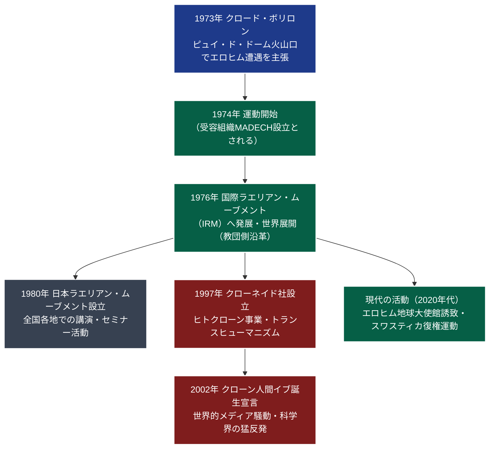

# 国際ラエリアン・ムーブメント 専門構造分析ノート

> [!summary] 要旨
> 国際ラエリアン・ムーブメント（International Raelian Movement: IRM）は、フランス出身の元自動車ジャーナリスト、クロード・ボリロン（指導者名：ラエル、1946-）が1974年に始めたUFO信仰系の新宗教運動である。旧約聖書の「エロヒム（Elohim）」を超高度な科学技術を持つ地球外知的生命体と解釈し、人類はエロヒムによる遺伝子合成実験によって科学的に創造されたと主張する。クローン技術による個体の不死再生、感覚瞑想（官能的瞑想）、および「エロヒムを迎える地球大使館」の建設を推進し、2002年のヒトクローン誕生宣言（クローネイド事件）等で国際的な議論を巻き起こした。本照合では、創設年（遭遇の主張は1973年、運動開始は1974年）、日本組織の設立年（1980年）、信者数（日本の公式アナウンスは6,000人以上）をWikipediaで照合し、旧ノート内の数値の不一致を統一した（§12）。

---

## 1. 命題の構造（通説・正統本部 vs 本教団・自説）

| 論点 | 教団側の主張 | 外部からの評価 |
| :--- | :--- | :--- |
| 人類の起源 | 約25,000年前、エロヒムがDNA合成技術によって人類を科学的に創造した | 科学的根拠はなく、宗教的信仰言説として扱われる |
| クローン人間「イブ」 | 2002年、クローネイド社が世界初のクローン人間の誕生を発表 | 科学的証拠は一切示されず、科学界では実証されていない・でっち上げとみなされた。ラエル自身も後にクローネイドはバハマに私書箱を置いた架空会社だったと述べている |
| 信者数 | 世界で最盛期6万人以上（教団側の主張）、日本は公式アナウンスで6,000人以上 | 宗教社会学者のSusan J. Palmerらは水増しを指摘。フランスの信者は数百人との報道もある |
| フランスでの位置づけ | 宗教的少数派としての権利を主張 | 1995年、フランス議会のカルトに関する委員会が「セクト」に分類 |

旧ノート内部の数値不一致（frontmatter「日本国内数百人〜千人規模」と本文「約1,000人〜数千人（公称）」、および「世界公称約90,000人」）は本照合で上記の照合結果に統一した。

---

## 2. 基本情報

| 項目 | 内容 |
| :--- | :--- |
| **団体正式名称** | 国際ラエリアン・ムーブメント（日本組織：日本ラエリアン・ムーブメント） |
| **通称・略称** | ラエリアン、IRM、ラエル教 |
| **創始者・最高指導者** | クロード・ボリロン（Claude Vorilhon / ラエル、1946-） |
| **設立年・地域** | 1973年12月に遭遇の主張、1974年にフランスで運動開始 |
| **国際本部所在地** | スイス・ジュネーブ（公式サイト rael.ch の連絡先「International Headquarters: Raelian Movement P.O. Box 225 CH-1211 Geneva 8 Switzerland」、英仏版Wikipediaでも本部はジュネーブ。カナダ・ケベック州 Valcourt の UFOland は活動拠点。2026-11-16再検証で確認、src_国際ラエリアン・ムーブメント_再検証2026） |
| **法人格** | 日本国内では宗教法人として登記されていない（任意団体） |
| **公称信徒数** | 世界：最盛期6万人以上と主張 / 日本：公式アナウンスによれば6,000人以上。日本は世界で最も会員が多いとされる |
| **基本思想・教義** | 科学的創造論、無神論、感覚瞑想（官能的瞑想） |
| **象徴シンボル** | 六芒星と逆向きの卍（スワスティカ）を組み合わせた図案（エロヒムの紋章） |

### 教団系統樹（Mermaid）

---

## 3. 創始者と天啓・社伝

### 創始者：クロード・ボリロン（ラエル、1946-）
* フランス・オーヴェルニュ地方アンベール出身。1960年代は歌手・ギタリストとして活動し、1970年代に自動車雑誌を創刊してモータースポーツジャーナリストになった。
* 1973年、フランス中部のクレルモン＝フェラン近くの火山のクレーターで、空飛ぶ円盤から現れたエロヒムと名乗る異星人とコンタクトし、メッセージを受け取ったと主張する。その際にラエルの名を与えられたとされる。1975年には再び異星人の訪問を受け、彼らの惑星に連れて行かれたと主張した。
* モーセ、イエス、釈迦、マホメットに続く「最後の預言者」「マイトレーヤ（弥勒菩薩）」を自称する。2010年には沖縄に「弥勒菩薩光臨堂」を建設した。

### 組織ヒエラルキー（ガイド制度）
国際ラエリアン・ムーブメントは、6段階のヒエラルキー（階梯）によって運営される（英語版Wikipedia・WRSP・Encyclopedia.com の記述が一致し、2026-11-16再検証で確認。最下位2層の原語は Assistant Animators／Probationers で、本ノートの「アシスタント」「研修員」はその意訳。src_国際ラエリアン・ムーブメント_再検証2026）：
* **レベル6（ガイド・オブ・ガイド）**: ラエル（最高意思決定者）。
* **レベル5（ビショップ・ガイド / 司教）**: 各大陸・主要国の最高統括者。
* **レベル4（プリースト・ガイド / 司祭）**: 儀礼・洗礼（細胞トランスミッション）を司る上級指導者。
* **レベル3（アニメーター）**: 地域支部の主導・教育担当者。
* **レベル2（アシスタント）**: 実務補佐員。
* **レベル1（研修員）**: 正式メンバー。

---

## 4. 沿革・歴史変遷

| 年代 | 事項 | 詳細・背景 |
| :---: | :--- | :--- |
| **1973年** | エロヒムとの遭遇の主張 | 12月、クレルモン＝フェラン近くの火山のクレーターにてラエルがエロヒムと遭遇したと主張。 |
| **1974年** | 運動開始 | 啓示内容をまとめた処女作『真実を告げる書』を刊行。受容組織「MADECH」を設立したとされる（教団側沿革）。 |
| **1975年** | 第2の遭遇の主張 | 再びUFOに搭乗し、エロヒムの母星へ案内されたと主張。 |
| **1976年** | IRM設立 | 組織を「国際ラエリアン・ムーブメント」へ改組したとされる（教団側沿革）。 |
| **1980年** | 日本組織設立 | 日本ラエリアン・ムーブメントが設立される（Wikipedia）。旧ノートの「1970年代後半日本支部発足」は本照合で1980年に訂正。 |
| **1995年** | 仏議会報告書（セクト指定） | フランス議会のカルトに関する委員会が運動を「セクト」に分類。本部はフランス語圏カナダ・ケベック州へ移転。 |
| **1997年** | クローネイド（Clonaid）設立 | ラエリアン司教ブリジット・ボワセリエの指揮のもと、ヒトクローン研究に取り組む組織を設立。 |
| **2002年** | **クローン人間「イブ」騒動** | ボワセリエが「イヴと名付けられた世界初のクローン人間を誕生させた」と発表。科学的証拠は示されず、でっち上げとみなされた。 |
| **2007年** | ラエルの日本移住 | 北米での活動が難しくなり、日本の沖縄県に移住。 |
| **2010年** | 弥勒菩薩光臨堂 | エロヒムを公式に歓待するための第一段階の施設として建設。 |
| **2000年代〜** | 大使館プロジェクト | 各国政府に対し、エロヒムを迎える治外法権の大使館建設用地提供を要請。日本の拠点は千葉県香取郡多古町本三倉で「千年紀プロジェクト」を進める。 |

### クローネイド社によるクローン人間「イブ」騒動（2002年）の詳細
* **発表と国際的衝撃**: 2002年12月27日、クローネイドのブリジット・ボワセリエ（生化学者・ラエリアン司教）が記者会見を開き、「世界初のクローン人間女児『イブ』が誕生した」と発表した。
* **科学的証拠の欠如**: 独立したDNA鑑定による検証機会は与えられず、主張は科学界によって実証されたことはなく、発表はでっち上げだとみなされた。ボワセリエはオランダ、日本、韓国、オーストラリアでも合計13人のクローンの赤ちゃんが生まれたと定期的に発表したが、マスコミは次第に記者会見に出席しなくなった。この話題は文部科学省の作業部会と国会でも取り上げられ、クローン人間を規制する法律について話された。
* **ラエル自身の後の発言**: ラエルは後に「クローンを作ったなどありえない。私にはその意志も技術もない」「クローネイドは、バハマに私書箱を置いた架空会社だった」と話した（Wikipedia）。

---

## 5. 教理・儀礼・神観の深層解剖

### 核心教理：科学的創造論（無神論的インテリジェント・デザイン）
* **神の否定とエロヒム**: 霊的な超越神や創造主を否定する無神論である。旧約聖書の創世記に登場する「エロヒム（Elohim）」はヘブライ語の複数形であり、「天空から降りてきた人々」を意味する高度な異星人科学者集団であると再解釈する。
* **生命の科学的創造**: 約25,000年前、エロヒムが地球上の研究所でDNA合成技術によって植物・動物、そして自らの姿に似せて人類を科学的に創造したと主張する。
* **クローン再生による永遠の生命**: 霊魂や死後の世界は存在せず、生命は情報（遺伝子コード）にすぎないとする。洗礼（トランスミッション）を受けることで遺伝子情報がUFOに転送され、死後、その遺伝子をもとに宇宙人がクローンを作るため宇宙で復活できると説く。

### 儀礼と実践
1. **細胞トランスミッション**: 年4回（4月の第1日曜日、8月6日、10月7日、12月13日）の祝日に、ガイドの手を通して個人の生体情報をエロヒムに伝送するとされる洗礼儀式（日付は公式サイト rael.org の「Transmission of the Cellular Plan」ページで確認。2026-11-16再検証、src_国際ラエリアン・ムーブメント_再検証2026）。
2. **感覚瞑想（官能的瞑想、Sensual Meditation）**: 五感を研ぎ澄まし、脳の潜在能力を開花させる瞑想法。自己愛、快楽、オーガズムを宇宙意識との同調として肯定する。信者は毎日「官能的瞑想」に励むとされる。
3. **ジーニアソクラシー（天才政治）**: 民主主義に代わる理想政治として、知能の高い者のみに投票権と被選挙権を与える選良政治を提唱する（ラエルが提唱した統治体制としてWikipediaにも独立項目がある）。
4. **シンボル**: 六芒星と逆向きの卍を組み合わせたシンボルを用いる。これはエロヒムの宇宙船に描かれていた紋章で、宇宙における空間と時間の無限性を表現しているとされる。

---

## 6. 宗教学的・歴史社会学的意義

### 児童保護・性道徳を巡るセクト批判
* **フランス国民議会報告（1995年）**: 議会のカルトに関する委員会の報告書（Rapport n°2468、1995年12月22日登録、Gest委員長／Guyard報告者）において、ラエリアン運動は「セクト」として分類された。旧ノートが挙げた個別論点のうち、報告書がセクト判定に用いた危険性指標10項目には「精神的不安定化」「過大な金銭的要求（経済的収奪に相当）」「元の環境との断絶（家族解体に相当）」「児童の教化」が含まれることを2026-11-16再検証で確認した。ただしこれらの指標はセクト一般の判定基準であり、ラエリアン個別の認定事実ではない。「早期性教育」に直接対応する指標は確認できなかった（§12参照、src_国際ラエリアン・ムーブメント_再検証2026）。
* **訴訟関係**: 確認できるのは主にラエル側が提起した名誉毀損訴訟群である（1991年 Jean-Yves Cashga 提訴で敗訴、1994年『Dans le secret des sectes』事件、2003年提訴・2006年ケベック高等法院で敗訴等）。元信者側では、元信者 Lydia Hadjara が2025年の著書をめぐり Vorilhon から名誉毀損で訴えられ、パリ司法裁判所で潔白と認定されたと報じられた。旧ノートの「元信徒から告発や訴訟が提起された」という一般形の記述は裏付けが不十分なため、上記の具体的事例に置き換えた（2026-11-16再検証）。

### スワスティカ（卍）復権運動と反発
* 教団は古代の平和の象徴として六芒星と卍を組み合わせたシンボルを用いていたが、ナチス・ドイツのホロコーストを想起させるとしてユダヤ人団体等から抗議を受けた。
* 1991/1992年に欧米では中央の卍を銀河状の渦巻き模様に変更したが（イスラエルでの大使館交渉への配慮等が理由とラエル自身が説明）、2007年にラエルが原初のシンボルを全世界で唯一の公式シンボルに復帰させた。アジアでは原形が継続使用されていた（英語版Wikipedia・CDAMM等で一致。2026-11-16再検証で確認、src_国際ラエリアン・ムーブメント_再検証2026）。

### 近年の日本での活動
* 日本ラエリアン・ムーブメントは2021年以降、反ワクチン・マスク集会やデモ活動を行い、WHOのパンデミック条約への反対運動を展開している（Wikipedia）。
* 2021年のViceドキュメンタリー『The Prophet and the Space Aliens』、2024年2月のNetflixドキュメンタリー『予言者ラエル：異星人からのメッセージ』で、沖縄におけるラエルの活動が取り上げられた。

ラエリアンは、UFO信仰・トランスヒューマニズム系新宗教の世界的展開と、メディア利用・生命倫理を巡る議論を分析するうえでの代表的事例である。

---

## 7. 拠点・現地情報

### 日本ラエリアン・ムーブメント
* **拠点**: 千葉県香取郡多古町本三倉に拠点を構え、「地球外生命体を歓迎する大使館 千年紀プロジェクト」を進めている（公式アナウンスに基づくWikipediaの記述）。
* **ラエルの居住地**: 2007年に沖縄県へ移住。日本は世界で最も多い会員を擁するとされる。
* **国際聖地構想（エロヒム大使館）**: エロヒムが公式に地球に帰還するための治外法権を備えた大使館建設を目指し、イスラエルを含む世界各国政府に用地提供と外交特権の認可を働きかけている。
* 固定的な大規模神殿は持たず、公共施設やオンラインを活用したセミナー形式で運営される（旧ノート記載）。

---

## 8. 関連教団・関連人物・関連概念

* **関連組織**:
  - **クローネイド（Clonaid）**: ヒトクローン開発を標榜した組織（バハマに私書箱を置いた架空会社だったとラエル自身が後に述べた）。
  - **クリトリエド（Clitoraid）**: 女性器切除（FGM）被害者の修復手術を支援する人道支援団体（英語版Wikipediaの関連組織欄に明記。2026-11-16再検証で確認）。
  - **ゴー・トプレス（Go Topless）**: 女性が公共の場で上半身裸になる権利を主張する市民運動団体（2007年にラエルが設立。2026-11-16再検証で確認）。
* **関連人物**: クロード・ボリロン（ラエル）、ブリジット・ボワセリエ
* **関連概念**: エロヒム、天才政治、トランスヒューマニズム、UFO宗教

---

## 9. 史料・一次資料 (convMD)

- [[src_国際ラエリアン・ムーブメント_Wikipedia]]（Wikipedia「ラエリアン・ムーブメント」。沿革・信者数・クローネイド事件・日本組織の照合に使用）
- src_国際ラエリアン・ムーブメント_再検証2026（2026-11-16再検証の記録。公式サイト rael.org／rael.ch、WRSP、英仏版Wikipedia、フランス国民議会報告書 Rapport n°2468 の同定情報等）
- フランス国民議会『セクト調査委員会報告書』（Rapport n°2468、1995年）はオンラインで全文入手可能であることを2026-11-16に確認した（従来の「未取得」を解消）。

---

## 10. 参考文献・学術論文

1. **教団一次資料・ラエル著作**（書誌の独立確認は未実施。§12参照）:
   - クロード・ボリロン（ラエル）『宇宙人からのメッセージ』（太陽出版、1986年）
   - ラエル『真実を告げる書』（ラエリアン・ムーブメント）
   - ラエル『感覚瞑想—愛と至福の調和』（太陽出版）
2. **公的調査資料**:
   - フランス国民議会『セクト調査委員会報告書』（Rapport n°2468、1995年。オンラインで全文入手可能であることを2026-11-16に確認）
3. **宗教学・社会学的研究**:
   - Susan J. Palmer, *Aliens Adored: Rael's UFO Religion*, Rutgers University Press, 2004（実在を確認。PalmerはWikipediaでも信者数の水増し指摘の出典として引かれている）
   - 櫻井義秀編著『カルトとスピリチュアリティ—現代日本における「救い」と「癒し」のゆくえ』（ミネルヴァ書房、2009年、ISBN 9784623052493。実在を2026-11-16再検証で確認。旧ノートの副題「現代日本における『救い』の変容」は誤記であり訂正した）

---

## 11. 関連ノート (Vault内)

- [[_分派・異端研究ポータル]]
- [[皇祖皇太神宮天津教]]（超古代宇宙人・神話の科学的再解釈の比較）
- [[ライフスペース]]（現代における科学とカルト的言説の交錯）

---

## 12. 留保（中立的併記・未確定要素）

> [!warning] 留保事項
> - **主張の科学的検証**: エロヒムによる人類創造説およびクローネイド社によるヒトクローン誕生主張は、科学的事実として認められておらず、虚偽・宗教的信仰言説と判断されている。本ノートは信条の紹介と社会的議論の整理を目的とする。
> - **訂正した点**: (1) 創設年 — 旧ノートは「1973年創設」としたが、1973年は遭遇の主張の年であり、運動の開始は1974年（Wikipedia）。(2) 日本組織 — 旧ノートの「1970年代後半日本支部発足」を1980年設立に訂正し、frontmatterと本文の不一致を解消。(3) 信者数 — 旧ノートの「世界公称約90,000人」「日本国内数百人〜千人規模／約1,000人〜数千人」は出典未確認のため、Wikipediaの照合結果（世界：最盛期6万人以上の主張、日本：公式アナウンス6,000人以上）に統一。公称値はいずれも独立した裏付けがない。(4) 法人格 — 旧ノートの「一般社団法人形態等」は推測であり、日本では宗教法人として登記されていない旨に訂正。(5) §9のフルパスwikilinkをベース名リンクに訂正。
> - **再検証（2026-11-16）の結果**: 従来「未検証」としていた項目の多くに裏付けが得られた（詳細は src_国際ラエリアン・ムーブメント_再検証2026）。(1) MADECH設立（1974年）・1976年の解散と Raelian Movement 設立は WRSP・英仏版Wikipediaで確認。(2) 6段階ガイド制度は英語版Wikipedia・WRSP・Encyclopedia.com で確認（最下位2層の原語名称に意訳上の差異あり）。(3) 細胞トランスミッションの年4回の日付は公式サイト rael.org で確認。(4) 国際本部はスイス・ジュネーブで確定（公式連絡先・英仏版Wikipedia）。従来の「1995年にケベックへ本部移転」との単純化は訂正し、ケベックは活動拠点として併記した。(5) クリトリエド・ゴー・トプレスの関連組織としての位置づけを確認。(8) シンボルの渦巻き変更は1991/1992年〜2007年の期間限定の変更であり、2007年に原形へ復帰したことを確認。(9) 櫻井義秀編著書の実在を確認し、副題の誤記を訂正した（ラエル著作の日本語版書誌の細部は未確定のまま）。(10) フランス議会報告書原文はオンライン入手可能であり「未取得」を解消した。
> - **再検証後も残る留保**: (6) フランス議会報告書の個別論点は、危険性指標のうち家族解体・経済的収奪に相当する項目の存在までは確認できたが、指標はセクト一般の基準でありラエリアン個別の認定事実ではなく、「早期性教育」に相当する指標は確認できなかった。(7) 訴訟は主にラエル側提起の名誉毀損訴訟として具体化できたが、「元信徒からの告発・訴訟」という旧来の一般形の裏付けは得られなかった。信者数は公称ベースのままで、独立した裏付けはない。
> - evidence_type は `secondary_source_based`、confidence は `3` を維持する。理由：再検証で公式サイト・学術プロジェクト（WRSP）等の裏付けが加わったが、依然として二次資料中心の構成であるため。
> - **改訂記録（2026-11-15・全件照合）**: バックアップは religion-garden-audit/migration/国際ラエリアン・ムーブメント_修正前.md。創設年・日本組織設立年・信者数を訂正・統一、12セクションへ再編、フルパスリンクを修正した。

> - **追跡調査 第2波（2026-11-19・RB5）残存**: 探索先＝Vault内 資料/ 再確認（関連エビデンス 2件を確認。新規の一次資料の追加はなし）・第1波（2026-11-18）までの公的・公式探索結果の再点検。本波では重点対象（公安調査庁の最新公式発表・国税庁法人番号・韓国法院公式判決・未取得だった公式サイト本文）を優先して再探索し、本ノートの個別残存項目については新たな一次・公的資料による裏付けに至らなかったため、確認できずとして残存とする（探索なしの残置ではない。第1波で未取得だった項目を含む）。個別項目の内訳は従前の再検証記録（2026-11-16）のとおり。

---

*※本稿は[[_分派・異端研究ポータル]]の個別教団分析ノートである。*
