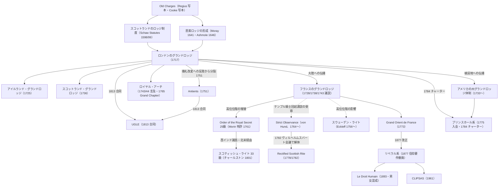

# フリーメイソンの起源と分派 専門構造分析ノート

> [!summary] 要旨
> フリーメイソンの起源を文書で辿れるのは、中世後期イングランドの石工規約集（Old Charges）と、16世紀末スコットランドのロッジ記録までである。ソロモン神殿やテンプル騎士団に直結させる系譜は、18世紀に形成された伝説的歴史であり、実証史とは区別される。制度史の画期は、1598〜99年の Schaw Statutes によるスコットランド・ロッジの組織化と、1717年のロンドンにおけるグランドロッジ結成である。以後の分派は、(1) 儀礼と正統性をめぐる分裂（Antients と Moderns、1751〜1813年）、(2) 3階級を超える高位位階の増殖（フランス起源の諸ライト、スコティッシュ・ライト33級、ヨーク・ライト、スウェーデン・ライト等）、(3) 信仰要件をめぐる分裂（1877年の Grand Orient de France 改正と正規系による承認撤回）、(4) 人種隔離を背景とするアメリカのプリンスホール系の並行形成、という複数の軸で生じた。本ノートは起源の実証史と分派の系譜を、伝説と学説を区別しつつ整理する。階級制度・儀礼内容の詳細は [[フリーメイソン]]、1723年『憲章』の内容は [[アンダーソン憲章]] を参照。

---

## 1. 命題の構造（伝説的起源像 vs 実証史）

| 論点 | 伝説・流布する像 | 実証史・出典に基づく記述 |
| :--- | :--- | :--- |
| 起源 | ソロモン神殿の建築者ヒラムや、解散後のテンプル騎士団の生き残りが創始した | 文書で確認できる最古層は中世後期の Old Charges（石工の規約と伝説的職人史）と、1599年以降のスコットランドのロッジ議事録である。神殿・騎士団への系譜は Anderson『憲章』（1723年）の伝説的歴史と、1737年のラムゼー演説以降に拡張された教説であり、史料上の連続性は確認されていない |
| 1717年の意味 | 1717年にフリーメイソンが創始された | ロッジ自体は17世紀以前から存在した。1717年はロンドンの4ロッジが合同して最初のグランドロッジ（統括組織）を結成した年であり、「創始」ではなく組織化の画期である |
| 実働から思索への移行 | 実働石工のギルドがそのまま思索的ロッジに姿を変えた | 非実働の「思索的」会員の入会は1640年代の記録（Moray 1641年、Ashmole 1646年）で確認できるが、移行の機制そのものは学術史でも未解明の部分が大きく、スコットランド先行説（Stevenson）とイングランド側の記録に基づく整理が併存する（§3-3） |
| 分派の構造 | 単一の世界組織から枝分かれした | グランドロッジは各々が主権を持ち、世界統括組織は存在しない。分派は分裂・合同・相互承認の断絶と回復の過程として展開した（§5） |
| 高位位階 | 33級は太古からの秘儀である | 3階級を超える学位は18世紀フランスを中心に新造・増殖したもので、「スコッツ・マスター」の記録は1733年以降、33級体制の成立は1801年（チャールストン）である（§5-5） |

---

## 2. 基本情報

| 項目 | 内容 |
| :--- | :--- |
| **対象** | フリーメイソンの起源に関する実証史と、グランドロッジ・諸ライトの分派系譜 |
| **実証史の起点文書** | Old Charges（Regius 写本、Cooke 写本ほか）。伝説的職人史と職務規約を併せ持つ |
| **最古のロッジ議事録** | スコットランド。Aitchison's Haven の議事録が1599年1月9日（当時の年始換算で1598年）に始まり、エディンバラの Lodge of Edinburgh (Mary's Chapel) の議事録は1599年7月31日から現存する |
| **初のグランドロッジ** | 1717年6月24日、ロンドン。4ロッジが合同し Grand Lodge of London and Westminster を結成（通称 Premier Grand Lodge） |
| **分派の主軸** | 儀礼・正統性（Antients／Moderns）、高位位階の増殖（諸ライト）、信仰要件（正規系／リベラル系）、アメリカにおける人種隔離（プリンスホール系） |
| **承認の構造** | グランドロッジ間の相互承認（recognition / amity）が関係の単位であり、承認の有無が「正規／非正規」の境界を形成する。UGLE の1929年「基本原則」は正規系の判定基準（[[フリーメイソン]] §5-6） |
| **本ノートの範囲外** | 階級制度・儀礼の詳細（[[フリーメイソン]]）、日本への伝来の詳細（[[フリーメイソン]] §8、[[ソレイユ・ルヴァン]]）、独立運動への関与言説（[[フリーメイソンと独立運動]]） |

---

## 3. 起源（実証史）

### 3-1. Old Charges（古規約）

Old Charges は、各ロッジが備えた石工の規約文書で、入会時にその一部（charges）への宣誓が求められた。本文は、ユークリッドやソロモン神殿を経てイングランドに職人が伝わったとする伝説的歴史と、徒弟・職人・親方の職務規約から構成される。

- **Regius 写本（Halliwell 写本、Regius Poem）**：Old Charges の最古のものとされる韻文写本（64葉）。アゼルスタン王（在位924–939年）のもとで石工が集い15条（articles）と15項（points）を定めたとする物語を含む。年代については、Halliwell 以来の **1390年説** と、大英博物館の Bond の比定に始まり現代の言語分析が支持する **15世紀第2四半期（1425–50年頃、シュロップシャー成立）説** が併存する（両論併記、§12）。現代の分析は後者に傾くが、伝統的な1390年比定も文献上広く引用され続けている。
- **Cooke 写本**：散文の Old Charges として最古級（1450年頃、大英図書館 Additional MS 23198）。レメクの子らの二本の柱の伝説など、Regius にない素材を含み、後代の憲章類に引き継がれた。Anderson は1723年『憲章』の編纂に際して Cooke 写本を利用した。
- 歴史家 Andrew Prescott は、Regius・Cooke 両写本を、1425年の石工集会禁止法令を背景に、石工側が自らの集会に王権の承認があったと示そうとした文書として位置づける。

### 3-2. スコットランドの制度化（Schaw Statutes と議事録）

- **William Schaw**（c.1550–1602）はスコットランド王ジェームズ6世の王室造営総監（Master of Works、1583年就任）で、石工全体の総監（General Warden）を兼ねた。
- **第一次 Schaw Statutes（1598年12月28日）** は全スコットランドの親方石工に宛てた規約で、ロッジと親方への義務、徒弟数の制限、入会の手続き、不良工事への罰則を定めた。
- **第二次 Schaw Statutes（1599年12月28日、ホリールードハウス）** はロッジの序列を定め、エディンバラを第一、エアシャーのキルウィニングを第二（"heid and secund ludge"）、スターリングを第三とした。また職人に「記憶（memorie）」の試験を行うこと、未資格の労働者（cowan）の使用禁止などを命じた。Stevenson はこの記憶への言及をルネサンスの記憶術（art of memory）と結びつけ、Schaw がロッジに規制的性格と並んで学芸的・儀礼的性格を与えたと解釈する。この解釈の当否自体は学説上の論点である。
- 規約が書記と記録を義務づけた結果、スコットランドには世界最古級のロッジ議事録が残った。**Aitchison's Haven**（イースト・ロージアン）の議事録は1599年1月9日（当時のスコットランドの年始は3月25日のため旧暦1598年）の Fellow Craft 授与記録に始まる。**Lodge of Edinburgh (Mary's Chapel)** の議事録は、最初の記録が1598年12月28日の第一次 Schaw Statutes の写し、実質的な議事録は1599年7月31日からで、現存し活動を続けるロッジの議事録としては最古とされる。同ロッジの記録は、実働ロッジが非実働会員を受け入れていく過程を17世紀を通じて追跡できる史料となっている。

### 3-3. 思索メイソンへの移行と学説

- **Robert Moray の入会（1641年5月20日）**：エディンバラ・ロッジの会員らにより、ニューカッスルにおいて入会。イングランドの地における思索的入会の最古の現存記録とされる（入会を行ったのはスコットランドのロッジ側である）。
- **Elias Ashmole の入会（1646年10月16日、ウォリントン）**：骨董家・錬金術研究者 Ashmole の日記に基づく記録。彼を入会させたロッジは、主としてあるいは entirely 思索的会員で構成されていたとされる。
- 1686年の Robert Plot『Natural History of Staffordshire』は、上流階級の人々がフリーメイソンの団体に受け入れられていることに言及する。
- **スコットランド説**：David Stevenson『The Origins of Freemasonry: Scotland's Century, 1590–1710』（Cambridge University Press、1988年）は、議事録・規約等の文書群に基づき、近代フリーメイソンの制度的骨格（ロッジの組織形態、入会儀礼、役職名、Mason Word の運用等）は1590〜1710年のスコットランドで形成されたとする。以後、学術史ではスコットランドの比重が大きく見積もられるようになった。
- **イングランド側の整理**：Knoop & Jones『The Genesis of Freemasonry』（Manchester University Press、1947年）は、イングランドの実働ロッジの史料に基づく古典的な起源論である。グランドロッジ時代の開始時点で、イングランド南部には純粋に思索的なロッジが優勢だった一方、北部とスコットランドでは実働・混合ロッジが多数を占めたとされる。
- **移行の機制**：実働ロッジが思索的団体へ移行した理由と機制は、なお解明されていない。設計の主導権が親方石工から建築家へ移ったこと、ロッジがジェントリの入会料で資金を得たこと、賃金・労働条件の改善のために有力者を招いたこと等が仮説として挙げられるにとどまる（両論併記、§12）。

### 3-4. 1717年（ロンドンのグランドロッジ結成）

- 1716年、ロンドンの4ロッジが Apple Tree Tavern で会合し、年次集会とグランドマスター選出を決議した。
- **1717年6月24日（洗礼者ヨハネの日）**、4ロッジはセント・ポール教会墓地脇の **Goose and Gridiron** 酒場に集い、自らをグランドロッジと宣言し、**Anthony Sayer** を初代グランドマスターに選んだ。4ロッジは酒場の名で呼ばれ、後の Lodge of Antiquity No.2（Goose and Gridiron）、Lodge of Fortitude and Old Cumberland No.12（Apple Tree）、Royal Somerset House and Inverness Lodge No.4（Rummer and Grapes）等に連なる。組織名は Grand Lodge of London and Westminster で、後代の Premier Grand Lodge はこれを指す通称である。
- グランドロッジの議事録は1723年まで残っておらず、初期の経緯には不確かな部分がある。1718年に Sayer は George Payne に交代し、Payne の起草した General Regulations（1720年）が後の『憲章』に取り込まれた。
- **Anderson『憲章』（1723年）** は、グランドロッジの授権のもと James Anderson が編んだ基本文書で、伝説的歴史、「義務（Charges）」、規則を含む。内容と位置づけは [[アンダーソン憲章]] を参照。
- **第3階級の成立**：1723年『憲章』が認める階級は徒弟と「職人／親方」の2区分にとどまる。第3階級（Master Mason）授与の初期記録として、ロンドンの音楽協会 Philo Musicae et Architecturae Societas の1725年5月12日の議事録、スコットランドの Dumbarton Kilwinning における1726年3月の記録がある。Prichard の暴露本『Masonry Dissected』（1730年）には、現代に通じる3階級の体系が初めて判別できる形で現れる。ヒラム伝説はこの過程で中核の寓意となり、その素材には聖書のヒラム像、フランスのコンパニョナージュの殺害伝説、1725年の Graham 写本に見えるノアの遺体探索譚などが関係するとされる。

---

## 4. 沿革・歴史変遷

```
15世紀前半：Regius 写本・Cooke 写本（Old Charges）
1598–99年：Schaw Statutes（スコットランドのロッジ制度化）
1599年：最古級のロッジ議事録（Aitchison's Haven、Mary's Chapel）
1641年：Robert Moray の入会記録（ニューカッスル）
1646年：Elias Ashmole の入会記録（ウォリントン）
1717年：ロンドンでグランドロッジ結成（4ロッジ、初代GM Anthony Sayer）
1723年：Anderson『憲章』刊行
1725年：アイルランド・グランドロッジの最古の言及（ダブリン）。ヨークでも Grand Lodge of All England の称号採用
1733年：ボストンで Henry Price が St. John's Lodge にチャーター（アメリカ最初の正式ロッジ）。「スコッツ・マスター」学位の記録（ロンドン）
1736年：スコットランド・グランドロッジ結成
1737年：ラムゼー演説（十字軍騎士への系譜付け）
1743–44年：ロイヤル・アーチへの言及（ダブリンの行列、D'Assigny の著作）
1751年：Antients グランドロッジ結成（Moderns との分裂開始）
1756年：Dermott『Ahiman Rezon』。Eckleff がストックホルムにセント・アンドリュー・ロッジ設立（スウェーデン・ライトの起点）
1761年：Morin への特許（パリ）。25級体系が大西洋を渡る起点
1765年：Moderns がロイヤル・アーチのグランド・チャプターを分離設置
1773年：Grand Orient de France の成立（フランス）
1778年：リヨン会議（Gauls 会議）。Willermoz による Rectified Scottish Rite の原型
1782年：ヴィルヘルムスバート会議。Strict Observance のテンプル騎士団起源説の放棄と解体
1784年：アフリカン・ロッジ No.459 へのチャーター（プリンスホール系の起点）
1801年：チャールストンに最高評議会（33級）開設。スコティッシュ・ライトの成立
1813年：Antients と Moderns の合同により UGLE 成立（12月27日）
1877年：GODF が信仰要件を撤廃。UGLE は承認を取り消し（1878年）、正規系／リベラル系の分裂が確定
1882年：Maria Deraismes の入会（ル・ペックのロッジ）
1893年：Le Droit Humain 創設（男女混成の国際組織）
1961年：CLIPSAS 結成（ストラスブール、リベラル系の連絡組織）
20世紀末以降：アメリカで州グランドロッジとプリンスホール系グランドロッジの相互承認が拡大。UGLE もプリンスホール系を承認
```

---

## 5. 分派の深層解剖

### 5-1. 系譜図



### 5-2. Antients と Moderns（1751–1813年）

- 先発のグランドロッジ（1717年系）は、暴露本対策として1730年代に儀礼へ変更を加え、また1735年にはアイルランド・グランドロッジからの使節と称するロッジ役員の入場を拒むなど、他系統との摩擦を生んだ。ロンドンに移住したアイルランド人メイソンの多くはこれらの変更を正統からの逸脱とみなし、独立ロッジを結成するか未加盟ロッジに加わった。
- **1751年**、独立系の5ロッジと新設の1ロッジが合同して対抗グランドロッジを結成した。彼らは自らを「Antients（古来派）」と称し、先発側を「Moderns（近代派）」と呼んだ。第2代グランドセクレタリ **Laurence Dermott**（1752年就任）のもとで組織は拡大し、その憲章書『Ahiman Rezon』（1756年初版）はアイルランドの憲章書を範とした。Antients はアイルランドとスコットランドの両グランドロッジから承認を得、グランドマスターにアソル公爵家を戴いたため Atholl Grand Lodge とも呼ばれる。
- 分裂の焦点は儀礼の細部と正統性の所在であり、ロイヤル・アーチの位置づけも争点の一つだった（§5-6）。ナポレオン戦争期に両者は禁止措置回避のため協調し、1811年から合同の手続きが進んだ。
- **1813年12月27日**、両グランドロッジは合同し **United Grand Lodge of England (UGLE)** が成立した。合同時のグランドマスターは Moderns 側がサセックス公、Antients 側がケント公で、合意文書（Articles of Union）は「純粋な古来のメイソンリーは3階級からなるが、第3階級にはロイヤル・アーチを含む」とする妥協を含んだ。新組織は Moderns の組織基盤と Antients の儀礼を継承したと整理される。

### 5-3. アイルランド・スコットランドのグランドロッジ

- **アイルランド・グランドロッジ（1725年）**：設立の直接記録は残らず、1725年6月26日の『Dublin Weekly Journal』が、グランドロッジがロス伯爵を新グランドマスターに選出した集会を報じたことが最古の言及である。1725年はこの言及に基づく記念年であり、実際の形成はそれ以前に遡る可能性が記事自体からも示唆される。マンスター地方の別系統のグランドロッジは1733年にダブリン側へ吸収された。
- **スコットランド・グランドロッジ（1736年）**：設立集会にはスコットランドのロッジの約3分の1が参加した。グランドマスターの称号は他に例のない **Grand Master Mason** である。スコットランドのロッジは古来の独立性を強く保持し、グランドロッジ成立後も各ロッジの手順・装飾・儀礼の独自性が広く認められる構造となった。
- **ヨークのグランドロッジ**：1725年、ヨークの結社は Grand Lodge of All England の称号を採用した。Anderson の伝説的歴史がヨーク集会を起源に置いたことと呼応する動きであるが、ロンドン側とは管轄の重なりがなく、対立関係にはなかったとされる。

### 5-4. フランスの展開

- フランスへの伝来は亡命ジャコバイトによるとされ、1721年のダンケルクにおけるロッジ、1725年頃のパリにおけるダーウェントウォーター伯のロッジが伝えられる。文書で確認できるパリのロッジは1732年（Louis d'Argent）で、同年にはロンドンのグランドロッジからフランスのロッジへのデピュテーション（認許の委任）が始まった。
- **グランドロッジの成立年には諸説がある**（両論併記）。現在の Grande Loge de France は1728年（ウォートン公をグランドマスターとする）を起源と主張し、Grand Orient の印章には1736年と刻むものがある。フランスの史家は1738年6月24日を成立とする。一方、1743年12月11日に「フランスにおけるイングランド・グランドロッジ」としてクレルモン伯をグランドマスターに成立した時点を最初の正規のグランドロッジとする整理もある。クレルモン伯は1771年の死去まで在位し、実務は代理者が担ったが、その庇護のもとでフランスのメイソンは安定と拡大の時期を得た。
- **ラムゼー演説（1737年）**：スコットランド出身のジャコバイト、Andrew Michael Ramsay（Chevalier Ramsay）の講演は、メイソンの系譜に聖地の十字軍騎士（聖ヨハネ騎士団の庇護のもとで秘義を回復したとする）を組み込んだ。以後、大陸側の系譜観はイングランド側と分岐し、高位位階の増殖と騎士団的学位の土壌となった。
- クレルモン伯の死後（1771年）に分裂が生じ、多数派はシャルトル公（後のオルレアン公フィリップ・エガリテ）をグランドマスターとして、1773年に **Grand Orient de France (GODF)** へ改組された。

### 5-5. スコティッシュ・ライトの成立（25級から33級へ）

- **高位位階の発生**：3階級を超える学位は18世紀フランスを中心に生じた。「スコッツ・マスター（Scots Master）」を授けるロッジの記録は1733年（ロンドン、Temple Bar の Devil Tavern）、1735年（バース）、1736年（ロンドンのフランス系ロッジ）に見える。1740〜60年代の Copiale 暗号文書はスコティッシュ・マスターを「まったく新しい発明」と記す。
- **Morin と1761年特許**：Étienne (Estienne) Morin は1744年以来ボルドーで高位位階に関わり、1747年にサン＝ドマング（現ハイチ）のル・カップに Écossais ロッジを設けた。1761年8月27日、パリのグランドロッジ役員の署名による特許が Morin に発給され、「新世界のあらゆる地域におけるグランド・インスペクター」に任じられた。当初の特許はクラフト・ロッジに関する権限だったが、後代の写しでは高位位階への権限が付加されており、Morin 自身による増補の可能性が指摘される。
- **「Perfection ライト25級」の再評価**（両論併記）：伝統的な説明では、パリの「東方と西方の皇帝評議会（Council of Emperors of the East and West）」が1758年に25級の Rite of Perfection を編んだとされてきた。しかし現在の研究では、この25級体系は Morin が編纂した「Order of the Royal Secret（王室の秘義のオーダー）」であり、「Rite of Perfection」の名称は1786年の『大憲章』の序文に初めて現れるもので、その典拠性自体に問題があることが指摘されている。
- **大西洋への伝播**：Morin の代理人 Henry Andrew Francken は1771年に第15〜25級の儀礼写本を作成し、1767年12月26日にはオールバニに Lodge of Perfection の特許を与えた（13植民地における Perfection 学位授与の最初）。チャールストンでは1783年2月に Sublime Grand Lodge of Perfection が設けられ、1796年には Hyman Isaac Long により25級の Consistory が組織された。
- **1801年チャールストン**：1801年5月31日、John Mitchell と Frederick Dalcho はチャールストンの Shepheard's Tavern で「アメリカ合衆国のための第33級最高評議会」を開いた。Morin の25級を含む33級を管轄する、世界初の最高評議会である。創設に関わった11人は「チャールストンの11人の紳士」として記録される。1813年には同評議会の権限により北部管轄（Northern Jurisdiction）の最高評議会が設けられた。33級の学位構成・儀礼の詳細は [[フリーメイソン]] §5-2 を参照。

### 5-6. ヨーク・ライト系の形成

- **ロイヤル・アーチ**：確実な初期言及は1743年のダブリンにおける行列の記録と、1744年の D'Assigny『Serious and Impartial Inquiry』における学位としての言及である。Dermott は1746年にダブリンでロイヤル・アーチ・メイソンとなり、これを「第4階級」と位置づけて承認を求めた。Antients はロッジ内でロイヤル・アーチを授けたのに対し、Moderns は1765年に独立のグランド・チャプターを設けてクラフトと分離する道を取った。1813年の合同合意は、ロイヤル・アーチを第3階級の内側に含める妥協でこの対立を処理したが、イングランドの Supreme Grand Chapter は2004年にこの位置づけを覆し、ロイヤル・アーチを独立した学位と宣言した。
- **クリプティック諸学位とテンプル騎士団系**：Royal & Select Masters（地下聖堂＝crypt の伝説に基づく一群）と、テンプル騎士団を範とする騎士団的オーダーが、18世紀後半の英愛・北米で形成された。テンプル騎士団系の会員資格はキリスト教信仰の表明を要件とする点で、クラフトの原則と異なる（[[フリーメイソン]] §5-3）。
- **「ヨーク・ライト」の成立**：Chapter（ロイヤル・アーチ）、Council（クリプティック）、Commandery（テンプル騎士団）の3組織を束ねる「ヨーク・ライト」は、アメリカで定着した呼称と編成であり、名称は Anderson の伝説的歴史におけるヨーク集会に由来する。単一のライトとしてヨーロッパで発生したものではない。

### 5-7. スウェーデン・ライト、Strict Observance、Rectified Scottish Rite

- **スウェーデン・ライト**：Carl Friedrich Eckleff は1756年にストックホルムに最初のセント・アンドリュー・ロッジを、1759年に最初のグランド・チャプターを設けた。その進級体系は、後にスウェーデン王カール13世となるセーデルマンランド公カールによって発展させられ、1800年までに体系が完成した。全学位を通じてキリスト教的性格を持つ単一の進級システムである（[[フリーメイソン]] §5-4）。
- **Strict Observance**：Karl Gotthelf von Hund はドイツに新しい「スコティッシュ」系の制度を導入し、1764年以降「Strict Observance（厳格な遵守）」と称した。この制度は、結社がテンプル騎士団の継承者であり、「知られざる上位者（Unknown Superiors）」に指導されると主張した。上位者の実在を示せないことへの不満が高まり、**1782年のヴィルヘルムスバート会議**で代議員はテンプル騎士団起源説を放棄し（全会一致ではなかった）、ロッジの自治を拡大した。制度は解体し、ロッジは他のライトへ移行した。
- **Rectified Scottish Rite (RER)**：Jean-Baptiste Willermoz は1778年のリヨンにおける Gauls 会議で、Strict Observance のフランス部門を改革し、Martinez de Pasqually の Élus Coëns の要素を取り込みつつテンプル騎士団の遺産を否定した。1778年リヨンと1782年ヴィルヘルムスバートの両会議を経て体系化されたのが RER で、その頂点の学位は Chevalier Bienfaisant de la Cité Sainte (CBCS) である。

### 5-8. リベラル系の分岐と承認問題の構造

- **1877年改正**：GODF は1877年9月の大会で、プロテスタント牧師 Frédéric Desmons の主張を軸に憲章第1条を改正し、神と霊魂の不滅への信仰要件を削除して「絶対的な良心の自由」を原則とした。UGLE は至高存在への信仰をランドマークとみなして承認を取り消し（1878年）、ここに正規系（英米系）とリベラル系（大陸系）の分裂が確定した。なおアメリカの一部の州グランドロッジは20世紀に入っても GODF との関係を維持しており、断絶は一斉ではなかった。
- **Le Droit Humain（1893年）**：Maria Deraismes は1882年1月14日、ル・ペックのロッジ Les Libres Penseurs で男性と同一の儀礼により入会した（当該ロッジは所属組織から活動停止処分を受けた）。1893年4月4日、Deraismes と Georges Martin は男女混成の組織 Le Droit Humain を創設した。同組織はスコティッシュ・ライトの1°〜33°を単一体系で実施する国際組織として拡大した（[[ソレイユ・ルヴァン]] はその東京ロッジの専門ノート）。
- **CLIPSAS（1961年）**：1961年1月22日、複数の主権的オベディエンスがストラスブールに集い、「ストラスブールの呼びかけ」に署名して CLIPSAS を結成した。リベラル系の国際連絡組織であり、GODF をはじめ署名諸組織が参加する。国連経済社会理事会の特殊諮問資格を持つ。
- **承認問題の構造**：正規系は UGLE の1929年「基本原則」を判定基準とし、信仰要件・男性のみ・聖典の備付等を欠く組織を承認しない。リベラル系は良心の自由を原則とし、承認の網は CLIPSAS 等を軸に別個に形成されている。両系の境界は教義ではなく承認関係によって引かれており、同じ「フリーメイソン」を名乗りながら相互訪問ができない状態が続く（[[非正規・自称フリーメイソン団体]] は承認の枠外にある自称団体を扱う）。

### 5-9. アメリカ（州グランドロッジ体制とプリンスホール系）

- **植民地期**：Daniel Coxe は1730年にニューヨーク・ニュージャージー・ペンシルベニアの州グランドマスター（Provincial Grand Master）に任じられたが、ロッジ設立の記録はない。**Henry Price** は1733年、ボストンのグループにチャーターを与え、St. John's Lodge がアメリカで最初の正式に設立されたロッジとなった。1733〜37年にかけて、マサチューセッツ、ニューヨーク、ペンシルベニア、サウスカロライナに州グランドロッジが認許された。独立後は各州のグランドロッジが主権を持つ体制が定着し、アメリカには全国グランドロッジが存在しない。
- **プリンスホール系の形成**：ボストンの自由黒人 Prince Hall は、植民地アメリカのロッジに受け入れられず、1775年3月6日、他の14名とともにアイルランド・グランドロッジ所属の軍隊ロッジ No.441（第38歩兵連隊付）で入会した。彼らは African Lodge No.1 を組織し、1784年9月29日、Premier Grand Lodge（グランドマスター：カンバーランド公）から **African Lodge No.459** としてチャーターを得た。1813年の UGLE 合同の際、同ロッジは連絡の途絶を理由に名簿から漏れた（正式な抹消ではなかった）。マサチューセッツのグランドロッジに承認を拒まれた後、African Lodge は独立のグランドロッジを宣言し、ここからプリンスホール系の系譜が形成された。
- **承認の拡大**：人種隔離のもとで並行組織として存続したプリンスホール系に対し、20世紀末以降、米国の主流系州グランドロッジが同一州内のプリンスホール系グランドロッジを承認する動きが広がった。現在では UGLE もプリンスホール系グランドロッジを承認し、大多数の州で相互承認が成立しているが、承認の範囲（相互訪問権、二重在籍の可否等）は管轄により異なる。プリンスホール系内部にも、Prince Hall Affiliation（PHA）と Prince Hall Origin（PHO）の組織的区別がある。

---

## 6. 宗教学的・歴史社会学的意義

- **近代的結社の原型**：フリーメイソンは、成文憲章、議事録の作成、選挙による役員選出、連邦的な統括組織（グランドロッジ）と主権単位（ロッジ）の分離といった近代的結社の手続きを18世紀初頭に備えた団体である。起源史が文書（規約・議事録）で追跡できることは、この組織形態の自己記録性による。
- **伝説的歴史の機能**：Old Charges と Anderson の歴史叙述は、事実の記録ではなく、職能団体に由緒と正統性を与える「創設神話」として機能した。18世紀のラムゼー演説と高位位階は、この神話に騎士道と秘教の要素を重ねていった。実証史と伝説の分離は、結社史研究の基本的な作業である。
- **承認を軸とする分派の形態**：教義の対立ではなく承認関係の断絶によって境界が形成される点に、フリーメイソンの分派の特質がある。1877年以降の正規系／リベラル系の分裂は、信仰要件という一点をめぐりながら、実態としては二つの承認ネットワークの併存である。
- **高位位階の増殖**：3階級を超える学位の新造は、啓蒙期ヨーロッパにおける儀礼的知識の市場化と、騎士道・秘教への関心の産物である。25級から33級への再編（1801年）は、その集約と制度化の到達点に位置する。
- **プリンスホール系の意義**：排除に対する並行組織の形成は、アメリカ社会における人種隔離の歴史を映すと同時に、チャーター（1784年）という正統性の根拠を持ち続けた点で、承認問題の構造を逆照射する事例である。

---

## 7. 伝説的起源と実証史の区別

実証史（§3〜§5）と区別すべき伝説的系譜は、以下の通りである。

- **ソロモン神殿・ヒラム伝説**：ヒラムは聖書に現れる青銅職人であるが、その殺害と遺体探索の物語は18世紀初頭の儀礼形成の中で成立した寓意であり、歴史的事実として扱う根拠はない。1725年の Graham 写本では、探索される遺体はヒラムではなくノアであり、伝説が流動的な形成過程にあったことを示す。
- **Anderson の伝説的歴史**：1723年『憲章』の歴史部は、アダムからユークリッド、アゼルスタンの子エドウィンを経てヨーク集会に至る系譜を叙述する。エドウィンは史料上確認できない人物であり、この歴史は規約文書の伝統を引き継ぐ由緒叙述である（[[アンダーソン憲章]]）。
- **十字軍・騎士団継続説**：ラムゼー演説（1737年）は十字軍騎士による秘義の回復を説いたが、テンプル騎士団そのものへの直結は、Strict Observance（1760年代〜）が主張したものである。1782年のヴィルヘルムスバート会議でこの主張は当の系統自身によって放棄された。聖ヨハネ騎士団・テンプル騎士団のいずれについても、1312年の解散から16世紀末のロッジ記録までの連続性を示す史料は存在しない。
- **ロスリン礼拝堂説**：スコットランドのロスリン礼拝堂をメイソンの起源と結びつける近年の一般書の主張は、グランドロッジ・オブ・スコットランドの学芸員 Robert Cooper『The Rosslyn Hoax』等により批判されている。
- **陰謀論的系譜**：フリーメイソンが近代の革命・独立運動を組織として主導したとする言説は、史料上の裏づけを欠く。個別の検討は [[フリーメイソンと独立運動]]、[[イルミナティ]] を参照。

---

## 8. 日本への伝来（概要）

日本におけるフリーメイソンは、第二次世界大戦後の1957年に設立された日本グランドロッジ（Grand Lodge of Japan）を正規系の中核とし、Le Droit Humain の東京ロッジ「ソレイユ・ルヴァン」（2008年設立）がリベラル系・男女混成の系統として併存する。両系統の承認関係と沿革は、本ノート §5-8 の承認問題の構造を日本に適用した事例である。詳細は [[フリーメイソン]] §8 および [[ソレイユ・ルヴァン]] を参照。

---

## 9. 史料・一次資料 (convMD)

本ノートの作成にあたり取得し、`資料/` に保存したエビデンスは以下の通り（いずれも2026-11-24取得）。

- src_freemasonry_origins_wikipedia_history — History of Freemasonry（起源・1717年・フランス成立年の諸説・Antients/Moderns の概観）
- src_freemasonry_origins_masonic_manuscripts — Masonic manuscripts（Old Charges、Regius 写本・Cooke 写本の比定と内容）
- src_freemasonry_origins_regius_poem — Regius Poem（Halliwell の1390年説と現代の15世紀第2四半期説の併記）
- src_freemasonry_origins_antients — Antient Grand Lodge of England（1751年の結成経緯、Dermott、1813年合同の内容）
- src_freemasonry_origins_gl_scotland — Grand Lodge of Scotland（1736年の結成、Grand Master Mason の称号）
- src_freemasonry_origins_gl_ireland — Grand Lodge of Ireland（1725年の最古の言及と設立記録の不存在）
- src_freemasonry_origins_godf — Grand Orient de France（1732年の文書記録、1773年の改組、1877年改正）
- src_freemasonry_origins_continental — Continental Freemasonry（1877年改正の経緯、Desmons の主張、正規系との断絶）
- src_freemasonry_origins_scottish_rite — Scottish Rite（Morin 特許1761年、Order of the Royal Secret への再評価、1801年チャールストン）
- src_freemasonry_origins_york_rite — York Rite（Chapter・Council・Commandery の編成とヨーク伝説）
- src_freemasonry_origins_swedish_rite — Swedish Rite（Eckleff 1756年、カール13世による発展）
- src_freemasonry_origins_strict_observance — Rite of Strict Observance（von Hund、知られざる上位者、1782年ヴィルヘルムスバート会議）
- src_freemasonry_origins_rectified_rite — Rectified Scottish Rite（Willermoz、1778年リヨン会議、CBCS）
- src_freemasonry_origins_prince_hall — Prince Hall Freemasonry（1775年入会、1784年チャーター、承認の拡大）
- src_freemasonry_origins_droit_humain — International Order of Freemasonry for Men and Women Le Droit Humain（1893年創設の経緯）
- src_freemasonry_origins_deraismes — Maria Deraismes（1882年の入会と1893年の創設）
- src_freemasonry_origins_clipsas — CLIPSAS（1961年1月22日の結成、ストラスブールの呼びかけ）

---

## 10. 参考文献・学術論文

- Stevenson, David. *The Origins of Freemasonry: Scotland's Century, 1590–1710*. Cambridge University Press, 1988.（同著者 *The First Freemasons: Scotland's Early Lodges and their Members*, Aberdeen University Press, 1988 も併せてスコットランド説の基礎文献である）
- Knoop, Douglas; Jones, G. P. *The Genesis of Freemasonry*. Manchester University Press, 1947.（イングランド側の実働ロッジ史料に基づく古典的起源論）
- Prescott, Andrew. Regius 写本・Cooke 写本を1425年の石工集会禁止法令との関係で論じた研究（University of Sheffield のメイソンリー研究センター関連の論考。本ノートでは §9 のエビデンス経由で内容を参照した）
- Cooper, Robert L. D. *The Rosslyn Hoax*. Lewis Masonic, 2006.（ロスリン礼拝堂起源説への批判。著者はグランドロッジ・オブ・スコットランドの学芸員）
- *Handbook of Freemasonry*（Brill Handbooks on Contemporary Religion, 2014）等の概説書は、起源と分派の研究動向を扱うが、本ノートの作成に際しては直接参照していない（書誌情報のみの記録）。

---

## 11. 関連ノート (Vault内)

### ハブ・基礎資料
- [[フリーメイソン]]（ハブノート：組織全体像、階級制度、信仰と政治、各国グランドロッジ、日本グランドロッジ）
- [[アンダーソン憲章]]（1723年『憲章』の詳細と Charges の全訳）
- [[フリーメイソン用語集]]（Mason Word、ランドマーク、承認関係等の用語）
- [[フリーメイソンの乾杯と符丁]]

### 儀礼書・暴露本
- [[ダンカン儀式書]]（アメリカ系儀礼の標準化）
- [[ダンカン儀式書_全訳]]
- [[モーガン暴露本]]
- [[モーガン暴露本_全訳]]

### 分派・関連団体
- [[ラウタロ・ロッジ網]]（南米独立期のロッジ網。本ノート §5 の大陸伝播の個別事例）
- [[フリーメイソンと独立運動]]（各国独立運動との関与言説の検討）
- [[ソレイユ・ルヴァン]]（Le Droit Humain 東京ロッジ。§5-8 のリベラル系の日本における事例）
- [[イルミナティ]]（ヴァイスハウプトのイルミナティとフリーメイソンの混同の系譜）
- [[非正規・自称フリーメイソン団体]]（承認の枠外にある団体）
- [[天空ロッジ]]（象徴概念をめぐる言説）
- [[日本の洪門]]（洪門系。西洋フリーメイソンとは組織的に無関係）

---

## 12. 留保と未検証項目

### 両論併記とした論点
- **Regius 写本の年代**：Halliwell 以来の1390年説と、Bond の比定に始まり現代の言語分析が支持する15世紀第2四半期（1425–50年頃）説。現代の分析は後者に傾くが、1390年説も文献上存続するため両論を併記した。
- **思索化への移行の機制と主導地域**：Stevenson のスコットランド説が学術史の重心を移したが、移行の理由・機制そのものは未解明であり、Knoop & Jones 以来のイングランド側の整理と併記した。
- **フランスのグランドロッジ成立年**：1728年（Grande Loge de France の主張）、1736年（Grand Orient の印章）、1738年6月24日（フランスの史家）、1743年12月11日（クレルモン伯の English Grand Lodge of France）の4説を併記した。
- **25級体系の編纂主体**：伝統説（パリの Council of Emperors of the East and West による Rite of Perfection）と、現在の研究による再評価（Morin が編んだ Order of the Royal Secret であり、「Rite of Perfection」の名称は1786年『大憲章』序文に由来）を併記した。
- **Royal Arch の位置づけ**：1813年合意の「第3階級に含まれる」とする妥協と、2004年の Supreme Grand Chapter による「独立した学位」とする宣言が併存する。

### 未検証として残した事項
- プリンスホール系承認の個別年次（各州グランドロッジの承認年、UGLE による承認の年次）は、今回取得したエビデンスでは確認できなかったため、本文では年次を特定せず「20世紀末以降」と記した。
- スコットランド・グランドロッジ初代 Grand Master Mason の人名は、今回のエビデンスでは確認できなかったため本文に記さなかった。
- ヨーク・ライトの米国における統合組織（Grand Encampment）の結成年次等、編成の詳細な年表は今回のエビデンスの範囲外であり、概要にとどめた。
- Brill『Handbook of Freemasonry』をはじめとする学術概説書は直接参照していない（§10 にその旨を明記）。

### 改訂記録
- 2026-11-24：初版作成。起源（Old Charges、Schaw Statutes、移行期の学説、1717年）と分派（Antients/Moderns、アイルランド・スコットランド、フランスと諸ライト、正規系／リベラル系、プリンスホール系）を、伝説的起源と区別して整理した。
