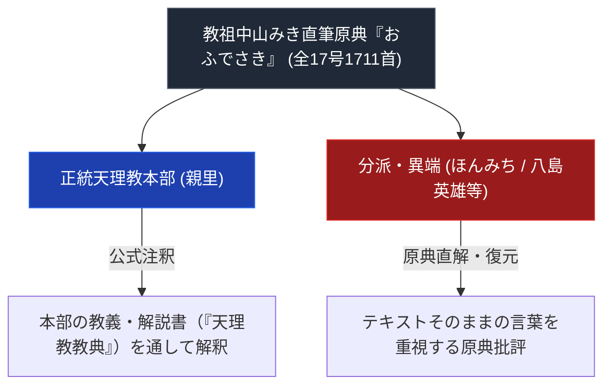

# おふでさき

> [!summary] 要旨
> 『おふでさき』（御筆先）は、天理教教祖・[[中山みき]]が1869年（明治2年）から1882年（明治15年）頃にかけて自ら筆を執って記した、天理教の原典（三原典）の一つである。全17号（17冊）・1711首の和歌形式で、親神（天理王命）の教えを記す。本稿では、書誌的事実（号数・首数・執筆年・公刊史）をWikipedia「おふでさき」「天理教」で照合した上で、正統天理教本部による公式注解と、ほんみち（[[大西愛治郎]]）・おうかんみち・[[八島英雄]]ら分派・異端側のテキスト直解という解釈対立の枠組み（本稿の解釈的整理）を併記する。

---

## 1. 命題の構造（本部の注解管理 vs 分派のテキスト直解）

> [!note] 本節の対比表・図は本稿の解釈的整理であり、各解釈の逐語的な典拠確認は未実施である（§12参照）。

| 比較考察軸 | 正統天理教本部の解釈（本稿の整理） | 分派・異端（ほんみち・八島英雄等）の解釈（本稿の整理） |
| :--- | :--- | :--- |
| **甘露台の記述** | 奈良天理のおぢばに立つ木柱（空間固定） | 現身の生き神（[[大西愛治郎]]等）の身体（人格流動） |
| **泥海初めの記述** | 人類創造の神話・太古の象徴的物語 | 既存の国家・社会秩序の解体と再創造の預言 |
| **おうかんの記述** | 信仰の道・心の成長のプロセス | 魂の直接的往来・本部統制からの解放 |

---

## 2. 基本情報

| 項目 | 内容 |
| :--- | :--- |
| **書名** | 『おふでさき』（御筆先） |
| **著者** | [[中山みき]]（教祖） |
| **執筆期間** | 1869年（明治2年）〜1882年（明治15年）頃 |
| **構成** | 全17号（17冊）・1711首（このほか号外3首が存在する。§5参照） |
| **形態** | 和歌形式（五七五七七）。「大和言葉」が特色とされる（Wikipedia「天理教」） |
| **位置づけ** | 天理教の三原典の一つ。通称「原典（一）」 |
| **現存** | 直筆は教会本部内・教義及史料集成室に現存。現在刊行されている原本は「正冊」と呼ばれ、教祖直筆で複写され当時の信者に渡されたものは「外冊」と呼ばれる（Wikipedia「天理教」） |

---

## 3. 起源と成立の経緯

Wikipedia「おふでさき」に掲載された号別の執筆年・首数は次の通りである（合計1711首）。

| 号 | 執筆年 | 歌の数 |
| :--- | :--- | :--- |
| 第一号 | 明治2年（1869年）正月より | 74首 |
| 第二号 | 明治2年3月 | 47首 |
| 第三号 | 明治7年（1874年）1月 | 149首 |
| 第四号 | 明治7年4月 | 134首 |
| 第五号 | 明治7年5月 | 88首 |
| 第六号 | 明治7年12月より | 134首 |
| 第七号 | 明治8年（1875年）2月 | 111首 |
| 第八号 | 明治8年5月 | 88首 |
| 第九号 | 明治8年6月 | 64首 |
| 第十号 | 明治8年6月 | 104首 |
| 第十一号 | 明治8年6月 | 80首 |
| 第十二号 | 明治9年（1876年）頃 | 182首 |
| 第十三号 | 明治10年（1877年）頃 | 120首 |
| 第十四号 | 明治12年（1879年）6月より | 92首 |
| 第十五号 | 明治13年（1880年）1月より | 90首 |
| 第十六号 | 明治14年（1881年）4月より | 79首 |
| 第十七号 | 明治15年（1882年）頃 | 75首 |

---

## 4. 変遷・歴史（公刊・使用禁止・復刊）

> [!warning] 戦時中の使用禁止
> 戦時体制下の「革新」（1938年、諭達第8号・革新委員会設置）に際し、『おふでさき』と『おさしづ』は使用を禁止され、各教会から回収された（Wikipedia「天理教」）。

- **1928年（昭和3年）4月26日**：『おふでさき』公刊（Wikipedia「天理教」の年表による）。
- **1938年（昭和13年）**：「革新」により使用禁止・回収（上記）。
- **1968年（昭和43年）**：二代真柱が『外冊「おふでさき」の研究』を上梓（Wikipedia「天理教」）。

---

## 5. 内容・様式の深層解剖

- 親神の教えを和歌の形で記したもので、「大和言葉」が特色とされる（Wikipedia「天理教」）。
- **号外の数え方**：Wikipedia「おふでさき」は、第一号〜第十七号（計1711首）に含まれない「号外」の句が**3首**存在するとする。一方、Wikipedia「天理教」は「外冊」にて「正冊」に対応しない和歌が**11首**あり、特別に「号外おふでさき」と呼ばれるとする。両者は数え方の対象が異なる記述であり、本稿では併記するに留める。
- 同じくWikipedia「おふでさき」は、第三号の40番と135番に同一の句が重出する点を指摘し、数え方によって総数が1710〜1714首の範囲で変動しうることを示している。公式の総数表記は1711首である。

---

## 6. 宗教学的・歴史社会学的意義

- 『おふでさき』は『みかぐらうた』『おさしづ』とともに「三原典」と呼ばれ、天理教教義の基礎となる（Wikipedia「おふでさき」）。
- 教祖自身の筆による唯一の歌集原典であるため、その解釈権をめぐる本部と分派の対立（§1）は、天理教系分派研究の中心的論点の一つである。ただし対立の具体的内実（各分派がどの歌をどう解釈したか）の逐語的裏付けは本稿では未実施であり、§1の対比は本稿の解釈的整理である。

---

## 7. 拠点・現地情報

- 直筆原典は天理教教会本部（奈良県天理市）内の教義及史料集成室に保管されている（Wikipedia「天理教」）。
- 原文テキストはウィキソース「おふでさき」で公開されている（Wikipedia「おふでさき」の外部リンク）。

---

## 8. 関連教団・関連人物・関連概念

- [[中山みき]]
- [[大西愛治郎]]
- [[八島英雄]]
- [[ほんみち]]
- [[おうかんみち]]
- [[甘露台]]
- [[泥海初め]]

---

## 9. 史料・一次資料 (convMD)

- [[src_おふでさき_Wikipedia]]（Wikipedia「おふでさき」。号数・首数・執筆年の確認に使用）
- [[src_天理教_Wikipedia]]（Wikipedia「天理教」。公刊年・正冊/外冊・戦時中の回収の確認に使用）
- [[src_中山みき_Wikipedia]]（[[中山みき]]ノートの照合で保存。全17号・1711首・1869年執筆開始の確認）
- src_RB3_おふでさき_金子昭論文（金子昭「治安維持法体制下の天理教」『天理大学おやさと研究所年報』第28号。1928年の全5冊刊行完了と筆写・私家版流通を確認、2026-11-16再検証）
- wobiya.tokyo掲載ページ（第四号・第六号の歌番号メモ）：旧稿が参照名 `src_wobiya_ofudesaki_4_6` で言及していたが、資料フォルダに実在せず、URLも特定できなかったため**未取得**。歌番号の照合は上記Wikipediaの号別表で代替した（再検証 2026-11-16でも当該ページの特定に至らず、未取得のまま）

---

## 10. 参考文献・学術論文

- 八島英雄『中山みき研究ノート』（立風書房、1987年）。実在は[[八島英雄]]ノートの照合で確認済み。本部の公式註釈と異なる立場からの原典批評として言及されるが、本稿での内容の詳細な突合は未実施
- 弓山達也『天啓のゆくえ—宗教が分派するとき』
- 二代真柱『外冊「おふでさき」の研究』（1968年上梓。Wikipedia「天理教」による）

---

## 11. 関連ノート (Vault内)

- [[おさしづ]]
- [[みかぐらうた]]
- [[稿本天理教教祖伝]]
- [[泥海初め]]
- [[甘露台]]
- [[_分派・異端研究ポータル]]

---

## 12. 留保（中立的併記・未確定要素）

> [!warning] 留保事項
> - **訂正（構成の単位）**: 旧稿は「全17巻・1711首」としていたが、単位は「巻」ではなく「号」である（全17号・1711首）。[[中山みき]]ノート（第6波照合済み）・Wikipedia「おふでさき」と一致させて訂正した。alias の「17巻1711首」も「全17号1711首」に改めた。
> - **確定（公刊年）**: 旧稿で未検証としていた公刊年のうち「1928年」は、Wikipedia「天理教」の年表（1928年4月26日『おふでさき』公刊）で確認できたため確定情報に移した。「1948年全公刊」という旧稿の言及は前回照合では確認できず未検証として分離したが、再検証（2026-11-16）で金子昭「治安維持法体制下の天理教」（『天理大学おやさと研究所年報』第28号）により、1928年4月26日に第1冊が公刊され、同年8月26日に全5冊の刊行が完了したことを確認した。「1948年全公刊」を支持する資料は見当たらず、1928年の全公刊完了と矛盾するため、旧稿の言及は誤記の可能性が高いものとして解消した（src_RB3_おふでさき_金子昭論文）。
> - **未検証（一部進展）**: 非公開時代の流通実態については、再検証（2026-11-16）で金子昭論文により『おふでさき』が筆写・私家版の形で流通していたことが確認できた。ただし「密写」という用語自体の用例は確認できていない。§1の解釈対比表も本稿の解釈的整理であり、各分派の解釈の逐語的典拠は未確認である（解釈の当否は教義判断を伴うため本バッチでは扱わない）。
> - **未取得**: wobiya.tokyo掲載ページ（§9参照。再検証 2026-11-16でも当該ページの特定に至らず）。
> - **是正（evidence_type / confidence）**: 旧稿は frontmatter が `mixed_secondary_unverified` / confidence `5`、留保内では confidence `3` と不整合だった。実態はWikipedia等の二次資料に基づく照合であるため、`secondary_source_based` / `3` に統一・是正した。
> - **改訂記録（2026-11-15・全件照合）**: 12セクションへの構造正規化、号別執筆年表の追加、公刊史の確定、上記の訂正・分離を実施。バックアップは監査フォルダに保存済み。

- **追跡調査 2026-11-18**: 探索先＝Web検索。wobiya.tokyo の当該ページは今回も特定できず、確認できず（未取得）。
> - **追跡調査 第2波 2026-11-19（RB3）**: wobiya.tokyo（TENRIKYO Lab）の対象ページは**未取得（継続）**。第2波では同サイトの現行稼働と記事ページへの検索到達（『おふでさき』の引用歌を含む記事等）を確認したが、RB3で対象とした特定ページの同定には至らなかった。残存：§1解釈対比表の逐語的典拠（教義解釈のため判断事項として維持）。探索先＝Web検索（wobiya.tokyo）、Vault内『資料/』横断突合（src_RB3W2_追跡調査第2波_探索記録2026-11-19）。

> - **最終判断ラウンド第394件（2026-11-20・本人決定）**: 教義・原典解釈系の保留項目は、解釈として帰属明示して残置すると決定した。本ノートでは§1解釈対比表の逐語的典拠が対象であり、同表は既に「本稿の解釈的整理」と帰属明示されているため、本文は変更せずこの決定を記録して残置する。
---

*※本稿は[[_分派・異端研究ポータル]]の原典分析ノートである。*
