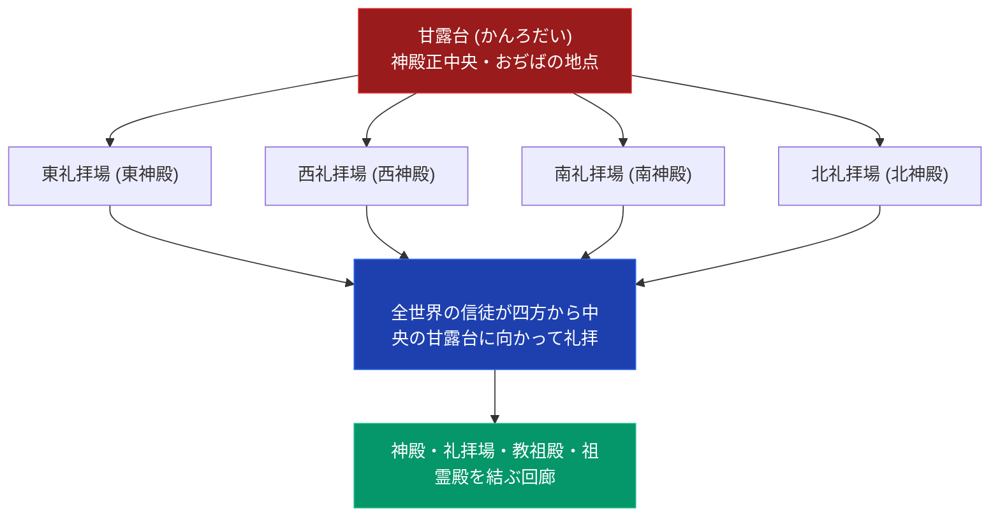

# 宗教都市天理の誕生と神殿建築 専門構造分析ノート

> [!summary] 要旨
> 本稿は、1954年（昭和29年）に日本で唯一「宗教団体の名称」をそのまま市名に採用して誕生した自治体「奈良県天理市」の都市形成史、親里神殿群の四方礼拝・3,157畳敷・回廊構造、および二代真柱・[[中山正善]]主導の「おやさとやかた構想」による親里の建築群形成を解剖した専門ノートである。

---

## 1. 命題の構造（親里神殿の空間配置：四方礼拝とおぢば中央固定）

| 建築・都市要素 | 特色・規模 | 宗教学的・構造的意義 |
|:--- |:--- |:--- |
| **市名「天理市」** | 1954年発足。丹波市町・櫟本町等6町村合併 | 21世紀の日本で、市名に宗教名が冠されている唯一の市（Wikipedia「天理市」） |
| **礼拝場（畳敷）** | 3,157畳（東西南北4礼拝場合計。Wikipedia「天理教」・TabiKenで確認） | 数千人が一堂に会して礼拝を行う |
| **四方正面構造** | 東・西・南・北の4方向から甘露台を拝する | 特定の正面を持たず、全方位へ開かれた世界観 |
| **回廊** | 神殿・礼拝場・教祖殿・祖霊殿を結ぶ回廊（1周約800m。天理教公式サイト「聖地『ぢば』」） | 親里施設群の一体的構造 |

---

## 2. 基本情報

| 項目 | 内容 |
|:--- |:--- |
| **対象** | 奈良県天理市の都市形成史と天理教教会本部（親里）の神殿建築 |
| **市制施行** | 1954年（昭和29年）4月1日 |
| **合併町村** | 山辺郡丹波市町・二階堂村・朝和村・福住村、添上郡櫟本町、磯城郡柳本町の6町村（Wikipedia「天理市」） |
| **教会本部所在地** | 〒632-8686 奈良県天理市三島町271 |
| **アクセス** | JR桜井線・近鉄天理線「天理駅」徒歩15分 |

---

## 3. 起源と成立の経緯（市名の由来とおぢば）

- **市名の由来**: Wikipedia「天理市」によれば、市名は天理教に由来し、「21世紀の日本で、市名に宗教名が冠されている唯一の市」である。同教の本部が市中心部の丹波市町にあったこと、同教が市制施行時に一帯に普及していたことによる。県への合併申請書類の一つ「市名選定の理由書」は、「宗教都市たる本質を明瞭に表現し」等の理由を述べている（Wikipedia「天理市」が引用）。
- **おぢば**: 天理教では人間の命の発祥地の中心を「ぢば」と称し、1875年（明治8年）に教祖の「ぢばさだめ」の啓示で場所が定められた。その証として据えられた「かんろだい」の地点は、数度の大規模な増築を経た現在に至るまで変わらぬ位置にあり、教会本部はこの「ぢば」を中心に建てられている（Wikipedia「天理教」）。

---

## 4. 沿革・歴史変遷（都市形成と神殿建築の過程）

- **1954年（昭和29年）4月1日の市制施行**: 山辺郡丹波市町、二階堂村・朝和村・福住村、添上郡櫟本町、磯城郡柳本町が合併し、日本で唯一、宗教団体名を冠する自治体「天理市」が誕生した（Wikipedia「天理市」）。
- **おやさとやかた構想**: 二代真柱・中山正善のもとで進められた親里の建築構想。Wikipedia「天理市」によれば、建築家・内田祥三らにより、教会本部を中心に約870m四方に68棟を建て巡らす広大な構想として建設され、1954年（昭和29年）から着工され、現在も構想は継続しており建設中である。
- **礼拝場の竣工過程**（TabiKenの現地記録）: 大正3年に北礼拝場と祖霊殿（当時は教祖殿）、昭和初期に教祖殿、南礼拝場と東西の回廊が竣工。昭和後期に西礼拝場と東礼拝場が完成し、おおよそ現在の姿になった。
- **インフラ整備**: 天理駅（JR・近鉄複合高架駅）、広大な親里大通り、天理よろづ相談所病院、天理大学・天理高校・天理教校が都市全体を構成する。

---

## 5. 内容・様式の深層解剖（神殿の内部構造）

Wikipedia「天理教」に基づく神殿の構造は以下の通りである。

- 神殿の中心部（いわゆる二階部分に相当）には、祭典時に祭主が祭文を奏上し、手おどりや毎朝夕のつとめが行われる一段高い木製の「神床」がある。神床の東西南北には「真座」へ降りる階段が設けられ、中心（ぢば）に人間創造をあらわす六角形の「甘露台」（木製、高さ約2.5m）が据えられている。
- 真座の四周約6間四方は床がなく純白の玉砂利が敷き詰められ、甘露台の四周約1間四方は花崗岩の延石で区切られ、那智黒の石が敷き詰められる。
- 神床の結界外は信者・参拝者が礼拝する畳敷きの四つの「礼拝場」（北・南・東・西、合わせて3,157畳）である。真座は地面（一階部分）であるため、礼拝場からは甘露台の上部が見えるのみである。
- 神殿の屋根は甘露台の上部一間四方が開けられているため、雨天時は甘露台に直接雨が降り注ぐ。
- 教会本部にはこのほか、教祖が存命のまま暮らしているとされる「教祖殿」、御霊を祀る「祖霊殿」があり、信仰に関係なく誰もが自由に出入りでき、南礼拝場は24時間開かれている。
- 回廊については、TabiKenの現地記録では「ぐるりと一周するのに2階建ての東西の回廊を通る」「歩くだけなら10分ちょっと」とされる。東回廊は船大工、西回廊は宮大工が棟梁を務めたという。天理教公式サイト「聖地『ぢば』」によれば、回廊は1周約800メートルである（2026-11-16再検証で確認）。

---

## 6. 宗教学的・歴史社会学的意義

天理市は、教団本部（おぢば）を核として自治体そのものが形成された宗教都市の事例であり、教育・医療・文化インフラ（天理大学・天理図書館・天理参考館・天理よろづ相談所病院）を教団関連法人が担う都市構造を持つ。神殿建築においては、特定の正面を持たず四方から中心の甘露台を礼拝する四方正面構造が、「ぢば」を世界の中心とする教理的世界観を空間的に表現している。

---

## 7. 拠点・現地情報

- **天理教教会本部**: 奈良県天理市三島町271。天理駅から徒歩15分。
- **参拝**: 教祖殿・祖霊殿は信仰に関係なく自由に出入り可能、南礼拝場は24時間開かれている（Wikipedia「天理教」）。神殿・回廊・祖霊殿・教祖殿などの内部と中庭での撮影は不可（TabiKen）。

---

## 8. 関連教団・関連人物・関連概念

- [[天理教]]（母体教団）
- [[おぢば]]（信仰の中心地点）
- [[甘露台]]（神殿中央の台）
- [[おぢばがえりと親里詰所建築群]]
- [[中山正善]]（二代真柱。おやさとやかた構想の推進者）
- [[明治15年甘露台石没収事件]]

---

## 9. 史料・一次資料 (convMD)

- [[src_天理市_Wikipedia]] — Wikipedia「天理市」（2026-11-15取得）。市制施行・合併町村・市名の由来・おやさとやかた構想を確認
- [[src_天理教本部神殿_TabiKen]] — TabiKen「天理教の本部神殿を見学」（2026-11-15取得）。礼拝場の竣工過程・回廊の現地記録を確認
- [[src_天理教_Wikipedia]] — Wikipedia「天理教」。神殿の内部構造・礼拝場合計3,157畳・ぢばの意義を確認
- src_RB3_天理教公式_聖地ぢば — 天理教公式サイト「聖地『ぢば』」（2026-11-16再検証）。回廊1周約800mを確認
- src_RB3_五十嵐太郎_新宗教の建築都市 — 五十嵐太郎論考の図版説明（東礼拝場1984年・西礼拝場1981年竣工）を確認（2026-11-16再検証）

---

## 10. 参考文献・学術論文

- Wikipedia「天理市」 https://ja.wikipedia.org/wiki/天理市
- Wikipedia「天理教」 https://ja.wikipedia.org/wiki/天理教
- TabiKen「天理教の本部神殿を見学」 https://tabiken.net/tenrikyo-headquarters/

---

## 11. 関連ノート (Vault内)

- [[おぢばがえりと親里詰所建築群]]
- [[中山正善]]
- [[明治15年甘露台石没収事件]]
- [[陽気ぐらしと天理教の社会福祉・医療]]
- [[_分派・異端研究ポータル]]

---

## 12. 留保（中立的併記・未確定要素）

> [!warning] 留保事項
> 1. 天理市の成立年・合併町村、市名の由来、おやさとやかた構想（1954年着工・約870m四方・68棟）はWikipedia「天理市」で確認済み。礼拝場合計3,157畳はWikipedia「天理教」とTabiKenの双方で確認できた。
> 2. **「八波（はちなみ）営繕」（未検証・除去）**: 旧稿の要旨・aliases・tagsにあった「八波営繕」という用語は、今回確認した資料のいずれにも現れず実在確認ができない。旧稿の留保でも「実在確認ができず削除した」とされながら要旨等に残存していた内部矛盾を解消し、本改訂で要旨・aliases・tagsから除去した。二代真柱主導の親里建築については、裏付けのある「おやさとやかた構想」に置き換えた。（再検証 2026-11-16：探索先＝Web全体検索・天理教公式サイト。「八波営繕」の用例は見当たらず、確認できず。除去済みの扱いを維持する）
> 3. **東西礼拝場の竣工年・個別の畳数（一部格上げ）**: 旧稿の「東西礼拝場は1984年竣工、各1,117畳」は、前回照合ではWikipedia・TabiKenのいずれでも確認できなかった。再検証（2026-11-16）で、五十嵐太郎論考（『10+1』DATABASE）の図版説明に「東（1984）西（1981）礼拝場は、竹中工務店による」と明記されていることを確認した。すなわち東礼拝場は1984年・西礼拝場は1981年竣工であり、「東西とも1984年」は誤りである。各1,117畳という個別の畳数は引き続き未確認（src_RB3_五十嵐太郎_新宗教の建築都市）。
> 4. **回廊の全長（格上げ）**: 旧稿の「1周約800m」は前回照合では確認できなかったが、再検証（2026-11-16）で天理教公式サイト「聖地『ぢば』」に「回廊は1周約800メートル」と明記されていることを確認し、§1表・§5に復帰させた（src_RB3_天理教公式_聖地ぢば）。前回典拠のTabiKen現地記録にも同旨の記載があり、前回は見落としの可能性が高い。
> 5. 「日本で唯一」の表現は、Wikipedia「天理市」の「21世紀の日本で、市名に宗教名が冠されている唯一の市」という記述に依拠する。
> 6. **改訂記録（2026-11-15・全件照合）**: 宗教版12セクションへ再編。エビデンス3件を保存（§9、うち2件は新規）。frontmatter（primary_source_based / 4）と留保（confidence 3）の不整合を是正し、根拠がWikipedia・現地記録ブログ等の二次資料である実態に合わせて evidence_type は `secondary_source_based`、confidence は `3` に統一した。

> - **追跡調査 第2波 2026-11-19（RB3）**: 探索先＝Vault内『資料/』全件の横断突合（RB2／RB4／RB5のエビデンスを含む）、文化庁『宗教年鑑』令和7年版ローカル抽出テキストの再検索、NDL・CiNii等の書誌確認の再点検（src_RB3W2_追跡調査第2波_探索記録2026-11-19）。本ノートの残存項目について新たな一次・公的裏付けは確認できず、未検証のまま残置する（探索なしの残置ではない）。
---

*※本稿は[[_分派・異端研究ポータル]]の都市建築・宗教空間分析ノートである。*
