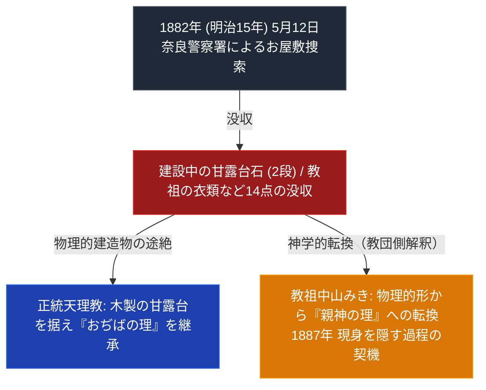

# 明治15年甘露台石没収事件

> [!summary] 要旨
> 本稿は、1882年（明治15年）5月12日、大阪府警察部奈良警察署がおぢばのお屋敷に立ち入り、据え付け中（2段まで完成）の「甘露台の石」および教祖・[[中山みき]]の衣類など14点を没収した事件「明治15年甘露台石没収事件」に関する専門構造分析ノートである。物理的建造物の普請が頓挫・没収されたことを、教祖が「人間の心を澄ますことが先決」と説く神学的転換として受け止めたとする教団側の解釈と、後年の分派（[[ほんみち]]の人間甘露台説）が本事件を自説の根拠とした構造を解剖する。

---

## 1. 命題の構造（国家権力による物理的没収 vs 『神の理』への転換）

| 比較考察軸 | 事件発生前 (物理的甘露台の普請) | 事件発生後 (石没収後の神学) |
| :--- | :--- | :--- |
| **甘露台の形態** | 六角形13段の石造柱（実際に2段まで製作） | 木製の甘露台 / 「神の理」としての甘露台 |
| **信者の信仰** | 物理的建物の完成（普請）を熱望 | 物理を超えた「心の埃払い」「世界助け」への転換（教団側の解釈） |
| **国家との関係** | 警察の監視と取締り | 『教派神道独立』への模索（[[明治の教難と教派神道独立]]参照） |

---

## 2. 基本情報

| 項目 | 内容 |
| :--- | :--- |
| **事件名** | 明治15年甘露台石没収事件 |
| **発生日** | 1882年（明治15年）5月12日（陰暦3月25日） |
| **場所** | おぢば（現・奈良県天理市三島、天理教教会本部） |
| **実施主体** | 大阪府警察部奈良警察署（署長・上村行業が数名の警官を率いて出張。『稿本天理教教祖伝』の記述による） |
| **没収物** | 2段まで完成していた甘露台の石、教祖の衣類など14点（赤衣を含む） |
| **同時期の措置** | 『みかぐらうた』の一部改変が断行された（Wikipedia「中山みき」） |

---

## 3. 背景（普請の着手と頓挫）

- **普請の着手**: 教祖中山みきの指示により、おぢばの地点（人類発祥の聖地とされる）に六角形13段の石造甘露台を築く「普請」が明治14年（1881年）初めから進行。石工が切り出した六角形の石が据え付けられ、この年の秋には2段目まで完成していたが、担当石工が姿を現さなくなり工事が中断していた（happist.net「かんろだいの没収」）。
- 甘露台の寸法・段数構成の解釈には複数説があり（[[甘露台]]ノート参照）、本ノートでは事件経過に限って扱う。

---

## 4. 沿革・事件の経過

- **1882年5月12日の踏み込み**: 大阪府警察部奈良警察署長・上村行業が数名の警官を率いてお屋敷に出張し、2段まで完成していた甘露台の石、および教祖の衣類など14点を没収した（『稿本天理教教祖伝』の記述を引く史料ページ・happist.net記事による）。Wikipedia「中山みき」も「1882年（明治15年）5月12日 - かんろだい石、赤衣が警察より没収」とし、同時期に『みかぐらうた』の一部が改変されたとする。
- **教祖の対応（歌詞改訂）**: 没収後、教祖はつとめの地歌を「いちれつすますかんろだい」から「いちれつすましてかんろだい」と改め、世界中の人々の心を澄ますことが建設の前提条件であることを示したとされる（happist.net記事による。この歌詞改訂の一次資料〈おふでさき等〉での逐語照合は本Vaultでは未実施）。
- **信仰的解釈**: この困難は信者の心を試し、教えの本質を深く理解させるための「ふし」（試練）と天理教内で解釈されている（教団側の解釈）。
- **事件後**: 没収後、ぢばには小石が積まれていた。明治21年（1888年）に板張り二段のものが据えられ、現在は木造の甘露台が据えられている（happist.net記事による）。

---

## 5. 解釈の深層解剖

- **本部の解釈**: 事件後、没収された地点（おぢば）に木製の甘露台を設置し、「空間的聖地のおぢば」を維持した。石製甘露台は「世界中の心が澄み切った時」に改めて据えられるとされる。
- **分派の解釈**: 後年の[[ほんみち]]（[[大西愛治郎]]）は「石が没収されたことで、甘露台は物理的建造物ではなく『現身の人間（生き神）』へと移行した」とする**人間甘露台説**を展開した。本事件の解釈の相違が分派派生の神学的ロジックの一つとなった。
- 没収の理由について、史料ページ（yousun）には明治14年の政変後の取締り強化との関連を考察する個人研究の記述があるが、これは考察の提示であり確定した史実ではない（『稿本天理教教祖伝』自体は没収の理由を記していない）。

---

## 6. 宗教学的・歴史社会学的意義

- **「聖地の空間的絶対性」と「分派の人間甘露台説」の分岐点**: 同一の事件をめぐり、本部は聖地の空間性を維持し、分派は聖性を人格へ移す解釈を生んだ。事件の「解釈」が教団分岐の資源となる構造の典型例である。
- 明治初期の民衆宗教への警察取締りの一事例として、[[明治の教難と教祖牢くぐり]]（拘留）と並ぶ教祖受難史の中核事件と教団史では位置づけられる。

---

## 7. 拠点・現地情報

- **おぢば**: 奈良県天理市三島町（天理教教会本部）。甘露台は神殿内に据えられる。天理教公式サイト「聖地『ぢば』」によれば、本部神殿は365日24時間開放され、拝観料・事前申込は不要で誰でも参拝できる（2026-11-16再検証で確認）。ただし甘露台自体の公開範囲（真座周辺への立入り可否）は公式案内でも明示されず未確認である。

---

## 8. 関連教団・関連人物・関連概念

- [[甘露台]]
- [[おぢば]]
- [[中山みき]]
- [[大西愛治郎]]
- [[ほんみち]]
- [[明治の教難と教派神道独立]]
- [[明治の教難と教祖牢くぐり]]

---

## 9. 史料・一次資料 (convMD)

- [[src_明治15年甘露台石没収事件_yousun史料ページ]] — 個人史料ページ「甘露台の石没収について」（『稿本天理教教祖伝』の引用を含む。2026-11-15 convMD保存）
- [[src_明治15年甘露台石没収事件_happist]] — happist.net「第29回『かんろだいの没収』」（天理教学生会関連サイト。普請の経緯・14点没収・歌詞改訂の照合に使用）
- [[src_中山みき_Wikipedia]] — Wikipedia「中山みき」（1882年5月12日没収・みかぐらうた改変の照合に使用）
- src_RB3_甘露台石没収事件_稿本天理教教祖伝書誌 — 『稿本天理教教祖伝』の書誌（天理教教会本部編・天理道友社・1956年10月、2026-11-16再検証）
- src_RB3_天理教公式_聖地ぢば — 天理教公式サイト「聖地『ぢば』」（本部神殿の24時間開放・参拝案内、2026-11-16再検証）

---

## 10. 参考文献・学術論文

- 天理教史料集「甘露台の石没収について」 http://www.yousun.sakura.ne.jp/public_html/siryou2/kanrodai/kanrodai.html
- happist.net「第29回『かんろだいの没収』」 https://happist.net/oshie/manabu/oyasama/25142（天理教学生会関連サイト、2026-11-15再確認）
- Wikipedia「中山みき」 https://ja.wikipedia.org/wiki/中山みき
- 『稿本天理教教祖伝』（没収当日の記述を含む教団側史料。本照合では上記史料ページの引用経由で確認。書誌〈天理教教会本部編・天理道友社・1956年10月・337p〉は2026-11-16再検証で確認済みだが、原典自体の閲覧は未実施）

---

## 11. 関連ノート (Vault内)

- [[_分派・異端研究ポータル]]
- [[甘露台]]
- [[明治の教難と教派神道独立]]
- [[明治の教難と教祖牢くぐり]]

---

## 12. 留保（中立的併記・未確定要素）

> [!warning] 注意
> - 日付（1882年5月12日）・没収の経緯（2段目まで完成した石の没収）は、Wikipedia「中山みき」、『稿本天理教教祖伝』を引く史料ページ、happist.net記事で相互に確認済み。[[中山みき]]ノート（第6波照合済み）の「1882年 かんろだい石・赤衣が警察より没収」の記述とも整合する。
> - 衣類没収点数（14点）・普請開始の経緯（明治14年着手、石工失踪による中断）・教祖の歌詞改訂（「いちれつすましてかんろだい」）はhappist.net記事に基づく。歌詞改訂の一次資料（おふでさき等）での逐語照合は未実施であり、この点は未検証として分離する。（再検証 2026-11-16：探索先＝原典公開テキスト・Web検索。逐語照合は未実施であり、確認できず）
> - 没収後の経過（小石→1888年板張り二段→現在の木造）もhappist.net記事に基づく単独系統の情報であり、教団公式史料での直接照合は未実施。（再検証 2026-11-16：探索先＝天理教公式サイト・公式史料の公開情報。公式史料での直接照合は未実施であり、単独系統のままである）
> - 旧稿の要旨にあった「不当侵入」「天理教史上の最大事件」「ご元出への最大の契機」等の評価的表現は、教団側の位置づけとして帰属を明示する形に改めた。
> - 信仰的解釈（「ふし」としての意義づけ）は教団側の解釈であり、史実とは区別する。
> - 本ノートの evidence_type は `secondary_source_based`、confidence は `3`。旧稿は `primary_source_based` / 4 としていたが、裏付けは個人史料ページ・教団関連サイト・Wikipedia等の二次資料に基づくため是正した。
>
> 改訂記録（2026-11-15・全件照合）: エビデンス2件を新規保存し、没収物の内訳（赤衣・みかぐらうた改変）・没収後の経過を補い、評価的表現の中立化と宗教版12セクションへの再編、frontmatter正規化を行った。

> - **追跡調査 第2波 2026-11-19（RB3）**: 探索先＝Vault内『資料/』全件の横断突合（RB2／RB4／RB5のエビデンスを含む）、文化庁『宗教年鑑』令和7年版ローカル抽出テキストの再検索、NDL・CiNii等の書誌確認の再点検（src_RB3W2_追跡調査第2波_探索記録2026-11-19）。本ノートの残存項目について新たな一次・公的裏付けは確認できず、未検証のまま残置する（探索なしの残置ではない）。
---

*※本稿は[[_分派・異端研究ポータル]]の歴史的重大事件分析ノートである。*
