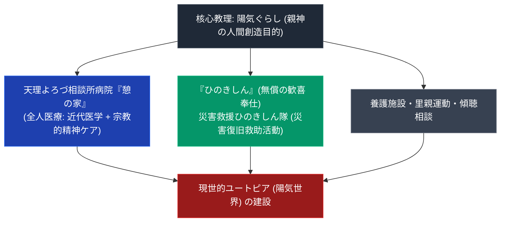

# 陽気ぐらしと天理教の社会福祉・医療 専門構造分析ノート

> [!summary] 要旨
> 本稿は、天理教の至高目的論「陽気ぐらし（陽気世界建設）」が具体的な社会的実践（天理よろづ相談所病院「憩の家」、養護施設、災害救援ひのきしん隊、および労働奉仕「ひのきしん」）として展開されたメカニズムを解剖した専門ノートである。よろづ相談所は1935年（昭和10年）に二代真柱・中山正善が開設し、1966年（昭和41年）に財団法人として現在地に「憩の家」を開所した。その運営は医療（身上部）・宗教的相談（事情部）・生活相談（世話部）の三部制を取り、「全人医療」の実践として学術的にも検討されている（深谷耕治『宗教と倫理』第16号）。

---

## 1. 命題の構造（「陽気ぐらし」理念から社会的救済への展開）

| 実践領域 | 具体的な施設・活動 | 宗教学的・社会的成果 |
|:--- |:--- |:--- |
| **医療（全人医療）** | 天理よろづ相談所病院「憩の家」（奈良県天理市） | 高度近代医学と信仰的精神ケア（事情部による相談）の融合 |
| **無償奉仕（ひのきしん）** | 4月29日「全教一斉ひのきしんデー」、公園・公共施設清掃 | 日常の健康・生かされている感謝を労働で表現 |
| **災害救助（災保）** | 天理教災害救援ひのきしん隊（おやさと隊と47教区隊、約6,000人） | 震災・水害現場への迅速なボランティア派遣 |
| **児童福祉・里親** | 天理養徳院（児童養護施設、1910年開設）、里親推進運動 | 明治期から続く児童への社会的養護 |

---

## 2. 基本情報

| 項目 | 内容 |
|:--- |:--- |
| **核心理念** | 陽気ぐらし（親神が人間を創造した目的とされる、喜びに満ちた暮らし） |
| **中核施設** | 公益財団法人天理よろづ相談所病院（通称「憩の家」） |
| **病院所在地** | 〒632-8552 奈良県天理市三島町200番地 |
| **病院開設** | 1966年（昭和41年）4月1日（前身の「よろづ相談所」は1935年開設） |
| **病床数** | 858床（白川分院を含む。Wikipedia「天理よろづ相談所病院」） |
| **運営法人** | 公益財団法人天理よろづ相談所（法人番号8150005007910。厚生労働省系「介護サービス情報公表システム」に公表） |
| **児童養護施設** | 天理養徳院（1910年開設、現・運営は社会福祉法人天理、法人番号9150005002910。WAM NET公表情報） |

---

## 3. 起源と成立の経緯

- **陽気ぐらしの教理的位置**: 天理教では、親神が人間を創造した目的は人間が「陽気ぐらし」を営む姿を見て共に楽しむことにあるとされる。この理念は抽象的な教理に留まらず、おやさとやかた構想をはじめとする施設建設や社会事業の動機づけとなってきた。二代真柱・中山正善は「憩の家」の設立に際し、「陽気ぐらし」を「人間の理想的な境遇」と説明し、医療を「陽気ぐらしへ向かう人生」への補助として位置づけた（深谷論文が『よろづ相談所のあゆみ』等に基づき紹介）。
- **よろづ相談所の発端**: 1935年（昭和10年）10月3日、天理教校の校主でもある二代真柱によって「よろづ相談所」と命名された施設が開設された。背景には、天理教校別科（現在の修養科）の志願者に病気や深刻な事情に悩む者が多く、専門医師による治療と信仰的な相談を与える機関が求められたことがある（深谷論文）。

---

## 4. 沿革・歴史変遷

深谷耕治『宗教と倫理』第16号（2016）およびWikipedia「天理よろづ相談所病院」に基づく。

- **1935年（昭和10年）10月3日**: 「よろづ相談所」が天理教校別科の附属施設として開設（二代真柱が命名）。
- **1937年（昭和12年）12月27日**: 私立病院開設の認可を受ける。
- **1939年（昭和14年）**: 建物が新築され、内科・小児科・眼科・レントゲン科の四科で診察開始。医療部に加えて厚生部・相談部が併設され、三部運営が始まる。
- **1940年（昭和15年）**: 分院が開設され「附属病院」と称される。
- **1966年（昭和41年）4月1日**: 財団法人として認可され、天理よろづ相談所病院を開設（当初許可病床600床）。おやさとやかたの西棟に「憩の家」として開所し、身上部・事情部・世話部の三部運営を引き継ぐ。
- **2011年（平成23年）**: 公益財団法人に認可される。
- **災害救援ひのきしん隊**: 災害時における救援組織として、おやさと隊と47教区隊が結成され、約6,000人の隊員が活動している。阪神・淡路大震災では2万人超、東日本大震災ではのべ18,000名が作業を行ったとされる（Wikipedia「天理教」）。

---

## 5. 内容・様式の深層解剖

### 5-1. 全人医療と三部運営（身上部・事情部・世話部）

- **設立**: 現在の病院は1966年（昭和41年）、二代真柱・[[中山正善]]のもとで開院した。
- **三部運営**: 病院内の運営部門は「身上部」「事情部」「世話部」の3部門から構成される。身上部が一般的な診療部門で、事情部は主に患者の精神面のケアと祈りを行い、世話部は生活上の相談、医療従事者の育成を担う（Wikipedia）。事情部の講師は病棟を巡回して患者一人ひとりと面談し、心身の悩みの解消を目的に相談にあたり、適宜「おさづけ」を行っている（深谷論文）。
- **理念上の位置づけ**: 深谷論文によれば、「病院」は厳密には「憩の家」の下位部門（身上部）であり、「憩の家」概念は病院より包括的である。事情部が「陽気ぐらし」へ向かう「心の養成」を主な役割とし、医療（身上部）はその補助的な役割を担うと位置づけられた。

### 5-2. ひのきしん（無償奉仕）

- 信者の積極的な神恩報謝の行為をすべて「ひのきしん（日の寄進）」と呼ぶ。日々健康に生きられることを親神に感謝し、その感謝を込めて働くことをいう。歴史的には元治元年（1864年）の「つとめ場所」の棟上げに始まるとされる（Wikipedia「天理教」）。
- **全教一斉ひのきしんデー**: 毎年4月29日に国内外で一斉に実施される（教団公式 Tenrikyo Online）。公園・公共施設等での清掃・奉仕活動が行われる。

### 5-3. 児童福祉・里親

- **天理養徳院**: 1910年（明治43年）に天理教の施設として開設された児童養護施設。2005年（平成17年）に社会福祉法人となり、現在は社会福祉法人天理（天理市別所町715-3）が運営する（天理市資料・WAM NET）。戦後は孤児の保護が主であったが、高度経済成長期を経て児童虐待への対応が増えたとされる。
- **里親運動**: 天理教の教会が里親に関わる活動については、八木三郎「社会的養護における天理教里親の意義」（『天理大学おやさと研究所年報』第17号、2011）等の学術的検討がある。

---

## 6. 宗教学的・歴史社会学的意義

「憩の家」の事情部の活動は、医療現場における宗教者の活動の事例として、キリスト教の病院チャプレンとの比較を含む「スピリチュアルケア」論の文脈で検討されてきた。深谷論文は、「スピリチュアルケア」概念にはキリスト教的な捉え方が強く反映されており、事情部のような非キリスト教の臨床実践を記述する上で必ずしも適切でない場合があると指摘し、各宗教の「宗教的ケア」を素朴に記述・比較する方向を提案している。天理教の社会事業は、教理（陽気ぐらし）が医療・福祉・奉仕の制度として具体化した事例として位置づけられる。

---

## 7. 拠点・現地情報

- **天理よろづ相談所病院「憩の家」**: 奈良県天理市三島町200番地。天理駅から徒歩15〜20分、または奈良交通バス「憩の家外来棟前」下車（厚生労働省「医療情報ネット」）。基本理念は「病む人の“陽気ぐらし”をめざして」。
- **白川分院**: 奈良県天理市岩屋町604番地。
- **天理養徳院**: 奈良県天理市別所町715-3。

---

## 8. 関連教団・関連人物・関連概念

- [[天理教]]（母体教団）
- [[中山正善]]（二代真柱。よろづ相談所・憩の家の創設者）
- [[天理教のおたすけ・おさづけと近代病気救済史]]
- [[宗教都市天理の誕生と神殿建築]]（おやさとやかた構想と「憩の家」の位置づけ）
- [[ほんみち]]
- [[ほんぶしん]]

---

## 9. 史料・一次資料 (convMD)

- [[src_天理よろづ相談所病院_Wikipedia]] — Wikipedia「天理よろづ相談所病院」（2026-11-15取得）。開設年月日・所在地・病床数・三部運営を確認
- [[src_天理よろづ相談所_深谷論文]] — 深谷耕治「天理よろづ相談所『憩の家』の理念と事情部の活動」『宗教と倫理』第16号（2016）。1935年開設から1966年「憩の家」までの沿革と理念を確認
- [[src_ひのきしんデー_TenrikyoOnline]] — 教団公式 Tenrikyo Online「Hinokishin Day」記事群。全教一斉ひのきしんデーが4月29日であることを確認
- [[src_天理教_Wikipedia]] — Wikipedia「天理教」。ひのきしんの定義・災害救援ひのきしん隊を確認
- ※旧稿が挙げた `src_ofudesaki_select`（『おふでさき』抜粋）・`src_osashizu_select`（『おさしづ』抜粋）は、資料フォルダ内に実在しない幽霊典拠であったため、本改訂で上記の実在ファイルへ付け替えた。原典自体の直接照合は未実施（未取得。再検証 2026-11-16でも未実施）。

---

## 10. 参考文献・学術論文

- 深谷耕治「天理よろづ相談所『憩の家』の理念と事情部の活動」『宗教と倫理』第16号、2016年
- 八木三郎「社会的養護における天理教里親の意義」『天理大学おやさと研究所年報』第17号、2011年、39-57頁
- Wikipedia「天理よろづ相談所病院」 https://ja.wikipedia.org/wiki/天理よろづ相談所病院
- Wikipedia「天理教」 https://ja.wikipedia.org/wiki/天理教
- 厚生労働省「介護サービス情報公表システム」公益財団法人天理よろづ相談所病院の事業所情報（法人番号8150005007910の公表元）
- WAM NET 法人詳細情報「社会福祉法人天理」（法人番号9150005002910、天理養徳院の運営法人）

---

## 11. 関連ノート (Vault内)

- [[天理教のおたすけ・おさづけと近代病気救済史]]
- [[中山正善]]
- [[ほんみち]]
- [[ほんぶしん]]
- [[宗教都市天理の誕生と神殿建築]]
- [[_分派・異端研究ポータル]]

---

## 12. 留保（中立的併記・未確定要素）

> [!warning] 留保事項
> 1. **全教一斉ひのきしんデーの日付訂正**: 旧稿は「4月18日『全教ひのきしんデー』」としていたが、これは誤りである。教団公式 Tenrikyo Online によれば全教一斉ひのきしんデーは毎年**4月29日**であり、4月18日は教祖誕生祭の日である。§1表・§5-2を訂正した。
> 2. **幽霊典拠の付け替え**: 旧稿§3が典拠として挙げた `src_ofudesaki_select`・`src_osashizu_select` は資料フォルダ内に実在しない（世界心道教ノート旧§9でも参照切れが記録されていたものと同名）。実在する保存分へ付け替え、『おふでさき』『おさしづ』原典の直接照合は未実施（未取得）と明記した。旧稿が引用した「にんげんこしらへ たのしみで」の歌も、原典照合が済むまで確定引用とは扱わない。（再検証 2026-11-16：探索先＝ウィキソース等の原典公開テキスト、Web検索。原典の直接照合は本バッチでも未実施であり、当該歌は引き続き確定引用として扱わない）
> 3. **所在地の混同の是正**: 旧稿 frontmatter の「本部所在地 三島町271」は天理教教会本部の住所であり、病院の所在地は三島町200番地である。両者を区別して記載した。
> 4. **分派との比較について**: 旧稿の要旨は「分派（ほんみち・ほんぶしん等）におけるユートピア社会観との比較」を謳っていたが、旧稿本文にはその裏付けとなる記述がなく、本改訂でも分派側の社会事業に関する出典は確認できなかった。当該比較は未検証であり、本稿の確定内容には含めない。（再検証 2026-11-16：探索先＝ほんみち・ほんぶしん関連資料、Web検索。分派側の社会事業に関する出典は得られず、確認できず。比較の枠組み自体は解釈事項である）
> 5. 病院の病床数（858床）・看護師に占める信者の割合等の数値はWikipediaの記載に依拠する（「約90%は信者とされる」等の記述を含む）。運営法人・養徳院運営法人の法人番号は公的システム（介護サービス情報公表システム・WAM NET）の公表値であり、検査用数字も一致する。
> 6. **改訂記録（2026-11-15・全件照合）**: 宗教版12セクションへ再編（旧稿は留保セクション自体が欠落していた）。エビデンス4件を保存（§9、うち3件は新規）。evidence_type は学術論文（深谷2016・八木2011）と公的情報を中心に据えたため `academic_research`、confidence は原典（おふでさき等）の直接照合が未実施であることから `4` とした（旧稿の primary_source_based / 5 は過大申告として是正）。

> - **追跡調査 第2波 2026-11-19（RB3）**: 探索先＝Vault内『資料/』全件の横断突合（RB2／RB4／RB5のエビデンスを含む）、文化庁『宗教年鑑』令和7年版ローカル抽出テキストの再検索、NDL・CiNii等の書誌確認の再点検（src_RB3W2_追跡調査第2波_探索記録2026-11-19）。本ノートの残存項目について新たな一次・公的裏付けは確認できず、未検証のまま残置する（探索なしの残置ではない）。

> - **最終判断ラウンド第394件（2026-11-20・本人決定）**: 教義・原典解釈系の保留項目は、解釈として帰属明示して残置すると決定した。本ノートでは分派との社会事業比較が対象であり、当該比較は既に本節で「未検証であり本稿の確定内容には含めない」「比較の枠組み自体は解釈事項」と明示されているため、本文は変更せずこの決定を記録して残置する。
---

*※本稿は[[_分派・異端研究ポータル]]の医療福祉・実践宗教学分析ノートである。*
