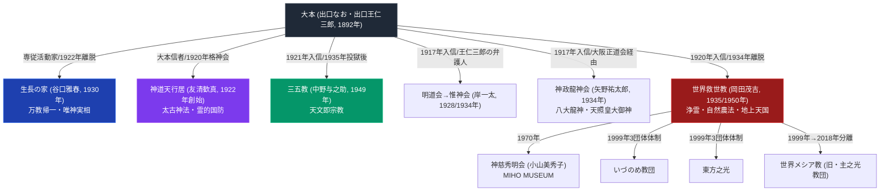

# 大本系諸派の教義比較マトリクス

> [!summary] 要旨
> 本稿は、大本（出口なお・出口王仁三郎、1892年立教）と、同教の元信者・元幹部が離脱・独立して創始した主要教団（[[世界救世教]]・[[生長の家]]・[[神道天行居]]・[[三五教]]・[[明道会・惟神会]]・[[神政龍神会]]）、および世界救世教からさらに派生した二次分派群（[[神慈秀明会]]・[[いづのめ教団]]・[[東方之光]]・[[世界メシア教]]）を、「離脱の契機」「中心教理」「政府弾圧の経験」「現況」等の軸で横断比較する。なお[[崇教真光]]は「手かざし」の儀礼的類似性から大本系諸教団と並べて語られることがあるが、大本ノート自体が「世界真光文明教団（岡田光玉創始）は世界救世教の信徒から」というWikipedia記載と、崇教真光・岡田光玉の各記事本体の「大本を研究したのみ」という記述との間に矛盾があると明記しており、系譜上の分派関係は本Vaultでは未確定である。この点を踏まえ、崇教真光は本稿の比較対象からは除外し、系譜未確定である旨のみ後述する。

---

## 1. 命題の構造（大本系の範囲と系譜未確定の扱い）

本稿の「大本系」とは、大本の元信者・元幹部が離脱・独立して創始した教団、およびその二次分派を指す作業上の範囲である。儀礼の類似（手かざし等）のみを根拠とする系譜の断定は行わない。崇教真光（真光系統）については、Wikipedia「大本」記事の分派一覧と崇教真光・岡田光玉の各記事本体の記述が矛盾し、本Vaultでは系譜未確定のため比較対象から除外する（詳細は[[手かざし系諸派の教義比較マトリクス]]参照）。

> [!warning] 系統図の限界
> 明道会・惟神会、神政龍神会は、教団自体の独立資料が乏しく、教義内容・組織の詳細は本Vaultでは十分に確認できていない。世界救世教から神慈秀明会・いづのめ教団・東方之光・世界メシア教への分岐は、いずれも「大本からの直接分派」ではなく「世界救世教内部からの二次分派」である点に注意（大本系譜としては孫世代にあたる）。

---

## 2. 基本情報

| 比較対象 | 創始者 | 成立年 | 大本との関係 |
| :--- | :--- | :--- | :--- |
| [[大本]]（本体） | 出口なお／出口王仁三郎 | 1892年 | - |
| [[世界救世教]] | 岡田茂吉 | 1935年（大日本観音会）／1950年改称 | 信者として入信（1920年）、1934年離脱 |
| [[生長の家]] | 谷口雅春 | 1930年 | 専従活動家、1922年離脱 |
| [[神道天行居]] | 友清歓真 | 1920年格神会／1922年創始 | 信者、思想的影響を受け独立 |
| [[三五教]] | 中野与之助 | 1949年 | 信者（1921年入信）、第二次大本事件で投獄後に独立 |
| [[明道会・惟神会]] | 岸一太 | 1928年（明道会）／1934年（惟神会） | 信者（1917年入信）、王仁三郎の弁護人 |
| [[神政龍神会]] | 矢野祐太郎 | 1934年 | 信者（1917年入信）、大阪正道会（大本分派）を経て独立 |
| 二次分派群 | [[神慈秀明会]]・[[いづのめ教団]]・[[東方之光]]・[[世界メシア教]] | 1970年／1999年／1999年／2018年 | 世界救世教からの分派（第5-2節） |

---

## 3. 起源と成立の経緯

大本は1892年、出口なおの神がかりに始まり、出口王仁三郎が教理体系化と全国展開を担った。大正期の急拡大の中で、大本の信者・幹部となった人物が後に独立して新教団を興す事例が相次いだ。離脱の経緯は、教理的対立・独自路線によるもの（生長の家、世界救世教、神道天行居）と、大本事件による投獄・弾圧経験を経たもの（三五教、神政龍神会）に大別できる（この2類型化は本Vaultの分析的整理であり、学術的定説ではない。第6節参照）。個別の成立経緯は各個別ノートを参照すること。

---

## 4. 変遷・歴史（弾圧と戦後）

大本は二度の大本事件を経験した。第一次事件（1921年、不敬罪・新聞紙法違反）は、第一審で王仁三郎に懲役5年の有罪判決が出たが大審院が破棄・差し戻し、再審理中の1927年5月17日に恩赦による免訴で終結した。第二次事件（1935年）では治安維持法違反について1942年の控訴審（大阪控訴院）で全員無罪となったが、不敬罪の有罪（王仁三郎・懲役5年）が残存し、確定は1945年9月8日の大審院上告棄却、不敬罪の解消は同年10月17日の大赦による（[[大本]]ノートで照合済み）。

派生教団側では、神政龍神会が1936年に治安維持法・不敬罪で弾圧を受け、矢野祐太郎は1939年に獄死した。世界救世教も、前身の大日本観音会が1936年に官憲の圧迫で解散し、1950年には本部捜索・岡田茂吉検挙（法難）を経験している。大本自体は戦後も存続したが、1980年以降の教主継承をめぐる内紛（第三次大本事件）により、宗教法人大本・大本信徒連合会・愛善苑の三派に分裂した（1986年に愛善苑が発足）。

---

## 5. 教理・儀礼・神観の深層解剖

### 5-1. 教義比較マトリクス（8軸）

| 比較軸 | 大本（本体） | 世界救世教 | 生長の家 | 神道天行居 | 三五教 | 明道会・惟神会 | 神政龍神会 |
| :--- | :--- | :--- | :--- | :--- | :--- | :--- | :--- |
| **創始者** | 出口なお／出口王仁三郎 | 岡田茂吉 | 谷口雅春 | 友清歓真 | 中野与之助 | 岸一太 | 矢野祐太郎 |
| **大本との関係** | - | 信者として入信（1920年）、1934年離脱 | 専従活動家、1922年に第一次大本事件を機に離脱（浅野和三郎に従う） | 信者、思想的影響を受け1920年に前身「格神会」を設立、1922年に神道天行居を創始 | 信者（1921年入信）、1935年第二次大本事件で投獄後に独立 | 信者（1917年入信）、出口王仁三郎の弁護人を務めるほど傾倒。1931年詐欺罪検挙を機に事実上離脱 | 信者（1917年入信）、大阪正道会（大本分派）を経て1934年独立 |
| **成立年** | 1892年 | 1935年（大日本観音会）／1950年改称 | 1930年 | 1920年（格神会）／1922年（神道天行居） | 1949年 | 1928年（明道会）／1934年（惟神会） | 1934年 |
| **中心教理** | 立替え・立直し、霊主体従、型の大本 | 浄霊、自然農法、地上天国建設 | 万教帰一（諸宗教融合）、唯神実相 | 太古神法（堀天龍斎伝承）、霊的国防 | 天文即宗教（現世利益を説かない） | 明記なし（降霊・除霊等の活動） | 八大龍神信仰、天照皇大御神・国常立大神中心の神学、終末論 |
| **救済儀礼・実践** | おふでさき・霊界物語による神示、お筆先 | 浄霊（手かざし） | 神想観（瞑想）等（本ノート未詳述） | 修法儀式（神璽埋置） | 天文台設立・国際協力活動（オイスカ） | 降霊・除霊 | 記録に乏しく未確認 |
| **国家権力との関係** | 二度の大本事件（1921年不敬罪等、1927年恩赦で免訴終結／1935年治安維持法違反は1942年控訴審で無罪・1945年確定、不敬罪の有罪は同年大赦で解消） | 1936年に前身・大日本観音会が官憲の圧迫で解散。1950年に本部捜索・岡田茂吉検挙（法難） | 直接の弾圧記録は未確認 | 記録なし | 記録なし | 岸一太が1931年詐欺罪で検挙（教団自体への弾圧ではない） | 1936年治安維持法・不敬罪で弾圧、矢野は1939年獄死 |
| **現況** | 1980年以降の内紛（第三次大本事件）で宗教法人大本・大本信徒連合会・愛善苑の三派に分裂 | 公称信者数454,774人（文化庁『宗教年鑑』令和6年版の公称値）、熱海・箱根・京都の3聖地 | 存続、環境問題への取り組みで知られる | 存続（詳細な組織規模は未確認） | 存続、NGOオイスカ運営 | 教団自体の現況は未確認 | 1936年弾圧により事実上解体・消滅 |

### 5-2. 世界救世教の二次分派（大本から見て孫世代）

| 比較軸 | 世界救世教（本体） | 神慈秀明会 | いづのめ教団 | 東方之光 | 世界メシア教（旧・主之光教団） |
| :--- | :--- | :--- | :--- | :--- | :--- |
| **創始者・代表** | 岡田茂吉 | 小山美秀子（会主、岡田茂吉を教祖として推戴） | 世界救世教の被包括法人（固有の創始者なし） | 世界救世教の被包括法人（固有の創始者なし、代表・下地竜生） | 岡田陽一（四代教主）・岡田真明（教主代行） |
| **分離年** | - | 1970年 | 1999年（3団体体制化） | 1999年（3団体体制化） | 2018年（法的分離） |
| **分離の契機** | - | 秀明教会（小山美秀子）が独立 | 1980年代の内部対立（第1次分裂）後の和解 | 同左 | 2017年、東方之光側による四代教主監視行為の発覚（第2次分裂） |
| **教義上の差異** | 浄霊・自然農法・地上天国 | 世界救世教の教義を継承しつつ「離脱の神意」で分離を正当化。実質的信仰対象は小山美秀子とされる（外部評価） | 世界救世教本体と共通（固有の教義差は未確認） | 世界救世教本体と共通（固有の教義差は未確認） | 世界救世教本体と共通（固有の教義差は未確認） |
| **現況** | いづのめ教団・東方之光の2団体を被包括法人とする | MIHO MUSEUM運営、単立宗教法人 | 世界救世教被包括法人として存続 | 世界救世教被包括法人として存続 | 2024年、世界救世教と和解（解決金13億円） |

---

## 6. 宗教学的・歴史社会学的意義

### 6-1. 大本離脱の2パターン：「教理的対立」型と「弾圧被害」型
大本から派生した教団の離脱動機は、大きく2つの型に分けられる（この2類型化は本Vaultの分析的整理であり、学術的定説ではない）。

1. **教理的対立・独自路線型**（生長の家、世界救世教、神道天行居）: 大本の教義・組織方針との相違を機に、独自の教義体系を新たに構築して離脱。谷口雅春の「万教帰一」、岡田茂吉の「浄霊・地上天国」は、いずれも大本の中心教理（立替え・立直し）とは異なる独自概念を核に据えている。
2. **弾圧被害・継承型**（三五教、神政龍神会）: 大本事件（特に1935年の第二次大本事件）による投獄・弾圧経験を経て、大本で得た人脈・霊学（本田親徳の霊学等）を基盤に独立した教団を興す。中野与之助（三五教）は友清歓真（神道天行居）と共に本田親徳の霊学を学んでおり、複数教団の思想的源流が重なる点も特徴的である。

明道会・惟神会（岸一太）は上記いずれにも明確に分類しがたく、大本への傾倒とその後の詐欺罪検挙という個人的スキャンダルが教団消長に直結した特異な事例である。

### 6-2. 「霊主体従」的世界観の継承と変容
大本の「霊主体従」（霊界が現界を主導する）という宇宙観は、程度の差はあれ派生教団にも影響を残している。神道天行居の「太古神法」、神政龍神会の神学体系は比較的直接的にこの霊学的世界観を継承しているのに対し、生長の家の「唯神実相」・世界救世教の「浄霊」は、大本の枠組みを離れて独自の理論的再構成を行っている点で異なる。

### 6-3. 世界救世教の内部分裂は「大本型」と類似の反復パターン
世界救世教自体も、岡田茂吉の死後（1955年）に後継体制の統合が弱く、神慈秀明会（1970年）をはじめとする複数の分派を生んだ。これは、大本が出口王仁三郎没後に教主継承をめぐる内紛で三派に分裂した経緯と構造的に類似しており、「カリスマ的創始者の死後、後継の正統性をめぐる分裂が起きやすい」という新宗教一般に見られるパターンの反復と位置づけられる（推測であり断定しない）。

---

## 7. 拠点・現地情報

- [[大本]]：本部は京都府綾部市・亀岡市（詳細は個別ノート参照）。
- [[世界救世教]]：熱海・箱根・京都の3聖地。
- 各派生教団の拠点・アクセスは各個別ノート（[[三五教]]、[[神道天行居]]等）を参照すること。本稿では拠点情報の独自の検証は行っていない。

---

## 8. 関連教団・関連人物・関連概念

- 関連教団：[[大本]]、[[世界救世教]]、[[生長の家]]、[[神道天行居]]、[[三五教]]、[[明道会・惟神会]]、[[神政龍神会]]、[[神慈秀明会]]、[[いづのめ教団]]、[[東方之光]]、[[世界メシア教]]
- 関連人物：[[出口なお]]、[[出口王仁三郎]]、[[岡田茂吉]]、[[谷口雅春]]、[[友清歓真]]、[[中野与之助]]、[[岸一太]]、[[矢野祐太郎]]
- 系譜未確定の関連教団：[[崇教真光]]（本稿の比較対象外。第12節参照）

---

## 9. 史料・一次資料 (convMD)

- [[src_大本_Wikipedia]]
- [[src_大本事件_Wikipedia]]
- [[src_世界救世教_Wikipedia]]
- [[src_真光系諸教団_Wikipedia]]（崇教真光の系譜問題の参照用）

---

## 10. 参考文献・学術論文

- Wikipedia「大本」 https://ja.wikipedia.org/wiki/大本
- 各教団の個別ノート（[[世界救世教]]、[[生長の家]]、[[神道天行居]]、[[三五教]]、[[明道会・惟神会]]、[[神政龍神会]]、[[神慈秀明会]]、[[いづのめ教団]]、[[東方之光]]、[[世界メシア教]]）
- 各創始者の個別ノート（[[出口王仁三郎]]、[[出口なお]]、[[岡田茂吉]]、[[谷口雅春]]、[[友清歓真]]、[[中野与之助]]、[[岸一太]]、[[矢野祐太郎]]）

---

## 11. 関連ノート (Vault内)

- [[大本]]
- [[天理教系諸派の教義比較マトリクス]]（同種の比較整理を天理教系分派について行ったもの）
- [[手かざし系諸派の教義比較マトリクス]]（世界救世教から派生した手かざし系分派の詳細比較）
- [[_分派・異端研究ポータル]]

---

## 12. 留保（中立的併記・未確定要素）

> [!warning] 留保事項
> - 本稿は既存Vaultノート（[[大本]]および各個別教団ノート）の記述内容を再整理したものであり、本稿作成にあたって新規のWeb調査は行っていない。個別の事実関係の一次的な裏付けは各参照元ノートの検証日・出典に依拠する。
> - 「大本離脱の2パターン」という分類は本Vaultの分析的整理であり、学術的に確立した分類ではない。
> - 明道会・惟神会・神政龍神会は教団自体の独立資料が乏しいため、教義・実践の欄は「明記なし」「未確認」と正直に記載し、推測で埋めていない。
> - 崇教真光との系譜関係は大本ノート側で既に矛盾が指摘されており、本稿では断定せず比較対象から除外した。
> - 東方之光の旧称は「西金派」（世界メシア教側Wikipedia記事）と「大日本観音会」（東方之光公式サイト）で表記が一致せず、両論併記のまま。
> - 神政龍神会の発起人（貴族院議員・陸海軍将校ら25名とされる）の具体名、肝川の具体的所在地は未確認。
> - 本ノートの evidence_type は `secondary_source_based`、confidence は `3`（参照元の各個別ノートは2026-11-15までの全件照合で検証済みだが、本稿自体はその再整理であり新規の事実確認は行っていないため）。
> - **再検証（2026-11-16・RB5-C）**: 探索先＝照合済み個別ノート（[[大本]]・[[神政龍神会]]・[[明道会・惟神会]]・[[神道天行居]]等）の現況およびWeb検索。結果：格上げ0件。崇教真光との系譜関係、神政龍神会の救済儀礼・発起人25名の具体名・肝川の所在地、神道天行居の組織規模、明道会・惟神会の現況は確認できず残存する。なお本ノートの世界救世教の信者数454,774人は『宗教年鑑』令和6年版の値であり、令和7年版での値は本バッチでは未取得（版混在については src_RB5C_再検証探索記録 参照）。
> - **改訂記録（2026-11-15・全件照合）**: 宗教版12セクションへ再編。照合済みの個別ノートと突き合わせて以下の誤りを訂正した。(1)大本事件の結末を「いずれも後に無罪確定」としていた点（正：第一次は1927年恩赦で免訴終結、第二次は治安維持法違反のみ1942年控訴審無罪・1945年確定、不敬罪の有罪は1945年大赦で解消）。(2)世界救世教の「国家権力との関係」を「直接の弾圧記録なし」としていた点（正：1936年前身解散、1950年法難）。(3)生長の家の離脱年「1921年」（正：1922年、[[谷口雅春]]ノートの訂正済み確定事項）。(4)神道天行居の成立を「1920年」とのみしていた点（正：1920年格神会設立・1922年神道天行居創始）。(5)大本の現況「戦後、内紛で三派に分裂」（正：1980年以降の内紛による三派分裂）。(6)第6-1節の「明道会・惣神会」は「明道会・惟神会」の誤記につき訂正。(7)世界救世教の信者数を「公称約45万人（2024年）」から確定値454,774人（『宗教年鑑』令和6年版）へ更新。evidence_type を primary_source_based から secondary_source_based へ、confidence を 4 から 3 へ是正。

> - **追跡調査 第2波（2026-11-19・RB5）残存**: 探索先＝Vault内 資料/ 再確認（関連エビデンス 0件を確認。新規の一次資料の追加はなし）・第1波（2026-11-18）までの公的・公式探索結果の再点検。本波では重点対象（公安調査庁の最新公式発表・国税庁法人番号・韓国法院公式判決・未取得だった公式サイト本文）を優先して再探索し、本ノートの個別残存項目については新たな一次・公的資料による裏付けに至らなかったため、確認できずとして残存とする（探索なしの残置ではない。第1波で未取得だった項目を含む）。個別項目の内訳は従前の再検証記録（2026-11-16）のとおり。

---

*※本稿は[[_分派・異端研究ポータル]]の比較分析専門ノートである。*
