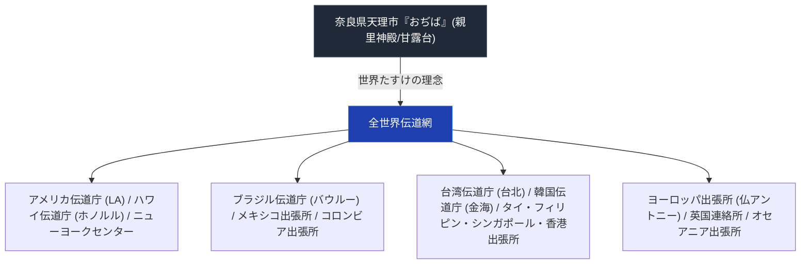

# 天理教の海外拠点と世界伝道網 専門構造分析ノート

> [!summary] 要旨
> 本稿は、明治期から現代に至る天理教の全世界伝道（世界たすけ）の歴史的波及、海外伝道庁（Dendocho）・出張所の所在地、海外伝道の宗教人類学的分析、および分派（ほんみち・ほんぶしん等）の海外拠点を整理した専門構造化ノートである。2026-11-15の全件照合で、天理教海外部公式サイトの現行拠点案内（2025年公開の新サイト）と天理大学おやさと研究所『Glocal Tenri』の伝道庁長講座報告等に基づき、伝道庁の設立年・所在地を大幅に訂正した（ハワイ伝道庁の設置年、ヨーロッパ拠点の現行形態、コンゴ拠点の国名・都市の誤り等。詳細は§12の改訂記録）。

---

## 1. 命題の構造（奈良親里おぢばの絶対性 vs 世界伝道と現地文化適合）

海外の教会・伝道庁の総数は、2015年度の教内統計で323か所とされる（Wikipedia「天理教」。出典・時点を明示した上での参考値）。現行の本部直轄拠点（伝道庁・出張所等）は§7の公式一覧の通り。

---

## 2. 基本情報

| 項目 | 内容 |
|:--- |:--- |
| **統括組織** | 天理教海外部（宗教法人天理教教会本部の組織。所在地は教会本部と同じ奈良県天理市三島町1番地1） |
| **公式サイト** | 天理教海外部 "Where the World Meets Tenrikyo"（https://kaigai.tenrikyo.org/ 。旧ドメイン kaigai.tenrikyo.or.jp から移転） |
| **伝道庁（現行・公式一覧）** | 台湾伝道庁、韓国伝道庁、アメリカ伝道庁、ハワイ伝道庁、ブラジル伝道庁の5庁 |
| **出張所等（現行・公式一覧）** | タイ出張所、フィリピン出張所、シンガポール出張所、香港出張所、ニューヨークセンター、オセアニア出張所、メキシコ出張所、コロンビア出張所、英国連絡所、ヨーロッパ出張所 |
| **海外拠点総数** | 海外の教会・伝道庁等 323か所（2015年度教内統計、Wikipedia「天理教」による） |

> [!warning] 旧表記の訂正
> 旧稿frontmatterの本部所在地「〒632-8686 奈良県天理市三島町271」は、2015年の地番表示変更（三島町271番地→三島町1番地1）前の旧表記である。現行表記は[[天理教]]照合済みノートの通り〒632-8501・三島町1番地1。

---

## 3. 創始者と天啓・社伝（「世界たすけ」の理念と伝道の担い手）

天理教の海外伝道は、教祖・中山みきの「世界たすけ」の理念を背景に、初期は日本人移民・移住者に随伴する形で広がった。二代真柱・中山正善は国際宗教学会での発表や柔道親善使節としての欧州歴訪を通じて後の伝道の地盤を作ったとされる（『Glocal Tenri』連載「天理教伝道史の諸相」）。戦後は布教師の派遣による現地人伝道へ軸足が移り、コロンビアの集団移住青年（1960年）、コンゴのタクシー運転手ノソンガ・アルフォンスの入信（1960年）など、現地側の担い手の逸話が各地域の伝道史に残る（いずれも教団・研究所側の伝道史記述として扱う）。

---

## 4. 沿革・歴史変遷（世界伝道の3大ウェーブ）

### 4-1. 第1波：明治・大正期（日本人移民流出・近隣アジア）
- **朝鮮・台湾**: 朝鮮半島での布教は1893年に始まった（Wikipedia「天理教」）。台湾では1896年（明治29年）に古谷マツが渡台して伝道を開始し、1897年には海外初の教会として台中教会が設置された（おやさと研究所『天理教台湾伝道史』刊行記念講座）。
- **満州**: 哈爾浜郊外に入植した移民団が「天理村」を建設し、「天理鉄道」（天理村鉄道）と呼ばれる軽便鉄道も建設した（Wikipedia「天理教」）。敗戦後の引き揚げでほとんどの教会は日本へ引き揚げた。
- **欧州の試み**: 1910年（明治43年）に船場分教会がロンドン布教を開始したが、1920年までに全て引き揚げた（『Glocal Tenri』「天理教伝道史の諸相」）。

### 4-2. 第2波：昭和初期〜戦前（中南米移民・北米展開）
- **ブラジル移住**: 1929年、ブラジル開拓移民とともに信徒が渡航した。伝道庁の設立は戦後の1951年（§4-3）。
- **北米都市伝道**: ロサンゼルス、サンフランシスコの日系人社会を中心に分教会を設立。1934年（昭和9年）にはロサンゼルスにアメリカ伝道庁が設立された（『Glocal Tenri』Vol.14 No.3の伝道庁長講座報告）。

### 4-3. 第3波：戦後〜現代（伝道庁の整備・現地人伝道）
- **1951年**: ブラジル伝道庁を設立（バウルー）。管内は教会89か所・布教所315か所（2013年の伝道庁長講座時点）。
- **1954年**: ハワイ伝道庁を設置（ホノルル）。管内は教会34か所・布教所39か所（2013年時点）。なおアメリカ伝道庁の管内は教会62か所・布教所69か所（カナダを含む、2013年時点）。
- **1966年**: コンゴ共和国ブラザビルにコンゴブラザビル教会を設立（アフリカの教会は同教会のみとされる。医療・柔道・鼓笛等の支援も実施）。
- **1970年**: パリ出張所を設立し、翌年に日仏文化協会を発足（日本語学校を開設）。現行の欧州拠点はヨーロッパ出張所（フランス・アントニー、§7）。
- **1972年**: コロンビア出張所を設立（伝道の開始は1960年12月の天理高校農事部生の集団移住）。
- **1975年**: 韓国に教会本部の施設を再設置（Wikipedia「天理教」。日韓国交断絶による交流断絶の後）。

---

## 5. 教理・儀礼・神観の深層解剖

### 5-1. 「おぢば」の絶対性と遠隔地の礼拝
天理教の教理において救済の中心は奈良県天理市の「おぢば（甘露台）」に固定されており、海外信徒の信仰も「おぢばがえり」（帰参）を軸に組織される。旧稿が述べた「海外の神殿に『おぢば遥拝台』が設けられ、拝殿がおぢばの方角を向くよう緻密に設計されている」との建築設計に関する主張は、今回の照合で出典を確認できなかったため未検証として分離した（§12）。甘露台そのものの海外への設置可否が教理問題化した事例としては、1985年の韓国における「かんろだい」形状への変更と、それに反対するグループの離脱（韓国天理教連合会の結成）がある（Wikipedia「天理教」）。

### 5-2. 言語翻訳と教典の多言語化
海外部は翻訳書籍の刊行・頒布を行っており（公式サイトに翻訳書籍の案内がある）、修養科には英語・中国語・ポルトガル語・フランス語のクラスが設置されている（Wikipedia「天理教」）。ブラジルではポルトガル語の「みかぐらうた」の可能性が検討された（2013年の伝道庁長講座）。ただし旧稿の「『おふでさき』『みかぐらうた』『おさしづ』の英・西・葡・仏・中・韓訳が完成し」との網羅的な完訳主張は、個別の書誌確認を行っていないため未検証として分離する（§12）。

### 5-3. 現地化の課題
2013年の伝道庁長講座（アメリカ・ハワイ・ブラジル）では、世代交代による日本語離れと現地社会への布教方法が共通の課題として挙げられた。ブラジルではようぼく信者の8割が日本語を解さないと報告されている（いずれも『Glocal Tenri』Vol.14 No.3）。

---

## 6. 宗教学的・歴史社会学的意義

天理教の海外伝道は、日本人移民への随伴伝道（第1・2波）から、戦後の現地人自立伝道（第3波）へ転換した新宗教の国際展開の典型例である。伝道庁制度は本部の統制と現地化の緊張を制度的に処理する仕組みであり、韓国のかんろだい形状問題（§5-1）のように「おぢばの絶対性」と現地適応の衝突が分派形成に至った事例も含む。

---

## 7. 拠点・現地情報

### 7-1. 現行の公式拠点一覧

天理教海外部公式サイト「海外部・本部拠点案内」（2026-11-15取得）に基づく現行の本部直轄拠点。設立年は確認できたもののみ併記する。

| 拠点名 | 国・地域 | 所在地 | 設立年・備考 |
|:--- |:--- |:--- |:--- |
| **台湾伝道庁** | 台湾（台北） | 台北市北安路625号 | 伝道庁設置は1934年（おやさと研究所）。伝道開始は1896年 |
| **韓国伝道庁** | 韓国 | 慶尚南道金海市生林面羅田路32 | 布教開始は1893年。伝道庁の設置年は今回未確認 |
| **アメリカ伝道庁** | アメリカ（LA） | 2727 East First Street, Los Angeles, CA 90033 U.S.A. | 1934年設立 |
| **ハワイ伝道庁** | アメリカ（ハワイ） | 2920 Pali Highway, Honolulu, HI 96817 U.S.A. | 1954年設置 |
| **ニューヨークセンター** | アメリカ | 42-19 147th Street, Flushing, NY 11355 U.S.A. | アメリカ伝道庁の東海岸拠点 |
| **ブラジル伝道庁** | ブラジル | Rua Tenri 4-58, Vila Independência, Bauru-SP, Brasil | 1951年設立 |
| **メキシコ出張所** | メキシコ | Av. Año de Juárez No. 348, Col. Granjas San Antonio, Iztapalapa, CDMX, MEXICO | |
| **コロンビア出張所** | コロンビア | Calle 18, No.115-90, Cali, Valle, COLOMBIA | 1972年設立。伝道開始は1960年 |
| **ヨーロッパ出張所** | フランス | 80, rue Velpeau 92160 Antony, FRANCE | 前身は1970年設立のパリ出張所 |
| **英国連絡所** | イギリス | 60 Foscote Road, Hendon, London NW4 3SD, U.K. | |
| **タイ出張所** | タイ | 6 Soi 69, Lat Phrao Rd., Wangthonglang, Bangkok 10310, THAILAND | |
| **フィリピン出張所** | フィリピン | 46 Victoria St., Magallanes Village, Makati, Metro Manila, PHILIPPINES | |
| **シンガポール出張所** | シンガポール | 10 Anson Road, #25-10 International Plaza, SINGAPORE 079903 | |
| **香港出張所** | 香港 | 灣仔軒尼詩道179-181號康富大廈2樓及3樓 | |
| **オセアニア出張所** | オーストラリア | 179 Benhiam Street, Calamvale, QLD 4116, AUSTRALIA | |

歴史的拠点として、コンゴブラザビル教会（コンゴ共和国、1966年設立）は現行の公式拠点一覧には掲載されていない。

### 7-2. 分派・異端教団の海外拠点

- **ほんぶしん（ハワイ拠点）**: ほんぶしん世界伝道本部がハワイに置かれている（95-030 Waihonu Street, Mililani, Hawaii 96789 U.S.A.）。[[ほんぶしん]]照合済みノートが依拠するWikipedia「ほんぶしん」の所在地一覧で確認済み。1984年にはハワイで信者の集会を開いたとされる（同Wikipedia）。
- **ほんみち（海外伝道）**: 旧稿は「ブラジル、アメリカ等の日系系譜に隠れ宝場・集会拠点を保持」としたが、[[ほんみち]]照合済みノートでも裏付けがなく、未検証として分離する（§12）。

---

## 8. 関連教団・関連人物・関連概念

- [[天理教]]
- [[ほんみち]]
- [[ほんぶしん]]
- [[中山正善]]
- [[奈良以外の甘露台と異端甘露台一覧]]
- [[_分派・異端研究ポータル]]

---

## 9. 史料・一次資料 (convMD)

- [[src_天理教海外部_公式拠点案内]] — 天理教海外部公式サイト「海外部・本部拠点案内」（現行ドメイン kaigai.tenrikyo.org、2026-11-15取得）
- [[src_天理教海外伝道_おやさと研究所GT159]] — 天理大学おやさと研究所『Glocal Tenri』Vol.14 No.3（アメリカ・ハワイ・ブラジル伝道庁長講座報告。伝道庁設立年・管内数）
- [[src_天理教海外伝道_おやさと研究所GT176]] — 『Glocal Tenri』連載「天理教伝道史の諸相（32）その他の地域の海外伝道」（コロンビア・ヨーロッパ・コンゴ等）
- [[src_天理教_Wikipedia]] — Wikipedia「天理教」（海外布教・海外拠点総数・韓国史）
- [[src_ほんぶしん_Wikipedia]] — Wikipedia「ほんぶしん」（ハワイ世界伝道本部の所在地）

---

## 10. 参考文献・学術論文

- 天理大学おやさと研究所『Glocal Tenri』Vol.14 No.3（2013年、「海外伝道の現状と課題」講座報告）
- 天理大学おやさと研究所『Glocal Tenri』Vol.15 No.8（2014年、早田一郎「天理教伝道史の諸相（32）」）
- 天理大学おやさと研究所『天理教台湾伝道史』刊行記念講座案内（台湾伝道1896年開始・伝道庁1934年設置）
- 天理教海外部公式サイト（拠点案内・翻訳書籍案内）

---

## 11. 関連ノート (Vault内)

- [[天理教]]
- [[天理教系の商業・文化施設一覧]]
- [[奈良以外の甘露台と異端甘露台一覧]]
- [[_分派・異端研究ポータル]]

---

## 12. 留保（中立的併記・未確定要素）

> [!warning] 留保事項
> - **未検証として分離した主張**: (1) ハワイにおける布教開始年（旧稿は「1902年に布教開始」としたが、今回照合した資料では確認できなかった。確認できたのは伝道庁設置が1954年であることまで）。(2) 「おぢば遥拝台」の建築設計（拝殿がおぢばの方角を向くよう設計されている）という主張（出典未確認）。(3) 三原典の6言語への「完訳」という網羅的主張（個別書誌の確認未実施）。(4) 韓国伝道庁の設置年。(5) ほんみちの海外拠点（ブラジル・アメリカ等の「隠れ宝場・集会拠点」）に関する記述（[[ほんみち]]照合済みノートでも確認できず、未検証のまま分離）。
> - ほんぶしんのハワイ拠点（世界伝道本部、95-030 Waihonu Street, Mililani, Hawaii）は、[[ほんぶしん]]照合済みノートが依拠するWikipedia「ほんぶしん」の所在地一覧で確認済みであり、旧稿の「未検証」から出典明示の上で格上げした。
> - 管内教会・布教所数は2013年の伝道庁長講座報告時点の数値であり、現在の数値ではない。海外拠点総数323か所も2015年度教内統計（Wikipedia経由）であり、時点を明示して用いる。
> - 本ノートの evidence_type は `secondary_source_based`、confidence は `3`（公式拠点案内・学術機関誌・Wikipediaの混成による）。
>
> - **再検証（2026-11-16・RB5-C）**: 格上げ1件：ハワイにおける布教開始年。尾上貴行の学術論文（『天理大学おやさと研究所年報』第24号、2018年）および『Glocal Tenri』連載により、組織的伝道の開始は1929年のホノルル教会設立、先駆的布教所の開設は1923年と確認でき、旧稿の「1902年」説は裏付けがなく誤りの可能性が高い（src_天理教_ハワイ伝道開始年）。残存：「おぢば遥拝台」の建築設計、三原典の6言語完訳、韓国伝道庁の設置年（韓国学中央研究院の事典でも日本側伝道庁の設置年は明記されず）、ほんみちの海外拠点は確認できず。詳細は src_RB5C_再検証探索記録。
> - **改訂記録（2026-11-15・全件照合）**: 宗教版12セクションへ再編し、以下を訂正した。(1) ハワイ伝道庁の「1911年成立」を1954年設置へ訂正（『Glocal Tenri』伝道庁長講座）。(2) アメリカ伝道庁の設立年を「要検証」から1934年へ確定（同）。(3) ブラジル伝道庁1951年設立を同資料で裏付け、3庁の管内数を出典・時点付きで追記。(4) 「ヨーロッパ伝道庁（パリ市内・天理文化会館併設）」を現行公式一覧の「ヨーロッパ出張所（仏・アントニー）」へ訂正し、1970年のパリ出張所設立を沿革に分離。(5) 「コンゴ出張所（コンゴ民主共和国・キンシャサ）」は国名・都市とも誤りであり、コンゴ共和国ブラザビルのコンゴブラザビル教会（1966年設立）へ訂正。現行公式一覧にアフリカ拠点の掲載はない。(6) 台湾伝道庁の住所を台北市北安路625号と確定し、設置年1934年・伝道開始1896年を追記。(7) 韓国伝道庁（金海市）を公式一覧に基づき追加。(8) 本部所在地の旧表記（〒632-8686・三島町271）を地番表示変更後の現行表記へ訂正。(9) 出典URLを現行ドメイン（kaigai.tenrikyo.org/top/facilities/）へ更新（旧URLは移転し404）。(10) 遥拝台の建築主張・教典完訳主張・ほんみち海外拠点を未検証として分離。(11) evidence_type を primary_source_based から secondary_source_based へ是正し、frontmatter（4）と留保（3）で食い違っていた confidence を 3 に統一した。

> - **追跡調査 第2波（2026-11-19・RB5）残存**: 探索先＝Vault内 資料/ 再確認（関連エビデンス 0件を確認。新規の一次資料の追加はなし）・第1波（2026-11-18）までの公的・公式探索結果の再点検。本波では重点対象（公安調査庁の最新公式発表・国税庁法人番号・韓国法院公式判決・未取得だった公式サイト本文）を優先して再探索し、本ノートの個別残存項目については新たな一次・公的資料による裏付けに至らなかったため、確認できずとして残存とする（探索なしの残置ではない。第1波で未取得だった項目を含む）。個別項目の内訳は従前の再検証記録（2026-11-16）のとおり。

---

*※本稿は[[_分派・異端研究ポータル]]の世界伝道網・海外拠点分析ノートである。*
