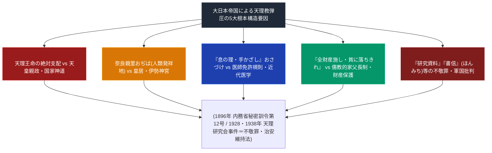

# 天理教弾圧の構造と歴史要因 極限深掘り史論専門構造分析ノート

> [!summary] 決定版・超深掘り史論要旨
> 本稿は、明治から昭和戦時下（1880年代〜1940年代）にかけて、大日本帝国政府（内務省・警察・特高・司法省）がなぜ天理教（親里本部）および派生分派（ほんみち／天理研究会等）に対して苛烈な弾圧（甘露台石没収・牢くぐり・内務省秘密訓令第12号（1896年）・不敬罪・治安維持法適用・教団解散命令）を行ったのか、その5大根本構造要因を多角解剖した極限専門史論ノートである。なお「5大根本構造要因」は本Vault独自の分析フレームワークであり、学術的定説ではない（§12参照）。

---

## 1. 命題の構造（弾圧の5大根本構造要因フレームワーク）

---

## 2. 基本情報

| 項目 | 内容 |
|:--- |:--- |
| **対象期間** | 1880年代〜1945年（明治〜昭和戦時下） |
| **弾圧主体** | 内務省・警察（特高）・司法省等の国家機関 |
| **被弾圧主体** | 天理教教会本部および派生分派（ほんみち／天理研究会ほか） |
| **主要事件** | 明治15年甘露台石没収事件（1882年）／教祖牢くぐり（最後の拘留1886年）／内務省秘密訓令第12号（1896年）／天理研究会事件（1928年・1938年） |
| **本部所在地** | 奈良県天理市三島町1番地1（天理教教会本部。郵便番号は資料により表記が揺れるため記載しない。§12参照） |
| **分析の性質** | 個別史実は照合済みノートに依拠するが、5要因への構造化は本Vault独自の分析 |

---

## 3. 起源と成立の経緯（弾圧構造の前提：明治国家の宗教統制）

明治国家は、祭政一致・国家神道体制の下で、天皇を現人神とする国体論を宗教秩序の中核に据えた。これに対し天理教は、親神・天理王命を世界の創造主とする一神観、おぢばを人類発祥の地とする聖地観、病気救済（おさづけ）を中核とする実践を掲げ、急速に信者を獲得した。国家の宗教統制（神道本局による教派管理、警察による取締り）との摩擦は構造的に避けがたく、教団側は1888年の神道天理教会公認、1908年の教派神道独立という「国家適応」の道をたどる一方、原典直解を掲げる分派は国家との正面衝突へ向かった（経緯の詳細は[[明治の教難と教派神道独立]]）。

---

## 4. 沿革・歴史変遷（弾圧の主要事件）

- **1882年（明治15年）5月12日**: 大阪府警察部奈良警察署がお屋敷に立ち入り、据え付け中（2段まで完成）の甘露台の石および教祖・中山みきの衣類など14点を没収（[[明治15年甘露台石没収事件]]）。
- **1886年（明治19年）2月18日〜**: 教祖の最後の拘留（12日間、櫟本警察分署。「最後の御苦労」。[[明治の教難と教祖牢くぐり]]）。
- **1888年（明治21年）**: 神道本局傘下「神道天理教会」の公認。国家適応の開始。
- **1896年（明治29年）4月6日**: 内務省訓令第12号（秘密訓令・甲第12号）発令。天理教取締りが苛烈化（[[天理教]]ノートで照合済み）。
- **1908年（明治41年）11月27日**: 教派神道「天理教」として一派独立。
- **1928年（昭和3年）**: 第一次天理研究会事件。大西愛治郎ら500人が不敬罪で検挙・起訴（[[大西愛治郎]]）。
- **1938年（昭和13年）**: 第二次天理研究会事件。『書信』配布により400人が検挙、大西は無期懲役、教団に結社禁止命令。同年、本部は「諭達第八号」による教義「革新」を宣言（[[革新天理教運動と昭和の教義論争]]）。
- **1945年（昭和20年）**: 敗戦により弾圧体制は終結。

---

## 5. 内容・様式の深層解剖（5大根本構造要因の詳細）

### 5-1. 要因1：国体論・現人神観との不可避的衝突
- **現人神 vs 天理王命**: 大日本帝国憲法下における「現人神たる天皇」の絶対的権威に対し、天理教は「親神・天理王命（てんりおうのみこと）」を人間および世界を創造した唯一の元初まりの神と仰ぐ。
- **特にほんみち（[[大西愛治郎]]）の先鋭化**: 1928年、天皇の神格を否定する内容を含む『研究資料』を配布したことが第一次天理研究会事件（不敬罪）の直接の契機となった。なお旧稿が引いた『神誡』の文言（「天皇親政は神の理に反する」）は逐語出典が確認できないため未検証として分離した（§12）。

### 5-2. 要因2：甘露台観（世界中心・人類発祥地）の地政学的摩擦
- **おぢば（親里） vs 皇居・伊勢神宮**: 天理教教理における甘露台（奈良県天理市三島）は「人類誕生の地点（元初まりの地）」であり、世界の中心とされる。これが皇祖神を祀る伊勢神宮や皇居と地政学的・宗教的秩序において対立したとするのが本フレームワークの解釈である。
- **明治15年甘露台石没収**: 1882年5月12日、警察が据え付け中の甘露台の石（2段分）および教祖の衣類など14点を没収した。国家神道以外の「世界の中心標識」の建設を阻止する国家意志の表れとする解釈は本Vaultの分析であり、事件自体の事実経過は[[明治15年甘露台石没収事件]]で確認済み。

### 5-3. 要因3：近代医療行政・医師免許制度との摩擦
- **「息の理・手かざし」のおさづけ**: 初期天理教の爆発的普及の動能は病気救済（おさづけ）であったが、明治政府が推進するドイツ流近代西洋医学および医師免許制度と正面衝突した。医師免許を法制化したのは**医師免許規則（1883年・明治16年10月23日、太政官布告第35号）**であり（『医制百年史』法令変遷・日本医史学会資料で確認。旧稿の「医師取締規則（1883年）」という名称は誤り）、無免許医業は旧刑法でも罰則の対象だった。「無免許医業」「迷信・祈祷」としての警察取締りは、教祖牢くぐりの一因となった。

### 5-4. 要因4：家制度・家父長制と財産拠出への反抗
- **「貧に落ちきれ」の教え**: 教祖中山みきが実践・提示した「全財産を施して陽気ぐらしへ向かう」教理は、明治民法が規定する「家父長による家財産の維持・家制度」と対立し、親族や警察からの「家産を傾ける邪教」との非難・弾圧を招いた。

### 5-5. 要因5：原典直解主義分派の出現と軍国主義批判
- 明治末から昭和戦時下にかけて、国家順応を進める本部（教派神道化）に対し、『おふでさき』を直解する分派（ほんみち等）が次々と派生。ほんみちは1928年に『研究資料』、1938年に『書信』全7信を配布し、いずれも大規模な検挙（第一次500人・第二次400人）・結社禁止命令へと至った。世界大戦と「立替え」の予言が軍国主義体制下で特高警察の徹底的弾圧を招いたと整理できる。

---

## 6. 学術的・社会学的意義

本フレームワークは、個別の弾圧事件を「国体論との教理的衝突」「聖地観の競合」「医療行政」「家制度」「分派の先鋭化」という複数の構造要因の複合として読み解く視点を提示する点に意義がある。ただし、これは本Vaultの分析的整理であり、宗教学・歴史学の学術的定説として確立された枠組みではない。個別史実の検証は各事件・教団ノートに委ね、本ノートはそれらを横断する解釈の置き場として機能する。

---

## 7. 拠点・現地情報

- **天理教教会本部（おぢば）**: 奈良県天理市三島町1番地1。JR桜井線・近鉄天理線「天理駅」徒歩15分。
- **櫟本警察分署跡**: 教祖最後の拘留の地（[[明治の教難と教祖牢くぐり]]参照）。

---

## 8. 関連教団・関連人物・関連概念

- [[天理教]]
- [[ほんみち]]
- [[大西愛治郎]]（天理研究会創始者）
- [[中山みき]]
- [[甘露台]]
- [[おさづけ]]
- 国家神道 / 不敬罪 / 治安維持法

---

## 9. 史料・一次資料 (convMD)

- [[src_天理教_Wikipedia]] — Wikipedia「天理教」（1896年内務省訓令第12号（秘密訓令・甲第12号）の照合に使用）
- [[src_天理教弾圧_医制百年史]] — 『医制百年史』（昭和館デジタルアーカイブ、2026-11-15 convMD保存）。法令変遷に「医師免許規則 明一六・一〇・二三」を確認
- [[src_中山みき_Wikipedia]] — Wikipedia「中山みき」（1882年石没収・1886年最後の拘留の照合に使用）
- [[src_中山眞之亮_Wikipedia]] — Wikipedia「中山眞之亮」（秘密訓令への教団対応の照合に使用）

---

## 10. 参考文献・学術論文

- 弓山達也『天啓のゆくえ—宗教が分派するとき』（2005年、教団史・分派研究の一般的文献として参照）
- 日本医史学会第118回総会一般演題「わが国の医師免許制度の法制化について―『吾園叢書』所収『医師営業規則』草案より―」（医師免許規則＝明治16年10月太政官布告第35号の確認に使用）

---

## 11. 関連ノート (Vault内)

- [[_分派・異端研究ポータル]]
- [[明治の教難と教派神道独立]]
- [[明治15年甘露台石没収事件]]
- [[明治の教難と教祖牢くぐり]]
- [[革新天理教運動と昭和の教義論争]]

---

## 12. 留保（中立的併記・未確定要素）

> [!warning] 注意
> - 「5大根本構造要因」は本Vaultの分析的フレームワークであり、学術的定説として確立されたものではない。個別の史実は他ノートでの検証結果に依拠する。
> - **未検証として分離した主張**: (1) 『神誡』に「天皇親政は神の理に反する」との文言があるとする旧稿の記述 — [[大西愛治郎]]ノートでも『神誡』の逐語引用は出典未確認として参照されておらず、本ノートでも事実として扱わない。(2) 「司法省『天理研究会不敬事件手続概要』」という文献名はWebSearchで実在確認ができなかった。天理研究会事件自体は実在するが、この具体的文献の存在は未確認のため参照から外した（旧稿から引き継ぎ）。
> - 本部所在地の郵便番号は、照合済みノート間でも表記が揺れる（〒632-8501／旧稿の〒632-8686）ため、本ノートでは郵便番号を記載せず所在地のみとした（地番は[[天理教]]ノートで確認済みの三島町1番地1。旧稿の「三島町271」は地番表示変更前の旧表記）。
> - 本ノートの evidence_type は `mixed_secondary_unverified`、confidence は `2`（旧稿は frontmatter が primary_source_based / 5、本文留保が unverified / 2 と不整合だった。フレームワーク自体が未検証の分析である実態に合わせ、本文側の自己評価に近い値へ統一した）。
> - **再検証（2026-11-16・RB5-C）**: 探索先＝Web検索・NDL／CiNii等の書誌データベース。結果：格上げ0件。『神誡』の文言「天皇親政は神の理に反する」の逐語出典、および司法省『天理研究会不敬事件手続概要』の書誌的実在は、今回も確認できず残存する。詳細は src_RB5C_再検証探索記録。
> - **改訂記録（2026-11-15・全件照合）**: 宗教版12セクションへ再編。(1) Mermaid図・要旨の「明治19年秘密達12号」は誤りであり、1896年（明治29年）4月6日の内務省訓令第12号（秘密訓令・甲第12号）に訂正（本文§3に旧稿自身が削除済みだった事項を図にも反映）。(2) 要因3の「医師取締規則（1883年）」は実在しない法規名であり、「医師免許規則（1883年・太政官布告第35号）」に訂正し、エビデンス（[[src_天理教弾圧_医制百年史]]）を新規保存。(3) 『神誡』の引用文を未検証として分離し、第一次事件の契機を『研究資料』配布（1928年・500人検挙）という確認済み事実に置換。第二次事件（1938年・400人検挙・無期懲役・結社禁止命令）の事実も[[大西愛治郎]]ノートと整合させた。(4) 甘露台石没収の記述を照合済みノートの事実経過（1882年5月12日・2段分・14点）に精密化。(5) 本部所在地を三島町1番地1に訂正。(6) frontmatter の evidence_type / confidence を正規化。

> - **追跡調査 第2波（2026-11-19・RB5）残存**: 探索先＝Vault内 資料/ 再確認（関連エビデンス 1件を確認。新規の一次資料の追加はなし）・第1波（2026-11-18）までの公的・公式探索結果の再点検。本波では重点対象（公安調査庁の最新公式発表・国税庁法人番号・韓国法院公式判決・未取得だった公式サイト本文）を優先して再探索し、本ノートの個別残存項目については新たな一次・公的資料による裏付けに至らなかったため、確認できずとして残存とする（探索なしの残置ではない。第1波で未取得だった項目を含む）。個別項目の内訳は従前の再検証記録（2026-11-16）のとおり。

---

*※本稿は[[_分派・異端研究ポータル]]の天理教弾圧構造専門史論ノートである。*
