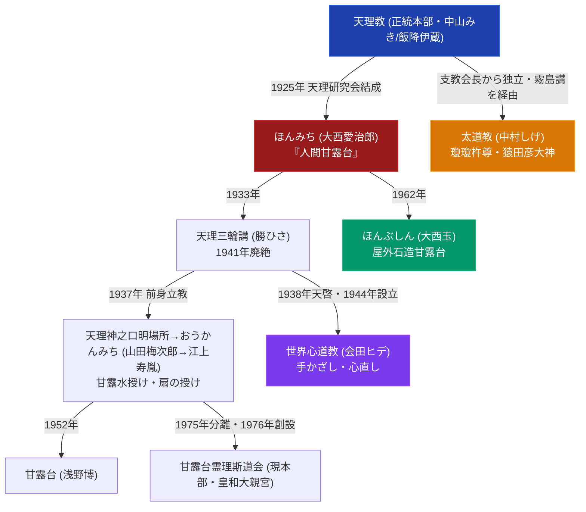

# 天理教系諸派の教義比較マトリクス

> [!summary] 要旨
> 本稿は、天理教（正統本部）と、そこから派生した主要分派・異端教団（ほんみち、ほんぶしん、世界心道教、太道教、おうかんみち、天理三輪講、甘露台霊理斯道会、陽気づくめ垂水教会等）を、「甘露台観」「天啓継承論」「聖典解釈」「救済儀礼」「国家権力との関係」等の教義軸で横断比較する。各教団の詳細な沿革・弾圧史・所在地情報は[[天理教分派・異端教団一覧]]および各個別ノートを参照し、本稿は分類軸に沿った比較整理に特化する。本稿の数値・年次・所在地は、2026-11-15の全件照合で確定した各個別ノートの記載に合わせて更新した（訂正内容は§12の改訂記録参照）。

---

## 1. 命題の構造（分派系統図と教義比較マトリクス）

### 1-1. 分派系統図（簡略版）

> [!warning] 系統図の限界
> 太道教は、創始者・中村しげが天理教支教会長から独立した後、霧島講（霧島神宮の講）の講元を経て立教したものであり、「天理教から直接分派」とは言えない（[[太道教]]照合済みノート参照）。Wikipedia「天理教」記事の分派一覧は太道教を天理教系分派として記録する一方、教団実態は教派神道系であり、系譜の評価には幅がある。陽気づくめ垂水教会は天理教包括からの離脱経緯の詳細（分派系統上どこに位置するか）が未確認のため図には含めていない。神修教・おやのみち甘露台は共に削除済み（実在未確認のため）。

### 1-2. 教義比較マトリクス（8軸）

| 比較軸 | 天理教（正統本部） | ほんみち | ほんぶしん | 世界心道教 | 太道教 | おうかんみち | 甘露台霊理斯道会 | 陽気づくめ垂水教会 |
| :--- | :--- | :--- | :--- | :--- | :--- | :--- | :--- | :--- |
| **創始者** | 中山みき／飯降伊蔵 | 大西愛治郎 | 大西玉（みろく様） | 会田ヒデ | 中村しげ | 山田梅次郎→江上寿胤 | 斎藤年男 | 山平順三 |
| **成立年** | 1838年 | 1913年天啓／1925年結成 | 1962年 | 1938年天啓／1944年設立 | 1938年霧島講講元／1940年届出 | 1937年（前身）／1946年再興／1960年改称 | 1975年分離／1976年創設 | 昭和後期〜平成期 |
| **甘露台観** | おぢばの物理的木柱（地点固定） | 大西愛治郎自身が「人間甘露台」 | 岡山・神山の屋外石造甘露台（六角形の石塔、Wikipedia）。明治15年に未完成に終わった石造甘露台の「完成型」とする教団側の位置づけ | 明記なし（水火風の理が中心） | 甘露台継承の裏付けなし（瓊瓊杵尊・猿田彦大神奉斎） | 「甘露水授け」等の秘儀、教主自身への人格的帰属 | 「扇の伺い」「甘露台の霊理」の直解継承を称する | 明治15年没収事件の石造甘露台（十三段）を境内に実物大で屋外奉斎（史料保存サイト） |
| **天啓継承論** | 教祖→本席で完結、1907年以降は真柱統制 | 大西愛治郎が「第三のやしろ」を自称 | 大西玉を「天啓者・みろく」、武田宗真を「天啓者・甘露台」と位置づける | 会田ヒデが月読之命・国狭土之命の天啓を自覚（ほんみち・三輪講を経た天啓継承の一例） | 中村しげの「神がかり」（詳細未確認） | 山田梅次郎が中山みきの夫「善兵衛」の生まれ替わりを自覚、江上寿胤が独自の天啓者を宣言 | 天啓者の存在は明確に否定し、「扇の伺い」の継承を称する（松井圭介の指摘） | 未確認（教理継承の詳細不明） |
| **聖典解釈** | 教団公式ドグマ（『天理教教典』等）を通じてのみ解釈 | 『おふでさき』直解、『神誡』『泥海初め』独自文書 | ほんみちの系譜を継ぐが「みろくの理」を独自展開 | 独自祭神「天地月日御親水火風之大神」 | 教理面の独自性は未確認 | 「神人合一」「甘露合世界達設」を標榜 | 中山みきの「教え」の直解を称する。教典『甘露台霊理斯道会教典』（RIRC記載） | 石造甘露台の物理的復元を教理の中心に据える |
| **救済儀礼** | おさづけ（手振り・ておどり） | 独自の手振り・甘露台人間拝礼 | みろくの理に基づく儀礼（詳細未確認） | 「手かざし（手差し）」「心直し」 | 詳細未確認 | 「甘露水授け」「扇の授け」「息の授け」 | 「扇の伺い」 | 石造甘露台への拝礼が中心と推測（詳細未確認） |
| **国家権力との関係** | 明治期に教派神道として公認・順応 | 二度の弾圧（1928年不敬罪、1938年治安維持法違反）で壊滅的打撃 | 直接の弾圧記録なし | 直接の弾圧記録なし | 直接の弾圧記録なし | 前身の山田梅次郎が治安維持法違反で検挙（1937または1938年） | 記録なし | 記録なし |
| **現況・規模** | 信者数最大規模、全国組織 | 信者数319,031人（文化庁『宗教年鑑』令和4年版）／信徒約30万人（RIRC掲載の教団沿革・教団申告）、全国組織 | 岡山本部（神山精舎）＋全国拠点、ハワイに世界伝道本部。信者数は未確認 | 東海圏中心、詳細な信者数未確認 | 阿佐ヶ谷猿田彦神社境内、規模不明 | 栃木県那須郡に本部、規模不明 | 本部は栃木県大田原市の皇和大親宮。信者数 千〜5千人（RIRC・教団申告）／13,000人（井上1996・教団申告） | 神戸市垂水区、規模不明 |

---

## 2. 基本情報（対象教団の諸元）

| 教団 | 創始者 | 成立年 | 本部所在地 | 現況 |
| :--- | :--- | :--- | :--- | :--- |
| 天理教 | 中山みき／飯降伊蔵 | 1838年 | 奈良県天理市三島町1番地1（教会本部） | 包括宗教法人。詳細は[[天理教]] |
| ほんみち | 大西愛治郎 | 1913年天啓／1925年天理研究会結成 | 大阪府高石市羽衣3丁目1-72 | 詳細は[[ほんみち]] |
| 天理三輪講 | 勝ひさ（勝ヒサノ） | 1933年3月（学術二次資料） | 大阪府北河内郡枚方町（現・枚方市） | 1941年に廃絶。詳細は[[天理三輪講]] |
| ほんぶしん | 大西玉 | 1962年 | 岡山県岡山市東区神崎町1（神山精舎） | 詳細は[[ほんぶしん]] |
| 世界心道教 | 会田ヒデ | 1938年天啓／1944年設立（東京・渋谷） | 愛知県豊川市諏訪2丁目101番地 | 詳細は[[世界心道教]] |
| 太道教 | 中村しげ | 1938年霧島講講元／1940年届出 | 東京都杉並区阿佐谷南1-1-38 | 包括宗教法人（教派神道系）。詳細は[[太道教]] |
| おうかんみち | 山田梅次郎→江上寿胤 | 1937年前身立教／1946年再興／1960年改称 | 栃木県那須郡（1973年東京より移転） | 詳細は[[おうかんみち]] |
| 甘露台霊理斯道会 | 斎藤年男 | 1975年分離／1976年創設 | 栃木県大田原市（皇和大親宮） | 1983年宗教法人登記。詳細は[[甘露台霊理斯道会]] |
| 陽気づくめ垂水教会 | 山平順三 | 昭和後期〜平成期（未検証） | 兵庫県神戸市垂水区名谷町1521 | 天理教包括離脱の単立教会。詳細は[[陽気づくめ垂水教会]] |

---

## 3. 創始者と天啓・社伝（天啓継承の「連鎖」構造）

[[天理教の分裂の系譜]]が指摘する通り、天理教は「教祖（中山みき）」と「本席（飯降伊蔵）」というダブルの天啓構造を持ち、1907年の本席没後に「第三の天啓者」を待望する信仰心理が働いたとされる（弓山達也モデル）。この延長線上に、大西愛治郎（ほんみち）→大西玉（ほんぶしん）という親子二代の継承と、大西愛治郎のほんみち→天理三輪講（勝ひさ）→山田梅次郎（おうかんみち前身）・会田ヒデ（世界心道教）という複数世代にわたる天啓継承の広がりが見られる。山田梅次郎と会田ヒデはいずれも天理三輪講を経た並行的な派生であり、直線的な継承関係ではない（会田ヒデは天理教→ほんみち→天理三輪講の順に移った）。ただし各段階での天啓の正統性の主張は教団側の自己申告であり、外部の学術的評価とは区別する必要がある。

なお、甘露台霊理斯道会はこの連鎖の末端に位置しながら、天啓者の存在自体を明確に否定し「扇の伺い」の継承を称する点で、連鎖構造からの離脱事例として対照的である（[[甘露台霊理斯道会]]照合済みノート、松井圭介の学術論文の指摘による）。

---

## 4. 沿革・歴史変遷（弾圧経験の有無による差異）

ほんみちおよびその前身に連なる系統（おうかんみちの前身・天理神之口明場所）は、戦前の不敬罪・治安維持法による直接の弾圧を経験している点で、他の分派（ほんぶしん、世界心道教、太道教、甘露台霊理斯道会、陽気づくめ垂水教会）と一線を画す。

- **ほんみち**: 1928年（第一次天理教事件・不敬罪）、1938年（第二次事件・治安維持法違反）の二度の弾圧で壊滅的打撃を受けた。
- **天理三輪講**: 1935年に一度解散して天理教へ復帰し、まもなく再建。1939年に治安維持法・不敬罪で検挙され、1941年の勝ヒサノの病死と結社禁止命令により廃絶した。
- **おうかんみち前身（天理神之口明場所）**: 山田梅次郎が治安維持法違反で検挙された（1937年または1938年）。
- **戦後の再編**: ほんみちは1950年に現名称へ改称、ほんぶしんは1962年にほんみちから独立、おうかんみちは1946年に再興し1960年に改称した。

これらの弾圧経験の有無が、戦後の教団運営における「無看板の宝場制度」（ほんみち）のような組織防衛的特徴の有無にも影響していると考えられる（推測であり断定しない）。

---

## 5. 教理・儀礼・神観の深層解剖

### 5-1. 甘露台観の3類型
天理教系分派の教義的差異は、多くの場合「甘露台」という中心概念をどう捉えるかに集約される。既存の[[天理教の分裂の系譜]]で提示された「甘露台観の地理的・人間的亀裂」というフレームワークを踏まえ、本稿では確認できた事例から以下の3類型に整理する（この3類型化は本Vaultの分析的整理であり、学術的定説ではない）。

1. **地点固定型**（正統本部）: おぢばの物理的木柱そのものを甘露台とする。
2. **人格化型**（ほんみち、おうかんみち系）: 創始者・教主自身を「人間甘露台」として奉斎する。
3. **物理的復元型**（ほんぶしん、陽気づくめ垂水教会）: 明治15年に警察が没収し未完成に終わった石造甘露台を、独自の聖地に屋外で復元・奉斎する。ただし形態の詳細には資料差があり、ほんぶしんの神山甘露台はWikipediaが「六角形の石塔」と記述するにとどまり（「十三段の実物復元」との性格づけは未検証、§12参照）、陽気づくめ垂水教会については史料保存サイトが「実物大の石造十三段甘露台」と紹介する。

世界心道教・太道教はこの3類型のいずれにも明確に当てはまらず、甘露台よりも独自の祭神（水火風の理、瓊瓊杵尊・猿田彦大神）を中心に据える教義体系を持つ点で異なる系統と言える。なお、甘露台そのものの精密寸法（総高八尺二寸等）と「高井猶吉説」への帰属は、[[甘露台]]ノートの照合で未検証として分離されており、本稿の比較でも寸法数値は用いていない。

### 5-2. 聖典解釈と祭神
『おふでさき』の解釈権をめぐる対立が分派形成の通底軸である。正統本部は教団公式ドグマを通じた解釈を統制し、ほんみちは『おふでさき』直解を掲げて独自文書（『神誡』『泥海初め』）を発達させた。おうかんみち・甘露台霊理斯道会も直解継承を称する。一方、世界心道教は独自祭神「天地月日御親水火風之大神」を、太道教は瓊瓊杵尊・猿田彦大神を奉斎し、原典解釈よりも祭神の転換によって自立性を確立した。

### 5-3. 救済儀礼
正統本部の「おさづけ」を起点に、ほんみちの独自の手振り、世界心道教の「手かざし（手差し）」「心直し」、おうかんみちの「甘露水授け」「扇の授け」「息の授け」、甘露台霊理斯道会の「扇の伺い」と、儀礼の形態は分派ごとに分化した。ほんぶしん・太道教・陽気づくめ垂水教会の儀礼詳細は未確認である（§1-2表に明記）。

---

## 6. 宗教学的・歴史社会学的意義

- **天啓者待望論モデル**: 本席没後の「第三の天啓者」待望が分派形成の心理的基盤になったとする弓山達也のモデルは、本マトリクスの「天啓継承論」軸の分析枠組みとして有効である。
- **聖地論（空間固定 vs 人格流動）**: 甘露台観の3類型（§5-1）は、聖地を「地点」に固定する正統本部と、「人格」や「復元物」へ移転させる分派という対比で整理できる。
- **分類軸の意義**: 本稿の8軸は、教団の自己申告（天啓・直解の主張）と外部確認可能な事実（所在地・法人格・弾圧記録）を分離して比較するための道具であり、各セルの根拠は個別ノートの検証水準に依存する。

---

## 7. 拠点・現地情報

各教団の本部所在地は§2の諸元表の通り（いずれも照合済み個別ノートに基づく）。分派横断の拠点情報は[[天理教分派・異端教団一覧]]、甘露台を奉斎する拠点については[[奈良以外の甘露台と異端甘露台一覧]]を参照。ほんぶしんの海外拠点（ハワイ世界伝道本部）については[[天理教の海外拠点と世界伝道網]]§5および[[ほんぶしん]]を参照。

---

## 8. 関連教団・関連人物・関連概念

- [[天理教]]、[[ほんみち]]、[[ほんぶしん]]、[[世界心道教]]、[[太道教]]、[[おうかんみち]]、[[天理三輪講]]、[[甘露台霊理斯道会]]、[[陽気づくめ垂水教会]]
- [[中山みき]]、[[飯降伊蔵]]、[[大西愛治郎]]、[[大西玉]]、[[会田ヒデ]]
- [[甘露台]]、[[おふでさき]]

---

## 9. 史料・一次資料 (convMD)

本稿は各教団の照合済み個別ノートの再整理であり、参照した主要エビデンスは以下の通り（いずれも content/資料/ に保存済み）。

- [[src_天理教_Wikipedia]] — Wikipedia「天理教」
- [[src_ほんみち_Wikipedia]] — Wikipedia「ほんみち」
- [[src_ほんみち_RIRC]] — RIRC教団データベース「ほんみち」
- [[src_ほんぶしん_Wikipedia]] — Wikipedia「ほんぶしん」
- [[src_ほんぶしん_公式]] — ほんぶしん公式サイト
- [[src_世界心道教_Wikipedia]] — Wikipedia「世界心道教」
- [[src_太道教_国税庁法人番号]] — 国税庁法人番号公表サイト「太道教」
- [[src_天理三輪講_日本語版Wikipedia]] — 日本語版Wikipedia「天理三輪講」関連記事
- [[src_おうかんみち_英語版Wikipedia]] — 英語版Wikipedia "Ōkanmichi"
- [[src_甘露台霊理斯道会_RIRC]] — RIRC教団データベース「甘露台霊理斯道会」
- [[src_甘露台霊理斯道会_公式サイト]] — 甘露台霊理斯道会公式サイト
- [[src_陽気づくめ垂水教会_国税庁法人番号]] — 国税庁法人番号公表サイト「陽気づくめ垂水教会」

---

## 10. 参考文献・学術論文

- 弓山達也『天啓のゆくえ—宗教が分派するとき』（日本地域社会研究所、2005年）
- 井上順孝ほか編『新宗教教団・人物事典』（弘文堂、1996年）
- 島薗進『新宗教の展開』（岩波書店）
- 梅原正紀・水野千里（1980年、天理三輪講の設立年・系統に関する学術二次資料。詳細は[[天理三輪講]]参照）
- 文化庁『宗教年鑑』令和4年版（ほんみち信者数）

---

## 11. 関連ノート (Vault内)

- [[天理教分派・異端教団一覧]]
- [[天理教の分裂の系譜]]
- [[天理教]]
- [[_分派・異端研究ポータル]]

---

## 12. 留保（中立的併記・未確定要素）

> [!warning] 注意
> - 本稿は既存Vaultノート（各個別教団ノート・[[天理教分派・異端教団一覧]]・[[天理教の分裂の系譜]]）の記述内容を再整理したものであり、個別の事実関係の裏付けは各参照元ノートの検証日・出典に依拠する。2026-11-15の本照合では、各個別ノート（第1〜7波で全件照合済み）と突合し、不一致は照合済み側に合わせて訂正した（改訂記録参照）。
> - 「甘露台観の3類型」という分類は本Vaultの分析的整理であり、学術的に確立した分類ではない。
> - 太道教・世界心道教等、教理面の詳細が未確認の教団については、比較表内で「未確認」「詳細未確認」と明記し、推測で埋めていない。
> - **未検証として分離した主張**: (1) ほんぶしん神山甘露台の「十三段の実物復元」という性格づけ（照合資料で確認できず、[[ほんぶしん]]ノートで未検証と分離済み）。(2) 天理三輪講の「1931年設立・天理教から直接独立」説（日本語版Wikipedia「天理教」記事本文のみで出典不明。学術二次資料は1933年・ほんみち派生で一致）。(3) 甘露台の精密寸法と「高井猶吉説」への帰属（[[甘露台]]ノートで未検証分離済み。本稿では寸法数値を用いていない）。
> - 本ノートの evidence_type は `secondary_source_based`、confidence は `3`（照合済み個別ノートに基づく二次整理であり、本稿自体は新規の一次確認を行っていないため）。
>
> - **再検証（2026-11-16・RB5-C）**: 探索先＝照合済み個別ノートの現況およびWeb検索。結果：格上げ0件。陽気づくめ垂水教会の成立時期・系統位置、太道教・世界心道教・ほんぶしん・陽気づくめ垂水教会の儀礼／教理詳細、ほんぶしん神山甘露台の「十三段の実物復元」という性格づけ、甘露台の精密寸法と「高井猶吉説」への帰属は確認できず残存する。版注記：本表のほんみち信者数319,031人は『宗教年鑑』令和4年版、RIRCの信徒約30万人は教団申告であり、出典・時点の異なる数値の混在に留意すること（令和7年版の値は未取得。src_RB5C_再検証探索記録）。
> - **改訂記録（2026-11-15・全件照合）**: 宗教版12セクションへ再編。照合済み個別ノートと突合して以下を訂正した。(1) 天理三輪講の成立年を「1931年（未解決）」から「1933年3月・ほんみち派生（学術二次資料）」へ訂正し、1931年説は未検証として分離。(2) おうかんみち後継組織（甘露台霊理斯道会）の設立年の差異（1975年/1976年）を解消（1975年11月2日分離・1976年4月24日創設）。(3) 甘露台霊理斯道会の創始者を「未確認」から斎藤年男へ、本部を栃木県大田原市・皇和大親宮へ訂正し、信者数に帰属（RIRC・井上1996、いずれも教団申告）を明示。天啓継承論も「天啓者を否定し扇の伺いを継承」へ訂正。(4) ほんぶしんの甘露台観から「十三段の実物復元」を外し、Wikipediaの「六角形の石塔」へ訂正。(5) 太道教の系譜を「天理教から直接分派」から「支教会長から独立・霧島講を経由」へ訂正し、系譜評価の幅を併記。(6) 天啓継承の連鎖構造の記述を訂正（山田梅次郎と会田ヒデは三輪講を経た並行派生）。(7) ほんみち信者数に帰属を明示（『宗教年鑑』令和4年版319,031人／RIRC掲載の教団沿革約30万人）。(8) evidence_type を primary_source_based から secondary_source_based へ、confidence を 4 から 3 へ是正（旧稿は新規Web調査なしの再整理でありながら一次資料ベースを自称していた）。

> - **追跡調査 第2波（2026-11-19・RB5）残存**: 探索先＝Vault内 資料/ 再確認（関連エビデンス 0件を確認。新規の一次資料の追加はなし）・第1波（2026-11-18）までの公的・公式探索結果の再点検。本波では重点対象（公安調査庁の最新公式発表・国税庁法人番号・韓国法院公式判決・未取得だった公式サイト本文）を優先して再探索し、本ノートの個別残存項目については新たな一次・公的資料による裏付けに至らなかったため、確認できずとして残存とする（探索なしの残置ではない。第1波で未取得だった項目を含む）。個別項目の内訳は従前の再検証記録（2026-11-16）のとおり。

---

*※本稿は[[_分派・異端研究ポータル]]の比較分析専門ノートである。*
