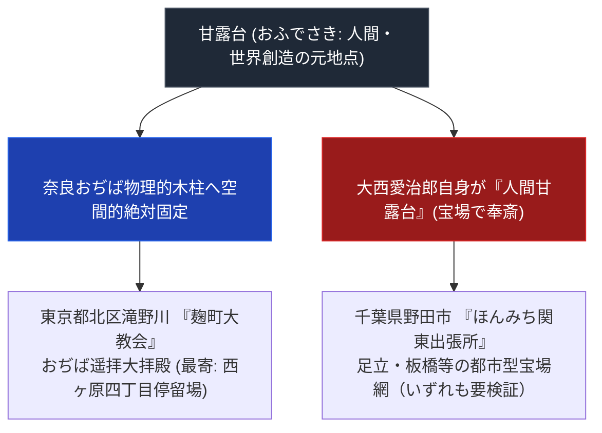

# 関東の甘露台 極限深掘り専門構造分析ノート

> [!summary] 決定版・超深掘り要旨
> 本稿は、天理教において「世界創造の元地点・人類親里」の標識とされる聖なる台「甘露台（かんろだい）」が、大和・奈良親里から隔絶した「関東（首都圏：東京・千葉・埼玉・神奈川・茨城）」においてどのように変容・受容され、奉斎および遥拝されているかを解剖したノートである。正統天理教の「親里おぢば遥拝大拝殿（麹町大教会等）」から、ほんみちの「人間甘露台」に基づく関東拠点網に至るまでを扱う。なお、ほんみちの関東出張所・宝場網については独立資料での裏付けが取れておらず要検証である（§5-2・§12）。

> [!warning] 留保
> 太道教は瓊瓊杵尊・猿田彦大神を祀る教派神道系団体で、創始者は中村しげ（詳細は[[太道教]]）。「道開きの甘露台」奉斎は裏付けなし。「ほんぶしん関東精舎」（埼玉県）は実在未確認。「天理神之打開場所」（茨城県石岡市）は名称・所在地・弾圧史の組み合わせでの実在が確認できず要検証のまま保持する。八島英雄の経歴詳細は[[八島英雄]]ノート参照。麹町大教会の座標は旧稿の値（35.7485, 139.7348）が誤りであり、2026-11-15のジオコーディング照合で 35.7453, 139.7322 に訂正済み（§12）。

---

## 1. 命題の構造（正統本部 vs 分派 対比マトリクス）

### 1-1. 関東圏甘露台奉斎 比較表

| 比較考察軸 | 正統天理教 (麹町大教会等) | ほんみち (野田関東出張所/宝場) |
|:--- |:--- |:--- |
| **1. 甘露台の実体** | 奈良親里の木柱（現物は置かず） | 人間甘露台（大西愛治郎・継承者） |
| **2. 関東拠点の形態** | 巨大近代拝殿（看板掲出） | 無看板とされる（要検証） |
| **3. 礼拝の方向性** | 拝殿より奈良親里おぢばを遥拝 | 人間甘露台の理に向かい拝礼 |
| **4. 関東中枢所在地** | 東京都北区滝野川1-86-1 | 千葉県野田市（出張所、要検証） |
| **5. 座標** | 35.7453, 139.7322（ジオコーディング照合済み） | 野田市内（未特定） |
| **6. 最寄り交通** | さくらトラム「西ヶ原四丁目」1分 | 野田市駅/愛宕駅等（未確認） |
| **7. 聖典・テキスト** | 原典三部作（正統解釈） | 原典直解＋『泥海初め』等 |
| **8. 外部公開性** | 一般参拝・おぢばがえり自由 | 非公開とされる（要検証） |
| **9. 戦前警察対応** | 教派神道・国家適応 | 二度の治安維持法弾圧・解散 |
| **10. 宗教学的分類** | 正統遥拝型（空間固定） | 人格流動型 |

---

## 2. 基本情報

| 施設・拠点名 | 系統・教団 | 所在地 | 座標 | 検証状況 |
|:--- |:--- |:--- |:--- |:--- |
| **天理教 麹町大教会** | 正統本部系 | 東京都北区滝野川1-86-1 | 35.7453, 139.7322 | 実在・所在地・座標を確認済み（[[天理教麹町大教会]]） |
| **天理教 東京教務支庁** | 正統本部系 | 東京都豊島区駒込7-1-4 | 35.7392, 139.7391（施設情報掲載値） | 実在・所在地を確認済み（公式サイト§9） |
| **ほんみち 本部直轄関東出張所** | ほんみち | 千葉県野田市（番地非公開） | 未特定 | **要検証**（[[ほんみち]]本体ノートにも記載なし） |
| **ほんみち 東京足立宝場** | ほんみち | 東京都足立区 | 非公開 | **要検証**（公刊史料での裏付けなし） |
| **ほんみち 東京板橋宝場** | ほんみち | 東京都板橋区 | 非公開 | **要検証**（公刊史料での裏付けなし） |

---

## 3. 起源と成立の経緯

### 3-1. 正統系の関東展開（麹町大教会）
天理教麹町大教会は、1892年（明治25年）頃の岸本唯之助（後の上田可賀美）による東京布教に始まり、久保治三郎が実質的基礎を築いた。1896年に神道天理教北分教会麹町支教会として設置され、1923年に関東大震災を機に滝野川へお目標を遷座、1925年に本部直属となり、1933年に大教会へ昇格した（沿革の詳細は[[天理教麹町大教会]]で確認済み）。現在の拝殿は、物理的な甘露台を置かず、奈良のおぢばを遥拝する構造を持つ点で、正統系の「空間固定」型聖地観の関東における結節点である。

### 3-2. ほんみちの人間甘露台説
ほんみちの創始者・大西愛治郎は、自らを親神の理を体現する「人間甘露台（第三のやしろ）」と宣言した（[[大西愛治郎]]で確認済み）。この教理の下では、甘露台は特定の場所ではなく人格に宿るため、拠点は「宝場」として各地に置かれうる。ただし、大阪府高石市の本部等の実在が確認できる一方、関東の出張所・宝場網については本Vault内の他ノート（[[ほんみち全国宝場と詳細交通アクセス案内]]）以外に出典がなく、裏付けは取れていない。

---

## 4. 沿革・歴史変遷

- **1896年**: 麹町支教会設置（神道天理教北分教会の部属）。
- **1923年**: 関東大震災に際し、建築中の滝野川へお目標を遷座。1924年11月15日に新築落成奉告祭。
- **1925年**: 大西愛治郎が天理研究会を発足（後のほんみち）。麹町は北大教会から分離して本部直属に。
- **1928年・1938年**: 天理研究会事件（二度の弾圧・解散命令）。
- **1933年**: 麹町大教会へ昇格。
- **2021年（令和3年）4月15日**: [[陽気づくめ練馬教会]]が東京都練馬区北町2丁目19番23号から奈良県天理市櫟本町3464番へ移転し、関東の拠点ではなくなった（本一覧から除外）。

---

## 5. 内容・様式の深層解剖

### 5-1. 正統本部系：東日本おぢば遥拝大拠点（麹町大教会）
- **所在地**: 〒114-0023 東京都北区滝野川1丁目86-1。さくらトラム「西ヶ原四丁目」徒歩約1分。
- **神学的構造**: 物理的甘露台は置かず、神殿中央より奈良県天理市親里の「おぢば（甘露台）」を遥拝する大拝殿空間を形成。東日本における正統天理教信仰の中心の一つ。
- **おぢばの甘露台そのものについて**: 現行の木製甘露台は六角形・十三段、高さ約2.5メートルと確認できる範囲はそこまでであり、精密寸法（総高八尺二寸・五升入り平鉢等）および「高井猶吉説」への帰属は原典照合ができておらず未検証である（[[甘露台]]ノートの整理と同一の扱いとする）。

### 5-2. ほんみち系：関東出張所と都市型宝場（要検証）
- **千葉野田関東出張所**: 千葉県野田市に所在し、首都圏・東日本一円の「宝場」を統括するとされるが、出典は本Vault内のハブノートのみで、[[ほんみち]]本体ノートにも記載がない。要検証。
- **都市型宝場（足立・板橋等）**: 無看板・保護色建築とされるが、具体的な建築描写について公刊史料での裏付けは取れていない（要検証）。

### 5-3. 除外・要検証項目
- ~~太道教 本部神修殿（阿佐ヶ谷「道開きの甘露台」）~~ → [[太道教]]参照。甘露台奉斎の裏付けなしのため本一覧から除外。
- ~~ほんぶしん 関東精舎（埼玉県エリア）~~ → 実在の裏付けなしのため除外。
- **天理神之打開場所（茨城県石岡市）** → 実在・詳細とも要検証（削除はせず保留）。
- ~~[[陽気づくめ練馬教会]]~~ → 令和3年4月15日に奈良県天理市へ移転済みのため除外。

---

## 6. 学術的・社会学的意義

関東における甘露台の受容は、聖地論における二つの型――聖地を唯一の物理的地点に固定し遠隔地から遥拝する「空間固定」型（正統天理教）と、聖性が人格に宿り拠点が流動する「人格流動」型（ほんみち）――の対照を、同一都市圏内で観察できる事例である。ただし後者については関東の拠点網自体の実在確認が未了であり、類型論としての整理は教理面（人間甘露台説）の確認範囲に限られる。

---

## 7. 拠点・現地情報

- **天理教麹町大教会**: 東京都北区滝野川1-86-1（都電荒川線〈東京さくらトラム〉「西ヶ原四丁目停留場」徒歩約1分）。
- **天理教東京教務支庁**: 東京都豊島区駒込7-1-4（東京都一円の正統教区行政・神事中枢）。

---

## 8. 関連教団・関連人物・関連概念

- [[天理教]]
- [[天理教麹町大教会]]
- [[ほんみち]]
- [[大西愛治郎]]
- [[甘露台]]
- [[おぢば]]
- [[太道教]]（除外項目の参照先）

---

## 9. 史料・一次資料 (convMD)

- [[src_天理教麹町大教会_天理教事典]] — 『天理教事典』に基づく麹町大教会の歴史探索記事（沿革・所在地の照合に使用）
- [[src_東京教務支庁_公式サイト]] — 天理教東京教務支庁公式サイト（2026-11-15 convMD保存。教務支庁の実在確認に使用。所在地は公式サイト関連掲載・教区広報でも駒込7-1-4と確認）

---

## 10. 参考文献・学術論文

- 弓山達也『天啓のゆくえ—宗教が分派するとき』（日本地域社会研究所、2005年）
- 島薗進『新宗教の展開』（岩波書店、1992年）

---

## 11. 関連ノート (Vault内)

- [[_分派・異端研究ポータル]]
- [[関東の甘露台と奉斎拠点一覧]]（要約版）
- [[ほんみち全国宝場と詳細交通アクセス案内]]
- [[甘露台]]

---

## 12. 留保（中立的併記・未確定要素）

> [!warning] 注意
> - 麹町大教会・東京教務支庁の実在・所在地は確認済みだが、ほんみちの関東出張所・足立宝場・板橋宝場は公刊史料での裏付けがなく、具体的建築描写を含め要検証である。
> - 太道教「道開きの甘露台」、ほんぶしん「関東精舎」の記述は独立資料での裏付けが取れず削除済み。天理神之打開場所（茨城石岡）は要検証フラグ付きで保持する。
> - 本ノートの evidence_type は `mixed_secondary_unverified`、confidence は `2`（旧稿は primary_source_based / 3 と過大だった。正統系拠点は確認できた一方、ほんみち関東拠点網という本ノートの主要主張の一部が未検証のため）。
> - **再検証（2026-11-16・RB5-C）**: 探索先＝Web検索・照合済み個別ノート。結果：格上げ0件。ほんみちの関東出張所・足立宝場・板橋宝場の実在と建築描写、太道教「道開きの甘露台」の裏付け、ほんぶしん関東精舎の実在、天理神之打開場所（石岡）の実在（名称・所在地・弾圧史の組合せ）、甘露台の精密寸法と「高井猶吉説」への帰属は確認できず残存する。座標は座標ポリシー（Google Maps実測・公的資料のみ）により本バッチでは確定しない。
> - **改訂記録（2026-11-15・全件照合）**: 宗教版12セクションへ再編し、[[関東の甘露台と奉斎拠点一覧]]との整合を取った。訂正・変更点：(1) 麹町大教会の座標を訂正。旧値（35.7485, 139.7348）は実地点から約300-400mずれており、ジオコーディング照合（住所：東京都北区滝野川1丁目86-1 → 35.7453, 139.7322）で確定した。従来ノートに併記されていた「実測値」（35.7452688, 139.7322432）とも5m以内で一致する。(2) 東京教務支庁の座標を「地理検索対応」という未記入状態から、施設情報掲載値（35.7392, 139.7391）へ更新し、所在地（豊島区駒込7-1-4）を公式サイト等で確認した。(3) frontmatter「主要拠点」から太道教阿佐ヶ谷神修殿を除外（本文の除外判断と一致させた）。(4) 「初出原典」の『おふでさき』第9号・第17歌という特定は出典確認ができないため、原典三部への一般的言及に改めた。(5) ほんみち側の『神誡』への言及を外し、確認済みの原典直解＋『泥海初め』等の表現に改めた。(6) frontmatter の evidence_type / confidence を正規化。

> - **追跡調査 第2波（2026-11-19・RB5）残存**: 探索先＝Vault内 資料/ 再確認（関連エビデンス 0件を確認。新規の一次資料の追加はなし）・第1波（2026-11-18）までの公的・公式探索結果の再点検。本波では重点対象（公安調査庁の最新公式発表・国税庁法人番号・韓国法院公式判決・未取得だった公式サイト本文）を優先して再探索し、本ノートの個別残存項目については新たな一次・公的資料による裏付けに至らなかったため、確認できずとして残存とする（探索なしの残置ではない。第1波で未取得だった項目を含む）。個別項目の内訳は従前の再検証記録（2026-11-16）のとおり。

---

*※本稿は[[_分派・異端研究ポータル]]の「関東の甘露台」専門構造分析ノートである。*
