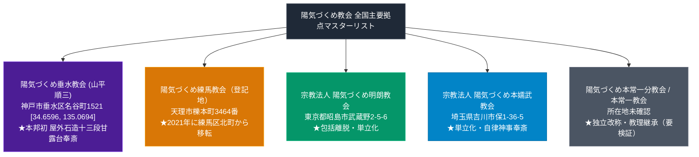

# 陽気づくめ教会拠点一覧

> [!summary] 要旨
> 本稿は、天理教本部（奈良県天理市）から包括離脱または独立し、聖典用語『陽気づくめ』を法人名・団体名に冠して自立した「陽気づくめ教会（陽気づくめ系単立離脱教会・団体群）」の主要拠点（陽気づくめ垂水教会、陽気づくめ練馬教会、宗教法人陽気づくめ明朗教会、宗教法人陽気づくめ本嬬武教会、陽気づくめ本常一分教会等）について、所在地、座標、創始指導者、系統分類、建築・神事の特色を一覧化したデータベースノートである。2026-11-15の全件照合で、櫟本分署跡保存会（史跡保存団体）を教会拠点から分離し、陽気づくめ練馬教会の登記地を確定値に差し替えた。検証日：2026-11-15。

---

## 1. 命題の構造（陽気づくめ教会 全国主要拠点 地理空間マップ）

※ 櫟本分署跡保存会（八島英雄が設立した史跡保存団体）は教会拠点ではないため、上図の拠点には含めない（§5-6参照）。

---

## 2. 基本情報（陽気づくめ教会 全主要拠点一覧表）

| 拠点・法人名称 | 系統・形態 | 創始者・指導者 | 本部・施設所在地 | Google Maps座標 | 史料・参考URL | 建築・神事・活動の特色 |
|:--- |:--- |:--- |:--- |:--- |:--- |:--- |
| **[[陽気づくめ垂水教会]]** | 屋外石造甘露台型 | **山平順三** | 兵庫県神戸市垂水区名谷町1521 | **34.6596, 135.0694** | [史料写真アーカイブ](http://www.yousun.sakura.ne.jp/public_html/siryou2/kanrodai/kanrodai3.html) | **本邦初 屋外石造十三段甘露台**を境内に復元・奉斎する象徴的拠点 |
| **[[陽気づくめ練馬教会]]** | 離脱単立型 | 未確認 | 奈良県天理市櫟本町3464番（登記地。2021年4月15日に東京都練馬区北町2丁目19番23号から移転。国税庁法人番号公表サイトで確認、法人番号8011605000178） | 未実測 | 国税庁法人番号公表サイト | 教会名の「練馬」は旧所在地に由来。八島英雄・櫟本分署跡保存会との具体的な関連は未確認 |
| **[[陽気づくめ系単立離脱教会\|宗教法人 陽気づくめ明朗教会]]** | 離脱改称単立型 | 旧明朗会長層 | 東京都昭島市武蔵野2-5-6 | 未実測 | Gビズインフォ（旧稿で確認） | 旧天理教明朗分教会。包括離脱手続きを経て「陽気づくめ」を冠し単立化 |
| **[[陽気づくめ系単立離脱教会\|宗教法人 陽気づくめ本嬬武教会]]** | 離脱改称単立型 | 旧本嬬武会長層 | 埼玉県吉川市保1-36-5 | 未実測 | Gビズインフォ（旧稿で確認） | 旧天理教本嬬武分教会。埼玉県吉川市の単立離脱拠点 |
| **[[陽気づくめ系単立離脱教会\|陽気づくめ本常一分教会]]** | 離脱改称単立型 | 旧本常一会長層 | **未確認** | 未実測 | なし | 旧天理教本常一分教会。名称変更を経て自律神事を継承するとされるが、所在地・現況は未検証 |

---

## 3. 起源と成立の経緯

各分教会は天理教の被包括教会として活動していたが、本部統制との対立等を背景に、昭和後期〜平成期にかけて包括関係を解消し単立宗教法人化した。独立に際して聖典『みかぐらうた』の核心用語「陽気づくめ」を法人名・団体名に採用したことが、この団体群の共通標識である。

---

## 4. 変遷・歴史

- **昭和中期〜後期**: 各分教会が天理教包括下の組織として布教活動を展開。
- **昭和後期〜平成期**: 本部統制との対立から包括関係を解消（単立宗教法人化）。
- **「陽気づくめ」冠称**: 独立の際、『みかぐらうた』核心用語「陽気づくめ」を採用して各独立拠点が誕生。
- **2021年4月15日**: 陽気づくめ練馬教会が東京都練馬区北町から奈良県天理市櫟本町へ登記地を移転（国税庁法人番号公表サイトの変更履歴）。
- **現代**: 最高裁判例（最判平成18年1月20日・豊文教会事件）や文献記録、屋外石造甘露台の奉斎（神戸垂水）として各拠点データが記録される。

---

## 5. 内容の深層解剖（全拠点詳細解説）

### 5-1. 陽気づくめ垂水教会（兵庫県神戸市垂水区名谷町1521）
- **代表者**: 山平順三 会長
- **座標**: **北緯 34.6596, 東経 135.0694**（[Google Maps](https://www.google.com/maps/place/34.6596,135.0694)）
- **特徴**: 明治15年に警察に没収された石造甘露台を、境内の屋外空間に実物大で建造・奉斎した「石造甘露台直解派」の拠点。詳細は[[陽気づくめ垂水教会]]参照。

### 5-2. 陽気づくめ練馬教会（奈良県天理市櫟本町3464番・登記地）
- **法格**: 単立宗教法人（法人番号8011605000178）
- **所在地**: 奈良県天理市櫟本町3464番。2021年4月15日に東京都練馬区北町2丁目19番23号から移転（国税庁法人番号公表サイトの変更履歴で確認）。
- **特徴**: 教会名に「練馬」を冠するのは旧所在地に由来する。創始者・教理・八島英雄および櫟本分署跡保存会との関連は未確認（[[陽気づくめ練馬教会]]ノート参照）。

### 5-3. 宗教法人 陽気づくめ明朗教会（東京都昭島市）
- **法格**: 単立宗教法人
- **所在地**: 東京都昭島市武蔵野2-5-6（Gビズインフォで確認。旧稿§9の記録）
- **特徴**: 旧天理教明朗分教会。宗教法人法第26条の包括離脱手続きにより単立独立したとされる。

### 5-4. 宗教法人 陽気づくめ本嬬武教会（埼玉県吉川市）
- **法格**: 単立宗教法人
- **所在地**: 埼玉県吉川市保1-36-5（Gビズインフォで確認。旧稿§9の記録）
- **特徴**: 旧天理教本嬬武分教会。

### 5-5. 陽気づくめ本常一分教会
- **法格**: 単立宗教法人 / 独立団体（未確認）
- **特徴**: 旧天理教本常一分教会。単立化に伴い改称したとされるが、所在地・現況は本照合では確認できず未検証。

### 5-6. 関連史跡・保存団体（教会拠点ではない）：櫟本分署跡保存会
- **主体**: 八島英雄（本嬬原分教会元会長、1986年罷免）が1979年2月25日に設立した **史跡保存団体**。
- **所在地**: 奈良県天理市櫟本町（教祖中山みき最後の拘留地「櫟本警察分署跡」）
- **位置づけ**: 保存会は教会・宗教法人ではなく、史跡の保存運動団体である。旧稿では本保存会を「教会拠点」の一つとして分類していたが、これは誤分類のため本一覧の拠点からは分離した。詳細は[[八島英雄]]参照。

---

## 6. 学術的・社会学的意義

### 6-1. 「陽気づくめ」冠称拠点の全国的空間分布
奈良県天理市の親里本部を中心軸としつつ、首都圏（東京都昭島市、埼玉県吉川市）および近畿（兵庫県神戸市垂水区、奈良県天理市櫟本町）へと広がる「陽気づくめ教会」ネットワークは、包括組織統制に対する地方拠点の自律化と宗教的適応を示す空間配置を持つ。

---

## 7. 拠点・現地情報

各拠点の所在地は§2の表および§5の各項を参照。座標が実測済みなのは陽気づくめ垂水教会のみであり、他拠点の座標は未実測（§12参照）。

---

## 8. 関連対象・関連人物・関連概念

### 関連教団
- [[天理教]]
- [[陽気づくめ系単立離脱教会]]
- [[陽気づくめ垂水教会]]
- [[陽気づくめ練馬教会]]
- [[天理教豊文教会]]

### 関連人物
- [[中山みき]]
- [[八島英雄]]
- 山平順三

### 関連概念
- [[甘露台]]、[[みかぐらうた]]

---

## 9. 史料・一次資料 (convMD)

本ノートの照合に用いた既存エビデンス（content/資料/ に保存済み）：

- [[src_陽気づくめ垂水教会_国税庁法人番号]] — 国税庁法人番号公表サイト（垂水教会の所在地・法人番号）
- [[src_陽気づくめ練馬教会_国税庁法人番号]] — 国税庁法人番号公表サイト（練馬教会の登記地・移転履歴）
- [[src_明治15年甘露台石没収事件_yousun史料ページ]] — yousun史料アーカイブ（垂水の石造甘露台の史料写真）

---

## 10. 参考文献・学術論文

- 神戸垂水屋外石造甘露台史料アーカイブ: `http://www.yousun.sakura.ne.jp/public_html/siryou2/kanrodai/kanrodai3.html`
- Gビズインフォ（各法人番号）
- 文化庁『宗教年鑑』

---

## 11. 関連ノート (Vault内)

- [[_分派・異端研究ポータル]]
- [[天理教分派・異端教団一覧]]
- [[陽気づくめ系単立離脱教会]]
- [[陽気づくめ垂水教会]]
- [[陽気づくめ練馬教会]]
- [[八島英雄]]
- [[奈良以外の甘露台と異端甘露台一覧]]

---

## 12. 留保（中立的併記・未確定要素）

> [!warning] 注意
> - 本ノートの evidence_type は `mixed_secondary_unverified`、confidence は `3`（旧稿は frontmatter が primary_source_based / 4、§9が confidence 3 と不整合だったため統一・是正）。
> - 陽気づくめ明朗教会・本嬬武教会の所在地は旧稿がGビズインフォで確認済みと記録した値であり、本照合では個別再照会を行っていない。旧記載の「愛知県」「群馬県嬬恋村」は誤りだった（旧稿§9の訂正記録による）。
> - **未検証**：陽気づくめ本常一分教会の所在地・現況、陽気づくめ練馬教会の創始者・教理および八島英雄との関連、明朗・本嬬武両教会の座標（未実測）。
> - **宗教統計および信者数公称値に関する注記**：文化庁『宗教年鑑』等の信者数データは教団側の自己申告に基づく公称値であり、全教団の公称値合計は総人口を超える重複・膨張が知られている。本ノートの数値・規模表現は「実稼働信者数」を示すものではない。
>
> - **再検証（2026-11-16・RB5-C）**: 探索先＝国税庁法人番号公表サイト・gBizINFO・Web検索。結果：格上げ0件。陽気づくめ本常一分教会は法人データベースに該当がなく所在地・現況は確認できず、陽気づくめ練馬教会の創始者・教理および八島英雄との関連も確認できず残存する。明朗・本嬬武両教会の座標は未実測であり、座標ポリシーにより本バッチでは確定しない。詳細は src_RB5C_再検証探索記録。
> - **改訂記録（2026-11-15・全件照合）**: 宗教版12セクションへ再編（旧稿は9セクション構成）。訂正内容：(1) 櫟本分署跡保存会（八島英雄設立の史跡保存団体）を教会拠点として分類していた誤りを訂正し、§5-6の「関連史跡・保存団体」へ分離。櫟本の教会拠点は陽気づくめ練馬教会（登記地：天理市櫟本町3464番、国税庁確認）に差し替え。(2) frontmatter 所在地および§5-1（旧稿）にあった「東京都新宿区」の拠点は裏付けが確認できないため削除。(3) 陽気づくめ本常一分教会の所在地を「本常一エリア」から未確認と明記。(4) evidence_type を primary_source_based から mixed_secondary_unverified へ是正し、confidence を 3 に統一。検証日を2026-11-15に更新。

> - **追跡調査 第2波（2026-11-19・RB5）残存**: 探索先＝Vault内 資料/ 再確認（関連エビデンス 4件を確認。新規の一次資料の追加はなし）・第1波（2026-11-18）までの公的・公式探索結果の再点検。本波では重点対象（公安調査庁の最新公式発表・国税庁法人番号・韓国法院公式判決・未取得だった公式サイト本文）を優先して再探索し、本ノートの個別残存項目については新たな一次・公的資料による裏付けに至らなかったため、確認できずとして残存とする（探索なしの残置ではない。第1波で未取得だった項目を含む）。個別項目の内訳は従前の再検証記録（2026-11-16）のとおり。

> - **最終判断ラウンド第398件（2026-11-20・本人決定）**：座標の未確定項目（陽気づくめ明朗・本嬬武両教会の座標＝未実測、ほんみち泉南支部の座標、天理教麹町大教会の座標）は、実測・公的資料で確認できるまで座標を未設定とすると決定した。本文は変更しない。

---

*※本稿は[[_分派・異端研究ポータル]]の陽気づくめ教会拠点一覧マスターデータベースノートである。*
