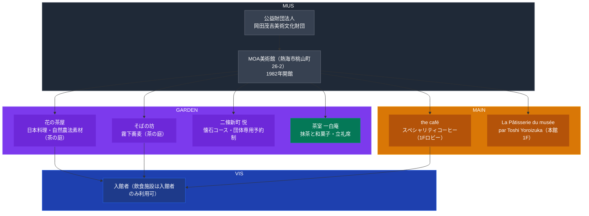

# MOA美術館の館内飲食（花の茶屋・そばの坊）

> [!summary] 要旨
> **MOA美術館**（静岡県熱海市桃山町26-2）は、世界救世教の開祖・岡田茂吉（1882-1955）が創設したコレクションを基盤とし、公益財団法人岡田茂吉美術文化財団が運営する美術館である（1982年1月11日開館、前身の熱海美術館は1957年1月1日開館）。館内には公式サイト「お食事・カフェ」で6施設が案内される（2026-11-24確認）。中心は、地産地消とオーガニック・自然農法素材による日本料理を掲げる「花の茶屋」と、「本物」を志向し戸隠・黒姫・八ヶ岳産の霧下蕎麦を用いる「そばの坊」であり、ほかに「the café」「La Pâtisserie du musée par Toshi Yoroizuka」「二條新町 悦」「茶室 一白庵」がある。各施設の営業形態（美術館の直営か外部事業者への委託か）は公式サイトに明記されておらず、未確認として分離する（§12）。

---

## 1. 命題の構造（一般の美術館飲食 vs 自然農法を掲げる館内飲食）

| 比較軸 | 一般の美術館併設レストラン（外部視点 / etic） | MOA美術館の館内飲食（施設側の提示 / emic） |
|:--- |:--- |:--- |
| **存在意義** | 来館者の休憩・食事のための付帯施設 | 美術鑑賞と一体の「食」の提示。創立者・岡田茂吉の美の構想と自然農法の系譜に連なる |
| **食材** | 地産地消・旬の食材を謳うことが多い | 花の茶屋は地産地消とオーガニック・自然農法素材を明示（公式サイト）。米・野菜・魚、出汁と調味料へのこだわりを掲げる |
| **利用条件** | 入館者以外も利用できる施設もある | 花の茶屋・そばの坊・the caféはいずれも「入館いただいた方のみご利用いただけます」と公式サイトに明記 |
| **母体との関係** | 美術館運営法人の直営または外部委託 | 運営母体は岡田茂吉美術文化財団。個別施設の直営・委託の別は公式サイトに記載なし（未確認、§12） |

---

## 2. 基本情報

| 項目 | 内容 |
|:--- |:--- |
| **施設名** | MOA美術館（MOA Museum of Art）館内飲食施設群 |
| **運営母体** | 公益財団法人岡田茂吉美術文化財団（美術館の運営。Wikipedia「MOA美術館」） |
| **所在地** | 〒413-8511 静岡県熱海市桃山町26-2（美術館公式サイトの所在地表記。そばの坊公式サイトは〒413-0232と表記） |
| **美術館開館** | 1982年1月11日（岡田茂吉生誕100周年）。前身の熱海美術館は1957年1月1日開館 |
| **館内飲食施設** | La Pâtisserie du musée par Toshi Yoroizuka／花の茶屋／そばの坊／二條新町 悦／the café／茶室 一白庵（公式サイト「お食事・カフェ」、2026-11-24確認） |
| **花の茶屋** | 日本料理。地産地消とオーガニック・自然農法素材。茶の庭所在、座席数20、営業時間11:00〜15:30（L.O.15:00）、休日は水曜日・木曜日・展示替日（公式サイト） |
| **そばの坊** | そば。戸隠・黒姫・八ヶ岳で栽培された霧下蕎麦を使用。茶の庭所在、座席数36、営業時間11:00〜15:30（L.O.15:00）、休日は木曜日・展示替日（公式サイト）。問い合わせ先として電話番号0557-84-2777と店舗独自サイト（sobanobou.com）が案内される |
| **the café** | カフェ。独自焙煎のスペシャリティコーヒー、相模灘を一望。1Fロビー所在、座席数約70、営業時間9:30〜16:30（L.O.16:00）、休日は木曜日・展示替日（公式サイト） |

---

## 3. 起源と成立の経緯

### (1) 美術館の成立
Wikipedia「MOA美術館」によれば、創立者・岡田茂吉は「美術品は決して独占すべきものではなく、一人でも多くの人に見せ、娯しませ、人間の品性を向上させる事こそ、文化の発展に大いに寄与する」との信念のもと、戦後に東洋美術の優品を蒐集して海外流出を防ぎ、1952年6月15日に箱根美術館を開館、同年9月15日に財団法人東明美術保存会（現在の公益財団法人岡田茂吉美術文化財団）を設立した。その後、熱海にも美術館を建設したいという岡田の願いが継承され、1957年1月1日に熱海美術館が開館し、岡田の生誕100周年にあたる1982年1月11日にMOA美術館が開館した。館名は「Mokichi Okada Association」の頭文字による。

### (2) 館内飲食の位置づけ
館内飲食施設個別の開設時期は、本照合では公式サイト・Wikipediaのいずれでも確認できていない（§12）。現行の施設構成は公式サイト「お食事・カフェ」で確認できる6施設であり、花の茶屋が自然農法素材を明示する点で、岡田茂吉が提唱した[[自然農法（岡田茂吉）|自然農法]]の系譜と館内飲食が結びつく形になっている。

### (3) 改修と現行施設
MOA美術館は、現代美術作家・杉本博司と建築家・榊田倫之が主宰する「新素材研究所」の監修による改修を経て、2017年2月5日に新装開館した（Wikipedia「MOA美術館」）。

---

## 4. 変遷・歴史

- 1952年6月15日: 箱根美術館開館。同年9月15日に財団法人東明美術保存会（現・公益財団法人岡田茂吉美術文化財団）設立。
- 1955年2月10日: 岡田茂吉逝去。
- 1957年1月1日: 熱海美術館開館（MOA美術館の前身）。
- 1982年1月11日: MOA美術館開館。
- 2017年2月5日: 新素材研究所の監修による改修を経て新装開館。
- 2026-11-24時点: 公式サイト「お食事・カフェ」に6施設を掲載。花の茶屋の個別ページには、イベント開催に伴う臨時休業の告知（11月10日〜11月19日）が掲載されていた。

> [!warning] 時点情報の留保
> 営業時間・休日・メニュー価格は公式サイトの2026-11-24時点の記載であり、展示替日・イベントにより変動する。花の茶屋の営業時間については、公式サイトの「よくあるご質問」ページと個別ページで表記が一致する（11:00〜15:30、L.O.15:00）が、そばの坊については個別ページが11:00〜15:30（L.O.15:00）、店舗独自サイトが11:00〜15:00としており、表記に差異がある（§12）。

---

## 5. 内容・様式の深層解剖

### 5-1. 施設構成

### 5-2. 花の茶屋
公式サイトによれば、「地産地消とオーガニック・自然農法素材により日本料理を提供」し、「お米、野菜、魚など、吟味された食材、出汁とこだわりの原材料を使用して作られた調味料」による和食を、茶の庭の風情とともに提供する。メニューには黒毛和牛すき重（2,400円）、料理長こだわりハンバーグ（2,500円〜）、静岡名産しらす2色丼（2,000円）、親子丼（1,900円）等が掲載される（2026-11-24時点、税込）。自然農法素材の具体的な調達先・使用比率は公式サイトに記載されていない（§12）。

### 5-3. そばの坊
公式サイトによれば、「お腹を満たすだけの食ではなく、五感で感じることの出来る」食として「本物」を志向し、戸隠・黒姫・八ヶ岳で栽培された霧下蕎麦を使用する。メニューにはそば三昧（1,820円）、あい盛りそば（1,380円）等が掲載される（2026-11-24時点、税込）。店舗独自のウェブサイト（sobanobou.com）を別途持ち、店舗名を「二條新町 そばの坊」と表記するページもある。

### 5-4. the café とその他の施設
the caféは、展示スペースから続くブリッジを抜けた眺めのよい空間から相模灘を一望でき、独自に焙煎したスペシャリティコーヒーを提供する（公式サイト）。メニューにはスペシャリティ・コーヒー（500円）、カフェラテ（550円）、なみうらソフト（650円）等が掲載される（2026-11-24時点、税込）。このほか、本館1Fにパティシエ鎧塚俊彦プロデュースのスイーツ店「La Pâtisserie du musée par Toshi Yoroizuka」、団体・グループ専用で懐石コース限定の「二條新町 悦」（予約制）、立礼席で抹茶と和菓子を提供する「茶室 一白庵」がある。

---

## 6. 学術的・社会学的意義
宗教運動の開祖が掲げた美の構想と自然農法の思想が、公益財団法人が運営する公共的文化施設の館内飲食として提示される事例である。花の茶屋が「自然農法素材」を公式に標榜する点は、教団系の食実践が美術館という世俗的・文化的な回路を通じて一般来館者に届く形態を示す。同様の構造は、神慈秀明会系の[[MIHO MUSEUM レストラン「ピーチ」（秀明自然農法）]]（秀明自然農法の食材を用いる美術館併設レストラン）にも見られ、岡田茂吉の系譜を引く両施設の比較対象となる。

---

## 7. 拠点・現地情報
- **所在地**: 静岡県熱海市桃山町26-2（MOA美術館）。美術館公式サイトの所在地表記は〒413-8511、電話番号は0557-84-2511（代表）
- **美術館開館時間**: 9:30〜16:30（最終入館16:00まで。公式サイト）
- **花の茶屋**: 茶の庭所在。11:00〜15:30（L.O.15:00）、休日は水曜日・木曜日・展示替日。座席数20。予約は受け付けておらず、来店順の案内（公式サイト個別ページ）
- **そばの坊**: 茶の庭所在。座席数36。問い合わせ0557-84-2777。予約は応相談（公式サイト個別ページ）。利用には美術館入館料が必要（店舗独自サイト）
- **the café**: 1Fロビー所在。9:30〜16:30（L.O.16:00）、休日は木曜日・展示替日。座席数約70。予約不可（公式サイト個別ページ）
- **利用条件**: 各施設とも入館者のみ利用可（公式サイト個別ページ）

---

## 8. 関連対象・関連人物・関連概念
- 岡田茂吉（創立者。世界救世教開祖）
- 公益財団法人岡田茂吉美術文化財団（運営母体）
- [[自然農法（岡田茂吉）]]（花の茶屋が標榜する自然農法素材の源流）
- 鎧塚俊彦（La Pâtisserie du musée par Toshi Yoroizukaのプロデュース）
- 箱根美術館（姉妹館。同じ財団が運営）
- 瑞雲郷（MOA美術館が所在する世界救世教の聖地）

---

## 9. 史料・一次資料（convMD）
- src_MOA美術館_公式レストラン — MOA美術館公式サイト「お食事・カフェ」。館内6施設の構成を確認（2026-11-24取得）
- src_MOA美術館_公式花の茶屋 — MOA美術館公式サイト「花の茶屋」。自然農法素材の標榜、メニュー、営業時間・座席数を確認（2026-11-24取得）
- src_MOA美術館_公式そばの坊 — MOA美術館公式サイト「そばの坊」。霧下蕎麦の使用、メニュー、営業時間・座席数・問い合わせ先を確認（2026-11-24取得）
- src_MOA美術館_公式カフェ — MOA美術館公式サイト「the café」。スペシャリティコーヒー、メニュー、営業時間・座席数を確認（2026-11-24取得）
- [[src_MOA美術館_Wikipedia]] — Wikipedia「MOA美術館」。開館の経緯、運営母体、2017年の新装開館を確認（既存保存分）

---

## 10. 参考文献・学術論文
- Wikipedia「MOA美術館」
- MOA美術館公式サイト「お食事・カフェ」および各施設個別ページ（2026-11-24確認）
- そばの坊公式サイト（sobanobou.com、店舗情報の表記差異の確認に使用）

---

## 11. 関連ノート (Vault内)
- [[MOA美術館と岡田茂吉ゆかりの美術館群]]（美術館群の横断ノート。館内飲食施設6施設の先行記録を含む）
- [[MOAインターナショナル]]（MOAグループの関連団体ノート）
- [[MIHO MUSEUM レストラン「ピーチ」（秀明自然農法）]]（秀明自然農法の美術館レストランとの比較）
- [[自然農法（岡田茂吉）]]
- [[_分派・異端研究ポータル]]

---

## 12. 留保（中立的併記・未確定要素）

> [!warning] 留保事項
> - **営業形態は未確認**: 各飲食施設が岡田茂吉美術文化財団の直営であるか、外部事業者への運営委託であるかは、MOA美術館公式サイトの「お食事・カフェ」および各施設個別ページのいずれにも明記されていない（2026-11-24確認）。そばの坊が店舗独自のウェブサイト（sobanobou.com）と専用の問い合わせ電話番号を持つことは確認できるが、それをもって委託・独立運営と断定はできないため、営業形態は未確認として分離する。
> - **未検証として分離した主張**: (1) 館内飲食施設個別の開設時期は公式サイト・Wikipediaで確認できていない。(2) 花の茶屋における自然農法素材の調達先・使用比率・認証の有無は公式サイトに記載がなく確認できていない。(3) 「二條新町 悦」と「そばの坊」の名称関係（店舗独自サイトの「二條新町 そばの坊」表記との整合）は公式サイト上で説明されておらず未確認。
> - **表記の差異**: (1) そばの坊の営業時間は、美術館公式サイト個別ページが11:00〜15:30（L.O.15:00）、店舗独自サイトが11:00〜15:00としており一致しない。(2) 所在地の郵便番号は、美術館公式サイトが〒413-8511、そばの坊公式サイトが〒413-0232と表記する。いずれも出典どおり併記し、単一の確定値として扱わない。
> - **時点情報**: メニュー・価格・営業時間・臨時休業の告知は2026-11-24時点の公式サイト記載であり、変動しうる。
> - 本ノートの evidence_type は `secondary_source_based`、confidence は `4`（施設構成・メニュー・営業時間は美術館公式サイトで直接確認したが、営業形態と開設時期は未確認のため）。
