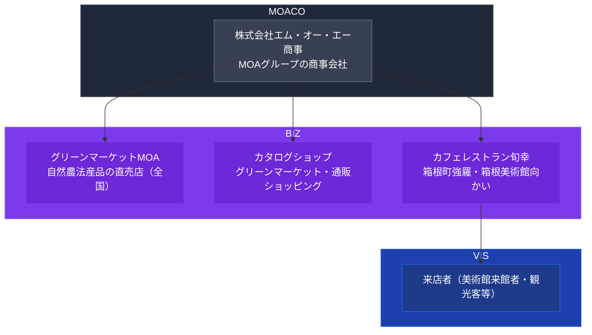

# カフェレストラン旬幸（箱根・MOA商事）

> [!summary] 要旨
> **カフェレストラン旬幸**（シュンサイ）は、神奈川県箱根町強羅の箱根美術館向かいに所在するカフェレストランで、株式会社エム・オー・エー商事が運営する。農林水産省の「国産有機サポーターズ」登録ページ（株式会社エム・オー・エー商事の登録情報）に、同社のレストランとして「カフェレストラン旬幸（シュンサイ）（神奈川県箱根町）」と明記され、「オーガニックレストラン認証取得」と記載される（2026-11-27取得時点）。店舗公式サイトでは、カレー（800円）、カツカレー（1,200円）、カツサンド（1,400円）等のメニューと、有機ビール・有機純米酒等の飲料が掲載される（2026-11-27確認）。併設のセレクトショップがあるとされる（§12）。

---

## 1. 命題の構造（観光地レストラン vs MOAグループの直営レストラン）

| 比較軸 | 一般の観光地レストラン（外部視点 / etic） | カフェレストラン旬幸（施設側の提示 / emic） |
|:--- |:--- |:--- |
| **運営主体** | 個人・一般法人の経営が多い | MOAグループの商事会社（株式会社エム・オー・エー商事）の直営レストラン |
| **食材の位置づけ** | 地産地消・観光客向けメニューが中心 | 農水省の有機サポーターズ登録上「オーガニックレストラン認証取得」と位置づけられる |
| **立地** | 観光地の商業立地 | 箱根美術館（岡田茂吉創立）の向かいという、教団系文化施設と隣接する立地 |

---

## 2. 基本情報

| 項目 | 内容 |
|:--- |:--- |
| **施設名** | カフェレストラン旬幸（読みは農水省登録ページで「シュンサイ」） |
| **所在地** | 神奈川県足柄下郡箱根町強羅1300-466（箱根美術館向かい） |
| **運営主体** | 株式会社エム・オー・エー商事（農林水産省「国産有機サポーターズ」登録ページに同社のレストランとして明記） |
| **メニュー例** | カレー800円、カツカレー1,200円、カツサンド1,400円、御飯350円、気まぐれデザート550円、アイスクリーム550円（店舗公式サイト、2026-11-27確認） |
| **飲料例** | 有機純米酒850円、有機ビール650円、箱根七湯ビール850円、プレミアムモルツ中瓶650円（店舗公式サイト） |
| **認証** | 農水省登録ページに「オーガニックレストラン認証取得」と記載（2026-11-27取得時点） |

---

## 3. 起源と成立の経緯

旬幸個別の開店時期は、店舗公式サイト・農水省登録ページのいずれでも確認できない（§12）。運営主体の株式会社エム・オー・エー商事は、MOAグループの商事会社で、自然農法産品の直売店「グリーンマーケットMOA」の全国展開、カタログショップ等を手がける（農水省登録ページ）。旬幸は同社の事業のうち「レストラン」に位置づけられる。立地は、岡田茂吉が1952年に開館した箱根美術館の向かいである。

---

## 4. 変遷・歴史

- 2026-11-27時点: 店舗公式サイトが現存し、メニューが掲載されている。2026年5月の訪問口コミがあることが2026-11-27の網羅性調査で確認されており、現行営業中である。

> [!warning] 時点情報の留保
> メニュー・価格は店舗公式サイトの2026-11-27時点の取得内容であり、変動しうる。公式サイトの取得は部分的にとどまり、営業時間・定休日は取得範囲では確認できていない（§12）。

---

## 5. 内容・様式の深層解剖

### 5-1. MOA商事の事業内での位置づけ

### 5-2. メニュー構成
店舗公式サイトに掲載されるメニューは、カレー、カツカレー、カツサンド等の洋食系の食事メニューを中心に、デザート（気まぐれデザート、アイスクリーム）、酒類（有機純米酒、有機ビール、箱根七湯ビール等）、おつまみで構成される。各ライス大盛・カレールー大盛は各300円とされる。

### 5-3. オーガニックレストラン認証
農林水産省「国産有機サポーターズ」の株式会社エム・オー・エー商事の登録ページは、旬幸について「（オーガニックレストラン認証取得）」と付記する（2026-11-27取得）。同ページでは、同社のその他飲食店（北海道・愛知県・鹿児島県）については「オーガニックレストラン認証は取得していません」と区別されている。

---

## 6. 学術的・社会学的意義
MOAグループの商事会社が、教団系美術館の向かいという立地で一般向けレストランを直営し、有機レストランとしての公的登録を受ける形態は、[[椨の木（東京療院・自然農法カフェ）]]（医療施設内の飲食）やグリーンマーケットMOA（物販）と並ぶ、MOA系の食事業の展開形態の一つである。美術館の館内飲食（[[箱根美術館の館内飲食（THE CAFÉ & BAKERY・真和亭）]]）とは運営主体・利用条件が異なる点で対照をなす。

---

## 7. 拠点・現地情報
- **所在地**: 神奈川県足柄下郡箱根町強羅1300-466（箱根美術館向かい）
- **営業時間・定休日**: 店舗公式サイトの取得範囲では確認できていない（§12）

---

## 8. 関連対象・関連人物・関連概念
- 株式会社エム・オー・エー商事（運営主体。グリーンマーケットMOAの運営会社でもある）
- 箱根美術館（向かいに所在する岡田茂吉創立の美術館）
- [[MOAインターナショナル]]（MOAグループの関連団体）
- [[自然農法（岡田茂吉）]]（MOA系食事業の源流）

---

## 9. 史料・一次資料（convMD）
- src_旬幸_公式サイト — カフェレストラン旬幸の店舗公式サイト。メニュー・価格を確認（2026-11-27取得。取得は部分的にとどまる）
- src_MOA商事_農水省オーガニックサポーターズ — 農林水産省「国産有機サポーターズ」の株式会社エム・オー・エー商事登録ページ。旬幸が同社のレストランであることと「オーガニックレストラン認証取得」の記載を確認（2026-11-27取得）

---

## 10. 参考文献・学術論文
- 農林水産省「国産有機サポーターズ」株式会社エム・オー・エー商事登録ページ（2026-11-27確認）
- カフェレストラン旬幸公式サイト（2026-11-27確認）

---

## 11. 関連ノート (Vault内)
- [[箱根美術館の館内飲食（THE CAFÉ & BAKERY・真和亭）]]（箱根美術館の館内飲食）
- [[岡田茂吉系の飲食店・ホテル・病院一覧]]（岡田茂吉系施設の総覧）
- [[椨の木（東京療院・自然農法カフェ）]]（MOA系飲食施設）
- [[MOAインターナショナル]]
- [[_分派・異端研究ポータル]]

---

## 12. 留保（中立的併記・未確定要素）

> [!warning] 留保事項
> - **開店時期は未確認**: 旬幸個別の開店年は公式資料で確認できていない。
> - **営業時間・定休日・席数は未確認**: 店舗公式サイトのconvMD取得が部分的にとどまり、営業時間等の店舗情報欄を取得できていない。
> - **併設セレクトショップ**: 併設のセレクトショップがあることは2026-11-27の網羅性調査で挙げられたが、取得済みの公式資料の範囲では内容を確認できていない。
> - **認証の時点情報**: 農水省登録ページの「オーガニックレストラン認証取得」は2026-11-27取得時点の記載である。なお、同調査ではオーガニックレストランJAS認証が2025年10月22日付で廃止されたとする情報もあったが、これは認証制度側の変更を指すものとみられ、店舗の営業継続とは別である。認証の現行の種別・有効性は未確認として分離する。
> - **時点情報**: メニュー・価格は2026-11-27時点の公式サイト記載であり、変動しうる。
> - 本ノートの evidence_type は `primary_source_based`、confidence は `3`（運営主体と所在地は農水省の公的登録で確認したが、開店時期・営業時間等は未確認のため）。
