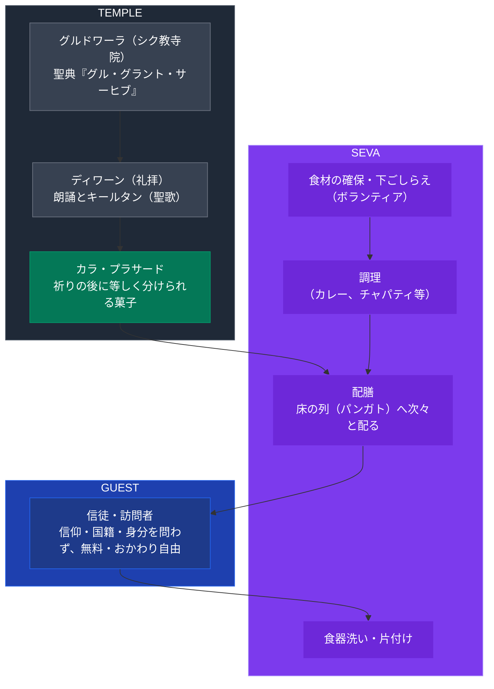

# シク教寺院のランガル（共同食堂）

> [!summary] 要旨
> **ランガル**は、シク教寺院（グルドワーラ）が礼拝後に無料の食事を信徒・訪問者を問わず提供する宗教実践であり、パンジャブ語で「無料で食事を提供する」意味を持つと説明される。性別・民族・国籍・社会的身分に関係なく、誰でも床に座って食事ができ、無料でおかわりも自由であり、メニューはすべてベジタリアンである（解説サイト「シク教をシル」）。食事はボランティアによる奉仕（セヴァー）で成り立つ。日本国内のグルドワーラは東京（グル・ナーナク・ダルバール東京、文京区大塚3-5-4）・神戸・茨城県境町の3か所とされる。東京の礼拝（ディワーン）は月1回程度と資料により頻度の記載が異なり、ランガルの実施頻度（毎週か等）は公式案内で確認できていないため未確認として分離する（§12）。

---

## 1. 命題の構造（無料食堂としての外形 vs 平等と奉仕の宗教実践）

| 比較軸 | 外部視点（etic） | 内部視点（emic／シク教側の位置づけ） |
|:--- |:--- |:--- |
| **存在意義** | 無料で食事が提供される共同食堂・炊き出し | 身分の上下なく同じ列（パンガト）に床に座って食べることによる平等の実践 |
| **食事の性格** | ベジタリアンのカレー・チャパティ等の食事 | 礼拝（ディワーン）とカラ・プラサードに続く、祈りと分かち合いの一連の流れの一部 |
| **担い手** | 寺院のスタッフによる給食 | 食材の確保・調理・配膳・食器洗いの各役割を担うボランティアの奉仕（セヴァー）。シク教徒以外も参加できる |
| **利用条件** | 誰でも無料 | 信仰・国籍・身分を問わず歓迎されるが、グルドワーラは礼拝の場であり、無料の食事だけを目的とする場所ではない（訪問レポートの注意書き） |

---

## 2. 基本情報

| 項目 | 内容 |
|:--- |:--- |
| **名称** | ランガル（共同食堂・無料食堂） |
| **意味** | パンジャブ語で「無料で食事を提供する」意味（「シク教をシル」）。日本語の「炊き出し」に近いと同サイトは説明する |
| **実施主体** | シク教寺院（グルドワーラ）。調理・配膳等はボランティアが担う |
| **対象** | 性別・民族・国籍・社会的身分・肌の色等に関係なく、どなたでも |
| **費用** | 無料。おかわりも自由 |
| **メニュー** | すべてベジタリアン。日によって変わり、カレーの組み合わせやスイーツ等が季節や行事に合わせて決められる。チャパティは欠かせないとされる |
| **座席形式** | 床に敷かれたシートの上に座る列（パンガト） |
| **国内の拠点** | 東京・神戸・茨城県境町の3か所のグルドワーラ（「シク教をシル」） |

---

## 3. 起源と成立の経緯

### (1) 始まりのエピソード
解説サイト「シク教をシル」によれば、ランガルの始まりは、初代グル・グル・ナーナクが父親から商売を始めるための資金を渡され、別の町へ移動する途中でヒンドゥー教僧侶（サードゥー）にその資金で料理を振る舞ったこととされる。

### (2) 慣習としての本格的採用
食事を誰にでも無料で振る舞う仕組みが慣習として本格的に採用されたのは、3代目グル・グル・アマル・ダースの時代とされる。同サイトは、ムガル帝国のアクバル皇帝がグル・アマル・ダースに会いに来た際、まずパンガト（人々と共に床に座る列）で一般の人々と共に食事をとってから会うよう求められ、そのとおりにしたという逸話を伝える。地位の高低に関係なく同じ列で食事をとる点に、平等のメッセージが込められていると説明される。

### (3) 日本への定着
日本のシク教共同体は1920年代初頭から日本に居住するパンジャーブ系インド人を中心とする共同体であり、神戸に1952年にグルドワーラが設けられ、東京には1999年にグル・ナーナク・ダルバールが開設された（[[日本シク教共同体]]）。ランガルは各グルドワーラの礼拝に伴う実践として日本でも行われている。

---

## 4. 変遷・歴史

- 15世紀末〜16世紀: グル・ナーナクのエピソードに始まり、3代目グル・グル・アマル・ダースの時代に慣習として本格化したとされる。慣習は500年以上続くと説明される（「シク教をシル」）。
- 1952年: 神戸にグルドワーラが設立される（1966年に現在の形に整備）。
- 1999年: 東京グル・ナーナク・ダルバールが、カールサー（共同体）生誕300年を記念して開設される。
- 2026年7月12日: 東京・茗荷谷のグルドワーラへの訪問レポートが、ディワーンとカラ・プラサードの後にチャパティとカレーが配られるランガルの実施を記録している（参加者16人、12:00〜14:30）。

> [!warning] 時点情報の留保
> 東京の寺院の公式サイト（nanakdarbartokyo.com）は既存調査時点で取得できず、2026-11-24に日本語版とされる ja.nanakdarbartokyo.com へ再取得を試みたが HTTP 404 で取得できなかった（§9・§12）。このため、現行の礼拝日程・ランガルの実施頻度は公式案内では確認できていない。

---

## 5. 内容・様式の深層解剖

### 5-1. ランガルの運営構造

### 5-2. 役割分担
「シク教をシル」によれば、ランガルの役割分担は大きく4つ（食材の確保・食材を切る、調理、料理を振る舞う、食器洗い・片付け）あり、大半はボランティアが担う。シク教徒以外の人も、材料を切る、食事を配る、食器を洗う等のボランティアに参加できる。大きな寺院ではチャパティの自動製造機が使われる場合もあるとされる。

### 5-3. 1日の流れ（日本の寺院の例）
同サイトが日本のシク教寺院を参考として示す1日のスケジュールでは、7:30〜9:30に掃除・準備とランガルの料理作り、10:30〜12:00にお祈り、12:00〜13:30に讃歌（キールタン）、13:30〜14:00に最後の祈り（アルダース）とカラー・パルシャードの授与、14:00〜16:00がランガルの時間（参拝者全員に無料・おかわり自由で食事が振る舞われる）、16:00に片付け・解散とされる。これは日本の寺院一般を参考にした例示であり、特定の寺院の現行日程ではない（§12）。

### 5-4. 東京での実施の記録
2026年7月12日の訪問レポートによれば、東京・茗荷谷のグルドワーラでは、12:45からのディワーン参加、13:30のカラ・プラサードの後にランガルが行われ、床に同じ高さで並んで座り、金属の皿にチャパティとカレーが次々と配られ、おかわりが勧められた。費用・寄付箱の記載は同レポートにはない。

---

## 6. 学術的・社会学的意義
ランガルは、カースト等の身分秩序に対して「同じ列に座り同じ食事をとる」ことをもって平等を身体的に実践する仕組みであり、奉仕（セヴァー）と分かち合いを中核とするシク教の社会実践として位置づけられる。日本においては、在日インド人コミュニティの宗教施設が、信徒以外の訪問者にも開かれた共食の場となっている事例であり、宗教施設による無料の食事提供の一覧である[[東京の宗教団体の子ども食堂・無料の食事一覧]]におけるモスクのイフタールや教会の子ども食堂等と比較できる、宗教的動機に基づく無償の食事提供の形態である。

---

## 7. 拠点・現地情報
- **グル・ナーナク・ダルバール東京**: 東京都文京区大塚3-5-4、ビルの地下1階。東京メトロ丸ノ内線「茗荷谷駅」から徒歩約5分（「シク教をシル」）。礼拝は月1回程度とされる資料と、隔週の日曜日とする案内があり、頻度は資料により異なる（§12）
- **グル・ナーナク・ダルバール神戸**: 兵庫県神戸市。1階がランガルのスペース、2階が礼拝の場所とされる（「シク教をシル」）。所在地は神戸市中央区野崎通2-1-15（[[日本シク教共同体]]）
- **シク教寺院 境**: 茨城県猿島郡境町。近くに駅はなく、圏央道「境古河IC」が近い（「シク教をシル」）。14:00〜16:00に参拝者全員に無料・おかわり自由で食事が出ると既存一覧ノートに記録があるが、頻度の記載はない
- **訪問時の注意**: グルドワーラは礼拝の場であり、服装・頭を覆うこと・靴を脱ぐこと・撮影の可否等は現地の案内に従う（訪問レポート）

---

## 8. 関連対象・関連人物・関連概念
- グルドワーラ（シク教寺院）
- ディワーン（礼拝）、キールタン（聖歌）、カラ・プラサード（礼拝後に分けられる菓子）
- セヴァー（無償奉仕）、パンガト（床に座る食事の列）
- グル・ナーナク（初代グル）、グル・アマル・ダース（3代目グル）
- 『グル・グラント・サーヒブ』（聖典）
- プラサーダム（ヒンドゥー教の供物食。比較対象）

---

## 9. 史料・一次資料（convMD）
- ランガル（共同食堂）とは？ — 解説サイト「シク教をシル」のランガル解説。意味・歴史・メニュー・役割分担を確認（既存保存分）
- シク教のお寺【グルドワーラ】 — 同サイトのグルドワーラ解説。日本の3寺院の一覧、ランガルを含む1日のスケジュール（14:00〜16:00）を確認（既存保存分）
- 【開催レポート】東京・茗荷谷のグルドワラでシク教のディワーンとランガルを体験 — 2026年7月12日の東京でのディワーンとランガルの実施記録（既存保存分）
- [[src_日本シク教共同体_Wikipedia]] — 英語版Wikipedia「Sikhism in Japan」。東京（1999年開設）・神戸のグルドワーラと東京の信徒数約70人（2016年時点）を確認（既存保存分）
- 東京の寺院の公式サイト（nanakdarbartokyo.com／ja.nanakdarbartokyo.com）は、2026-11-24の再取得試行で HTTP 404 となり**未取得**。公式案内による現行日程の確認はできていない

---

## 10. 参考文献・学術論文
- 英語版Wikipedia「Sikhism in Japan」
- 「シク教をシル」（learnsikhism.jp）「ランガル（共同食堂）とは？」「シク教のお寺」
- ゆる歴史散歩会「東京・茗荷谷のグルドワラでシク教のディワーンとランガルを体験」（2026年7月12日開催レポート）

---

## 11. 関連ノート (Vault内)
- [[日本シク教共同体]]（日本のシク教共同体の系譜ノート）
- [[東京の宗教団体の子ども食堂・無料の食事一覧]]（東京のランガルの先行記録を含む一覧ノート）
- [[_分派・異端研究ポータル]]

---

## 12. 留保（中立的併記・未確定要素）

> [!warning] 留保事項
> - **実施頻度は未確認**: 東京のランガルが毎週実施されるか否かは、公式案内で確認できていない。資料間でも頻度の記載が異なる。海外のグルドワーラー一覧サイトは東京の礼拝（ディワーン）を「月1回、通常は日曜」とし、英語版Wikipediaは東京のグルドワーラを「月1日のみ礼拝のために開かれる」とする一方、信徒側の案内ブログは「1週間おきの日曜日」、2014年の訪問記は「月に2回」とする。いずれも寺院公式の現行案内ではないため、頻度は未確認として分離し、単一の値として本文に採用しない。
> - **未検証として分離した主張**: (1) 神戸・境町を含む各寺院のランガルの現行の実施曜日・時間は、公式案内で個別に確認できていない（境町の14:00〜16:00という時間帯は既存一覧ノートの二次資料に基づく記録であり、頻度の記載はない）。(2) §5-3の1日のスケジュールは解説サイトが「日本のシク教寺院を参考に」示した例示であり、特定の寺院の現行日程として確認したものではない。(3) 東京の寺院の設立を1999年とする点は、英語版Wikipediaおよび訪問レポートでの寺院側の説明に基づく。
> - **公式サイト未取得**: 東京の寺院の公式サイトは既存調査時点で取得できず、2026-11-24に ja.nanakdarbartokyo.com へ convMD で再取得を試みたが HTTP 404 で取得できなかった。理由はサイト側の応答（404）であり、現行の公式日程案内は未取得のままである。
> - **時点情報**: 2026年7月12日の実施記録は同日の訪問に基づくものであり、定例実施の頻度を示すものではない。
> - 本ノートの evidence_type は `secondary_source_based`、confidence は `4`（ランガルの定義・歴史・国内3寺院の存在は複数の保存資料で確認できるが、実施頻度は公式案内で確認できていないため）。
