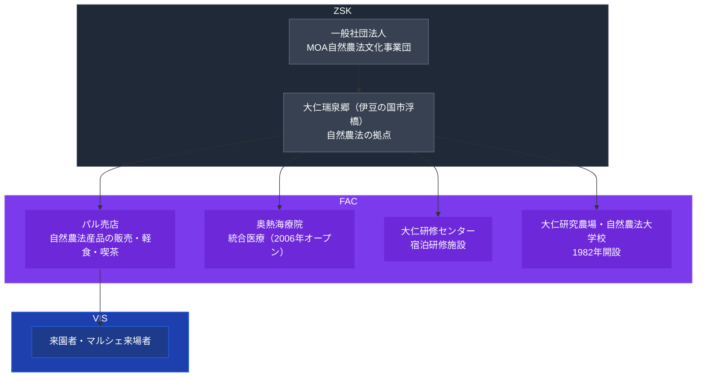

# パル売店（大仁瑞泉郷）

> [!summary] 要旨
> **パル売店**（パル店）は、静岡県伊豆の国市の自然農法拠点「大仁瑞泉郷」の園内施設の一つで、自然農法産品や地元の加工食品を販売し、軽食・喫茶を提供する売店である。大仁瑞泉郷は一般社団法人MOA自然農法文化事業団が運営し、園内には奥熱海療院、[[大仁研修センター]]、大仁研究農場・自然農法大学校、大仁牧場等が配置される。公式サイト「園内施設紹介」は、パル売店について「自然農法産の野菜を使った身体に優しい食事を提供し、地産地消の取り組みを推進しています。マルシェの開催拠点でもあります」と案内する（2026-11-27確認）。

---

## 1. 命題の構造（農場直売所 vs 自然農法拠点の園内売店）

| 比較軸 | 一般の農場直売所（外部視点 / etic） | パル売店（施設側の提示 / emic） |
|:--- |:--- |:--- |
| **存在意義** | 農産物の販売拠点 | 自然農法の理念に基づく「食」の提供拠点。販売と軽食・喫茶を兼ね、瑞泉郷マルシェの開催拠点でもある |
| **取扱品** | 地元農産物・加工品 | 自然農法産品と地元の加工食品。食事には自然農法産の野菜を使用 |
| **位置づけ** | 農場の付帯施設 | 統合医療の療院・宿泊研修施設・研究農場と並ぶ園内施設の一つ |

---

## 2. 基本情報

| 項目 | 内容 |
|:--- |:--- |
| **施設名** | パル売店（公式表記は「パル売店」、写真キャプションでは「大仁瑞泉郷パル店」） |
| **所在地** | 〒410-2311 静岡県伊豆の国市浮橋1606-6（大仁瑞泉郷内。公式サイト「園内施設紹介」） |
| **運営主体** | 一般社団法人MOA自然農法文化事業団（大仁瑞泉郷の運営主体。売店個別の運営形態の明記は公式サイトにない） |
| **営業時間** | 10:00〜15:00（公式サイト） |
| **定休日** | 木曜日、日曜日、夏季休業期間、年末年始（公式サイト） |
| **内容** | 自然農法産品・加工食品の販売、軽食・喫茶の提供、瑞泉郷マルシェの開催拠点 |

---

## 3. 起源と成立の経緯

パル売店個別の開設時期は、公式サイトでは確認できない（§12）。所在する大仁瑞泉郷は、MOA自然農法文化事業団が運営する自然農法の拠点で、大仁研究農場は1982年（昭和57年）に開設された自然農法のモデル農場である（公式サイト「園内施設紹介」）。園内施設は「自然農法の理念に基づき、人々の『食』『健康』『学び』を支える」構成とされ、パル売店はそのうち「食」を担う販売・軽食施設として位置づけられる。

---

## 4. 変遷・歴史

- 1982年: 大仁研究農場が開設（公式サイト）。
- 2006年: 園内の奥熱海療院がオープン（公式サイト）。
- 2026-11-27時点: 公式サイト「園内施設紹介」にパル売店が現行施設として掲載され、営業時間・定休日が案内されている。

> [!warning] 時点情報の留保
> 営業時間・定休日は公式サイトの2026-11-27時点の記載であり、夏季休業期間・年末年始等の臨時休業により変動しうる。

---

## 5. 内容・様式の深層解剖

### 5-1. 大仁瑞泉郷の園内施設構成

### 5-2. 販売と食事提供
公式サイトによれば、パル売店は自然農法産品や加工食品を販売し、軽食・喫茶を提供する。食事には自然農法産の野菜が使われ、「身体に優しい食事」を提供すると案内される。具体的なメニュー・価格は公式サイト「園内施設紹介」には掲載されていない（§12）。

### 5-3. マルシェの開催拠点
パル売店は瑞泉郷マルシェの開催拠点でもあると公式サイトに明記される。園内の古民家前広場・大駐車場もマルシェの会場として利用される。

---

## 6. 学術的・社会学的意義
自然農法の研究・教育拠点の内部に置かれた販売・軽食施設であり、生産（研究農場・牧場）、医療（奥熱海療院）、教育（自然農法大学校・研修センター）と同一敷地内で「食」の出口を担う。[[自然農法（岡田茂吉）]]の実践拠点における生産から消費までの完結した配置の一例である。

---

## 7. 拠点・現地情報
- **所在地**: 静岡県伊豆の国市浮橋1606-6（大仁瑞泉郷内）
- **営業時間**: 10:00〜15:00
- **定休日**: 木曜日、日曜日、夏季休業期間、年末年始
- **園内駐車場**: 大駐車場（乗用車116台、大型バス22台。一般来場者は無料。公式サイト）

---

## 8. 関連対象・関連人物・関連概念
- 大仁瑞泉郷（所在する自然農法拠点）
- 一般社団法人MOA自然農法文化事業団（運営主体）
- 奥熱海療院（園内の統合医療施設）
- [[自然農法（岡田茂吉）]]（取扱う自然農法産品の源流）
- [[MOAインターナショナル]]（MOAグループの関連団体）

---

## 9. 史料・一次資料（convMD）
- src_大仁瑞泉郷_公式園内施設紹介 — MOA自然農法文化事業団公式サイト「園内施設紹介」。パル売店の所在地・営業時間・提供内容を確認（2026-11-27取得）

---

## 10. 参考文献・学術論文
- MOA自然農法文化事業団公式サイト「園内施設紹介」（2026-11-27確認）

---

## 11. 関連ノート (Vault内)
- [[大仁研修センター]]（同じ大仁瑞泉郷内の宿泊研修施設）
- [[岡田茂吉系の飲食店・ホテル・病院一覧]]（岡田茂吉系施設の総覧）
- [[MOAインターナショナル]]
- [[自然農法（岡田茂吉）]]
- [[_分派・異端研究ポータル]]

---

## 12. 留保（中立的併記・未確定要素）

> [!warning] 留保事項
> - **開設時期は未確認**: パル売店個別の開設年は公式サイトに記載がなく、確認できていない。
> - **メニュー・価格は未確認**: 公式サイト「園内施設紹介」には軽食・喫茶の提供と自然農法産野菜の使用が明記されるが、具体的なメニュー・価格の掲載はない。
> - **所在地の番地**: 公式サイト「園内施設紹介」のパル売店の項は浮橋1606-6と表記する。園内の他施設（古民家・大駐車場等）は1606-2、奥熱海療院・大仁研修センターは1606-1と表記され、施設ごとに番地が異なる。
> - **運営形態**: 売店が事業団の直営であるか否かは公式サイトに明記されていない。
> - **時点情報**: 営業時間・定休日は2026-11-27時点の公式サイト記載であり、変動しうる。
> - 本ノートの evidence_type は `primary_source_based`、confidence は `3`（施設の実在・所在地・営業時間・提供内容は運営主体の公式サイトで確認したが、開設時期とメニューの詳細は未確認のため）。
