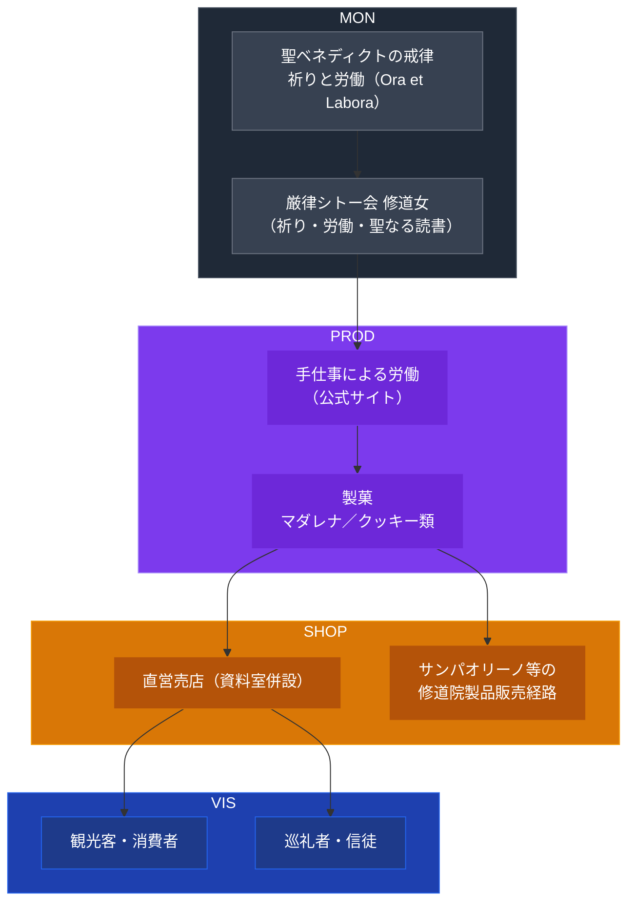

# 函館トラピスチヌ修道院の製菓・売店

> [!summary] 要旨
> **天使の聖母トラピスチヌ修道院**は、北海道函館市上湯川町346にある厳律シトー会（トラピスト会）の女子修道院で、通称「天使園」と呼ばれる。函館市公式観光情報「はこぶら」によれば、1898（明治31）年に日本最初の女子観想修道院として創立された。修道女たちは祈り・労働・聖なる読書を日課の3本柱とし、生計を立てる収益事業としてフランスケーキ「マダレナ」やクッキーを製造する（はこぶら）。マダレナは1956（昭和31）年から製造販売され、原料は卵、バター、小麦粉、砂糖の4種類のみとされる（はこぶら「フランスケーキ マダレナ」）。製品の製造者名は「宗教法人 天使の聖母トラピスチヌ修道院」である（サンパオリーノの製品表示）。前庭と売店に併設する資料室は一般に開放され、売店の開館時間は季節により異なる（はこぶら、2026-11-24確認）。男子修道院である [[当別トラピスト修道院の製酪・直営売店]] とは、同じ厳律シトー会に属するが組織・所在地・製品が異なる別個の修道院である。

---

## 1. 命題の構造（一般観光客 vs 修道院戒律）

| 比較軸 | 一般観光客・消費者（外部視点 / etic） | 厳律シトー会修道女（内部視点 / emic） |
|:--- |:--- |:--- |
| **存在意義** | 函館の歴史ある修道院、マダレナとクッキーの土産店 | 神の御顔を探し求めることに生涯を捧げる観想修道の共同体（修道院公式サイト） |
| **労働の意味** | 土産物の製造・販売事業 | 祈り・労働・聖なる読書という日課の3本柱の一つであり、生計を立てる収益事業（はこぶら） |
| **売店の位置づけ** | 修道院土産の購入場所、資料室併設の見学施設 | 修道院の生産物を外部へ届ける接点 |
| **立ち入り制限** | 前庭・売店併設の資料室は見学可能 | 修道生活の場は一般開放の対象外 |

---

## 2. 基本情報

| 項目 | 内容 |
|:--- |:--- |
| **施設名** | 天使の聖母トラピスチヌ修道院（通称・天使園）直営売店 |
| **運営母体** | 宗教法人 天使の聖母トラピスチヌ修道院（サンパオリーノ掲載製品の製造者表示による） |
| **所在地** | 〒042-0914 北海道函館市上湯川町346（修道院公式サイト） |
| **創立** | 1898（明治31）年。日本最初の女子観想修道院とされる（はこぶら）。フランスのウプシー修道院から派遣された8名の修道女により創立（サンパオリーノ／Wikipedia） |
| **修道会** | 厳律シトー会（トラピスト会）。修道院公式サイトの表記は「厳律シトー会 天使の聖母 トラピスチヌ修道院」 |
| **主要製品** | フランスケーキ「マダレナ」（1956年から製造販売）、プレーンクッキー、ココナッツクッキー等の焼菓子 |
| **製造者名** | 宗教法人 天使の聖母トラピスチヌ修道院（製品表示） |
| **一般開放** | 前庭のほか、売店に併設する資料室を見学可能（はこぶら） |
| **売店開館時間** | 入場門開閉・売店・資料館の時間は、3月・4月・10月・11月 8:30〜16:30／5月〜9月 8:30〜17:00／12月〜2月 9:00〜16:00。休日は年末年始（12月29日〜1月2日）（はこぶら、2026-11-24確認） |
| **連絡先** | 修道院 0138-57-2839（受付時間 9:00〜11:30／14:00〜16:30、公式サイト）。売店 0138-57-3331（はこぶら） |

---

## 3. 起源と成立の経緯

### (1) 創立（1898年）
はこぶらによれば、天使の聖母トラピスチヌ修道院は1898（明治31）年に日本最初の女子観想修道院として創立された。発足当時は、1893（明治26）年にパリ外国宣教会のアンドレ・ベルリオーズ司教が70ヘクタールの土地を購入して建てた旧孤児院を使用していた（はこぶら）。Wikipediaおよびサンパオリーノの修道院紹介によれば、創立はフランスのウプシー修道院から派遣された8名の修道女による。

### (2) 建物の変遷の起点
はこぶらによれば、1903（明治36）年に一夜の大嵐で木造の修道院は崩壊し、その2年後にレンガ造り2階建ての本館正面棟の一部が完成した。1913（大正2）年までに竣工した本館正面棟と聖堂は、1925（大正14）年の火災で焼失し、1927（昭和2）年に再建されたものが現存する（§4）。

### (3) 製菓事業の開始
はこぶら「フランスケーキ マダレナ」によれば、マダレナは1956（昭和31）年から製造販売されている。はこぶらは、マダレナケーキやクッキーの製造を、修道女たちが生計を立てる収益事業と位置づける。

### (4) 男子修道院との関係
1896年に創立された当別（北斗市）の男子修道院 [[当別トラピスト修道院の製酪・直営売店]] と本修道院は、同じ厳律シトー会に属するが、組織・所在地・製品ラインナップが異なる別個の修道院である。当別側がバター等の製酪を中心とするのに対し、函館側の代表的製品はマダレナとクッキー類の焼菓子である。

---

## 4. 変遷・歴史

- 1898（明治31）年: 創立（はこぶら／Wikipediaでは4月30日創立とされる）。
- 1903（明治36）年: 大嵐で木造の修道院が崩壊。その2年後にレンガ造り2階建ての本館正面棟の一部が完成（はこぶら）。
- 1925（大正14）年: 火災で本館正面棟と聖堂が焼失。教皇ピオ11世からの義援金や各修道院からの寄付金で、1927（昭和2）年に再建され現存する（はこぶら）。煉瓦の外壁、半円アーチの窓などゴシックとロマネスクの混在するデザインとされる（同）。
- 1956（昭和31）年: フランスケーキ「マダレナ」の製造販売を開始（はこぶら／Wikipedia）。
- 現在: 修道女たちは3時半の起床から19時45分の就寝までに7回の祈りを行い、祈り・労働・聖なる読書を日課の3本柱とする共同生活を送る（はこぶら）。売店・資料室は季節別の時間で開館する（§2）。

> [!warning] 時点情報の留保
> 売店・資料館の開館時間は季節により変動する。はこぶらの現行案内（2026-11-24確認）では、年末年始（12月29日〜1月2日）が休日で、工事などの場合に臨時閉門があるとされる。修道院公式サイトには売店の営業時間の独立した案内ページを確認できなかった（§12）。

---

## 5. 内容・様式の深層解剖

### 5-1. 修道院生産の構造

### 5-2. マダレナ
はこぶらによれば、マダレナはフランスから伝えられた伝統のレシピのもと、添加物を一切使用せずに作られるケーキで、原料は卵、バター、小麦粉、砂糖の4種類のみである。名称は、裏側のシェル（貝）の模様が涙のあとに似ていることから、聖マダレナ（マグダラのマリア）にちなんでつけられたと同記事は伝える。かつては鶏を育て採れたての鶏卵を使用していたが、現在は函館市内の供給者から鶏卵を購入していると同記事は記す（いずれも「〜そうです」「〜と伝えられる」形式の伝聞を含むため、由来の確定資料としては扱わない。§12）。

### 5-3. クッキー類と製品表示
サンパオリーノの製品ページでは、プレーンクッキー、ココナッツクッキー、マダレナ（3個入り・6個・8個・12個箱入り）等が掲載され、いずれも製造者は「宗教法人 天使の聖母トラピスチヌ修道院」と表示される。同ページはクッキーを修道女の手作りとする。2026-11-24確認時点で同ページの掲載品は多くが SOLD OUT 表示であった。

### 5-4. 労働の位置づけ
修道院公式サイト「修道院の生活」は、厳律シトー修道会が創立者たちの精神に従い、額に汗して働く肉体労働（手仕事）を大切にするとし、一日7回の聖務日課とミサを生活の中心とする。製菓はこの手仕事の一形態として修道院の生計を支える（はこぶら）。

---

## 6. 学術的・社会学的意義
女子観想修道院が、沈黙と祈りを旨とする閉鎖的共同体の内部で製菓という手仕事を継続し、その製品が地域の土産品として定着した事例である。1898年創立という日本における女子観想修道院の初期事例であり、男子修道院の製酪（当別）とは異なる製品領域（焼菓子）で、同じ厳律シトー会の労働実践が性別・地域ごとに分化した形を示す。前庭・資料室の開放と修道生活空間の非公開という二重構造は、当別修道院と共通する観想修道院と観光社会の接し方である。

---

## 7. 拠点・現地情報
- **所在地**: 〒042-0914 北海道函館市上湯川町346（修道院公式サイト）
- **売店・資料館**: 入場門開閉、売店・資料館の開館時間は季節別（§2）。休日は年末年始（12月29日〜1月2日）、臨時閉門あり（はこぶら）
- **見学**: 前庭のほか、売店に併設する資料室で院内での生活や修道院の歴史の紹介を見学できる（はこぶら）
- **駐車場**: なし（隣接の市民の森有料駐車場。市民の森売店専用の無料駐車場2台あり。はこぶら）
- **アクセス**: 「トラピスチヌ入口」バス停下車、徒歩10分（はこぶら）
- **連絡先**: 修道院 0138-57-2839／売店 0138-57-3331

---

## 8. 関連対象・関連人物・関連概念
- 厳律シトー会（トラピスト会）／聖ベネディクトの戒律
- [[当別トラピスト修道院の製酪・直営売店]]（同じ厳律シトー会の男子修道院。製酪中心）
- サンパオリーノ（修道院製品の販売店。本修道院製品も扱う）
- マグダラのマリア（聖マダレナ。製品名の由来と伝えられる）
- Ora et Labora（祈れ、働け）

---

## 9. 史料・一次資料（convMD）
- src_函館トラピスチヌ_公式トップ — 修道院公式サイトのトップページ。所在地（函館市上湯川町346）、電話番号、受付時間を確認。売店の営業時間の記載はこのページにはない
- src_函館トラピスチヌ_はこぶらスポット — 函館市公式観光情報「はこぶら」のスポット紹介。1898年創立、建物の変遷、日課の3本柱、売店・資料館の開館時間と休日、売店の電話番号を確認
- src_函館トラピスチヌ_はこぶらマダレナ — はこぶら「フランスケーキ マダレナ」。1956年からの製造販売、原料4種、売店での販売、名称の由来の伝聞を確認
- src_函館トラピスチヌ_Wikipedia — Wikipedia「天使の聖母トラピスチヌ修道院」。沿革の年表（創立、火災と再建、マダレナ製造開始等）の照合に使用
- src_函館トラピスチヌ_サンパオリーノ製品 — サンパオリーノの函館トラピスチヌ製品ページ。製造者名「宗教法人 天使の聖母トラピスチヌ修道院」、クッキー・マダレナの製品構成と原材料表示を確認
- いずれもサンプル確認で文字化け（Shift_JIS 崩れ）は認められなかった

---

## 10. 参考文献・学術論文
- 函館市公式観光情報サイト「はこぶら」（スポット紹介・マダレナ紹介）
- Wikipedia「天使の聖母トラピスチヌ修道院」
- 『天使の聖母トラピスチヌ修道院 ガイドブック』（トラピスチヌ修道院、2011年。Wikipedia の参考文献として挙がるもので、本ノート作成時点で現物未確認。§12）

---

## 11. 関連ノート (Vault内)
- [[当別トラピスト修道院の製酪・直営売店]]（同じ厳律シトー会の男子修道院の製酪・直営売店。相互リンク）
- [[サンパオリーノ]]（カトリック修道院直営ショップ。本修道院製品の販売経路）
- [[天龍寺直営 精進料理店「篩月」]]（宗教施設直営飲食の比較）
- [[_分派・異端研究ポータル]]

---

## 12. 留保（中立的併記・未確定要素）

> [!warning] 留保事項
> - **未検証として分離した主張**: (1) 「天使園」の呼称について、はこぶら・サンパオリーノ・Wikipedia はいずれも「通称」とする。本ノートでは通称として扱い、「旧称」とする一次資料は確認できなかった。(2) マダレナの名称の由来（聖マダレナにちなむという説明）は、はこぶらが伝聞形式で伝えるもので、修道院公式サイトでの確認はできていない。(3) 修道女の現在の人数は、資料により記載が異なるため本ノートでは記載しない。
> - **販売経路についての併記**: はこぶらはマダレナを「ここの売店でしか購入できないケーキ」と記す一方、サンパオリーノの通販ページにはマダレナとクッキー類が掲載される（2026-11-24確認時点で多くが SOLD OUT 表示）。両記載が併存するため、販売経路の排他性については断定しない。
> - **公式サイトで確認できない部分**: 修道院公式サイトには、売店の営業時間・製品一覧を記した独立ページを確認できなかった。売店の開館時間は函館市公式観光情報「はこぶら」の現行案内によるもので、公式サイトによる直接確認ではない旨を明記する。
> - **再検証記録（2026-11-24）**: 探索先＝修道院公式サイト（トップ／ご案内／修道院の生活）、はこぶら（スポット／マダレナ）、Wikipedia、サンパオリーノ製品ページ。創立年（1898年）、マダレナ製造開始年（1956年）、製造者名（宗教法人 天使の聖母トラピスチヌ修道院）、売店・資料館の季節別開館時間を上記資料で確認した。→ §9 の各エビデンス
