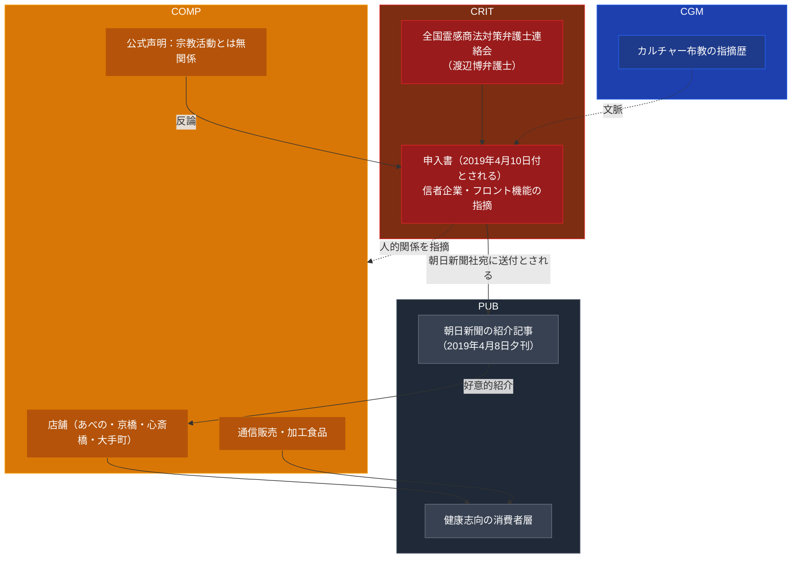

# 実身美（サンミ）

> [!summary] 要旨
> **玄米カフェ実身美（サンミ）**は、2002年に大阪で創業したとされる株式会社実身美が展開する自然食レストラン・加工食品企業である。玄米と酵素ドレッシング等を用いた健康食で一般消費者から高い評価を得てきた。一方で2019年、朝日新聞の紹介記事に対し、全国霊感商法対策弁護士連絡会の渡辺博弁護士が「経営者らがキリスト教福音宣教会（摂理／CGM）の信者であり、正体を隠した勧誘の信用付けに利用される恐れがある」旨の申入書を送付したと報じられ、カルト問題における「信徒企業フロント」論争の事例となった。会社側は「いかなる政治・宗教活動とも一切関係がない」との声明を公表している。**本ノートは両論を併記し、関係の有無について断定しない。**なお公式サイトでは2026年11月15日時点で、あべの・京橋・心斎橋・大手町の4店舗の日替わりメニューが発信され営業中であることが確認できる。

---

## 1. 命題の構造（一般社会 vs 弁護団・カルト対策側 vs 企業公式）

| 比較軸 | 一般社会・消費者（外部視点 / etic） | 弁護団・被害救済側（批判的視点） | 企業・実身美（公式スタンス） |
|:--- |:--- |:--- |:--- |
| **存在意義** | 玄米・発酵食品による健康的な食生活の提案 | 信徒の生活基盤および勧誘時の信用獲得装置としての機能が疑われる | 安全・安心な食の提供を目的とする一般食品企業 |
| **宗教との関係** | 宗教色を感じさせない洗練された自然派ブランド | 経営陣・従業員の信者性および教団との人的関係を指摘 | 「政治・宗教活動とは一切関係がない」と公式に否定 |
| **評価の根拠** | 受賞歴・メディア露出・消費者の支持 | 申入書による公開指摘、元信者の証言等（旧稿の整理） | 公式声明・通常の企業活動の継続 |

---

## 2. 基本情報

| 項目 | 内容 |
|:--- |:--- |
| **企業名** | 株式会社実身美 |
| **創業・設立** | 2002年12月創業（公式沿革は「2002年 大阪市あべのにて創業」）、2006年6月法人設立、代表取締役は大塚三紀子（公式沿革・企業情報・PR TIMES配信で確認、2026-11-16再検証） |
| **本社** | 大阪府大阪市旭区新森3丁目11番19号（法人番号公表情報。公式沿革に「2021年 大阪市旭区新森に本社移転」） |
| **店舗** | あべの店、京橋店、心斎橋店、大手町店（公式サイトで営業を確認）。那覇店（沖縄店）は2011年1月18日に開店し、**2024年1月18日に閉店**（公式告知） |
| **主力商品** | 玄米定食、酵素ドレッシング（「食べるドレッシング」）、加工食品の通信販売 |
| **受賞歴** | 大阪市優良店舗コンクール会長賞（2004年）、モンドセレクション金賞W受賞（2012年、豆乳プリンの黒蜜がけ・酵素ドレッシング）、おとりよせネット「ベストお取り寄せ大賞」総合大賞（2017〜2019年）、ITI優秀味覚賞三星（2022年・2023年）等（公式COMPANY沿革） |
| **通信販売** | 実身美 楽天市場店等（発送元として大阪市旭区新森3-11-19の表記あり、sangmi-kenko.jp） |
| **論争の経緯** | 2019年4月、朝日新聞夕刊の紹介記事に対し全国霊感商法対策弁護士連絡会が申入書を送付（§3） |
| **法人番号** | **3120001115286**（gBizINFO／法人番号公表サイトで名称・本店所在地の一致を確認、2026-11-16再検証） |

---

## 3. 起源と成立の経緯

### (1) 企業の成立
公式サイトのCOMPANY沿革によれば、2002年に大阪市あべの（阿倍野区）で創業した（企業情報では2002年12月創業、2006年6月に株式会社実身美として法人設立、代表取締役・大塚三紀子）。玄米食と酵素ドレッシングを軸に店舗と通信販売を拡大し、百貨店催事等でも知られるようになった。本社は2021年に大阪市旭区新森へ移転している（公式沿革）。

### (2) 2019年の申入と論争の公化
2019年4月8日付の朝日新聞夕刊が実身美を好意的に紹介したことを受け、全国霊感商法対策弁護士連絡会の渡辺博弁護士が同年4月10日付で朝日新聞社宛の申入書を送付したとされる。申入の趣旨は、経営者・主要スタッフが摂理（キリスト教福音宣教会）の信者であること、店舗が勧誘の際の信用付け（フロント）として機能しうることへの警告であったと報じられている。会社側は宗教活動との関係を否定する声明を出した。申入書の原文は本照合では**未取得**であり、上記は旧稿および二次報道に基づく整理である。

### (3) 摂理（CGM）側の文脈
摂理は大学サークルや文化・スポーツ活動を通じた勧誘手法（いわゆるカルチャー布教）が従来から指摘されてきた団体であり、食品企業がその一環とみなされうるかどうかが論点となる。ただし、個別企業と教団との組織的関係の有無は、公開資料のみでは確定できない（§12）。

---

## 4. 変遷・歴史

> [!warning] 時点情報の留保
> 店舗構成は変動しうる。2026-11-16時点では公式サイトで4店舗（あべの・京橋・心斎橋・大手町）の営業が確認できる。那覇店（沖縄店）は2011年1月18日に開店し、コロナ禍で休業の後、**2024年1月18日に閉店**した（公式サイトの閉店告知、2026-11-16再検証で確認）。

---

## 5. 内容・様式の深層解剖

### 5-1. 論争の構造

### 5-2. 評価を分ける論点
論点は (a) 経営者・従業員個人の信仰の有無、(b) 企業と教団との組織的・資金的関係の有無、(c) 店舗が勧誘活動に実際に利用された事実の有無、の3層に分解できる。弁護団の指摘は主として (a)(b) に、会社側の否定は (b)(c) に向けられたものと整理でき、公開情報のみではいずれも決着していない。

---

## 6. 学術的・社会学的意義
本事例は、カルト問題における「フロント組織」概念の適用範囲——信者個人が経営する一般企業をどこまで教団関連とみなすか——という境界問題を典型的に示す。宗教学的には、企業の宗教的出自の主張と企業の自己規定が衝突する事例として、断定を避けた両論併記の記録が求められる類型である。

---

## 7. 拠点・現地情報
- **あべの店ほか**: 大阪市内にあべの・京橋・心斎橋の3店舗、東京都内に大手町店（公式サイト掲載）
- **那覇店**: 那覇市牧志2-17-44。2011年1月18日開店、2024年1月18日閉店（公式告知）
- **通信販売の大阪事務所**: 大阪市旭区新森3-11-19（sangmi-kenko.jpの表記）

---

## 8. 関連対象・関連人物・関連概念
- キリスト教福音宣教会（摂理／CGM）／鄭明析
- 全国霊感商法対策弁護士連絡会／渡辺博（弁護士）
- フロント組織、正体隠し勧誘、カルチャー布教
- 酵素ドレッシング、玄米食、マクロビオティック的自然食文化

---

## 9. 史料・一次資料（convMD）
- [[src_実身美_公式サイト]] — 実身美公式サイト（sangmi.jp）トップページ。あべの・京橋・大手町・心斎橋の4店舗の日替わりメニュー発信を確認（2026-11-15）
- src_実身美_再検証2026 — 公式COMPANY沿革（創業・受賞歴・本社移転）、公式の那覇店閉店告知、法人番号3120001115286の再検証エビデンス（2026-11-16）
- 申入書（2019年4月10日付とされる）の原文は再検証（2026-11-16）でも**未取得**（申入の存在と趣旨はデイリー新潮2019年10月5日付記事等の二次報道で確認できるが、原文自体は公開源で確認できなかった）

---

## 10. 参考文献・学術論文
- 朝日新聞2019年4月8日付夕刊（実身美紹介記事。申入の対象となった記事）
- 全国霊感商法対策弁護士連絡会の公開情報（申入の存在は二次報道・旧稿による）

---

## 11. 関連ノート (Vault内)
- キリスト教福音宣教会（摂理・CGM）
- 日光オリーブの里（摂理関連施設とされる）
- [[_分派・異端研究ポータル]]

> - **追跡調査 第2波（2026-11-19）**: 申入書（2019-04-10付）の原文は本波でも未取得継続（第1波に同じ）。店名の語源と教理との親和性も残存。

---

## 12. 留保（中立的併記・未確定要素）

> [!warning] 留保事項
> - **中立性の原則**: 弁護団側の「信者企業・フロント」との指摘と、会社側の「宗教活動とは一切関係がない」との公式否定は対立したままであり、本ノートはいずれの主張も事実として断定しない。経営者・従業員の信仰の有無は個人の内心に関わる事項であり、公開資料による確定は不可能である。
> - **未検証として分離した主張（残存）**: (1) 申入書（2019年4月10日付とされる）の原文は再検証でも未取得（存在と趣旨は二次報道で確認）。(2) 店名「実身美」の語源と摂理教理との親和性に関する旧稿の示唆は、外部の解釈であり検証可能な根拠を欠くため、事実としては扱わない（なお会社側の由来説明として「実があって、身体に良くて、美しい」という3つの「み」の説明が店舗紹介等にみられるが、教理との親和性という解釈自体は検証不能のままである。再検証 2026-11-16：公式COMPANY・公式告知・全国弁連関連の公開情報を探索、教理文書レベルの裏付けは確認できず）。
> - **那覇店の開業日（公式内の相違・採用値確定）**: 公式COMPANY沿革には「2010年 那覇店開業」とある一方、公式の閉店告知には具体日付「2011年1月18日オープン」とあり、公式内で表記が相違する。本ノートは具体日付のある閉店告知を優先し、開業日を**2011年1月18日**として確定する（最終判断ラウンド第256件・本人決定 2026-11-20）。「2010年開業」表記は公式内の相違として本注記に残す。
> - **再検証記録（2026-11-16）**: 探索先＝公式サイトCOMPANYページ・公式ニュース（那覇店閉店告知）、gBizINFO／法人番号公表サイト、PR TIMES配信、デイリー新潮。格上げ5件：(1) 創業・設立・代表者 — 公式沿革で2002年あべの創業を確認し、2006年6月法人設立・代表取締役 大塚三紀子を企業情報とPR TIMESの一次配信で確認。(2) 那覇店 — 公式告知で**2011年1月18日開店・2024年1月18日閉店**と確定（COMPANY沿革の「2010年 那覇店開業」とは年表記が1年異なる点に留意）。(3) 本社所在地 — 現本社は**旭区新森3-11-19**（2021年移転、法人番号公表情報と一致）。旧稿の昭和町2-2-21は確認できず。(4) 法人番号 — **3120001115286**を名称・所在地の一致をもって特定。(5) 受賞歴 — 公式COMPANY沿革で細部を確認し§2に反映。→ src_実身美_再検証2026
> - **波及事項**: 照合済みのキリスト教福音宣教会（摂理・CGM）ノートには実身美への言及がなく、両ノート間の相互参照は本ノート側からのみ存在する（親検証への申し送り事項）。
> - 本ノートの evidence_type は `secondary_source_based`（旧値 `secondary_and_legal_records` は7値外のため正規化）、confidence は `3`（申入書原文が未取得であり、核心的主張が両論対立のまま未決着のため、旧値4から引き下げ）。
> - **改訂記録（2026-11-15・全件照合）**: 宗教版12セクションへ再編。公式サイトで4店舗の営業を確認し店舗情報を時点明示した。那覇店・法人番号・本社所在地・申入書原文を未確認・未取得として分離した。検証日を2026-11-15に更新。

- **追跡調査 2026-11-18**: 探索先＝Web検索。2019年4月10日付の申入書の原典は今回も特定できず、確認できず（未取得。デイリー新潮の二次報道のみ）。
- **改訂記録（2026-11-20・最終判断ラウンド第256件）**: 那覇店の開業年について、公式内の相違（COMPANY沿革「2010年開業」vs 閉店告知「2011年1月18日オープン」）に対し、本人が「2011年1月18日オープンを採用する」と決定した。本文（§2・§4・§7）の「2011年1月18日開店」表記を確定値とし、「2010年開業」は公式内の相違として§12の注記に残す。本文の日付自体は既に採用済みの値のため変更なし。

