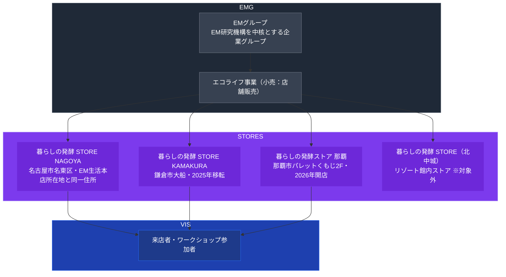

# 暮らしの発酵ストア（EM系ライフスタイルストア）

> [!summary] 要旨
> **暮らしの発酵ストア**は、EMグループが展開するライフスタイルストアの店舗網である。EM商品やEM農産物を中心に、発酵調味料・自然派商品を取り揃え、味噌づくり等のワークショップを通じてEMを体験する場として位置づけられる。EMグループ公式「エコライフ事業」は小売店舗として、沖縄県北中城村・愛知県名古屋市・神奈川県鎌倉市の3店舗を案内してきたが、2026年4月27日には沖縄県那覇市（パレットくもじ）に「暮らしの発酵ストア 那覇」が新規オープンし、4店舗体制となった（EMグループ公式ニュース）。本ノートは、北中城村のリゾート館内ストアを除く NAGOYA・KAMAKURA・NAHA の3店舗を対象とする。北中城のストアは[[EMウェルネス暮らしの発酵ライフスタイルリゾート]]の館内施設として同ノートに収録されている。

---

## 1. 命題の構造（一般の自然食品店 vs EM技術の体験型店舗）

| 比較軸 | 一般の自然食品店（外部視点 / etic） | 暮らしの発酵ストア（施設側の提示 / emic） |
|:--- |:--- |:--- |
| **存在意義** | 自然派商品の小売 | EM商品・EM農産物の販売に加え、試食やワークショップを通じてEMを「体験」する場 |
| **取扱品** | オーガニック・自然派食品が中心 | EM商品を中心に、発酵調味料、自然派商品、地域の限定商品等 |
| **母体との関係** | 独立系・一般法人の店舗が多い | EM技術の提唱・運営グループ（EM研究機構を中核とするEMグループ）の小売事業として公式に位置づけられる |

---

## 2. 基本情報

| 項目 | 内容 |
|:--- |:--- |
| **店舗網名** | 暮らしの発酵ストア（店舗表記は「EM WELLNESS 暮らしの発酵 STORE ○○」） |
| **NAGOYA** | 愛知県名古屋市名東区極楽5丁目148番地。電話052-715-3013。営業時間11:00〜17:00、定休日は日曜・月曜・祝日、年末年始、お盆（株式会社EM生活公式オンラインショップの店舗情報） |
| **KAMAKURA** | 神奈川県鎌倉市大船1-23-16 サンワード大船102。電話0467-47-5674。営業時間10:00〜18:00、定休日は日曜・祝日、年末年始、お盆（同上）。2025年6月17日に移転リニューアル |
| **NAHA** | 沖縄県那覇市久茂地1丁目1番1 パレットくもじ2F。営業時間10:00〜20:30。2026年4月27日オープン（EMグループ公式ニュース） |
| **北中城（対象外）** | EMウェルネス暮らしの発酵ライフスタイルリゾート館内の「暮らしの発酵 STORE」。詳細は[[EMウェルネス暮らしの発酵ライフスタイルリゾート]] |
| **内容** | EM商品・EM農産物・発酵調味料・自然派商品の販売、ワークショップ（味噌づくり、発酵食品づくり、EM発酵液づくり等）の開催 |

---

## 3. 起源と成立の経緯

各店舗個別の開店時期は、NAHA（2026年4月27日）を除き公式資料では確認できない（§12）。EMグループ公式「エコライフ事業」は、暮らしの発酵ストアを同グループの小売事業として位置づけ、「お客様には実際に商品を手に取って、試食やワークショップなどを通じてEMを体験していただけます」と案内する。KAMAKURAは2025年6月17日に大船駅前の現所在地へ移転リニューアルした（株式会社EM生活公式のイベント情報）。NAHAは、国際通りの商業施設パレットくもじ2階に2026年4月27日にオープンした（EMグループ公式ニュース、2026年4月16日付）。

---

## 4. 変遷・歴史

- 2025年6月17日: KAMAKURAが現所在地（鎌倉市大船1-23-16 サンワード大船102）へ移転リニューアル（EM生活公式）。
- 2026年4月27日: NAHAがパレットくもじ2階にオープン（EMグループ公式ニュース）。店舗網は4店舗体制となった。
- 2026-11-27時点: NAGOYA・KAMAKURAはEM生活公式オンラインショップのEMパートナー（店舗）情報に現行掲載され、イベント・ワークショップの開催が継続している。

> [!warning] 時点情報の留保
> 営業時間・定休日は各公式ページの2026-11-27時点の記載であり、店舗が定める臨時休業日等により変動しうる。

---

## 5. 内容・様式の深層解剖

### 5-1. 店舗網の構成

### 5-2. 取扱いと体験の提供
EMグループ公式によれば、各店舗はEM商品やEM農産物、人と地球にやさしい商品を取り揃え、味噌づくりや季節の農産物を使った発酵食品づくり、EM発酵液づくり、米ぬか肥料づくりなど、「食」を軸として家庭内の循環を目指したワークショップを開催する。KAMAKURAでは店内がEM技術を使用した珪藻土の空間とされ、毎週火曜日・木曜日には三浦のEM野菜を販売する（EM生活公式の店舗紹介）。

### 5-3. EMマルシェとの関係
EM農産物の生産者を紹介するウェブサイト[[EMマルシェ]]が生産者側の直販へつなぐ形態であるのに対し、暮らしの発酵ストアはEMグループ自身の小売店舗網であり、販売と体験の両方を担う点で位置づけが異なる。

---

## 6. 学術的・社会学的意義
EM技術の提唱グループが、技術の普及拠点として体験型の小売店舗を都市部に展開する事例である。北中城のリゾート（[[EMウェルネス暮らしの発酵ライフスタイルリゾート]]）が滞在型の総合的実演拠点であるのに対し、暮らしの発酵ストアは日常の買い物とワークショップを通じた接点として機能する。EM技術そのものの内容と評価については[[EM菌]]を参照。

---

## 7. 拠点・現地情報
- **NAGOYA**: 愛知県名古屋市名東区極楽5丁目148番地。11:00〜17:00、日曜・月曜・祝日休み。駐車スペース7台分（EM生活公式）
- **KAMAKURA**: 神奈川県鎌倉市大船1-23-16 サンワード大船102（大船駅東口から徒歩3分）。10:00〜18:00、日曜・祝日休み
- **NAHA**: 沖縄県那覇市久茂地1丁目1番1 パレットくもじ2F（ゆいレール県庁前駅直結）。10:00〜20:30

---

## 8. 関連対象・関連人物・関連概念
- EM（有用微生物群）
- 株式会社EM研究機構（EMグループの中核）
- 株式会社EM生活（店舗情報の案内主体。NAGOYAの住所は同社の本店所在地と同一）
- [[EM菌]]（技術の内容と評価）
- 比嘉照夫（EM技術の開発・提唱者）

---

## 9. 史料・一次資料（convMD）
- src_EMグループ_公式エコライフ事業 — EMグループ公式「エコライフ事業」。暮らしの発酵ストアの位置づけと3店舗（北中城・名古屋・鎌倉）の所在を確認（2026-11-27取得）
- src_EMグループ_発酵ストア那覇オープン — EMグループ公式ニュース「暮らしの発酵ストア 那覇 4月27日オープンのお知らせ」。NAHAの所在地・営業時間・開店日を確認（2026-11-27取得）

---

## 10. 参考文献・学術論文
- EMグループ公式サイト「エコライフ事業」（2026-11-27確認）
- EMグループ公式ニュース（2026年4月16日付、那覇オープン告知）
- 株式会社EM生活公式オンラインショップ「EMパートナー」店舗情報（NAGOYA・KAMAKURAの住所・電話・営業時間。2026-11-27閲覧で確認。convMD取得は失敗したため未保存、§12）

---

## 11. 関連ノート (Vault内)
- [[EMウェルネス暮らしの発酵ライフスタイルリゾート]]（北中城の館内ストア・館内飲食を収録）
- [[EM菌]]
- [[EMマルシェ]]
- [[_分派・異端研究ポータル]]

---

## 12. 留保（中立的併記・未確定要素）

> [!warning] 留保事項
> - **各店舗の開店時期**: NAHA（2026年4月27日）を除き、NAGOYA・KAMAKURAの開店年は公式資料で確認できていない。KAMAKURAについては2025年6月17日の移転リニューアルのみ確認した。
> - **運営法人の切り分け**: EMグループ公式は小売事業として暮らしの発酵ストアを位置づけるが、各店舗の運営法人（EM研究機構・EM生活等のいずれか）の個別明記は公式ページにない。NAGOYAの住所が株式会社EM生活の本店所在地と同一であることは2026-11-27の網羅性調査で確認された。
> - **EM生活公式の店舗一覧ページは convMD 取得に失敗**したため、NAGOYA・KAMAKURAの住所・電話番号・営業時間は同ページの閲覧による確認であり、エビデンスファイルとしては未保存である。
> - **北中城ストアの名称**: リゾート公式では「暮らしの発酵 STORE」と表記され、EMグループ公式「エコライフ事業」では北中城村の店舗として暮らしの発酵ストアに含められる。本ノートでは北中城店を対象外とし、[[EMウェルネス暮らしの発酵ライフスタイルリゾート]]に委ねる。
> - **時点情報**: 営業時間・定休日は2026-11-27時点の公式記載であり、変動しうる。
> - 本ノートの evidence_type は `primary_source_based`、confidence は `3`（店舗網の位置づけとNAHAの開店はEMグループ公式で確認したが、各店舗の運営法人の切り分けと開店年は未確認のため）。
