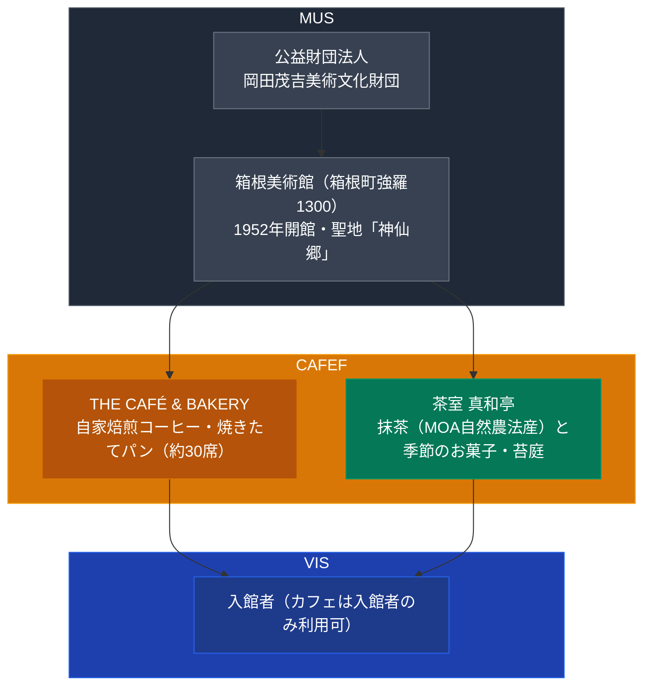

# 箱根美術館の館内飲食（THE CAFÉ & BAKERY・真和亭）

> [!summary] 要旨
> **箱根美術館**（神奈川県足柄下郡箱根町強羅1300）は、世界救世教の開祖・岡田茂吉（1882-1955）が創立し、公益財団法人岡田茂吉美術文化財団が運営する美術館である（1952年6月15日開館、聖地「神仙郷」内）。館内の飲食施設として、館内で自家焙煎するスペシャルティコーヒーと焼きたてのパンを提供する「THE CAFÉ & BAKERY」と、神仙郷の苔庭を眺めながら抹茶（MOA自然農法産）と季節のお菓子を提供する「茶室 真和亭」が公式サイトで案内される（2026-11-27確認）。THE CAFÉ & BAKERYは、美術館の改修休館（2026年5月7日〜10月29日）を経たリニューアルで新設された。姉妹館である[[MOA美術館の館内飲食（花の茶屋・そばの坊）|MOA美術館の館内飲食]]と対になる施設群である。

---

## 1. 命題の構造（一般の美術館飲食 vs 庭園と一体の館内飲食）

| 比較軸 | 一般の美術館併設カフェ（外部視点 / etic） | 箱根美術館の館内飲食（施設側の提示 / emic） |
|:--- |:--- |:--- |
| **存在意義** | 来館者の休憩・食事のための付帯施設 | 名勝・神仙郷の散策と一体の休憩の提示。真和亭の抹茶はMOA自然農法産を用い、創立者の自然農法の系譜に連なる |
| **食材** | 館内調理・外部仕入れが一般的 | 真和亭は抹茶（MOA自然農法産）を公式に明示。THE CAFÉ & BAKERYは館内自家焙煎のコーヒーと焼きたてパンを掲げる |
| **利用条件** | 入館者以外も利用できる施設もある | THE CAFÉ & BAKERYは「ご入館いただいた方のみご利用いただけます」と公式サイトに明記 |
| **母体との関係** | 美術館運営法人の直営または外部委託 | 運営母体は岡田茂吉美術文化財団。個別施設の直営・委託の別は公式サイトに記載なし（未確認、§12） |

---

## 2. 基本情報

| 項目 | 内容 |
|:--- |:--- |
| **施設名** | 箱根美術館（Hakone Museum of Art）館内飲食施設 |
| **運営母体** | 公益財団法人岡田茂吉美術文化財団（美術館の運営） |
| **所在地** | 神奈川県足柄下郡箱根町強羅1300（箱根美術館、聖地「神仙郷」内） |
| **美術館開館** | 1952年（昭和27年）6月15日。箱根で最も歴史のある美術館と公式サイトは案内する |
| **美術館開館時間** | 9:30〜16:30（最終入館16:00まで。公式サイト） |
| **THE CAFÉ & BAKERY** | カフェ・ベーカリー。館内で自家焙煎するスペシャルティコーヒーと焼きたてのパン各種。座席数約30席。休日は木曜日（祝休日の場合は営業）・年末年始・展示替え日。入館者のみ利用可、予約不可（公式サイト） |
| **茶室 真和亭** | 神仙郷・苔庭の茶室。立礼席で季節のお菓子と抹茶（MOA自然農法産）を提供。開席時間10:00〜15:30、一服900円（友の会850円）（公式サイト） |

---

## 3. 起源と成立の経緯

### (1) 美術館と神仙郷の成立
箱根美術館は、創立者・岡田茂吉が戦後に蒐集した東洋美術の優品を基盤として1952年6月15日に開館した（[[MOA美術館の館内飲食（花の茶屋・そばの坊）]]§3、Wikipedia「MOA美術館」）。美術館が建つ「神仙郷」は、岡田茂吉が昭和19年（1944年）から昭和28年（1953年）にかけて造営した庭園で、令和3年（2021年）3月26日に国の名勝の指定を受けた（公式サイト）。同年9月15日には財団法人東明美術保存会（現在の公益財団法人岡田茂吉美術文化財団）が設立された。

### (2) 館内飲食の位置づけ
真和亭の開設時期は公式サイトでは確認できない（§12）。THE CAFÉ & BAKERYは、美術館の改修休館（2026年5月7日〜10月29日）を経たリニューアルに伴い新設された施設で、公式ページは2026年10月26日付で公開されている。

---

## 4. 変遷・歴史

- 1944年〜1953年: 岡田茂吉が神仙郷を造営（公式サイト）。
- 1952年6月15日: 箱根美術館開館。同年9月15日に財団法人東明美術保存会（現・公益財団法人岡田茂吉美術文化財団）設立。
- 1955年2月10日: 岡田茂吉逝去。
- 2021年3月26日: 神仙郷が国の名勝に指定（公式サイト）。
- 2026年5月7日〜10月29日: 美術館は改修のため休館。
- 2026年10月: リニューアルに伴いTHE CAFÉ & BAKERYが新設（公式ページ公開は2026年10月26日）。

> [!warning] 時点情報の留保
> 営業時間・休日・価格は公式サイトの2026-11-27時点の記載であり、展示替え日等により変動する。両施設とも不定期の休業・貸切がありうる旨が公式サイトに明記される。

---

## 5. 内容・様式の深層解剖

### 5-1. 施設構成

### 5-2. THE CAFÉ & BAKERY
公式サイトによれば、館内で丁寧に自家焙煎したスペシャルティコーヒー豆を用い、ハンドドリップやエスプレッソで提供する。パンはクルミパン、クリームパン、カレーパン等を揃え、ラインナップは日によって異なる。価格例（2026-11-27時点、税込）：クリームぱん250円、熱海こがしあんぱん370円、カレーぱん390円、まいたけフォカッチャ430円、トマトベーコンフォカッチャ470円。

### 5-3. 茶室 真和亭
公式サイトによれば、四季折々の苔庭の風景を眺めながら、立礼席で季節のお菓子と抹茶（MOA自然農法産）を楽しむことができる。開席時間は10:00〜15:30、一服900円（友の会850円）。不定期で閉席または貸席の場合がある。

---

## 6. 学術的・社会学的意義
岡田茂吉が造営した庭園（国の名勝・神仙郷）と美術館鑑賞に、自然農法産の抹茶を用いる茶室と自家焙煎コーヒーのカフェが組み合わされる事例である。姉妹館のMOA美術館では花の茶屋が自然農法素材を標榜しており、両館とも「鑑賞」と「食」を一体に提示する構造を持つ（[[MOA美術館の館内飲食（花の茶屋・そばの坊）]]§6）。真和亭の抹茶がMOA自然農法産である点は、教団系の食実践が茶室という伝統的形態を通じて来館者に提示される形を示す。

---

## 7. 拠点・現地情報
- **所在地**: 神奈川県足柄下郡箱根町強羅1300（箱根美術館）
- **美術館開館時間**: 9:30〜16:30（最終入館16:00まで）
- **THE CAFÉ & BAKERY**: 座席数約30席。休日は木曜日（祝休日の場合は営業）・年末年始・展示替え日。入館者のみ利用可。予約は受け付けていない（公式サイト）
- **茶室 真和亭**: 神仙郷・苔庭所在。開席時間10:00〜15:30。一服900円（友の会850円）

---

## 8. 関連対象・関連人物・関連概念
- 岡田茂吉（創立者。世界救世教開祖）
- 公益財団法人岡田茂吉美術文化財団（運営母体）
- 神仙郷（美術館が所在する聖地。国の名勝）
- [[自然農法（岡田茂吉）]]（真和亭の抹茶の生産方式の源流）
- MOA美術館（姉妹館。熱海市）

---

## 9. 史料・一次資料（convMD）
- src_箱根美術館_公式カフェ — 箱根美術館公式サイト「THE CAFÉ & BAKERY」。自家焙煎コーヒー、パンのメニュー・価格、座席数・休日を確認（2026-11-27取得）
- src_箱根美術館_公式真和亭 — 箱根美術館公式サイト「茶室 真和亭」。抹茶（MOA自然農法産）、開席時間・一服料金を確認（2026-11-27取得）
- src_箱根美術館_公式トップ — 箱根美術館公式サイトトップ。開館時間、神仙郷の名勝指定と造営経緯を確認（2026-11-27取得）
- [[src_箱根美術館_Wikipedia]] — Wikipedia「箱根美術館」（既存保存分）

---

## 10. 参考文献・学術論文
- 箱根美術館公式サイト（2026-11-27確認）
- Wikipedia「MOA美術館」「箱根美術館」

---

## 11. 関連ノート (Vault内)
- [[MOA美術館の館内飲食（花の茶屋・そばの坊）]]（姉妹館の館内飲食）
- [[MOA美術館と岡田茂吉ゆかりの美術館群]]（美術館群の横断ノート）
- [[カフェレストラン旬幸（箱根・MOA商事）]]（箱根美術館向かいのMOA商事直営レストラン）
- [[岡田茂吉系の飲食店・ホテル・病院一覧]]（岡田茂吉系施設の総覧）
- [[自然農法（岡田茂吉）]]
- [[_分派・異端研究ポータル]]

---

## 12. 留保（中立的併記・未確定要素）

> [!warning] 留保事項
> - **営業形態は未確認**: 両施設が岡田茂吉美術文化財団の直営であるか、外部事業者への運営委託であるかは、公式サイトに明記されていない（2026-11-27確認）。
> - **真和亭の開設時期は未確認**: 茶室 真和亭個別の開設時期は公式サイトで確認できていない。THE CAFÉ & BAKERYについては、改修休館後のリニューアル新設であることは調査で確認したが、公式ページ自体に「新設」の明記はない。
> - **改修休館の期間**: 2026年5月7日〜10月29日の改修休館は2026-11-27の網羅性調査で確認したもので、公式サイトの取得済みページには期間の明記がない。
> - **時点情報**: メニュー・価格・開席時間は2026-11-27時点の公式サイト記載であり、変動しうる。
> - 本ノートの evidence_type は `primary_source_based`、confidence は `3`（施設構成・メニュー・料金は美術館公式サイトで直接確認したが、営業形態と真和亭の開設時期は未確認のため）。
