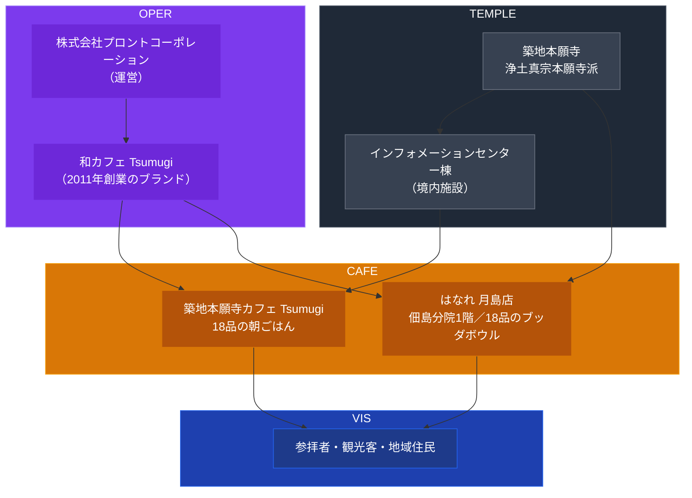

# 築地本願寺カフェ Tsumugi

> [!summary] 要旨
> **築地本願寺カフェ Tsumugi（ツムギ）**は、東京都中央区築地3-15-1の築地本願寺インフォメーションセンター棟内にあるカフェである。運営は株式会社プロントコーポレーションで、同社が展開する「和カフェ Tsumugi」と築地本願寺（浄土真宗本願寺派）とのコラボレーション業態として、2017年11月にオープンした（プロントコーポレーションの資料）。築地本願寺公式サイトによれば、営業時間は8:00〜18:00（年中無休）で、朝食は基本的に8:00〜10:30の提供である。名物の「18品の朝ごはん」は、阿弥陀如来の本願（第18願）にちなんだ店舗限定メニューで（プロントコーポレーションの資料）、小鉢16品とおかゆ、みそ汁の構成とされる。2022年9月には、築地本願寺佃島分院（東京都中央区月島1-2-9）の1階に姉妹店「築地本願寺カフェ Tsumugi はなれ 月島」が開店した。寺院直営ではなく、外部飲食企業の運営に寺院がコラボレーションする形態である点が、寺院直営店と異なる。

---

## 1. 命題の構造（一般来訪者 vs 寺院・コラボレーション運営）

| 比較軸 | 一般来訪者・消費者（外部視点 / etic） | 築地本願寺／運営会社（内部視点 / emic） |
|:--- |:--- |:--- |
| **存在意義** | 本堂を眺めながら朝食や和スイーツを楽しめる寺院内のカフェ | インフォメーションセンター棟内施設として、参拝者と地域の来訪者を受け入れる接点 |
| **運営形態** | 寺院のカフェという印象 | 運営はプロントコーポレーション、築地本願寺とのコラボレーション業態（寺院直営ではない） |
| **看板メニュー** | 小鉢が並ぶ「18品の朝ごはん」 | 阿弥陀如来の本願（第18願）にちなんで構成された店舗限定メニュー |
| **宗教的要素** | メニュー名や数に込められた由来への関心 | 浄土真宗本願寺派の教義（四十八願・第18願）を飲食メニューへ翻訳する試み |

---

## 2. 基本情報

| 項目 | 内容 |
|:--- |:--- |
| **施設名** | 築地本願寺カフェ Tsumugi |
| **運営** | 株式会社プロントコーポレーション（同社の「和カフェ Tsumugi」ブランドと築地本願寺とのコラボレーション業態） |
| **所在地** | 〒104-0045 東京都中央区築地3-15-1 築地本願寺インフォメーションセンター棟内カフェ区画（プロント店舗ページ） |
| **電話** | 03-5565-5581（プロント店舗ページ） |
| **営業時間** | 8:00〜18:00、定休日なし（プロント店舗ページ）。築地本願寺公式サイトも 8:00〜18:00（年中無休）と案内する（2026-11-24確認） |
| **朝食** | 基本的に8:00〜10:30の提供。「18品の朝ごはん」は数量に限りがあり、10:30より前に終了する場合がある（築地本願寺公式サイト） |
| **座席** | 96席（プロント店舗ページ）。全席禁煙 |
| **開店** | 2017年11月、築地本願寺インフォメーションセンター棟内にオープン（プロントコーポレーションの資料） |
| **看板メニュー** | 「18品の朝ごはん」。阿弥陀如来の本願（第18願）にちなむ（同）。構成は小鉢16品とおかゆ、みそ汁とされる |
| **姉妹店** | 築地本願寺カフェ Tsumugi はなれ 月島（§3 (3)、§7） |

---

## 3. 起源と成立の経緯

### (1) 和カフェ Tsumugi ブランド
プロントコーポレーション公式サイトによれば、「和カフェ Tsumugi」は和のモチーフや色（藍色）を取り入れた空間と、和テイストのドリンクやごはん・スイーツを取りそろえた、2011年創業の和カフェブランドである。

### (2) 築地本願寺とのコラボレーション（2017年）
プロントコーポレーションの資料によれば、「築地本願寺カフェ Tsumugi」は2017年11月に築地本願寺インフォメーションセンター棟内にオープンし、阿弥陀如来の本願（第18願）にちなんだ「18品の朝ごはん」などの店舗限定商品を展開した。日本経済新聞の報道（2022年）も、同店をプロントコーポレーションと築地本願寺のコラボレーションによる和風カフェとし、メニュー名やコンセプトを同寺と共同で考案したと伝える。

### (3) はなれ月島店の開店（2022年）
プロントコーポレーションの発表によれば、「築地本願寺カフェ Tsumugi はなれ 月島店」は2022年9月1日に、築地本願寺佃島分院内1階にオープンした。同店は人気メニューのブッダボウル専門店と位置づけられ、「18品の朝ごはん」に続く商品として「18品のブッダボウル」が登場したとされる。築地本願寺とのコラボカフェとしては2店舗目である（日本経済新聞）。

---

## 4. 変遷・歴史

- 2011年: プロントコーポレーションが和カフェブランド「和カフェ Tsumugi」を創業（同社公式サイト）。
- 2017年11月: 築地本願寺インフォメーションセンター棟内に「築地本願寺カフェ Tsumugi」がオープン（プロントコーポレーションの資料）。
- 2022年9月1日: 築地本願寺佃島分院1階に「築地本願寺カフェ Tsumugi はなれ 月島店」がオープン（同社発表）。
- 2026年1月5日: 原材料の高騰に伴う価格改定が実施され、「18品の朝ごはん」は2,400円（税込2,640円）となった（築地本願寺公式サイトのお知らせ）。

> [!warning] 時点情報の留保
> 営業時間・価格は変動しうる。2026-11-24時点で築地本願寺公式サイトおよびプロント店舗ページに掲載される案内は、営業時間8:00〜18:00、年中無休（定休日なし）である。開店当初の営業時間は現行と異なっていたとする報道があり（§12）、利用時は現行案内の確認が必要である。

---

## 5. 内容・様式の深層解剖

### 5-1. 「18品の朝ごはん」の構造
築地本願寺公式サイトは、本堂や境内を眺めながらいただく築地本願寺オリジナルの人気メニューとして「18品の朝ごはん」を紹介し、朝食やランチ、日本茶や和スイーツ、アルコール類のメニューを用意すると案内する。「18品」の由来は、阿弥陀如来の四十八願の根本の願である第18願（本願）であり（プロントコーポレーションの資料／報道）、構成は16種類のおかず（小鉢）とおかゆ、みそ汁の合計18品とされる。朝食の提供は基本的に8:00〜10:30で、同メニューは数量限定のため早期に終了する場合がある（築地本願寺公式サイト）。

### 5-2. コラボレーションの構造

### 5-3. 教義の数理の翻訳
「18」という数は、浄土真宗で根本の願とされる阿弥陀如来の第18願に由来し、教義上の数をそのままメニューの品数へ置き換えた構成である。はなれ月島店の「18品のブッダボウル」も同じ数を踏襲する（プロントコーポレーションの発表）。個別メニューの品目一覧は時期により変わるため、本ノートでは固定しない。

---

## 6. 学術的・社会学的意義
大規模寺院が境内施設の運営を外部の飲食企業へ委ね、寺院側は立地・ブランド・教義的コンセプトの提供に関与するコラボレーション型の寺院飲食の事例である。寺院直営の精進料理店（例: [[天龍寺直営 精進料理店「篩月」]]）や寺院関係団体が運営する寺カフェとは運営主体の構造が異なり、宗教施設の「開かれたお寺」型の施設活用と、飲食チェーンのブランド展開が交差する形態を示す。教義上の数（第18願）をメニュー構成へ翻訳する手法は、宗教的象徴の飲食商品化の具体例でもある。

---

## 7. 拠点・現地情報
- **本店所在地**: 東京都中央区築地3-15-1 築地本願寺インフォメーションセンター棟内
- **本店営業時間**: 8:00〜18:00、定休日なし。朝食は基本的に8:00〜10:30（築地本願寺公式サイト／プロント店舗ページ、2026-11-24確認）
- **本店電話**: 03-5565-5581
- **はなれ月島店**: 東京都中央区月島1-2-9 築地本願寺 佃島分院 1階。営業時間10:00〜20:00、定休日なし、座席10席、電話 03-6910-1300（プロント店舗ページ）
- **眺望**: 本堂や境内を眺めながら食事ができる（築地本願寺公式サイト）

---

## 8. 関連対象・関連人物・関連概念
- 浄土真宗本願寺派・築地本願寺／阿弥陀如来の四十八願・第18願（本願）
- 株式会社プロントコーポレーション／和カフェ Tsumugi
- 築地本願寺佃島分院（はなれ月島店の所在地）
- 寺カフェ（伝統仏教寺院のカフェ一般）

---

## 9. 史料・一次資料（convMD）
- src_築地本願寺カフェTsumugi_プロント店舗 — プロントコーポレーション公式店舗ページ「築地本願寺カフェ Tsumugi」。所在地・営業時間帯の存在を確認。なお convMD 抽出では住所・営業時間・座席数の各欄の一部が欠落しており、それらの数値は同ページの検索インデックス表示で補って照合した（§12）
- src_築地本願寺カフェTsumugi_プロントはなれ月島 — 同「築地本願寺カフェTsumugi はなれ 月島」。所在地（佃島分院1階）、営業時間10:00〜20:00を確認
- src_築地本願寺カフェTsumugi_プロント公式ブランド — プロントコーポレーション「和カフェTsumugi」公式ページ。和カフェ Tsumugi が2011年創業の和カフェブランドであることを確認
- **未取得**: 築地本願寺公式サイト「お食事」ページ（https://tsukijihongwanji.jp/enjoy/meal-stay/）および価格改定のお知らせページは、convMD 取得時に HTTP 503 となり MD 化できなかった。同サイトの内容（営業時間8:00〜18:00・年中無休、朝食8:00〜10:30、「18品の朝ごはん」の数量限定の注意、2026年1月5日の価格改定）はブラウザ表示と検索インデックスで確認したもので、convMD エビデンスは未保存である（§12）
- いずれの取得済みファイルもサンプル確認で文字化け（Shift_JIS 崩れ）は認められなかった

---

## 10. 参考文献・学術論文
- 築地本願寺公式サイト「お食事」および「築地本願寺カフェTsumugi 一部商品の価格改定のお知らせ」（convMD 未取得。§9・§12）
- プロントコーポレーション公式サイト・店舗ページ・開店発表資料（§9）
- 日本経済新聞「プロント、築地本願寺とコラボの和風カフェ2号店を開業」（2022年9月6日）
- 本ノート作成時点で、本店舗を対象とする学術論文は確認していない（§12）

---

## 11. 関連ノート (Vault内)
- [[伝統仏教系の寺カフェ・宿坊一覧]]（本店舗を含む伝統仏教系寺カフェの横断整理。本店舗の先行記録）
- [[天龍寺直営 精進料理店「篩月」]]（寺院直営の精進料理店との運営形態の比較）
- [[寺カフェ 茶庭（萬福寺）]]（伝統仏教寺院のカフェとの比較）
- [[函館トラピスチヌ修道院の製菓・売店]]（宗教施設の製菓・販売の比較）
- [[_分派・異端研究ポータル]]

---

## 12. 留保（中立的併記・未確定要素）

> [!warning] 留保事項
> - **未取得のエビデンス**: 築地本願寺公式サイトの2ページは convMD 取得が HTTP 503 で失敗し、エビデンス MD を保存できなかった（2026-11-24）。同サイト由来の記載（営業時間・朝食提供時間・価格改定）はブラウザ表示と検索インデックスによる確認であり、再取得が今後の課題である。
> - **convMD 抽出の欠落**: プロント店舗ページ（本店）の convMD 抽出では、住所・営業時間・座席数の欄が本文に展開されなかった。本ノートの当該数値（築地3-15-1、8:00〜18:00、96席、定休日なし）は同ページの検索インデックス表示による照合であり、ファイル単体では裏付けが完結しない。
> - **営業時間の変遷についての併記**: 開店当初の報道には営業時間を朝8時から夜9時までとするものがあるが、現行の公式案内（築地本願寺公式サイト／プロント店舗ページ）は8:00〜18:00である。本ノートは現行案内を採用し、旧時間は変遷の参考としてのみ記す。
> - **未検証として分離した主張**: (1) 「18品の朝ごはん」の個別の小鉢品目は時期により変動するため、特定時点の品目一覧は本ノートでは確定情報として記載しない。(2) 来客数・売上等の経営数値は公式資料で確認できず記載しない。
> - **再検証記録（2026-11-24）**: 探索先＝築地本願寺公式サイト（お食事ページ・価格改定のお知らせ。ブラウザ表示で確認、convMD は 503 で未取得）、プロントコーポレーション公式サイト（店舗ページ2件・ブランドページ）、日本経済新聞の開店報道。運営主体（プロントコーポレーション）、コラボレーション業態であること、2017年11月の開店、はなれ月島店の2022年9月開店と所在地・営業時間を上記資料で確認した。→ §9 の各エビデンス
