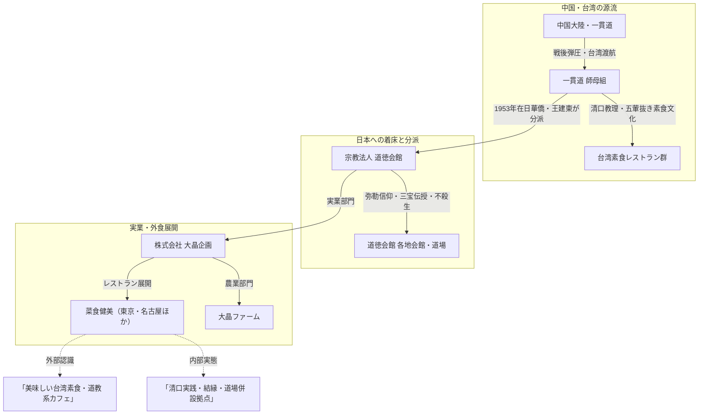

# 菜食健美（大晶企画・道徳会館） 専門構造分析ノート

> [!warning] 執筆前の確認事項
> - **菜食健美（さいしょくけんび / Saishoku Kenbi）**は、五葷（ネギ・ニンニク等）を使わない「オリエンタル・ベジタリアン（素食）」を提供するレストラン・カフェおよび自然食品ブランドである。
> - 運営は**「一貫道（師母組系）」から分派・独立した日本の新宗教「宗教法人道徳会館」の関連企業（株式会社大晶企画）**とされる。道徳会館と菜食健美・大晶ファームの関係は、Wikipedia「道徳会館」が外部リンクとして「菜食健美・大晶ファーム - 実業部門が経営」を掲げていることからも確認できる。
> - **食事規定の訂正**: 旧ノートは「卵・乳製品も一切使用しない」としていたが、現在の公式サイト（東京店）は「肉・魚・五葷を一切使用しない」としつつ、**一部メニューに卵・乳を使用している**旨を明記している（2026-11-15確認）。本ノートでは公式表記に合わせて訂正した。

> [!summary] 要旨
> **菜食健美**は、一貫道にルーツを持つ宗教法人「道徳会館」の実業部門とされる株式会社大晶企画が展開する精進料理・オリエンタルベジタリアンレストランである。公式サイトによれば、提供料理は肉・魚・五葷（ネギ・ニンニク・ニラ・ラッキョウ・アサツキ）を使用せず、一部メニューには卵・乳を使用する。東京店は新宿区百人町に所在し道徳会館東京会館に併設される。本照合では、道徳会館の宗教法人認証年（1992年）等の誤りを訂正し、名古屋店所在地については旧記載（昭和区福江）を確認できなかったため、現行の名古屋八事店（昭和区広路町石坂）への訂正と未検証分の分離を行った（§12）。

---

## 1. 命題の構造（通説・一般的認知 vs 宗教学的・歴史的実態）



### 比較マトリクス表（外部視点 vs 内部・宗教学的実態）

| 比較軸 | 一般客・外部視点（etic） | 宗教学・教団内部視点（emic） |
| :--- | :--- | :--- |
| **位置づけ** | ヘルシーな台湾風精進料理・オリエンタルヴィーガン店 | 一貫道・道徳会館の戒律**「清口（完全菜食）」**の実践・普及拠点 |
| **宗教的背景の誤認** | 「台湾の道教関係の店」「中華精進料理店」 | **一貫道師母組系から独立した「道徳会館」**の関連実業（大晶企画） |
| **食事規定** | 肉・魚・五葷不使用（公式）。一部メニューに卵・乳使用あり | 不殺生の功徳、殺生のカルマ回避等（教団側の説明） |
| **店舗と道場の関係** | たまたま同じビルや隣にある施設 | **店舗と礼拝施設（道徳会館会館）の複合構造**（東京店） |
| **代替肉の意義** | 大豆ミートやおからこんにゃくを使ったヘルシー料理 | 菜食への移行を助ける**「方便」**として位置づけられる |

---

## 2. 基本情報

| 項目 | 内容 |
| :--- | :--- |
| **ブランド名** | 菜食健美（Saishoku Kenbi / さいしょくけんび） |
| **運営会社** | 株式会社 大晶企画（DAISHO-KIKAKU CO., LTD.） |
| **設立** | 2002年11月13日（大晶企画公式サイト会社概要で確認、2026-11-20。資本金1,000万円・代表取締役 岩原正起） |
| **法人番号** | 6200001024170（国税庁法人番号公表サイトで確認、2026-11-20。§9・§12） |
| **本社所在地** | 岐阜県中津川市苗木字柿野46番地361（公式会社概要・国税庁法人番号公表サイトで確認、2026-11-20。NAVITIME掲載とも一致） |
| **関連宗教法人** | **宗教法人 道徳会館**（1953年に名古屋市瑞穂区で創設、1992年に愛知県から宗教法人認証。現本部の番地は未確認） |
| **教団創始者** | 王建東（在日華僑。生没年は未検証、§12留保） |
| **信仰・教理系統** | 一貫道（師母組）系分派 ➔ 弥勒信仰・三宝伝授・不殺生菜食 |
| **主要拠点・店舗** | 東京店（東京都新宿区百人町2-21-26）、名古屋八事店（名古屋市昭和区広路町石坂37-6） |
| **食材・調理特徴** | 肉・魚・五葷不使用（公式）。一部メニューに卵・乳を使用（公式） |

---

## 3. 起源と設立の経緯

### (1) 一貫道の分派と道徳会館の創設
道徳会館は、中華人民共和国成立後の弾圧を逃れて台湾へ渡った「一貫道（師母組）」の信者（居士）であった在日華僑・**王建東**が、1953年（昭和28年）に名古屋市瑞穂区において分派・独立して設立した宗教団体である。任意団体時代を経て、**1992年に愛知県から宗教法人認証を受けた**（Wikipedia「道徳会館」、[[道徳会館]]ノート照合済み）。旧ノートの「1964年に宗教法人認証」は誤りであり訂正した。教義の中心には弥勒信仰と、一貫道固有の儀礼である**「三宝（点玄関・合同印・五字真言）」**があるとされる。なお道徳会館側は一貫道との関係を否定している（Wikipedia「道徳会館」）。

### (2) 「清口」の実践と食の自給
一貫道および道徳会館において、信徒の戒律として**「清口（終身完全菜食の誓約）」**があるとされる。Wikipedia「道徳会館」は「不殺生に基づく菜食等の戒律があり、直営農場やレストランを持つ」と記している。

### (3) 株式会社大晶企画と菜食健美
実業部門として株式会社大晶企画が設立され（2002年11月13日、公式会社概要で確認）、「菜食健美」ブランドのレストラン展開が行われた。Wikipedia「道徳会館」の外部リンクには「菜食健美・大晶ファーム - 実業部門が経営」と明記されている。

---

## 4. 沿革・歴史変遷

```
1953年：在日華僑・王建東が名古屋市瑞穂区に道徳会館を設立（一貫道師母組からの分派・独立）
1992年：宗教法人「道徳会館」として愛知県から認証（旧ノートの1964年は誤り）
2002年11月13日：株式会社大晶企画を設立（公式会社概要で確認、2026-11-20）
2026-11-15現在：東京店（百人町）・名古屋八事店（昭和区広路町石坂）の営業を二次資料で確認
```

- **広島店の所在地変遷**: 現行所在地は広島市西区己斐上4丁目32-2（大晶企画公式サイトで確認、§7）。旧ノート記載の「広島市西区大芝3-15-18」は、移転前の旧所在地として本沿革に残す（移転時期は未確認。扱いは2026-11-19の本人判断による、§12）。

※旧ノートにあった「1970〜90年代の会館網拡大」「2010年代の大晶ファーム設立」「2020年代のEC拡充」等の細部は、本照合では個別確認できていないため沿革から外し、§12留保に分離した。

---

## 5. 食事規定・教理的背景・事業モデルの深層解剖

### 5-1. 「清口」と五葷禁忌（教団側の説明として）
- **不殺生**: 一貫道・道徳会館では不殺生に基づく菜食の戒律がある（Wikipedia「道徳会館」）。
- **五葷（ごくん）の排除**: ネギ（葱）、ニンニク（大蒜）、ニラ（韮）、ラッキョウ（薤）、アサツキ（興渠）の5種類は、道教・仏教・一貫道の素食実践で禁忌とされる。
- 公式サイト（東京店）は、創設者らが「五葷、酒類を口にしなかった」ことに触れ、現行の提供料理について「肉・魚・五葷を一切使用しない」と明記する一方、**一部メニューに卵・乳を使用している**ことも明記している（2026-11-15確認）。したがって店舗の現行実践は、厳格な清口（卵・乳を含む完全排除）とは同一ではない。

### 5-2. 代替肉・New精進の調理技術
- **大豆たんぱく・湯葉・おからこんにゃく**: 台湾の素食加工技術を用い、唐揚げ、酢豚等の風味・食感を再現するメニューが提供されると紹介されている（二次資料ベース）。

### 5-3. 拠点（会館・道場）と店舗の併設構造
- **東京店（百人町）**: 東京都新宿区百人町2-21-26に所在し、「道徳会館 東京会館」と同住所である（[[道徳会館]]ノートと一致）。
- **名古屋八事店**: 名古屋市昭和区広路町石坂37-6 八事石坂ビル1F（HappyCow等の店舗情報、2026-11-15確認。電話052-848-7361）。

---

## 6. 宗教学的・食文化史的意義

### 6-1. 一貫道文化の日本現地化
- 道徳会館は、一貫道の核心儀礼（三宝伝授）と食文化（清口）を維持しつつ、日本で宗教法人として着床した事例である。外部から「台湾の道教寺院・道教文化」に見えるのは、一貫道の道教神習合の形態によると一般に説明される。

### 6-2. 宗教色を前面に出さない外食展開
- 店舗運営は株式会社（大晶企画）を通じて行われ、一般の健康志向層・訪日外国人向けレストランとして展開されている。

---

## 7. 拠点・現地情報

| 拠点・店舗 | 所在地 | 特徴・確認状況 |
| :--- | :--- | :--- |
| **菜食健美 TOKYO（東京店）** | 東京都新宿区百人町2-21-26 | 道徳会館東京会館と同住所。公式サイト（現行）は東京店のサイト |
| **菜食健美 名古屋八事店** | 愛知県名古屋市昭和区広路町石坂37-6 八事石坂ビル1F | HappyCow等の店舗情報で確認（2026-11-15）。旧ノートの「昭和区福江1-11-5」は確認できず（§12） |
| **株式会社 大晶企画 本社** | 岐阜県中津川市苗木字柿野46番地361 | 公式会社概要・国税庁法人番号公表サイトで確認（2026-11-20）。法人番号6200001024170 |
| **菜食健美 広島店** | 広島市西区己斐上4丁目32-2 | 大晶企画公式サイトの広島店ページで現行営業を確認（2026-11-16再検証）。営業11:00〜15:00、定休日・火曜、Tel/Fax 082-271-3770。移転前の旧所在地は広島市西区大芝3-15-18（現行所在地とは別。§4・§12） |
| **株式会社 大晶ファーム** | 北海道上川郡新得町字屈足西一線12番地7 | 大晶企画公式サイト会社概要に「系列会社」として掲載（2026-11-20確認）。Instagram位置情報でも現存登録を確認（2026-11-16再検証） |

---

## 8. 関連教団・関連人物・関連概念

- **[[道徳会館]]**: 運営母体となる宗教法人（一貫道師母組系分派）
- **[[天道（一貫道）]]**: ルーツとなる中国・台湾発祥の救済新宗教
- **[[一貫道と台湾素食レストラン]]**: 台湾および日本国内の一貫道系素食ネットワーク
- **清口**: 一貫道・道徳会館における終身完全菜食の誓約
- **五葷**: ネギ、ニンニク、ニラ、ラッキョウ、アサツキの禁忌
- **台湾素食**: 台湾で発展した精進料理文化
- **オリエンタル・ベジタリアン**: 肉・魚・五葷を断つ東洋的菜食主義（卵・乳の扱いは実践により異なる）
- **王建東**: 道徳会館の創始者（在日華僑）

---

## 9. 史料・一次資料 (convMD)

1. **菜食健美 公式サイト（東京店）**: [[src_菜食健美_公式サイト]]（saishoku-kenbi.jp、2026-11-15取得）
2. **株式会社大晶企画 公式サイト（トップページ）**: [[src_大晶企画_公式サイト]]（daisho-kikaku.com、2026-11-15取得）
3. **Wikipedia「道徳会館」**: [[src_道徳会館_Wikipedia]]（既存エビデンス）
4. **道徳会館 公式サイト**: [[src_道徳会館_公式]]（既存エビデンス）
5. **菜食健美広島店（大晶企画公式）**: src_菜食健美広島店_公式_再検証2026（2026-11-16取得）
6. **大晶企画の法人特定（国税庁・公式会社概要）**: src_大晶企画_国税庁法人番号・公式会社概要（2026-11-20取得。法人番号6200001024170の特定経緯と登記情報提供サービスの扱いを含む）

---

## 10. 参考文献・学術論文

- 旧ノートが挙げていた井上順孝編『新宗教教団・人物事典』、文化庁『宗教年鑑』、松本浩一『中国人の宗教・一貫道』、林本炫『台湾の一貫道と社会変遷』、台湾文化部『台湾素食文化志』等は、本照合では個別に内容確認を行っていない。なおWikipedia「道徳会館」は、道徳会館について宗教教団情報データベースや『新宗教 教団・人物事典』に公開記載がない旨を記している。

---

## 11. 関連ノート (Vault内)

- [[一貫道と台湾素食レストラン]]
- [[天道（一貫道）]]
- [[道徳会館]]
- [[佛光山「滴水坊」法水寺店]]（台湾仏教系素食の比較）
- [[静思書軒（Jing Si Books & Cafe）]]（台湾慈済系菜食の比較）
- [[Loving Hut（ラビングハット）]]（スプリーム・マスター・チンハイ系ヴィーガンレストランの比較）
- [[各教団の食の教義・タブー比較]]

---

## 12. 留保（中立的併記・未確定要素）

> [!warning] 留保事項
> - **訂正した誤り（宗教法人認証年）**: 旧ノートの「1964年に宗教法人認証」は誤り。正しくは**1992年に愛知県から認証**（Wikipedia「道徳会館」、照合済みの[[道徳会館]]ノートと一致）。
> - **訂正した誤り（卵・乳）**: 旧ノートの「肉・魚・卵・乳製品を一切使用しない」は公式サイトの現行表記と矛盾する。公式サイトは肉・魚・五葷の不使用を明記する一方、一部メニューの卵・乳使用を明記しているため、公式表記に合わせて訂正した。
> - **所在地の食い違い（固有フラグ）への回答**: 旧ノートは名古屋店を「名古屋市昭和区福江1-11-5」とし、[[道徳会館]]ノート側は本部を瑞穂区とするなど食い違いがあった。本照合の結果は次の通り。**(a) レストラン（現行の名古屋八事店）は名古屋市昭和区広路町石坂37-6**であり、昭和区内ではあるが福江ではない。**(b) 道徳会館の創設地・本部は名古屋市瑞穂区**（1953年創設。ただし現行本部の番地は[[道徳会館]]ノートでも未確認）。**(c) 「昭和区福江1-11-5」はいかなる公式・登記・店舗情報でも確認できなかった**ため、当該住所は未検証として分離する（名古屋会館の所在地とされるが、その関係も未確認）。
> - **未検証として分離した主張（残存）**: 王建東の生没年（1912–1999）、旧沿革の細部（会館網拡大の年代等）。なお大晶企画の会社細部（設立月日・資本金・代表取締役名）は、再検証（2026-11-16）・第2波（2026-11-19）では特定できず未確認として残していたが、2026-11-20（第388件）に公式サイトの会社概要ページで確認でき、法人番号も国税庁で特定できたため、未検証から外した（下記改訂記録）。
> - **広島店（再検証で格上げ・旧住所の扱いは決定済み）**: 大晶企画公式サイトの広島店ページで現行営業と現行所在地（広島市西区己斐上4丁目32-2）を確認した。旧ノート記載の「広島市西区大芝3-15-18」は現行公式情報と異なる値であり、移転前の旧所在地か誤記かを判別する資料はないが、2026-11-19の本人判断により「移転前の旧所在地」として沿革（§4）・拠点表（§7）に、現行所在地と区別して残すこととした。
> - **大晶ファーム（2026-11-20に格上げ）**: 再検証（2026-11-16）ではInstagram位置情報（二次資料）で現存登録を確認した範囲に留めたが、2026-11-20（第388件）に大晶企画公式サイトの会社概要で、系列会社「株式会社 大晶ファーム」（北海道上川郡新得町字屈足西一線12番地7）の掲載を確認したため、事業関係は公式確認済みとして格上げした（§7拠点表も公式表記に更新）。
> - **道教との関係**: 外部では「台湾の道教関係の店」と紹介されることが多いが、組織・教理の実態は一貫道系新宗教（道徳会館）である。なお道徳会館側は一貫道との関係自体を否定している点も併記する。
> - **法人番号**: 大晶企画の法人番号6200001024170を国税庁法人番号公表サイトで確認し、§2に記載した（2026-11-20・第388件）。**教典名**: 『○○教典』形式の教典名の記載はない（該当なし）。
> - **evidence_type**: `secondary_source_based`（旧 `primary_and_secondary_sources`＝7値外から訂正）
> - **confidence**: `3`（旧 `5` から訂正。中核的事実は公式・Wikipediaで確認できるが、会社細部・一部拠点は未確認のため）

> [!note] 改訂記録
> - 2026-11-15・全件照合：公式サイトをconvMDで取得し、宗教法人認証年（1964→1992）と卵・乳の扱いを訂正。名古屋店所在地の食い違いを公式・登記系情報で検証し、名古屋八事店（昭和区広路町石坂）への訂正と福江住所の未検証分離を実施。evidence_type/confidenceを再評価した。
> - **再検証記録（2026-11-16）**: 探索先＝大晶企画公式サイト（トップ・広島店ページ）、国税庁法人番号公表サイト、Wikipedia「道徳会館」、Instagram位置情報。(1) 広島店：公式ページで現行所在地・営業時間を確認し格上げ、本文の拠点表を更新した。(2) 大晶ファーム：新得町での現存登録を二次資料で確認し一部格上げ。(3) 王建東の生没年、大晶企画の会社細部（設立月日・資本金・代表者）、「昭和区福江1-11-5」および道徳会館の現行本部番地は確認できず残存。エビデンスは src_菜食健美広島店_公式_再検証2026 に保存。検証日を2026-11-16に更新。

> - **追跡調査 第2波（2026-11-19）**: 大晶企画の法人特定は、探索先＝Web検索（gBizINFO・国税庁インボイス公表・NAVITIME）で再試行したが、岐阜県中津川市の同名法人等の候補は所在地照合ができず、当該法人（道徳会館系）の特定には至らず残存（同名別法人に注意）。王建東の生没年・旧沿革細部・名古屋市昭和区福江の番地も残存。
> - **改訂記録（2026-11-19・最終判断ラウンド第66件）**: 広島店の旧住所「広島市西区大芝3-15-18」の扱いについて、本人判断により「移転前の旧所在地」として沿革に残すことを決定。§4（所在地変遷の注記を新設）・§7（拠点表）・本§12（留保項目）の表記を、現行所在地（広島市西区己斐上4丁目32-2）と混同しない形に整えた。根拠は batch-rb1-food.md 判断事項4・重大な誤りB-19（現行所在地への更新は実施済みで、旧住所の扱いのみが未決だった）。
> - **法人特定（2026-11-20・最終判断ラウンド第388件・本人決定「法務局の登記情報取得等を行う」）**: 無料の公的経路で再照合を実施し、大晶企画の法人特定を完了した。(1) 大晶企画公式サイトの会社概要ページに到達し、本社所在地（岐阜県中津川市苗木字柿野46番地361）・設立（2002年11月13日）・資本金（1,000万円）・代表取締役（岩原正起）・系列会社（株式会社大晶ファーム）を確認。(2) 国税庁法人番号公表サイトで、商号・本店所在地が公式記載と一致する法人として法人番号6200001024170を特定した（法人番号指定日2015年10月5日）。従来は名称検索のみで同名他社が多く特定できなかったが、今回は公式会社概要の本店所在地による所在地照合で特定に至った。(3) 法務局系の登記情報提供サービス自体は利用者登録・手数料が必要で本VMからは本人のアカウントなしに利用できないため使用していない。登記事項証明書レベルの詳細（役員構成・資本金の変遷等）が必要な場合は、本人のアカウントでの取得が必要。反映箇所：frontmatter（成立時期・主要主体・検証日）、§2（設立・法人番号・本社所在地）、§3・§4（設立日）、§7（本社・大晶ファーム）、§9（エビデンス追加）、本§12。エビデンスは src_大晶企画_国税庁法人番号・公式会社概要 に保存。


---

*※本稿は[[_分派・異端研究ポータル]]の飲食・食品関連および台湾系新宗教の食文化実践に関する専門構造分析ノートである。*
