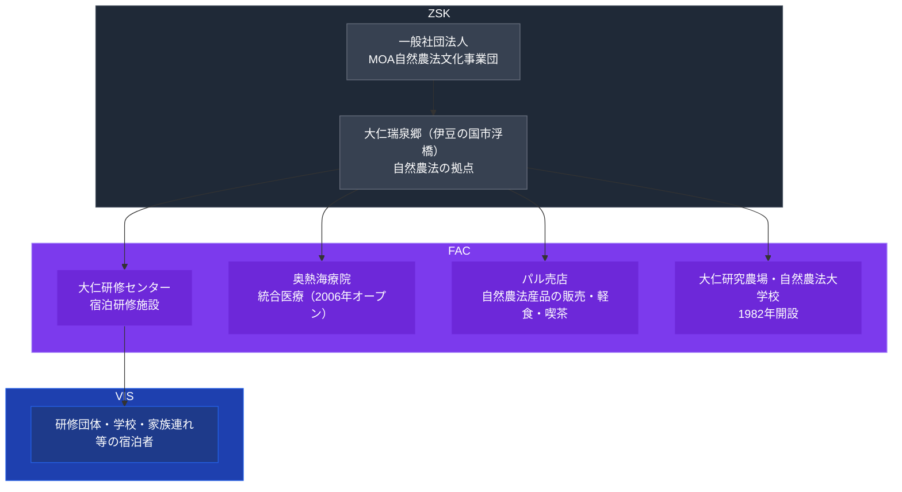

# 大仁研修センター

> [!summary] 要旨
> **大仁研修センター**（MOA大仁研修センター）は、静岡県伊豆の国市の自然農法拠点「大仁瑞泉郷」の園内施設の一つで、宿泊を伴う研修施設である。一般社団法人MOA自然農法文化事業団が運営する大仁瑞泉郷内に所在し、公式サイト「園内施設紹介」は「企業などの団体研修や会議、学校行事、家族での宿泊利用が可能です」と案内する（2026-11-27確認）。宿泊料金は1泊2食で8,000円（税込）からとされる。園内には奥熱海療院（統合医療）、[[パル売店（大仁瑞泉郷）|パル売店]]、大仁研究農場・自然農法大学校等が配置される。

---

## 1. 命題の構造（一般の研修宿泊施設 vs 自然農法拠点の研修センター）

| 比較軸 | 一般の研修宿泊施設（外部視点 / etic） | 大仁研修センター（施設側の提示 / emic） |
|:--- |:--- |:--- |
| **利用形態** | 企業研修・合宿等の団体利用が中心 | 団体研修・会議・学校行事に加え、家族での宿泊利用も可能と公式に案内される |
| **立地の意味** | 研修環境としての静けさ・自然 | 自然農法のモデル農場・統合医療の療院と同一敷地内にあり、「食」「健康」「学び」を支える園内施設の一つ |
| **食事** | 施設食堂の提供が一般的 | 1泊2食の料金設定があり、食事付きの宿泊が可能。園内では自然農法の理念に基づく食事提供が行われる |

---

## 2. 基本情報

| 項目 | 内容 |
|:--- |:--- |
| **施設名** | 大仁研修センター（公式サイトの写真キャプションでは「MOA研修センター」） |
| **所在地** | 〒410-2311 静岡県伊豆の国市浮橋1606-1（大仁瑞泉郷内。公式サイト「園内施設紹介」） |
| **運営主体** | 一般社団法人MOA自然農法文化事業団（大仁瑞泉郷の運営主体） |
| **電話番号** | 0558-79-0021（公式サイト） |
| **宿泊料金** | 1泊2食で8,000円（税込）〜、1泊食事なしは5,200円（税込）〜（公式サイト） |
| **休館日** | 木曜日、年末年始・夏季休業（公式サイト） |
| **利用形態** | 企業などの団体研修・会議、学校行事、家族での宿泊利用 |

---

## 3. 起源と成立の経緯

大仁研修センター個別の開設時期は、公式サイトでは確認できない（§12）。所在する大仁瑞泉郷は、MOA自然農法文化事業団が運営する自然農法の拠点で、大仁研究農場は1982年（昭和57年）に開設された自然農法のモデル農場である（公式サイト「園内施設紹介」）。園内施設は「自然農法の理念に基づき、人々の『食』『健康』『学び』を支える」構成とされ、研修センターは宿泊を伴う「学び」の拠点として位置づけられる。

---

## 4. 変遷・歴史

- 1982年: 大仁研究農場が開設（公式サイト）。
- 2006年: 園内の奥熱海療院がオープン（公式サイト）。
- 2026-11-27時点: 公式サイト「園内施設紹介」に大仁研修センターが現行施設として掲載され、宿泊料金・休館日が案内されている。

> [!warning] 時点情報の留保
> 宿泊料金・休館日は公式サイトの2026-11-27時点の記載であり、変動しうる。

---

## 5. 内容・様式の深層解剖

### 5-1. 大仁瑞泉郷の園内施設構成

### 5-2. 利用形態
公式サイトによれば、企業などの団体研修や会議、学校行事、家族での宿泊利用が可能である。信徒・会員向けに限定する旨の記載は公式サイトにはなく、一般の団体・家族が利用できる宿泊研修施設として案内される。

### 5-3. 食事付き宿泊
宿泊料金には1泊2食（8,000円〜）と1泊食事なし（5,200円〜）の区分があり、食事付きの宿泊が可能である。園内の[[パル売店（大仁瑞泉郷）|パル売店]]では自然農法産の野菜を使った食事が提供されるが、研修センターの食事の具体的な内容は公式サイト「園内施設紹介」には明記されていない（§12）。

---

## 6. 学術的・社会学的意義
自然農法の研究・教育拠点に併設された宿泊研修施設であり、農場見学・体験、統合医療の療院と同一敷地内で組み合わされることで、滞在型の学習・静養の受け皿となる。岡田茂吉系の宿泊施設としては、医療施設内の[[東京療院]]の宿泊（高輪リトリートステイ）が治療滞在型であるのに対し、本施設は研修・教育滞在型に位置づけられる。

---

## 7. 拠点・現地情報
- **所在地**: 静岡県伊豆の国市浮橋1606-1（大仁瑞泉郷内）
- **電話番号**: 0558-79-0021
- **宿泊料金**: 1泊2食8,000円（税込）〜、1泊食事なし5,200円（税込）〜
- **休館日**: 木曜日、年末年始・夏季休業
- **園内駐車場**: 大駐車場（乗用車116台、大型バス22台。一般来場者は無料。公式サイト）

---

## 8. 関連対象・関連人物・関連概念
- 大仁瑞泉郷（所在する自然農法拠点）
- 一般社団法人MOA自然農法文化事業団（運営主体）
- 奥熱海療院（園内の統合医療施設）
- [[自然農法（岡田茂吉）]]（拠点の理念的源流）
- [[MOAインターナショナル]]（MOAグループの関連団体）

---

## 9. 史料・一次資料（convMD）
- src_大仁瑞泉郷_公式園内施設紹介 — MOA自然農法文化事業団公式サイト「園内施設紹介」。大仁研修センターの所在地・電話番号・宿泊料金・休館日・利用形態を確認（2026-11-27取得）

---

## 10. 参考文献・学術論文
- MOA自然農法文化事業団公式サイト「園内施設紹介」（2026-11-27確認）

---

## 11. 関連ノート (Vault内)
- [[パル売店（大仁瑞泉郷）]]（同じ大仁瑞泉郷内の売店・軽食喫茶）
- [[岡田茂吉系の飲食店・ホテル・病院一覧]]（岡田茂吉系施設の総覧）
- [[MOAインターナショナル]]
- [[自然農法（岡田茂吉）]]
- [[_分派・異端研究ポータル]]

---

## 12. 留保（中立的併記・未確定要素）

> [!warning] 留保事項
> - **開設時期は未確認**: 大仁研修センター個別の開設年は公式サイトに記載がなく、確認できていない。
> - **客室数・定員・設備の詳細は未確認**: 公式サイト「園内施設紹介」には客室数・収容定員・浴室等の設備情報の掲載がない。
> - **食事の内容**: 1泊2食の料金設定は確認できるが、食事が自然農法産品をどの程度用いるかは公式サイトに明記されていない。
> - **時点情報**: 宿泊料金・休館日は2026-11-27時点の公式サイト記載であり、変動しうる。
> - 本ノートの evidence_type は `primary_source_based`、confidence は `3`（施設の実在・所在地・料金・利用形態は運営主体の公式サイトで確認したが、開設時期と施設規模の詳細は未確認のため）。
