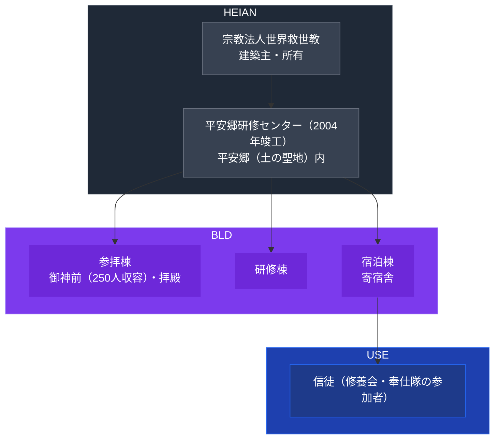

# 平安郷研修センター

> [!summary] 要旨
> **平安郷研修センター**（世界救世教平安郷研修センター）は、京都市右京区嵯峨野の聖地「平安郷」内に所在する世界救世教の研修・宿泊施設である。建築主は世界救世教、主用途は宗教施設（寄宿舎）で、2004年2月に竣工した（株式会社日本設計の公式プロジェクトページ）。参拝棟・研修棟・宿泊棟の3棟で構成され、一泊二日の「平安郷修養会」等の信徒研修・修養の場として用いられる。**一般向けのホテル営業は行われていない**（2026-11-27確認）。平安郷は、岡田茂吉が1952年（昭和27年）に京都・嵯峨野の広沢池畔に取得した「土の聖地」である。

---

## 1. 命題の構造（一般向け宿泊施設 vs 聖地の研修・修養施設）

| 比較軸 | 一般のホテル・宿泊施設（外部視点 / etic） | 平安郷研修センター（施設側の提示 / emic） |
|:--- |:--- |:--- |
| **利用者** | 不特定の一般客 | 世界救世教の信徒（修養会・奉仕隊等の参加者） |
| **目的** | 観光・ビジネスの宿泊 | 信仰の修養、聖地の庭苑・建造物の学び、宿泊奉仕 |
| **営業形態** | 宿泊営業として一般に販売 | 一般向けの宿泊販売は行われず、教団の行事・募集を通じて利用される |

---

## 2. 基本情報

| 項目 | 内容 |
|:--- |:--- |
| **施設名** | 世界救世教平安郷研修センター |
| **所在地** | 〒616-8307 京都府京都市右京区嵯峨広沢池下町24（平安郷公式サイト「アクセス」）。電話075-872-3550 |
| **建築主** | 世界救世教（株式会社日本設計の公式プロジェクトページ） |
| **主用途** | 宗教施設（寄宿舎）（同上） |
| **竣工** | 2004年2月（同上） |
| **規模** | 延床面積4,594.7㎡、RC造・SRC造、地上2階・地下1階（同上） |
| **構成** | 参拝棟・研修棟・宿泊棟の3棟。参拝棟には250人収容の御神前（参拝席）と拝殿がある（照明学会誌の施設紹介） |
| **受賞** | 2006年 JIA優秀建築選、2004年 照明普及賞（優秀施設賞）（日本設計公式ページ） |

---

## 3. 起源と成立の経緯

平安郷は、岡田茂吉が1952年（昭和27年）10月18日に京都・嵯峨の広沢池畔の土地を購入し命名した聖地で、世界救世教において「土の聖地」とされる（[[MOA美術館と岡田茂吉ゆかりの美術館群]]、Wikipedia「岡田茂吉」）。在世中は自ら造営を進めることはかなわず、没後は教団・信徒の手によって池畔亭・春秋庵等の保存と庭園整備が進められ、岡田茂吉記念館、研修センター等が設けられた（世界救世教公式サイト「京都・平安郷」）。平安郷だよりによれば、研修センターの位置する土地と建物は、岡田茂吉が在世中に「池畔亭」として入手したものである。現行の研修センター棟は2004年2月に竣工した（日本設計公式ページ）。

---

## 4. 変遷・歴史

- 1952年: 岡田茂吉が平安郷の土地を入手（昭和27年）。
- 2004年2月: 世界救世教平安郷研修センターが竣工（日本設計公式ページ）。
- 2004年: 照明普及賞（優秀施設賞）を受賞。
- 2006年: JIA優秀建築選に選出。
- 2025年: 平安郷だより（2025年5月号）で一泊二日の平安郷修養会の募集と、二泊三日の平安郷建設奉仕隊の募集が案内されている。
- 2026-11-27時点: 平安郷公式サイトに研修センターの所在地・連絡先が現行掲載されている。

> [!warning] 時点情報の留保
> 修養会・奉仕隊の募集日程は平安郷だより2025年5月号の記載であり、年度により変動する。

---

## 5. 内容・様式の深層解剖

### 5-1. 施設構成

### 5-2. 建築の特徴
日本設計の公式プロジェクトページによれば、広沢の池の南に位置し、庭や外装といった「外」と建物の「内」を分断させず相関性を持たせる設計とされた。参拝室の天井では広沢の池の水面に反射する光や雲をアルミキャストで表現し、平安郷が「土の聖地」とされることから、内外装には土や木や竹の材料が多く用いられている。

### 5-3. 利用の形態
平安郷だより（2025年5月号）は、一泊二日の「平安郷修養会」（平安郷庭苑や建造物の学び、お茶、明主様とのご面会を通して信仰を学ぶ会）と、二泊三日の「平安郷建設奉仕隊」（庭木の手入れ、木竹工芸、苔庭手入れ等）の募集を案内する。食事を伴う研修については厨房で食事（ご飯）が提供される旨が同号に記載される。一般向けの宿泊予約を受け付ける案内は公式サイトにはない。

---

## 6. 学術的・社会学的意義
世界救世教の3聖地（神仙郷・瑞雲郷・平安郷）のうち、平安郷に設けられた信徒研修・修養専用の宿泊施設である。建築主が宗教法人本体であり、設計を大手組織設計事務所（日本設計）が担い、建築賞を受賞している点で、教団の聖地整備における建築的投資の事例となる。熱海・瑞雲郷の[[瑞雲会館]]と並ぶ、聖地内の研修宿泊施設である。

---

## 7. 拠点・現地情報
- **所在地**: 京都府京都市右京区嵯峨広沢池下町24（〒616-8307）。電話075-872-3550（平安郷公式サイト「アクセス」）
- **アクセス**: JR山陰線・花園駅からタクシーで約15分、太秦駅から徒歩約20分。JR京都駅からバス26系統「山越」下車または75系統「山越中町」下車（同上）
- **利用条件**: 信徒向けの修養会・奉仕隊等の募集を通じて利用される。一般向けの宿泊営業の案内はない

---

## 8. 関連対象・関連人物・関連概念
- 平安郷（所在する聖地。「土の聖地」）
- 世界救世教（建築主・運営主体）
- 岡田茂吉（平安郷の創始者）
- 岡田茂吉記念館（平安郷内の美術館）
- 株式会社日本設計（設計者）

---

## 9. 史料・一次資料（convMD）
- src_平安郷研修センター_日本設計 — 株式会社日本設計の公式プロジェクトページ「世界救世教平安郷研修センター」。建築主・主用途・竣工・延床面積・構造・受賞歴を確認（2026-11-27取得）
- src_平安郷_公式アクセス — 平安郷公式サイト「アクセス」。研修センターの住所・電話番号・交通手段を確認（2026-11-27取得）
- src_平安郷_公式だより2025年5月号 — 平安郷公式サイト「平安郷だより」2025年5月号。修養会・奉仕隊の募集と厨房での食事提供を確認（2026-11-27取得）

---

## 10. 参考文献・学術論文
- 吉野弘恵「世界救世教平安郷研修センター参拝室の照明」『照明学会誌』89巻12号（2005年）。参拝棟・研修棟・宿泊棟の3棟構成と御神前の収容人数の確認に使用
- 世界救世教公式サイト「京都・平安郷」（研修センター設置の経緯）
- 株式会社日本設計公式プロジェクトページ（2026-11-27確認）

---

## 11. 関連ノート (Vault内)
- [[瑞雲会館]]（熱海・瑞雲郷の研修施設）
- [[MOA美術館と岡田茂吉ゆかりの美術館群]]（平安郷・岡田茂吉記念館を含む美術館群の横断ノート）
- [[岡田茂吉系の飲食店・ホテル・病院一覧]]（岡田茂吉系施設の総覧）
- [[世界救世教]]
- [[_分派・異端研究ポータル]]

---

## 12. 留保（中立的併記・未確定要素）

> [!warning] 留保事項
> - **一般向け宿泊営業は行われていない**: 本施設は信徒の研修・修養用であり、一般向けホテル営業の案内は公式サイトにない。本ノートでは宿泊カテゴリに収録するが、その性格は「聖地内の信徒研修・寄宿施設」である。
> - **宿泊棟の定員・室数は未確認**: 宿泊棟の客室数・収容定員は公式資料で確認できていない。
> - **運営の分担**: 平安郷は世界救世教（包括宗教法人）の所有で、被包括法人であった東方之光・いづのめ教団が共同利用してきた構造がある（[[世界救世教系の商業・文化施設一覧]]）。研修センターの日常運営の分担は公式資料では確認できていない。
> - **池畔亭との関係**: 平安郷だよりは研修センターの土地・建物を岡田茂吉が入手した「池畔亭」とするが、現行棟（2004年竣工）と池畔亭の建物の同一性（改築・建替の別）は公式資料では確認できていない。
> - **時点情報**: 修養会等の募集は2025年のだよりに基づく記載であり、現行の日程は変動しうる。
> - 本ノートの evidence_type は `primary_source_based`、confidence は `3`（建築概要は設計者の公式ページ、利用形態は教団公式のだよりで確認したが、宿泊棟の規模と運営分担は未確認のため）。
