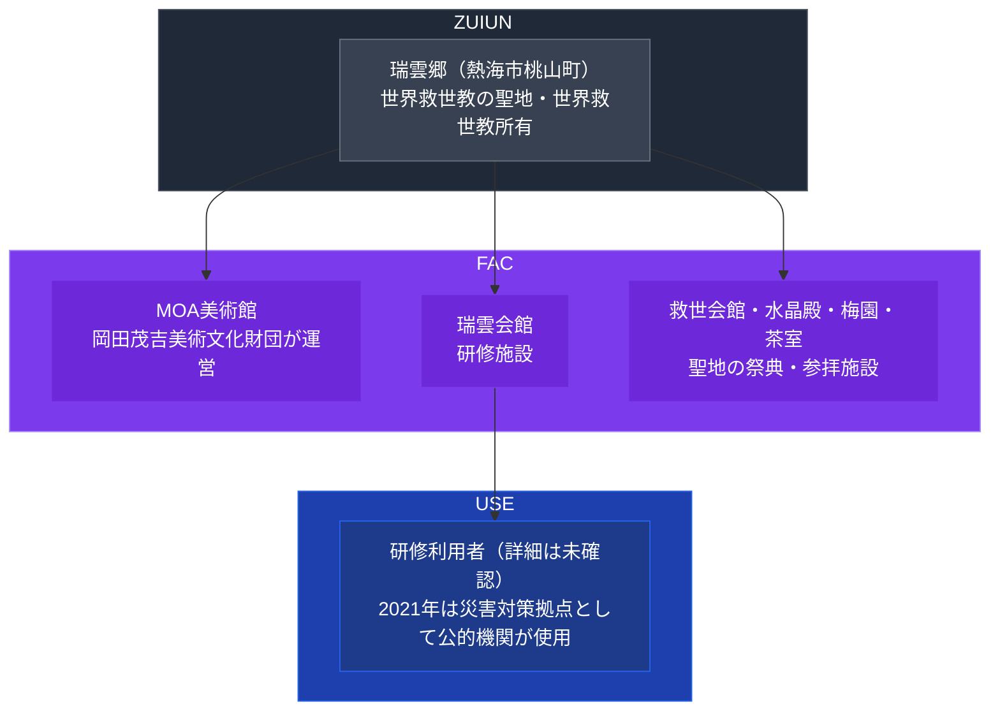

# 瑞雲会館

> [!summary] 要旨
> **瑞雲会館**は、静岡県熱海市の聖地「瑞雲郷」内に所在する研修施設である。東方之光の公式サイトは、2021年の熱海市伊豆山地区土砂災害に際して「瑞雲郷境内地、MOA美術館の駐車場と、瑞雲会館等の研修施設」を警察・消防・自衛隊の対策拠点として提供したと記載し、瑞雲会館を瑞雲郷内の研修施設として位置づける（2026-11-27確認）。**一般向けの宿泊営業を行っているかは、公式資料では確認できていない**（§12）。なお、既存ノートでは「ホテル瑞雲会館」という名称の施設は確認できないとして退けられてきたが、瑞雲会館自体は研修施設として公式に確認できる。

---

## 1. 命題の構造（名称の混同 vs 公式確認の範囲）

| 比較軸 | 「ホテル瑞雲会館」とする外部の言及（etic） | 公式資料で確認できる範囲（emic） |
|:--- |:--- |:--- |
| **施設の性格** | 熱海のホテル・宿泊施設として紹介されることがある | 東方之光公式は「研修施設」と位置づける |
| **所在** | 瑞雲郷・MOA美術館周辺とされる | 瑞雲郷境内地、MOA美術館に隣接する一画の施設として、災害支援の文脈で公式に言及される |
| **宿泊営業** | 一般客の宿泊が可能であるかのように扱われることがある | 一般向け宿泊営業の有無は公式資料に記載がなく未確認 |

---

## 2. 基本情報

| 項目 | 内容 |
|:--- |:--- |
| **施設名** | 瑞雲会館 |
| **所在地** | 静岡県熱海市桃山町（瑞雲郷内、MOA美術館隣接） |
| **施設の性格** | 研修施設（東方之光公式サイトの記載による） |
| **確認された使用例** | 2021年7月の熱海市伊豆山土砂災害に際し、警察・消防・自衛隊の対策拠点として提供（東方之光公式サイト） |
| **宿泊営業** | 一般向け宿泊営業の有無は未確認（§12） |

---

## 3. 起源と成立の経緯

瑞雲会館個別の設立・竣工時期は、公式資料では確認できない（§12）。所在する瑞雲郷は、岡田茂吉が造営した世界救世教の聖地で、MOA美術館（1982年開館、前身の熱海美術館は1957年開館）が所在する。瑞雲郷は世界救世教（包括宗教法人）の所有で、被包括法人であった東方之光・いづのめ教団が共同で祭典・行事に利用してきた構造がある（[[世界救世教系の商業・文化施設一覧]]）。

---

## 4. 変遷・歴史

- 2021年7月: 熱海市伊豆山地区の土砂災害に際し、熱海市の要請を受けて瑞雲郷境内地、MOA美術館の駐車場と、瑞雲会館等の研修施設が、警察・消防・自衛隊の対策拠点として提供された（東方之光公式サイト）。
- 2026-11-27時点: 2026-11-27の網羅性調査で、東方之光公式・MOAインターナショナル公式・熱海市公式資料における瑞雲会館の使用が確認された。

> [!warning] 時点情報の留保
> 公式確認の中心は2021年の災害支援時の記載であり、現行の運用状況（研修利用の頻度・対象）は公式資料では確認できていない。

---

## 5. 内容・様式の深層解剖

### 5-1. 瑞雲郷内での位置づけ

### 5-2. 研修施設としての使用
東方之光公式サイトの記載は、瑞雲会館を「研修施設」と明示する。研修の対象者・内容・頻度は同記載には含まれず、確認できていない。京都・平安郷の[[平安郷研修センター]]が信徒の修養会等に用いられるのと同様の、聖地内の研修・宿泊施設である可能性があるが、断定はできない（§12）。

---

## 6. 学術的・社会学的意義
世界救世教の聖地・瑞雲郷における研修施設の存在が、災害支援という公的文脈の公式発表によって確認された事例である。教団施設が災害時に自治体・公的機関の対策拠点として提供される形態は、宗教施設の地域社会における役割の一例として記録される。

---

## 7. 拠点・現地情報
- **所在地**: 静岡県熱海市桃山町（瑞雲郷内、MOA美術館隣接）
- **利用条件**: 研修施設。一般向け宿泊営業の有無は未確認であり、一般の宿泊予約を受け付ける案内は公式資料にない

---

## 8. 関連対象・関連人物・関連概念
- 瑞雲郷（所在する聖地）
- 世界救世教（聖地の所有者）
- 東方之光（公式サイトで研修施設として言及）
- MOA美術館（隣接する美術館）
- 岡田茂吉（瑞雲郷の創始者）

---

## 9. 史料・一次資料（convMD）
- src_東方之光_公式_瑞雲会館言及 — 東方之光公式サイト。2021年熱海市伊豆山土砂災害への支援の記載の中で「瑞雲会館等の研修施設」と言及（2026-11-27取得）

---

## 10. 参考文献・学術論文
- 東方之光公式サイト（2026-11-27確認）
- 2026-11-27の網羅性調査レポート（MOAインターナショナル公式・熱海市公式資料での使用確認を含む）

---

## 11. 関連ノート (Vault内)
- [[平安郷研修センター]]（京都・平安郷の研修センター）
- [[岡田茂吉系の飲食店・ホテル・病院一覧]]（岡田茂吉系施設の総覧）
- [[世界救世教系の商業・文化施設一覧]]（瑞雲郷の施設構成）
- [[東方之光]]
- [[_分派・異端研究ポータル]]

---

## 12. 留保（中立的併記・未確定要素）

> [!warning] 留保事項
> - **一般向け宿泊営業の有無は未確認**: 瑞雲会館が研修施設として実在することは公式に確認できるが、宿泊機能の有無、一般向け宿泊営業の有無は公式資料では確認できていない。本ノートは宿泊カテゴリに収録するが、確定しているのは「研修施設」としての実在までである。
> - **設立・竣工時期、規模は未確認**: 竣工年、延床面積、収容定員、運営主体の公式明記は確認できていない。
> - **「ホテル瑞雲会館」の名称について**: 既存ノートが退けたのは「ホテル瑞雲会館」という名称・性格づけであり、瑞雲会館自体の実在とは区別される。瑞雲会館を一般向けホテルとして扱う外部の紹介がある場合は、本ノートの確認範囲と併記する必要がある。
> - **レストラン「明日葉」**: 瑞雲会館内にレストラン「明日葉」があるとする情報は、グルメサイトの店舗ページのみで公式確認が取れておらず、本ノートでは施設として扱わない（2026-11-27の網羅性調査の判定による）。
> - 本ノートの evidence_type は `primary_source_based`、confidence は `2`（研修施設としての実在は教団公式で確認できるが、施設の詳細情報が乏しく、宿泊営業の有無が未確認のため）。
