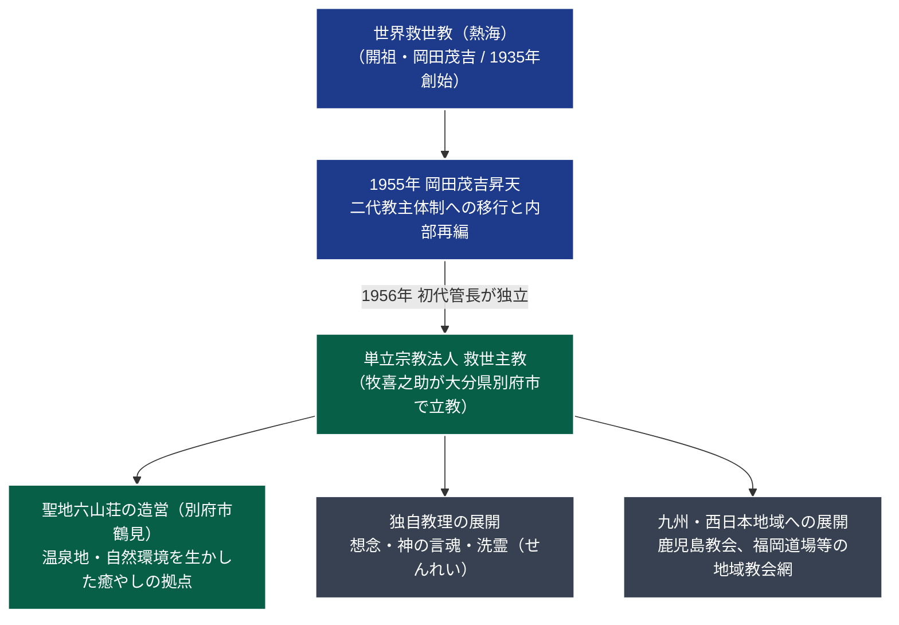

# 救世主教（きゅうせしゅきょう） 専門構造分析ノート

> [!summary] 要旨
> **救世主教**（きゅうせしゅきょう）は、世界救世教の初代管長を務めた**牧喜之助**（1902-1988）が、開祖・[[岡田茂吉]]の昇天（1955年）の翌年である1956年（昭和31年）に独立して大分県別府市に創始した単立宗教法人であると、分派紹介記事（岡田茂吉大学）は伝える。ただし本照合では同記事を取得できず、創始・沿革の詳細は未検証である。公的に確認できたのは、関連法人「宗教法人救世主教大分中央教会」（法人番号2320005001001、大分県大分市大字上野797番地6）の国税庁登記、および地図サービス上に「救世主教本部 聖地六山荘」（別府市）の掲載があることまでである。旧ノート記載の法人番号（3180005002235）は実在しない番号であり削除した。

---

## 1. 命題の構造（通説・正統本部 vs 本教団・自説）

（本図の分岐経緯は分派紹介記事に基づく旧ノートの整理であり、本照合では未検証。§12留保参照。）

---

## 2. 基本情報

| 項目 | 内容 |
| :--- | :--- |
| **教団正式名称** | 単立宗教法人 救世主教（きゅうせしゅきょう） |
| **通称・別名** | 救世主（きゅうせしゅ）教、別府救世主教、六山荘 |
| **創始者（開教者）** | 牧喜之助（まき きのすけ、元世界救世教初代管長）※未検証 |
| **現代表者** | 未確認（旧ノートは「代表役員（牧家後継者）」と記すが裏付けなし） |
| **立教年・認可** | 1956年（昭和31年）別府にて立教 / 1957年（昭和32年）宗教法人認可 ※いずれも未検証 |
| **本部所在地** | 大分県別府市（聖地六山荘）。旧ノート記載の「〒874-0836 別府市荘園町（大字鶴見）」は公的裏付け未確認 |
| **法人格・所轄** | 単立宗教法人（大分県知事所轄とされる） |
| **法人番号** | 未確認（旧記載3180005002235は実在しない番号のため削除。関連法人の番号は§9参照） |
| **信仰対象・主神** | 大光明真神（みろくおおみかみ）、開祖・岡田茂吉（明主様）※教団側の教義説明として未検証 |
| **代表的修行・儀礼** | 洗霊（浄霊）、想念修養、神の言魂奉唱 ※未検証 |

---

## 3. 創始者と天啓・社伝

### 創始者：牧喜之助（1902-1988）※以下は分派紹介記事に基づく旧ノートの記述で、本照合では未検証
* 岡田茂吉の黎明期（大日本観音会時代）からの最古参直弟子の一人。
* 戦後、宗教法人世界救世教の設立（1950年）に際して中心的役割を果たし、初代管長として全国の布教網構築や教団組織化を指揮した。
* 1955年2月に開祖・岡田茂吉が昇天した後、二代教主・岡田よしを中心とする熱海本部指導部との間で、教理継承のあり方や教団運営方針を巡って意見の相違が生じ、翌1956年に自ら役職を辞任して独立を決断した。
* 別府市に居を移し、自らの霊的確信に基づき「救世主教」を開教した。

### 後継体制と運営（旧ノート記述・未検証）
* 創始者没後は、牧家の親族および高弟らによる合議制によって運営が継承されているとされる。
* 巨大な組織拡大を志向せず、信徒一人ひとりの魂の純化と療病・家庭円満を主眼とする地域密着型の宗教法人として活動を維持しているとされる。

なお、[[世界救世教]]ノートおよび[[_分派・異端研究ポータル]]は本教団の創始地を「名古屋」と記すが、これは本ノート旧版の留保でも誤りとされ、別府が正しいとされてきた。本照合では別府の「救世主教本部 聖地六山荘」の地図掲載を確認したが、名古屋説・別府説いずれについても一次資料による確定はできていない（波及事項として各ノートの照合で処理）。

---

## 4. 沿革・歴史変遷（検挙・裁判・不敬罪・治安維持法弾圧等）

| 年代 | 事項 | 詳細・背景 |
| :---: | :--- | :--- |
| **1930〜40年代** | 世界救世教での活躍 | 牧喜之助が岡田茂吉に帰依し、大日本観音会・日本五六七教の重鎮として活躍。※未検証 |
| **1950年** | 初代管長就任 | 宗教法人世界救世教の設立とともに初代管長に就任。教団草創期の組織統率を担う。※未検証 |
| **1955年** | 岡田茂吉昇天 | 茂吉の昇天後、後継体制を巡る議論の中で本部と一線を画す。※未検証 |
| **1956年** | **救世主教立教** | 初代管長を辞任し、大分県別府市にて「救世主教」を開教。※未検証 |
| **1957年** | 宗教法人認証 | 大分県知事より宗教法人としての認証を受け、単立法人として独立。※未検証 |
| **1960年代** | 聖地「六山荘」造営 | 別府市鶴見山麓に聖地「六山荘」を整備。※未検証 |
| **1970〜80年代** | 九州教会網の確立 | 別府本部を中心に、鹿児島、宮崎、熊本、福岡など九州一円に信徒組織・教会を拡大。※未検証（ただし大分市に関連法人「救世主教大分中央教会」の登記、岡山県に「救世主教栗野教会」の法人情報があることは確認） |
| **1988年** | 牧喜之助帰幽 | 創始者が死去。後継指導部が遺志を継承し現在に至る。※未検証 |

### 事件・裁判・社会的議論
旧ノートは「熱海本部との間で財産争奪訴訟や誹謗合戦に至らなかった」「霊感商法や高額献金被害等の記録はない」と記すが、これらは不在の主張であり、本照合の範囲では裏付けも反証も得られていない（未検証として分離）。

---

## 5. 教理・儀礼・神観の深層解剖

### 核心教理：想念・言魂と「洗霊」（旧ノート記述・未検証）
救世主教は、岡田茂吉の教義を土台としつつも、牧喜之助独自の宗教的体験に基づく教理深化を行っているとされる。

1. **洗霊（せんれい）**:
   - 世界救世教の「浄霊」と同様、掌から神聖な光（霊気）を取り次ぐ治病・魂の浄化法であるが、救世主教では「霊の曇りを洗い清める」という意味を込めて「洗霊」と呼称する。
   - 心身の毒素を排出し、本来の神性を回復させる不可欠の実践とされる。
2. **想念の法則**:
   - 「人間の心（想念）のあり方が霊界に波動として伝わり、それが現界の幸不幸を決定する」と説く。日常における感謝、反省、利他の心を重視する。
3. **神の言魂（ことだま）**:
   - 祝詞や言霊の響きによる空間・肉体の浄化作用を強調。独自の聖典や御讃歌を熱心に唱える。

（本節全体が分派紹介記事に基づく単一系統の記述であり、教団自身の教義文書による確認はできていない。）

---

## 6. 宗教学的・歴史社会学的意義

世界救世教の分派の中でも、開祖没後まもない1956年という極めて初期に、初代管長という最高幹部が独立した事例として位置づけられてきた。ただし、その位置づけの前提となる経緯自体が単一二次資料に依存しており、本照合では未検証である。公的に確認できる範囲では、大分県を中心に関連法人の登記が現存する世界救世教系と目される教団、という点までにとどまる。

---

## 7. 拠点・現地情報

### 救世主教本部・聖地六山荘（ろくざんそう）
* **所在地**: 大分県別府市（地図サービス「NAVITIME」に「救世主教本部 聖地六山荘」の掲載あり。座標は検索結果レベルで確認）。旧ノート記載の「〒874-0836 大分県別府市荘園町（大字鶴見）」は公的裏付け未確認。
* **環境（旧ノート記述）**: 別府八湯を見下ろす鶴見岳山麓に位置する。
* **交通アクセス（旧ノート記述）**:
  - **電車・バス**: JR日豊本線「別府駅」西口より、亀の井バス乗車、「荘園町」または「南石垣」下車、徒歩約10分。タクシーで約12分。
  - **自動車**: 東九州自動車道「別府IC」よりやまなみハイウェイ経由で約10分。

### 関連法人の登記所在地
* 宗教法人救世主教大分中央教会：大分県大分市大字上野797番地6（法人番号2320005001001、国税庁で確認）

---

## 8. 関連教団・関連人物・関連概念

* **法人格（旧ノート記述）**: 単立宗教法人救世主教（大分県知事所轄）。包括法人世界救世教とは法的・財務的に無関係とされる。
* **主要地方拠点（旧ノート記述・未検証）**:
  - 救世主教別府教会（大分県別府市荘園）
  - 救世主教鹿児島教会（鹿児島県鹿児島市）
  - 各地支部道場
* **公的に名称を確認できた関連法人**: 救世主教大分中央教会（大分市、国税庁）、救世主教栗野教会（法人番号3340005002780、gBizINFO）
* 関連教団: [[世界救世教]]（分派元）、[[世界救世教会]]、[[東方之光]]
* 関連人物: 牧喜之助（創始者とされる）、[[岡田茂吉]]
* 関連概念: 洗霊、想念、言魂、浄霊
* 注意: 「宗教法人日本救世主教」（法人番号2350005002500、愛知県）は名称が類似する**別組織**であり、本教団と混同しないこと。

---

## 9. 史料・一次資料 (convMD)

- [[src_救世主教大分中央教会_国税庁法人番号]]（国税庁法人番号公表サイト：宗教法人救世主教大分中央教会、法人番号2320005001001、大分県大分市大字上野797番地6）

未取得：HIRORO「分派教団シリーズ⑦ 教団紹介：救世主教」（岡田茂吉大学）。旧ノートの主要出典だが、記事URL自体が特定できず本照合では取得できなかった。文化庁『宗教年鑑』・大分県宗教法人名簿も版・頁未特定のため未取得。

---

## 10. 参考文献・学術論文

- HIRORO「分派教団シリーズ⑦ 教団紹介：救世主教」（岡田茂吉大学）※未取得
- 文化庁『宗教年鑑』（諸教・単立宗教法人の部）※版・頁未特定のため未取得
- 大分県『大分県宗教法人名簿』※未取得

（旧ノートが挙げていた『救世主教聖典』『想念の手引き』、牧喜之助『洗霊の道』、井上順孝編『新宗教事典』は、いずれも本教団に関する実在・掲載の確認が取れていないため参考文献から外し、未検証として留保に記す。）

---

## 11. 関連ノート (Vault内)

- [[_分派・異端研究ポータル]]
- [[世界救世教]]（分派母体・初代管長）
- [[世界救世教会]]（1970年独立分派）
- [[東方之光]]（本家包括の現在）

---

## 12. 留保（中立的併記・未確定要素）

> [!warning] 注意
> 1. **法人番号（必須点検a）— 実在しない番号を削除**: 旧ノート記載の 3180005002235 は検査用数字が不一致で**実在しない番号**であり、削除して「未確認」とした。本法人（救世主教本部）自体の法人番号は本照合では特定できていない。確認できたのは関連法人のみである：救世主教大分中央教会（2320005001001、大分市、国税庁）、救世主教栗野教会（3340005002780、gBizINFO）。なお愛知県の「宗教法人日本救世主教」（2350005002500）は別組織である。
> 2. **教典名（必須点検b）**: 『救世主教聖典』『想念の手引き』および牧喜之助『洗霊の道』の実在は確認できなかった。旧ノート由来の情報として「実在未確認」と明記して残す。
> 3. ** src_参照（必須点検c）**: 本ノートが参照する src_ ファイル1件は `content/資料/` に実在することを確認した。旧 §9 の関連ノートはフルパス wikilink だったため、basename 形式に訂正した（§11）。
> 4. **本拠地について**: 旧ノートの留保は「名古屋市は不正確であり、別府市鶴見の聖地六山荘が法人所在地・本部であることを公的宗教年鑑および大分県名簿にて確認・是正した」と主張していたが、本照合では宗教年鑑・大分県名簿の該当箇所を取得できておらず、その主張は再確認できていない。別府については地図サービス上の「救世主教本部 聖地六山荘」掲載（検索結果レベル）と大分市の関連法人登記の存在までが確認範囲である。番地・郵便番号（〒874-0836 荘園町）も未確認。
> 5. **未検証（中核的主張を含む）**: 牧喜之助の初代管長就任・1956年独立・1957年法人認証・生没年（1902-1988）、洗霊・想念・言魂の教理内容、九州教会網の展開、後継体制、「訴訟・不祥事の不在」は、いずれも分派紹介記事（岡田茂吉大学⑦）という単一二次資料に基づく旧ノートの記述であり、同記事が未取得のため本照合では裏付けが取れていない。旧ノートの「教団史料および分派史研究により確定事実として検証済み」という申告は根拠を確認できず撤回する。信者数「推定数千人」も出典がなく「未確認」に訂正した。
> 6. **confidence の根拠**: 公的資料で確認できたのは関連法人の登記と地図掲載のみで、教団本体の基本情報すら単一未取得記事に依存するため、evidence_type を「academic_research / official_database」（7値外の複合表記）から secondary_source_based へ、confidence を 5 から 2 へ是正した。
> 7. **改訂記録（2026-11-15・全件照合）**: 12セクション構造へ再編。実在しない法人番号を削除。フルパス wikilink を basename 形式に訂正。未検証の中核的主張を留保へ分離し、過大申告（confidence 5・「検証済み」）を是正。関連法人の登記を新規に確認・保存した。
