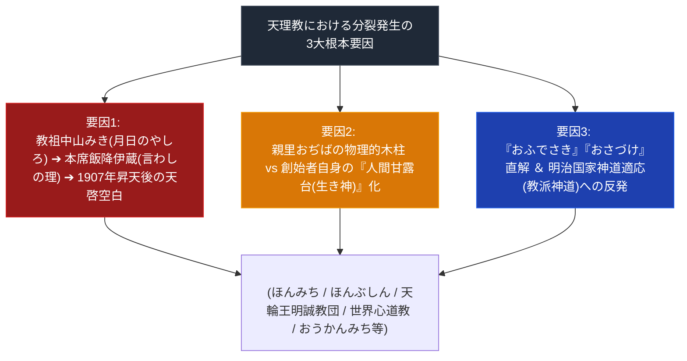

# 天理教の分裂の系譜

> [!summary] 要旨
> 本稿は、1838年の立教以来、天理教においてなぜ多数の分派・異端教団（ほんみち、ほんぶしん、天輪王明誠教団、太道教、世界心道教、天理三輪講、おうかんみち等）が発生・独立したのか、その根本メカニズム（3大構造要因：ダブル天啓の構造的空白、甘露台観の亀裂、原典直解主義）を、弓山達也『天啓のゆくえ』等の学術モデルに基づいて解剖した史論ノートである。検証日：2026-11-15。

---

## 1. 命題の構造（天理教における分裂発生の3大構造要因）

---

## 2. 基本情報

| 項目 | 内容 |
|:--- |:--- |
| **分析対象** | 天理教（1838年立教）における分派・異端教団の発生メカニズム |
| **分析枠組み** | 3大構造要因（ダブル天啓の空白／甘露台観の亀裂／原典直解主義） |
| **典拠モデル** | 弓山達也『天啓のゆくえ—宗教が分派するとき』（2005年）等の学術研究 |
| **母体教団本部** | 〒632-8501 奈良県天理市三島町1番地1（天理教教会本部。[[天理教]]ノートの照合値に合わせた） |
| **検証日** | 2026-11-15 |

---

## 3. 起源と成立の経緯（ダブル天啓構造の成立）

天理教は「教祖・中山みき（月日のやしろ）」の神がかり（1838年）に始まり、教祖潜伏（1887年）後は「本席・飯降伊蔵（言わしの理）」を通じて神意が伝えられる二段階の天啓構造を持った。この構造自体は教団の統制装置であると同時に、本席の死後に「次の天啓者」を待望する心理的素地を信者層に残したことが、後の分派発生の起点となった（§5-1）。

---

## 4. 変遷・歴史（時代別・分派生成マトリクス）

| 時代・時期 | 代表的教団・講社 | 主な分裂・独立の背景とメカニズム |
|:--- |:--- |:--- |
| **明治期** | **[[天輪王明誠教団]]** (1881年創立) | 中山みき直授の講名。1888年に弾圧回避のため教派神道「神習教」傘下入り（従属開始）。神習教からの独立は **1940年説（宗教団体法施行時）と1942年説が併存し未確定**（旧稿の「戦後単立独立」は誤り。[[天輪王明誠教団]]ノート参照）。 |
| **大正〜昭和初期** | **[[ほんみち]]** (1925年独立) **[[天理三輪講]]** (1933年独立) **[[おうかんみち]]** (1937年前身立教) | 本席昇天後のダブル天啓不在。大西愛治郎の「人間甘露台」宣言と昭和の不敬罪弾圧事件。ほんみちからの連続的スピンオフ（三輪講はほんみち起源が学術資料支持）。 |
| **昭和戦中〜戦後** | **[[太道教]]** (1940年頃) **[[世界心道教]]** (1944年) **[[ほんぶしん]]** (1962年) | 天理教教師・ほんみちを経たカリスマ伝道者（会田ヒデ、大西玉）による独自天啓の獲得と分立。 |
| **平成〜現代** | **[[天理教豊文教会]]** (2006年最高裁確定) **[[八島英雄]]** (1986年罷免) | 自律的運営を巡る包括・被包括法人の対立。最高裁第二小法廷判決で「天理教」自称権認可。 |

> [!warning] 弾圧の記録
> ほんみちは昭和期に2度の不敬罪・治安維持法弾圧を受け、天理三輪講は1939年の検挙と結社禁止により1941年に廃絶した。分派の「固定化」には、弾圧による殉教的結束も作用したとされる。

---

## 5. 内容の深層解剖（3大構造要因）

### 5-1. 要因1：ダブル天啓が生んだ「第三のやしろ（天啓者）」待望論
- **二段階天啓モデル**: 天理教は「教祖・中山みき（月日のやしろ）」の神がかりから始まり、教祖潜伏（1887年）後は「本席・飯降伊蔵（言わしの理）」を通じて神託（おさづけ）が下される二段階構造を持っていた。
- **1907年（明治40年）の構造的空白**: 本席・飯降伊蔵の昇天後、教会本部（第一代真柱・中山正善体制へ）は「天啓の完結」を宣言。しかし、信者層のなかには「三軒三棟の理」に基づき「第三の天啓者」を待望する心理が根強く残り、大西愛治郎（ほんみち）や会田ヒデ（世界心道教）らのカリスマが受容される土壌となった（弓山達也『天啓のゆくえ』）。

### 5-2. 要因2：甘露台観の亀裂（物理的木柱 vs 人間甘露台）
- **本部**: 奈良県天理市「親里おぢば」中央に据えられた物理的な木柱（甘露台）を絶対的な宇宙の中心として奉斎。
- **分派**: 神意を受けた創始者自身（大西愛治郎、大西玉等）を「人間甘露台（生き神）」とし、あるいは屋外に独自の石造甘露台（ほんぶしん、陽気づくめ垂水教会）を復元・奉斎した。

### 5-3. 要因3：原典直解主義 vs 明治国家適応への反発
- **教義の変容**: 明治政府の取締回避のため、正統本部は教派神道「天理教本道」として神道体系（十二神将や神道用語の導入）に適応。
- **原典復帰運動**: これに対し、教祖自筆の聖典『おふでさき』や『みかぐらうた』の原典そのままの直解に回帰しようとする純粋主義運動（ほんみち、ほんぶしん等）が分裂の推進力となった。

---

## 6. 学術的・社会学的意義

3大要因モデルは、天理教の分派を個別の逸脱ではなく、二段階天啓という構造自体が生んだ必然的な現象として説明する点に意義がある。とりわけ「天啓の完結」を宣言する本部と「第三の天啓者」を待望する信者層の非対称性は、ほんみち系分派の反復的発生を統一的に理解する枠組みを提供する（弓山達也の分析）。分派カタログは[[天理教分派・異端教団一覧]]、教義比較は[[天理教系諸派の教義比較マトリクス]]を参照。

---

## 7. 拠点・現地情報

- **天理教教会本部（おぢば）**: 〒632-8501 奈良県天理市三島町1番地1。JR桜井線・近鉄天理線「天理駅」徒歩15分。
- 分派各教団の拠点は[[天理教分派・異端教団一覧]]§5および各教団ノートを参照。

---

## 8. 関連対象・関連人物・関連概念

- [[天理教]]、[[ほんみち]]、[[ほんぶしん]]、[[天理三輪講]]、[[おうかんみち]]、[[世界心道教]]、[[太道教]]、[[天輪王明誠教団]]
- [[中山みき]]、[[飯降伊蔵]]、[[大西愛治郎]]、[[大西玉]]、[[会田ヒデ]]
- [[甘露台]]、[[おふでさき]]、[[みかぐらうた]]、[[おさづけ]]

---

## 9. 史料・一次資料 (convMD)

本ノートの照合に用いた既存エビデンス（content/資料/ に保存済み）：

- [[src_天理教_Wikipedia]] — Wikipedia「天理教」（沿革・本部所在地の照合）
- [[src_天理教_RIRC]] — RIRC教団データベース「天理教」（本部所在地〒632-8501・三島町1番地1の確認）
- [[src_ほんみち_Wikipedia]] — Wikipedia「ほんみち」

個別教団の年次等の確定値は、各教団ノートの§9エビデンスに基づく。

---

## 10. 参考文献・学術論文

1. 弓山達也『天啓のゆくえ—宗教が分派するとき』（日本地域社会研究所、2005年）
2. 井上順孝 ほか編『新宗教教団・人物事典』（弘文堂、1996年）
3. 島薗進『新宗教の展開』（岩波書店）

---

## 11. 関連ノート (Vault内)

- [[_分派・異端研究ポータル]]
- [[天理教分派・異端教団一覧]]
- [[天理教系諸派の教義比較マトリクス]]
- [[天理教]]
- [[ほんみち]]
- [[ほんぶしん]]
- [[天輪王明誠教団]]
- [[世界心道教]]
- [[太道教]]
- [[おうかんみち]]

---

## 12. 留保（中立的併記・未確定要素）

> [!warning] 注意
> - 本ノートは学術モデル（主に弓山達也）に基づく分析的史論であり、一次史料の直接照合ではない。evidence_type は `academic_research`、confidence は `3`（旧稿の primary_source_based / 4 は過大申告のため是正）。
> - **両論併記**：天輪王明誠教団の神習教からの独立年は1940年説（Wikipedia）と1942年説（RIRC）が併存し、本Vaultでは確定していない。
> - 3大要因は分析モデルであり、各分派の個別事情（経済的要因・地域事情・個人的対立等）を捨象している点に留意。
>
> - **改訂記録（2026-11-15・全件照合）**: 宗教版12セクションへ再編（旧稿は3セクション構成）。訂正内容：(1) 天輪王明誠教団について「戦後単立独立」を訂正し、神習教からの独立は1940年説・1942年説の併存（未確定）と明記。(2) frontmatter の天理教本部所在地を「〒632-8686 奈良県天理市三島町271」から照合済みの「〒632-8501 奈良県天理市三島町1番地1」へ訂正（郵便番号は[[天理教]]ノートの照合値に統一）。(3) 天理三輪講の系統をほんみち起源（学術資料支持）に整合。(4) evidence_type を primary_source_based から academic_research へ、confidence を 4 から 3 へ是正。検証日を2026-11-15に更新。

---

*※本稿は[[_分派・異端研究ポータル]]の史論・系譜専門分析ノートである。*
