# 会田ヒデ

> [!summary] 要旨
> 会田ヒデ（1898年9月30日 - 1973年5月24日）は、天理教教師を経てほんみち・天理三輪講へ移り、1938年に「月読尊・国狭土尊（水火風の理）」の天啓を受けたと自覚して、1944年に「世界心道教」（設立時は世界心道会）を創始した人物である。弓山達也『天啓のゆくえ』のいう「中山みき → 大西愛治郎 → 会田ヒデ」の三世代連続天啓チェーンの第3世代に位置づけられる。

---

## 1. 命題の構造（通説・正統本部 vs 本教団・自説）

```mermaid
graph LR
    A["<div style='color:#ffffff;'>天理教教師時代 (1923年入信)</div>"] --> B["<div style='color:#ffffff;'>ほんみち (大西愛治郎) へ (1925年)</div>"]
    B --> C["<div style='color:#ffffff;'>天理三輪講へ (1933年)</div>"]
    C -->|1938年3月13日 大阪・西淀川| D["<div style='color:#ffffff;'>会田ヒデ自らの天啓覚醒<br>(月読尊・国狭土尊の天下り)</div>"]
    D -->|1944年11月3日 渋谷で設立| E["<div style='color:#ffffff;'>世界心道教 創始<br>1946年 豊川移転・1949年 諏訪へ</div>"]
    
    style A fill:#1f2937,stroke:#4b5563,color:#fff
    style B fill:#991b1b,stroke:#dc2626,color:#fff
    style C fill:#7c2d12,stroke:#ea580c,color:#fff
    style D fill:#d97706,stroke:#f59e0b,color:#fff
    style E fill:#065f46,stroke:#059669,color:#fff
```

- 天理教本部側の立場では、天啓は教祖中山みきと本席飯降伊蔵で完結したとされる。これに対し会田ヒデは、『おふでさき』『泥海古記』の独自解釈に基づき、1838年（天理教創始の年）から100年後に新たな者から天の指図が下されると説き、その「100年後」（1938年）に自ら天啓を受けたとする（教団側の解釈。[[世界心道教]]ノート参照）。

---

## 2. 基本情報

| 項目 | 内容 |
| :--- | :--- |
| **氏名** | 会田ヒデ（あいだ ひで、出生時の姓は吉田） |
| **生没年** | 1898年 (明治31年) 9月30日 〜 1973年 (昭和48年) 5月24日（満74歳） |
| **立場** | [[世界心道教]] 創始者・教祖（信者からは「親様」と呼ばれる） |
| **本部拠点** | 愛知県豊川市諏訪2丁目101番地（[[世界心道教]]本部） |
| **出身地** | 未確認 |

---

## 3. 創始者と天啓・社伝

- 1923年に天理教に入信し教師を務めたが、1925年に大西愛治郎に賛同して[[ほんみち]]へ移り、1933年には元ほんみち信者・勝ひさのの[[天理三輪講]]へ移って活動を続けた（Wikipedia「世界心道教」）。
- 1938年3月13日、大阪府西淀川区で月読之命と国狭土之命の2社が体に天下り、天啓者となったとされる。さらに1942年12月23日には10社が天下ったとされる（いずれも教団側の伝承としての天啓自覚であり、史実としての検証対象ではない）。
- 天啓の内容は「水火風の理」と総括され、祀る神は「天地月日御親水火風之大神」とされる。

---

## 4. 沿革・歴史変遷

- **1923年**: 天理教入信、教師となる。
- **1925年**: [[ほんみち]]（大西愛治郎）へ移る。
- **1933年**: [[天理三輪講]]へ移る。
- **1938年3月13日**: 大阪府西淀川区で天啓を自覚したとされる。
- **1942年12月23日**: さらに10社が天下ったとされる。
- **1943年**: 東京都渋谷区大岡山で人助けを始める。
- **1944年1月**: 渋谷へ移転。
- **1944年11月3日**: 「世界心道会」を設立（東京・渋谷）。
- **1946年3月**: 本部を愛知県豊川市へ移転。
- **1948年7月6日**: 法人化により「世界心道教」の名称が確認される。
- **1949年**: 豊川市諏訪の現在地へ移転。
- **1973年5月24日**: 死去。遺言により娘の会田和子が第2代教主となる。

（以上、[[世界心道教]]ノートおよびWikipedia「世界心道教」による）

---

## 5. 教理・儀礼・神観の深層解剖

- 会田ヒデは中山みきの『おふでさき』『泥海古記』を独自に解釈し、1838年から100年後に新たな天の指図が下されると説いた（その「100年後」が自らの天啓の年であるとする教団側の解釈）。
- 教義によれば、ヒデに神が天下った後は、拝むだけでは功徳を積んだことにならず、「道をあけねば」御利益は得られない。「道あけ」とは心の改良を行うことであり、身上（体の悩み）や事情（心の悩み）は人の心が天の心に反したために起こるもので、心の改良を行えば御利益が得られるとする。これを「心のしんせいふっこう」と呼ぶ（Wikipedia「世界心道教」教義節）。
- 救済の実践は「おさづけ」の発展形としての手かざし・心直しとして展開された（詳細は[[世界心道教]]ノート参照）。

---

## 6. 宗教学的・歴史社会学的意義

- 弓山達也『天啓のゆくえ』における「中山みき → 大西愛治郎 → 会田ヒデ」という三世代連続天啓チェーンを実証する重要人物と位置づけられる。
- 経歴のうえでは、天理教 → ほんみち → 天理三輪講と分派を渡り歩いた末に自ら天啓者を自覚した点で、「天啓者待望論」が分派内部で連鎖する様相を示す事例である。

---

## 7. 拠点・現地情報

- [[世界心道教]]本部：愛知県豊川市諏訪2丁目101番地（法人番号 5180305003618、国税庁で確認済み。[[世界心道教]]ノート参照）。

---

## 8. 関連教団・関連人物・関連概念

- [[世界心道教]]
- [[ほんみち]]
- [[天理三輪講]]
- [[大西愛治郎]]
- [[中山みき]]

---

## 9. 史料・一次資料 (convMD)

- [[src_世界心道教_Wikipedia]]（Wikipedia「世界心道教」。会田ヒデの生没年月日・経歴・天啓・設立・継承の典拠）
- [[src_世界心道教_国税庁法人番号]]（国税庁法人番号公表サイト。世界心道教の法人番号・所在地）

---

## 10. 参考文献・学術論文

- 弓山達也『天啓のゆくえ』（三世代天啓チェーンの分析枠組み。原典は未取得）
- 井上順孝『新宗教教団・人物事典』（原典は未取得）

---

## 11. 関連ノート (Vault内)

- [[世界心道教]]
- [[ほんみち]]
- [[_分派・異端研究ポータル]]

---

## 12. 留保（中立的併記・未確定要素）

> [!warning] 注意
> - **改訂記録（2026-11-15・全件照合）**: (1) **本部拠点を訂正した**。旧稿は「愛知県豊川市諏訪2-152（心の里）」としていたが、国税庁・[[世界心道教]]ノート・分派一覧はいずれも諏訪2丁目101番地であり、旧稿の番地は裏付けが取れないため訂正した。(2) **生没年を確定した**。旧稿は年のみだったが、Wikipedia「世界心道教」により1898年9月30日生・1973年5月24日没を確認。旧稿の「享年75歳」は数え年であり、満年齢は74歳に訂正した。(3) **経歴を訂正・詳細化した**。旧稿は「天理教教師からほんみち運動へ参加した後、1938年のほんみち第二次事件の弾圧下で天啓を受けた」としていたが、実際は1933年に天理三輪講へ移っており、天啓の自覚は1938年3月13日に大阪府西淀川区でのこととされる。ほんみち弾圧下という旧稿の枠組みは経歴と整合しないため改めた。(4) **立教の経緯を訂正した**。旧稿は「1944年に世界心道教を設立（豊川）」としていたが、設立は1944年11月3日に東京・渋谷で「世界心道会」としてであり、豊川移転は1946年、諏訪の現在地への移転は1949年である。(5) 出典URLが Wikipedia「天理教」記事の分派団体一覧節を指していたのを、実際に典拠となる Wikipedia「世界心道教」へ改めた。(6) evidence_type を `primary_source_based` / confidence `4` から `secondary_source_based` / `3` へ是正した。根拠はWikipedia記事と教団ノートの突き合わせであり、弓山・井上の学術文献の原典は未取得のためである。
> - 出身地の詳細は未確認（出生時の姓が吉田であることはWikipediaに記載がある）。天啓自称の教理的細部は教団側の伝承に基づく記述であり、史実として検証する性質のものではない。
> - **再検証 2026-11-16（RB3）**：探索先＝Wikipedia「世界心道教」日英両版、世界心道教公式資料、NDLサーチ・CiNii（弓山達也『天啓のゆくえ』・井上順孝編『新宗教教団・人物事典』の書誌は存在するが原典本文は未取得）。出身地の詳細は日英両版にも記載がなく確認できず残存。学術文献2点の原典未取得も解消できず残存。
> - 本ノートの evidence_type は `secondary_source_based`、confidence は `3`。

> - **追跡調査 第2波 2026-11-19（RB3）**: 探索先＝Vault内『資料/』全件の横断突合（RB2／RB4／RB5のエビデンスを含む）、文化庁『宗教年鑑』令和7年版ローカル抽出テキストの再検索、NDL・CiNii等の書誌確認の再点検（src_RB3W2_追跡調査第2波_探索記録2026-11-19）。本ノートの残存項目について新たな一次・公的裏付けは確認できず、未検証のまま残置する（探索なしの残置ではない）。
---

*※本稿は[[世界心道教]]および[[_分派・異端研究ポータル]]の人物ノートとして位置付けられる。*
